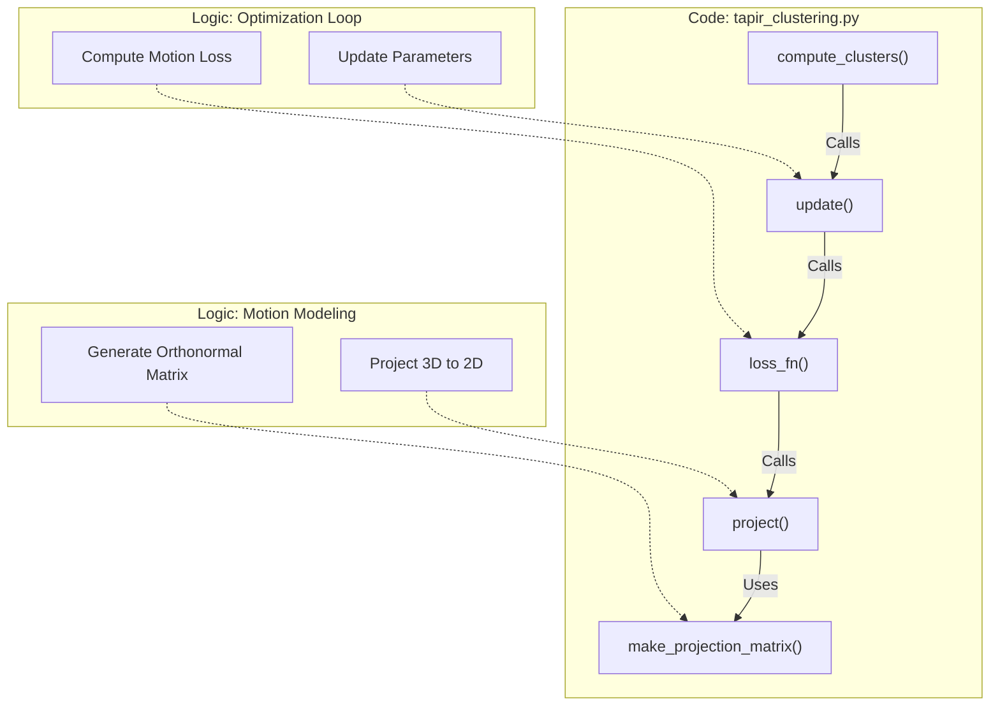
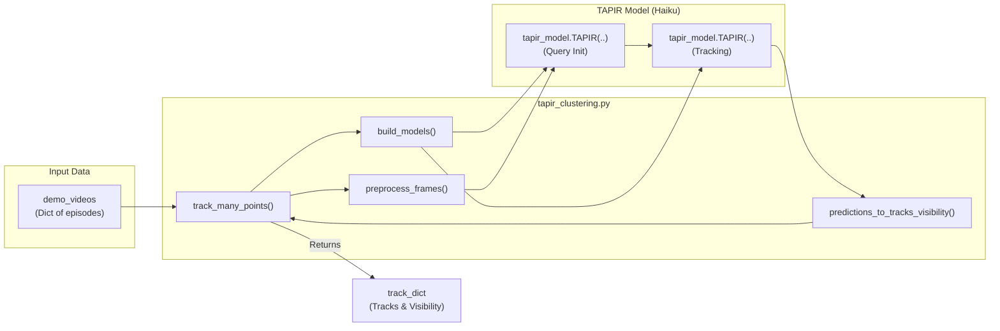

<!-- source: DeepWiki mcp.deepwiki.com · repo google-deepmind/tapnet · page 3.2 RoboTAP · fetched 2026-10-26 -->

# RoboTAP

<details>
<summary>Relevant source files</summary>

The following files were used as context for generating this wiki page:

- [colabs/tapir_clustering.ipynb](colabs/tapir_clustering.ipynb)
- [colabs/tapir_rainbow_demo.ipynb](colabs/tapir_rainbow_demo.ipynb)
- [tapnet/robotap/tapir_clustering.py](tapnet/robotap/tapir_clustering.py)
- [tapnet/tapvid/README.md](tapnet/tapvid/README.md)
- [tapnet/tapvid/requirements.txt](tapnet/tapvid/requirements.txt)
- [tapnet/tapvid3d/LICENSE](tapnet/tapvid3d/LICENSE)
- [tapnet/training/README.md](tapnet/training/README.md)

</details>


RoboTAP is a system that utilizes TAPIR point tracks to execute robotics manipulation tasks through efficient imitation in the real world. It includes a dataset with ground-truth points annotated on real robotics manipulation videos and a motion-based clustering algorithm for object segmentation.

## RoboTAP Dataset

The RoboTAP dataset extends the TAP-Vid benchmark, providing real-world robotics manipulation videos with manually annotated point trajectories [tapnet/tapvid/README.md:77-79](). Unlike TAP-Vid-RGB-Stacking, which contains synthetic robotics videos, RoboTAP consists of real manipulation scenarios [tapnet/tapvid/README.md:7-8]().

The dataset includes 265 videos for evaluation purposes only [tapnet/tapvid/README.md:81-81](). It follows the same annotation format as TAP-Vid-DAVIS [tapnet/tapvid/README.md:79-80]():
- **Frames**: 4D uint8 tensor `[T, H, W, 3]`.
- **Points**: float32 tensor with 3 axes `[N, T, 2]` (point ID, time, and x/y coordinates).
- **Occlusions**: boolean tensor with 2 axes `[N, T]` (point ID, time).

### Dataset Access
The data is contained in pickle files available for download:
- **RoboTAP**: [https://storage.googleapis.com/dm-tapnet/robotap/robotap.zip](https://storage.googleapis.com/dm-tapnet/robotap/robotap.zip) [tapnet/tapvid/README.md:79-79]().

Sources: [tapnet/tapvid/README.md:7-8](), [tapnet/tapvid/README.md:77-84]()

## Point Track Clustering

RoboTAP uses a clustering functionality to segment objects based on independent motion patterns. This allows a robot to identify coherent objects in a scene by observing how points move relative to each other over time [tapnet/robotap/tapir_clustering.py:16-16]().

### Clustering Logic Space to Code Entity Space

The following diagram maps the logical steps of motion-based clustering to the specific functions in `tapnet/robotap/tapir_clustering.py`.


Sources: [tapnet/robotap/tapir_clustering.py:42-91](), [tapnet/robotap/tapir_clustering.py:94-110](), [tapnet/robotap/tapir_clustering.py:406-445](), [tapnet/robotap/tapir_clustering.py:448-472](), [tapnet/robotap/tapir_clustering.py:500-505]()

### Implementation Details

The core algorithm is implemented in `compute_clusters` [tapnet/robotap/tapir_clustering.py:500-505](). It fits projective motion models to point tracks, modeling 3D motion and its projection into 2D space.

Key features include:
*   **Recursive Splitting**: The algorithm optimizes candidate clusters to either split (creating new clusters) or delete based on error minimization [tapnet/robotap/tapir_clustering.py:688-755]().
*   **Gram-Schmidt Orthonormalization**: The `make_projection_matrix` function uses Gram-Schmidt to ensure the 3x3 rotation component of the projection matrix remains orthonormal [tapnet/robotap/tapir_clustering.py:46-90]().
*   **Projection with Depth Penalties**: The `project` function handles 3D to 2D conversion while penalizing depth values that fall out of a reasonable range (0.5 to 2.0) [tapnet/robotap/tapir_clustering.py:94-109]().

### Configuration Parameters
The `compute_clusters` function accepts parameters to tune the segmentation:

| Parameter | Description | File Reference |
| :--- | :--- | :--- |
| `max_num_cats` | Maximum clusters allowed before merging/deletion. | [tapnet/robotap/tapir_clustering.py:503]() |
| `final_num_cats` | The target number of motion segments. | [tapnet/robotap/tapir_clustering.py:504]() |
| `fourdof` | If True, restricts motion to 4 degrees of freedom. | [tapnet/robotap/tapir_clustering.py:506]() |
| `cam_focal_length` | Focal length used for the projection model. | [tapnet/robotap/tapir_clustering.py:507]() |

Sources: [tapnet/robotap/tapir_clustering.py:42-110](), [tapnet/robotap/tapir_clustering.py:500-515](), [tapnet/robotap/tapir_clustering.py:688-755]()

## Multi-point Tracking Pipeline

Before clustering, RoboTAP must generate dense tracks. The `track_many_points` function serves as the entry point for large-scale tracking across multiple episodes [tapnet/robotap/tapir_clustering.py:1023-1030]().

### Data Flow for Dense Tracking

This diagram illustrates how video data flows through TAPIR models to produce the input for clustering.


Sources: [tapnet/robotap/tapir_clustering.py:918-936](), [tapnet/robotap/tapir_clustering.py:986-993](), [tapnet/robotap/tapir_clustering.py:1009-1014](), [tapnet/robotap/tapir_clustering.py:1023-1179]()

### Key Pipeline Functions
*   **`build_models`**: Wraps the `tapir_model.TAPIR` into initialization and prediction functions using `hk.transform_with_state` [tapnet/robotap/tapir_clustering.py:918-966]().
*   **`preprocess_frames`**: Normalizes video frames to the `[-1, 1]` range required by TAPIR [tapnet/robotap/tapir_clustering.py:1009-1021]().
*   **`predictions_to_tracks_visibility`**: Processes raw model outputs, applying softmax to occlusion logits and concatenating results into standard track formats [tapnet/robotap/tapir_clustering.py:986-1006]().

Sources: [tapnet/robotap/tapir_clustering.py:918-1179]()

## Usage and Visualization

RoboTAP provides a Colab demo for experimenting with the clustering algorithm [colabs/tapir_clustering.ipynb:1-3]().

### Running Clustering in Python
Users can run the clustering pipeline by first tracking points and then calling `compute_clusters`:
```python
# From tapir_clustering.ipynb
track_dict = tapir_clustering.track_many_points(
    demo_videos,
    demo_episode_ids,
    checkpoint_path,
    point_batch_size=1024,
    points_per_frame=10,
)

clustered = tapir_clustering.compute_clusters(
    track_dict['separation_tracks'],
    track_dict['separation_visibility'],
    track_dict['demo_episode_ids'],
    track_dict['video_shape'],
    track_dict['query_features'],
    max_num_cats=12,
    final_num_cats=7,
)
```
Sources: [colabs/tapir_clustering.ipynb:91-118]()

### Visualizing the Dataset
The RoboTAP dataset (in `.pkl` format) can be visualized using the `visualize.py` script [tapnet/tapvid/README.md:85-93]():
```bash
python3 visualize.py \
  --input_path=<path_to_robotap.pkl> \
  --output_path=<path_to_output_video.mp4> \
  --alsologtostderr
```
Sources: [tapnet/tapvid/README.md:85-93]()

---

