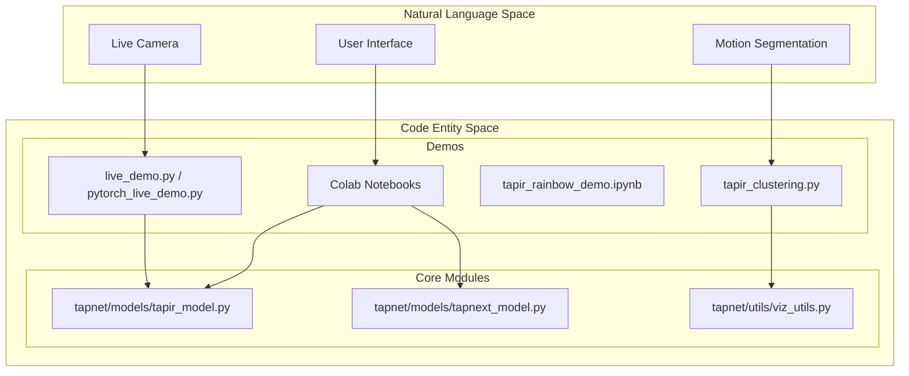
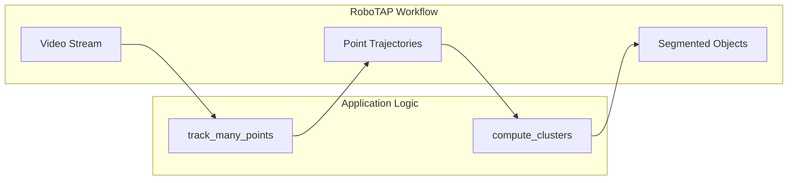

<!-- source: DeepWiki mcp.deepwiki.com · repo google-deepmind/tapnet · page 4 Demos and Applications · fetched 2026-10-26 -->

# Demos and Applications

Relevant source files

The following files were used as context for generating this wiki page:

- [README.md](README.md)
- [colabs/causal_tapir_demo.ipynb](colabs/causal_tapir_demo.ipynb)
- [colabs/tapir_demo.ipynb](colabs/tapir_demo.ipynb)
- [configs/tapnet_config.py](configs/tapnet_config.py)
- [requirements_inference.txt](requirements_inference.txt)

This page provides an overview of the various demos and applications available in the TAP (Tracking Any Point) repository. These tools allow users to experience and interact with the point tracking models through user-friendly interfaces, ranging from browser-based Colab notebooks to real-time local camera applications.

## Overview of Available Demos

The TAP repository offers several ways to experience and utilize the point tracking capabilities of models like **TAPIR**, **BootsTAPIR**, **TAPNext**, and **TAPNext++**.

Sources: [README.md:19-28](), [README.md:29-58]()

## Colab Demos
For details, see [Colab Demos](#4.1).

The simplest way to run the models is via interactive Colab notebooks. These notebooks handle environment setup, dependency installation, and model weight downloading automatically.

*   **TAPNext++**: Optimized for long-term tracking (1024 frames) and re-detection [README.md:41-41]().
*   **BootsTAPNext**: The high-performance online model using Vision Transformers and RG-LRUs [README.md:43-46]().
*   **Standard TAPIR**: The offline model that processes entire videos to achieve maximum accuracy [README.md:49-49]().
*   **Online TAPIR**: A causal implementation for sequential, frame-by-frame tracking [README.md:52-52]().

Sources: [README.md:34-58](), [colabs/tapir_demo.ipynb:1-151](), [colabs/causal_tapir_demo.ipynb:1-154]()

## Live Camera Demo
For details, see [Live Camera Demo](#4.2).

The repository includes scripts to run causal models on a local camera feed. This application demonstrates the efficiency of the `Online TAPIR` variant, which maintains a `causal_context` state to track points without looking at future frames.

*   **JAX Version**: Uses `live_demo.py` [README.md:95-95]().
*   **PyTorch Version**: Uses `pytorch_live_demo.py` for users preferring the Torch ecosystem.
*   **Performance**: Capable of ~17 FPS on consumer-grade GPUs [README.md:96-97]().

Sources: [README.md:59-97](), [colabs/causal_tapir_demo.ipynb:175-218]()

## Rainbow Visualization
For details, see [Rainbow Visualization](#4.3).

The Rainbow Visualization is a specialized tool for generating high-quality motion trails. It uses the `plot_tracks_tails` utility to render historical paths of points.

*   **Camera Motion Correction**: Uses homography estimation to separate object motion from camera motion [README.md:55-55]().
*   **Segmentation**: Implements RANSAC-based foreground/background segmentation to highlight moving objects.

Sources: [README.md:55-55](), [colabs/tapir_demo.ipynb:124-124]()

## Clustering Demo
For details, see [Clustering Demo](#4.4).

This application focuses on grouping point trajectories that exhibit similar motion patterns. It is a core component of the **RoboTAP** system for identifying objects in robotics manipulation tasks.

*   **Trajectory Grouping**: Uses `compute_clusters` to segment videos based on motion [README.md:116-117]().
*   **Dense Tracking**: Leverages `track_many_points` to provide enough spatial density for meaningful clustering.

Sources: [README.md:12-12](), [README.md:116-117]()

---

