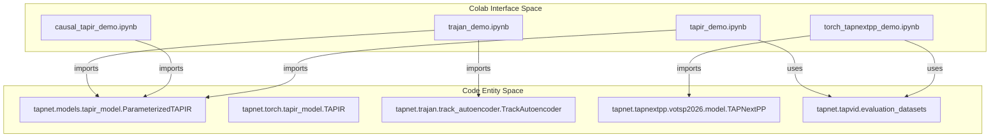
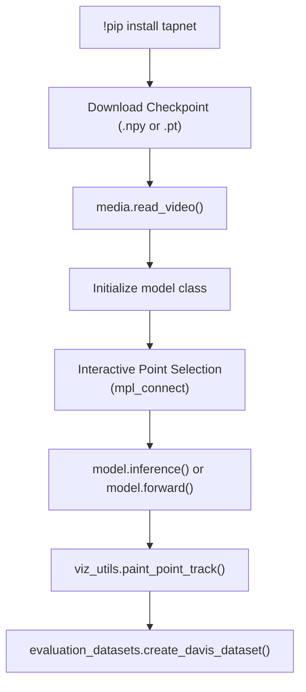

<!-- source: DeepWiki mcp.deepwiki.com · repo google-deepmind/tapnet · page 4.1 Colab Demos · fetched 2026-10-26 -->

# Colab Demos

<details>
<summary>Relevant source files</summary>

The following files were used as context for generating this wiki page:

- [colabs/causal_tapir_demo.ipynb](colabs/causal_tapir_demo.ipynb)
- [colabs/tapir_demo.ipynb](colabs/tapir_demo.ipynb)
- [colabs/tapnext_demo.ipynb](colabs/tapnext_demo.ipynb)
- [colabs/torch_causal_tapir_demo.ipynb](colabs/torch_causal_tapir_demo.ipynb)
- [colabs/torch_tapir_demo.ipynb](colabs/torch_tapir_demo.ipynb)
- [colabs/torch_tapnext_demo.ipynb](colabs/torch_tapnext_demo.ipynb)
- [colabs/torch_tapnextpp_demo.ipynb](colabs/torch_tapnextpp_demo.ipynb)
- [colabs/trajan_demo.ipynb](colabs/trajan_demo.ipynb)
- [requirements.txt](requirements.txt)
- [requirements_inference.txt](requirements_inference.txt)
- [tapnet/__init__.py](tapnet/__init__.py)
- [tapnet/tapnext/tapnext_benchmark_pytorch.ipynb](tapnet/tapnext/tapnext_benchmark_pytorch.ipynb)
- [tapnet/tapnext/tapnext_torch_utils.py](tapnet/tapnext/tapnext_torch_utils.py)

</details>


## Purpose and Overview

This page documents the Google Colab demonstrations available in the TAP (Tracking Any Point) repository. These demos provide an accessible way to experiment with various point tracking models (TAPIR, BootsTAPIR, TAPNext, TAPNext++, and TRAJAN) without setting up a local environment. For instructions on running demos locally on your own hardware, see [Live Camera Demo](#4.2).

The Colab demos allow users to:
- Run point tracking models on example videos or custom uploads.
- Interactively select points to track.
- Visualize tracking results with motion trails and occlusion handling.
- Evaluate model performance on benchmark datasets like TAPVid-DAVIS.
- Analyze motion consistency using trajectory autoencoders (TRAJAN).

Sources: [colabs/tapir_demo.ipynb:8-60](), [colabs/trajan_demo.ipynb:8-68]()

## Available Demos

The repository provides multiple Colab notebooks for experimenting with different models and frameworks:

| Demo | Model | Framework | Mode | Primary Features |
|------|-------|-----------|----------------|-----------------|
| [TAPNext++](https://colab.research.google.com/github/google-deepmind/tapnet/blob/main/colabs/torch_tapnextpp_demo.ipynb) | TAPNext++ | PyTorch | Online | SOTA tracking for 1024-frame sequences; VOTSp2026 entry. |
| [BootsTAPNext](https://colab.research.google.com/github/google-deepmind/tapnet/blob/main/colabs/tapnext_demo.ipynb) | BootsTAPNext | JAX | Online | High-performance temporal modeling using RG-LRUs. |
| [BootsTAPNext PyTorch](https://colab.research.google.com/github/google-deepmind/tapnet/blob/master/colabs/torch_tapnext_demo.ipynb) | BootsTAPNext | PyTorch | Online | PyTorch implementation of BootsTAPNext. |
| [Standard TAPIR](https://colab.research.google.com/github/google-deepmind/tapnet/blob/master/colabs/tapir_demo.ipynb) | TAPIR/BootsTAPIR | JAX | Offline | Processes whole videos at once for highest accuracy. |
| [Online TAPIR](https://colab.research.google.com/github/google-deepmind/tapnet/blob/master/colabs/causal_tapir_demo.ipynb) | TAPIR/BootsTAPIR | JAX | Online | Sequential causal tracking for real-time use. |
| [TRAJAN Demo](https://colab.research.google.com/github/google-deepmind/tapnet/blob/master/colabs/trajan_demo.ipynb) | TRAJAN | JAX | Analysis | Point trajectory autoencoder for motion realism. |
| [PyTorch TAPIR](https://colab.research.google.com/github/google-deepmind/tapnet/blob/master/colabs/torch_tapir_demo.ipynb) | TAPIR/BootsTAPIR | PyTorch | Offline | PyTorch implementation of standard TAPIR. |
| [PyTorch Online TAPIR](https://colab.research.google.com/github/google-deepmind/tapnet/blob/master/colabs/torch_causal_tapir_demo.ipynb) | BootsTAPIR | PyTorch | Online | PyTorch implementation of causal TAPIR. |

Sources: [colabs/torch_tapnextpp_demo.ipynb:9-15](), [colabs/trajan_demo.ipynb:31-57](), [colabs/tapir_demo.ipynb:30-51]()

## Demo Architecture

The following diagram maps the relationship between Colab notebook entities and the underlying code modules they import.

### System Mapping: Demos to Code Space

Sources: [colabs/tapir_demo.ipynb:121-124](), [colabs/torch_tapnextpp_demo.ipynb:153-156](), [colabs/trajan_demo.ipynb:131-136]()

## Standard Demo Workflow

The typical workflow for using any TAP Colab demo follows these steps:



Sources: [colabs/tapir_demo.ipynb:71-168](), [colabs/torch_tapnextpp_demo.ipynb:36-127]()

## Key Demo Implementation Details

### TAPNext++ (Torch)
The TAPNext++ demo demonstrates tracking for long sequences (up to 1024 frames) using the `TAPNextPP` wrapper. It handles scaling between display coordinates and the internal 256x256 model resolution.

**Inference Pattern:**
1. Scaling query points: `q_points[..., 1] = q_points[..., 1] * (256.0 / h)` [colabs/torch_tapnextpp_demo.ipynb:179-180]().
2. Running the model: The model is called per-frame, maintaining a `tracking_state` [colabs/torch_tapnextpp_demo.ipynb:198-206]().
3. Post-processing: Uses `tracker_certainty` to filter unreliable tracks [colabs/torch_tapnextpp_demo.ipynb:216-220]().

### TRAJAN (Motion Analysis)
The TRAJAN demo (`trajan_demo.ipynb`) uses a trajectory autoencoder to evaluate the consistency of point tracks generated by TAPIR.

**Key Components:**
- **Inference**: Generates tracks using `tapir_model.ParameterizedTAPIR` [colabs/trajan_demo.ipynb:163]().
- **Autoencoding**: Encodes the generated trajectories and reconstructs them using `track_autoencoder.TrackAutoencoder` to measure reconstruction error, which serves as a proxy for motion realism [colabs/trajan_demo.ipynb:136]().

### Online TAPIR (JAX)
The online demo (`causal_tapir_demo.ipynb`) highlights the causal state management required for real-time tracking.

**Causal Flow:**
1. **Init**: `online_model_init` extracts features for query points on the first frame [colabs/causal_tapir_demo.ipynb:175-182]().
2. **State Construction**: `tapir.construct_initial_causal_state` creates the recurrent context [colabs/causal_tapir_demo.ipynb:296]().
3. **Prediction**: `online_model_predict` processes one frame and updates the `causal_context` [colabs/causal_tapir_demo.ipynb:200-215]().

## Benchmark Evaluation in Colabs

Demos for TAPNext and TAPNext++ include integrated evaluation against the TAPVid-DAVIS dataset.

**Evaluation Logic:**
- **Dataset Creation**: `evaluation_datasets.create_davis_dataset` loads the `.pkl` annotations [colabs/torch_tapnextpp_demo.ipynb:122-127]().
- **Metrics**: The `run_eval_per_frame` function computes Average Jaccard (AJ) and Occlusion Accuracy (OA) by comparing predicted tracks against ground truth in `batch['target_points']` [colabs/torch_tapnextpp_demo.ipynb:167-240]().

| Metric | Code Reference |
|---|---|
| **Average Jaccard (AJ)** | `evaluation_datasets.compute_tapvid_metrics` |
| **Occlusion Accuracy (OA)** | `postprocess_occlusions` [colabs/torch_tapir_demo.ipynb:165-167]() |
| **Certainty Filtering** | `tracker_certainty` [tapnet/tapnext/tapnext_torch_utils.py:38-57]() |

Sources: [colabs/torch_tapnext_demo.ipynb:129-144](), [colabs/torch_tapnextpp_demo.ipynb:167-240]()

## Implementation: Interactive Point Selection
All demos utilize a standard Matplotlib interaction pattern to allow users to pick points on the first frame of a video.

```python
# Standard pattern across JAX/Torch demos
def on_click(event):
  if event.button == 1 and event.inaxes == ax:
    x, y = int(np.round(event.xdata)), int(np.round(event.ydata))
    select_points.append(np.array([x, y]))
    # ... plotting logic ...

fig.canvas.mpl_connect('button_press_event', on_click)
```
Sources: [colabs/tapir_demo.ipynb:416-431](), [colabs/causal_tapir_demo.ipynb:428-443]()

---

