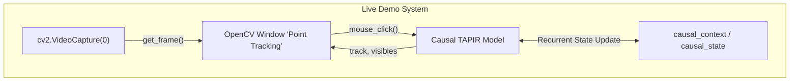
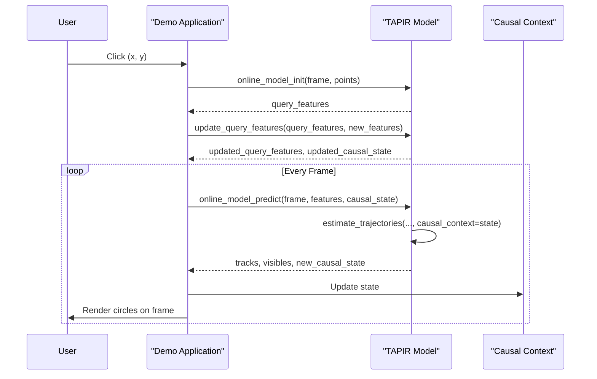

<!-- source: DeepWiki mcp.deepwiki.com · repo google-deepmind/tapnet · page 4.2 Live Camera Demo · fetched 2026-10-26 -->

# Live Camera Demo

<details>
<summary>Relevant source files</summary>

The following files were used as context for generating this wiki page:

- [tapnet/live_demo.py](tapnet/live_demo.py)
- [tapnet/models/tsm_resnet.py](tapnet/models/tsm_resnet.py)
- [tapnet/pytorch_live_demo.py](tapnet/pytorch_live_demo.py)
- [tapnet/torch/nets.py](tapnet/torch/nets.py)
- [tapnet/torch/tapir_model.py](tapnet/torch/tapir_model.py)
- [tapnet/torch/utils.py](tapnet/torch/utils.py)

</details>


The Live Camera Demo provides a real-time implementation of point tracking using the causal variants of TAPIR (Tracking Any Point with per-frame Initialization and Refinement). This page explains the setup, underlying architecture, and data flow for both the JAX and PyTorch implementations.

## Overview

The Live Camera Demo enables users to track points in real-time using a webcam. Users select points on the video stream by clicking, and the system tracks those points across frames using a causal state that does not require access to future frames [tapnet/live_demo.py:62-74](), [tapnet/pytorch_live_demo.py:62-75]().


Sources: [tapnet/live_demo.py:102-221](), [tapnet/pytorch_live_demo.py:121-236]()

## Implementation Variants

The demo is provided in two frameworks, sharing the same logic but utilizing different backends and checkpoints.

| Framework | Entry Point | Model Class | Checkpoint |
| :--- | :--- | :--- | :--- |
| **JAX** | `tapnet/live_demo.py` | `ParameterizedTAPIR` [tapnet/live_demo.py:42-48]() | `causal_tapir_checkpoint.npy` [tapnet/live_demo.py:38-40]() |
| **PyTorch** | `tapnet/pytorch_live_demo.py` | `tapir_model.TAPIR` [tapnet/pytorch_live_demo.py:110]() | `causal_bootstapir_checkpoint.pt` [tapnet/pytorch_live_demo.py:112-114]() |

Sources: [tapnet/live_demo.py:16-49](), [tapnet/pytorch_live_demo.py:16-118]()

## Key Components and Data Flow

The demo utilizes a recurrent processing loop where the model maintains a `causal_context` (or `causal_state`) to remember point features and temporal information.

### 1. Initialization and Feature Extraction
When a user clicks a point, the demo calls `online_model_init`. This function extracts a high-dimensional descriptor for the point from the current frame's feature grid [tapnet/live_demo.py:51-59](), [tapnet/pytorch_live_demo.py:44-54]().

### 2. Recursive Prediction
For every new frame from the camera, `online_model_predict` is called. It takes the current frame, the query features, and the previous `causal_context` to produce the new point locations and an updated state [tapnet/live_demo.py:62-77](), [tapnet/pytorch_live_demo.py:62-85]().


Sources: [tapnet/live_demo.py:171-206](), [tapnet/pytorch_live_demo.py:183-221](), [tapnet/torch/tapir_model.py:763-806]()

## Technical Implementation Details

### Frame Preprocessing
Frames are captured via OpenCV, cropped to square, and normalized.
- **JAX:** Uses `model_utils.preprocess_frames` [tapnet/live_demo.py:123]().
- **PyTorch:** Uses a local `preprocess_frames` function that scales `[0, 255]` uint8 to `[-1, 1]` float32 [tapnet/pytorch_live_demo.py:30-41]().

### Causal State Management
The `causal_context` is a dictionary of tensors containing buffered features for the `PIPSMLPMixer`'s causal convolutions [tapnet/torch/nets.py:149-186](). In PyTorch, this is initialized via `model.construct_initial_causal_state` [tapnet/pytorch_live_demo.py:143-145]().

### Occlusion Post-processing
Visibility is determined by combining the occlusion logit and the expected distance (uncertainty) logit.
- **Logic:** `visibles = (1 - sigmoid(occlusion)) * (1 - sigmoid(expected_dist)) > 0.5` [tapnet/pytorch_live_demo.py:58-59]().
- In JAX, this is handled by `model_utils.postprocess_occlusions` [tapnet/live_demo.py:196]().

### Code Entity Mapping

| System Concept | JAX Entity | PyTorch Entity |
| :--- | :--- | :--- |
| **Model Wrapper** | `ParameterizedTAPIR` [tapnet/live_demo.py:42]() | `tapir_model.TAPIR` [tapnet/pytorch_live_demo.py:110]() |
| **State Init** | `construct_initial_causal_state` [tapnet/live_demo.py:132]() | `construct_initial_causal_state` [tapnet/pytorch_live_demo.py:143]() |
| **Feature Update** | `update_query_features` [tapnet/live_demo.py:179]() | `update_query_features` [tapnet/pytorch_live_demo.py:192]() |
| **Inference Call** | `estimate_trajectories` [tapnet/live_demo.py:65]() | `estimate_trajectories` [tapnet/pytorch_live_demo.py:66]() |

Sources: [tapnet/live_demo.py:42-184](), [tapnet/pytorch_live_demo.py:110-197](), [tapnet/torch/tapir_model.py:763-806]()

## Execution Instructions

1. **Requirements:** A working webcam and a GPU (recommended for >12 fps) [tapnet/live_demo.py:91-92]().
2. **Environment:** Ensure `PYTHONPATH` includes the repository root.
3. **Run JAX:**
   ```bash
   python3 tapnet/live_demo.py
   ```
4. **Run PyTorch:**
   ```bash
   python3 tapnet/pytorch_live_demo.py
   ```
5. **Interaction:**
   - **Click:** Select a point to track. The demo supports up to `NUM_POINTS = 8` [tapnet/live_demo.py:28](), [tapnet/pytorch_live_demo.py:27]().
   - **ESC:** Exit the application [tapnet/live_demo.py:217](), [tapnet/pytorch_live_demo.py:232]().

Sources: [tapnet/live_demo.py:18-221](), [tapnet/pytorch_live_demo.py:18-236]()

---

