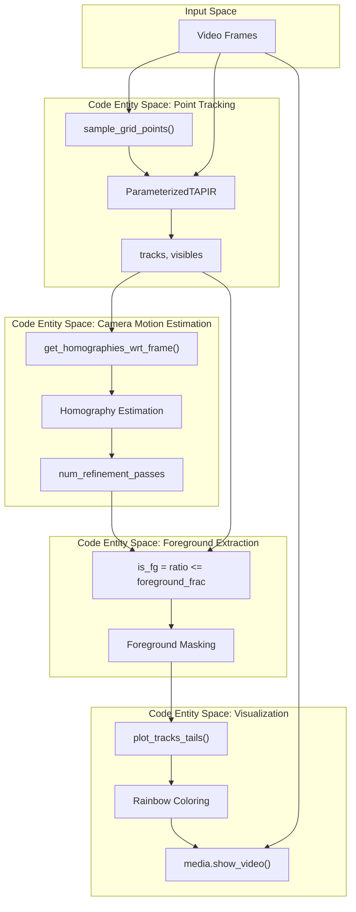

<!-- source: DeepWiki mcp.deepwiki.com · repo google-deepmind/tapnet · page 4.3 Rainbow Visualization · fetched 2026-10-26 -->

# Rainbow Visualization

<details>
<summary>Relevant source files</summary>

The following files were used as context for generating this wiki page:

- [colabs/tapir_clustering.ipynb](colabs/tapir_clustering.ipynb)
- [colabs/tapir_rainbow_demo.ipynb](colabs/tapir_rainbow_demo.ipynb)
- [tapnet/utils/viz_utils.py](tapnet/utils/viz_utils.py)

</details>


Rainbow Visualization is a specialized visualization technique that leverages TAPIR's point tracking capabilities to create motion trails showing how objects move through space. It corrects for camera motion and performs automatic foreground/background segmentation, making it particularly effective for visualizing the true motion paths of objects in videos where the camera might be following the action.

For standard point tracking without motion trails, see [Colab Demos](#4.1).

## Technical Overview

Rainbow Visualization builds upon TAPIR's point tracking to create a visually informative representation of object motion in videos. The approach involves several key steps that transform raw point tracks into trails that show motion paths through space.

### Data Flow and Pipeline



Sources: [colabs/tapir_rainbow_demo.ipynb:35-40](), [colabs/tapir_rainbow_demo.ipynb:298-316](), [colabs/tapir_rainbow_demo.ipynb:120-132]()

### How It Works

1.  **Dense Point Tracking**: The process begins by sampling a dense grid of points using `sample_grid_points` [colabs/tapir_rainbow_demo.ipynb:155-163]() on a specific frame (usually the first) and tracking these points through all video frames using either TAPIR or BootsTAPIR [colabs/tapir_rainbow_demo.ipynb:65-65]().
2.  **Camera Motion Estimation**: `get_homographies_wrt_frame` [tapnet/utils/viz_utils.py:202-211]() uses RANSAC (Random Sample Consensus) to estimate a homography matrix between frames, representing the camera motion. This assumes either a planar background or a camera that rotates but does not translate substantially [colabs/tapir_rainbow_demo.ipynb:35-40]().
3.  **Background/Foreground Separation**: Points that move according to the estimated homography (inliers) are classified as background. Points with motion patterns different from the camera movement (outliers) are retained as foreground objects based on `foreground_frac` [colabs/tapir_rainbow_demo.ipynb:307-311]().
4.  **Motion Trail Generation**: The trajectories of foreground points are visualized as "tails" or trails using `plot_tracks_tails` [tapnet/utils/viz_utils.py:282-295](). These trails appear frozen in space relative to the camera motion by applying the inverse homographies to the point coordinates [tapnet/utils/viz_utils.py:339-346]().

Sources: [colabs/tapir_rainbow_demo.ipynb:35-40](), [colabs/tapir_rainbow_demo.ipynb:155-163](), [colabs/tapir_rainbow_demo.ipynb:282-316](), [tapnet/utils/viz_utils.py:202-346]()

## Implementation Details

The Rainbow Visualization is implemented primarily in the `tapir_rainbow_demo.ipynb` Colab notebook and relies on the `viz_utils` module.

### Component Relationship

```mermaid
classDiagram
    class "ParameterizedTAPIR" {
        +get_feature_grids()
        +__call__()
    }
    
    class "model_utils" {
        +preprocess_frames()
        +postprocess_occlusions()
    }
    
    class "transforms" {
        +convert_grid_coordinates()
    }
    
    class "viz_utils" {
        +get_homographies_wrt_frame()
        +plot_tracks_v2()
        +plot_tracks_tails()
    }
    
    class "RainbowDemo" {
        +sample_grid_points()
        +chunk_inference()
    }
    
    "RainbowDemo" --> "ParameterizedTAPIR" : uses for inference
    "RainbowDemo" --> "model_utils" : uses for frame scaling
    "RainbowDemo" --> "transforms" : uses for coordinate mapping
    "RainbowDemo" --> "viz_utils" : uses for homography & trails
```

Sources: [colabs/tapir_rainbow_demo.ipynb:97-104](), [colabs/tapir_rainbow_demo.ipynb:114-117](), [colabs/tapir_rainbow_demo.ipynb:132-132]()

### Key Functions

1.  **`sample_grid_points`**: Creates a grid of points on a specific frame to track [colabs/tapir_rainbow_demo.ipynb:155-163]().
2.  **`get_homographies_wrt_frame`**: Estimates the homography matrices representing camera motion between frames. It returns the homographies, the squared error for each point, and a "canonical" frame index [tapnet/utils/viz_utils.py:202-211]().
3.  **`plot_tracks_tails`**: Generates the rainbow visualization by drawing motion trails for the foreground points. It applies the estimated homographies to ensure the trails stay fixed in "world" space rather than "camera" space [tapnet/utils/viz_utils.py:282-295]().
4.  **`paint_point_track`**: A utility used within standard visualizations to convert point sequences into color-coded videos [tapnet/utils/viz_utils.py:47-63]().

Sources: [colabs/tapir_rainbow_demo.ipynb:155-163](), [tapnet/utils/viz_utils.py:202-295](), [tapnet/utils/viz_utils.py:47-63]()

## Configuration Parameters

Rainbow Visualization requires careful tuning of several parameters to produce optimal results:

| Parameter | Description | Default Value |
| :--- | :--- | :--- |
| `ransac_inlier_threshold` | Threshold for RANSAC inliers in normalized coordinates [colabs/tapir_rainbow_demo.ipynb:283-283]() | 0.07 |
| `ransac_track_inlier_frac` | Required fraction of points to be inliers for a trustworthy trajectory [colabs/tapir_rainbow_demo.ipynb:284-284]() | 0.95 |
| `num_refinement_passes` | Number of refinement passes for homography adjustment [colabs/tapir_rainbow_demo.ipynb:285-285]() | 2 |
| `foreground_inlier_threshold` | Threshold for classifying points as outliers after homography estimation [colabs/tapir_rainbow_demo.ipynb:286-286]() | 0.07 |
| `foreground_frac` | Maximum fraction of inlier points for a track to be considered foreground [colabs/tapir_rainbow_demo.ipynb:287-287]() | 0.6 |
| `stride` | Spacing between sampled grid points [colabs/tapir_rainbow_demo.ipynb:196-196]() | 8 |

Sources: [colabs/tapir_rainbow_demo.ipynb:282-296](), [colabs/tapir_rainbow_demo.ipynb:195-198]()

## Usage Process

The Rainbow Visualization procedure follows these steps:

1.  **Load a TAPIR/BootsTAPIR model**: Initialize `ParameterizedTAPIR` with a pre-trained checkpoint [colabs/tapir_rainbow_demo.ipynb:120-132]().
2.  **Preprocess and track points**: Resize video and sample a grid of `query_points` [colabs/tapir_rainbow_demo.ipynb:200-215](). Run `chunk_inference` to get `tracks` and `visibles` [colabs/tapir_rainbow_demo.ipynb:265-271]().
3.  **Estimate camera motion**: Call `viz_utils.get_homographies_wrt_frame` to compute the background motion [colabs/tapir_rainbow_demo.ipynb:299-306]().
4.  **Segment foreground**: Identify `is_fg` tracks where the motion error relative to the homography is high [colabs/tapir_rainbow_demo.ipynb:307-311]().
5.  **Generate rainbow visualization**: Call `viz_utils.plot_tracks_tails` using the filtered foreground tracks and estimated homographies [colabs/tapir_rainbow_demo.ipynb:313-315]().

Sources: [colabs/tapir_rainbow_demo.ipynb:120-132](), [colabs/tapir_rainbow_demo.ipynb:200-316](), [tapnet/utils/viz_utils.py:282-295]()

## Limitations and Considerations

*   **Semi-automatic process**: The visualization is considered "semi-automatic" because it requires tuning thresholds for different video types [colabs/tapir_rainbow_demo.ipynb:35-40]().
*   **Background assumptions**: The homography model fails if the background is not planar or if the camera has significant translation (parallax) [colabs/tapir_rainbow_demo.ipynb:35-40]().
*   **Tracking failures**: Errors in tracking background points can lead to them being incorrectly classified as foreground [colabs/tapir_rainbow_demo.ipynb:35-40]().
*   **Coloring**: `plot_tracks_tails` uses the input order of points to choose colors; points should be sorted appropriately for specific rainbow effects [colabs/tapir_rainbow_demo.ipynb:35-40]().

Sources: [colabs/tapir_rainbow_demo.ipynb:35-40]()

---

