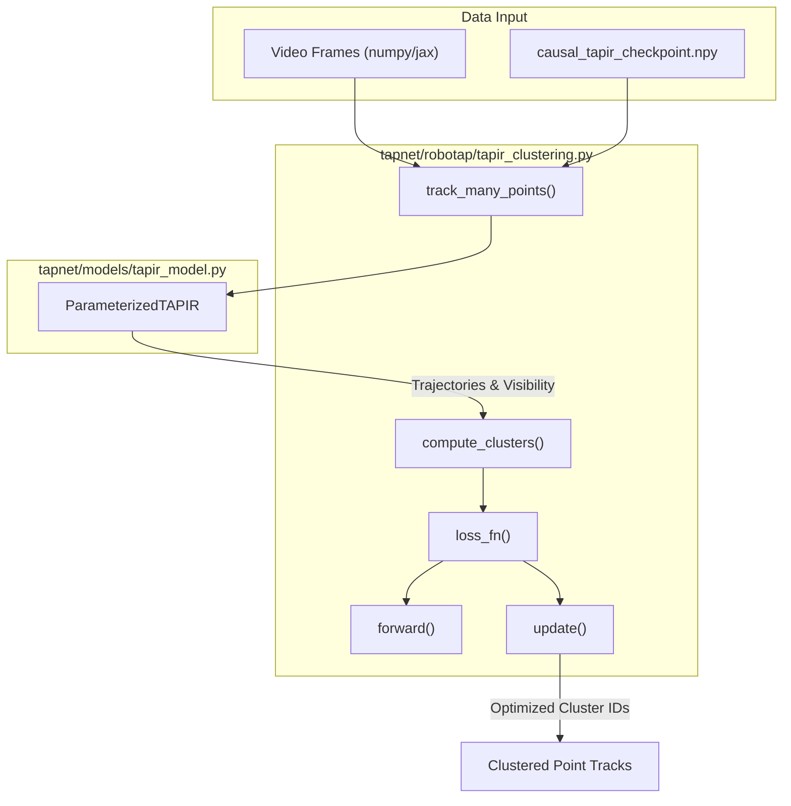
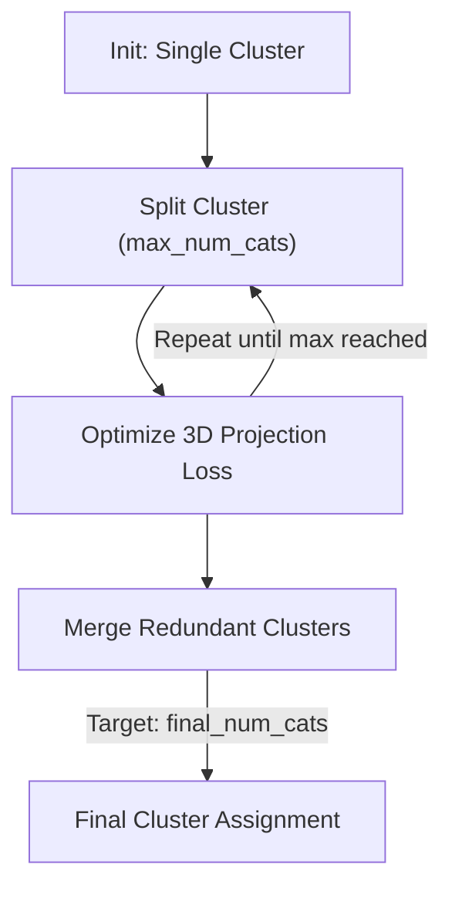
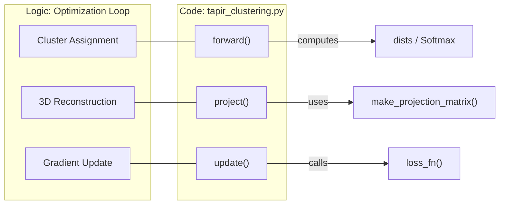

<!-- source: DeepWiki mcp.deepwiki.com · repo google-deepmind/tapnet · page 4.4 Clustering Demo · fetched 2026-10-26 -->

# Clustering Demo

<details>
<summary>Relevant source files</summary>

The following files were used as context for generating this wiki page:

- [colabs/tapir_clustering.ipynb](colabs/tapir_clustering.ipynb)
- [colabs/tapir_rainbow_demo.ipynb](colabs/tapir_rainbow_demo.ipynb)
- [tapnet/robotap/tapir_clustering.py](tapnet/robotap/tapir_clustering.py)

</details>


## Purpose and Overview

The Clustering Demo showcases the motion-based clustering capabilities of the TAP framework, specifically targeting the **RoboTAP** use case for identifying independent motion. It demonstrates how TAPIR's point tracking can be extended to segment objects in a video by grouping tracked points that move together. This allows for unsupervised segmentation of moving objects based on rigid-body motion constraints rather than semantic features.

The implementation is primarily contained in the `tapnet.robotap.tapir_clustering` module, which provides interfaces for dense point tracking and subsequent motion-based optimization.

Sources: [tapnet/robotap/tapir_clustering.py:16-17](), [colabs/tapir_clustering.ipynb:1-158]()

## Technical Overview

The clustering pipeline follows a two-stage process:

1.  **Dense Point Tracking**: Using `track_many_points`, the system samples points across the video (often using a grid or random sampling) and tracks them using a TAPIR model (typically the causal/online variant).
2.  **Motion-Based Optimization**: The `compute_clusters` function takes these trajectories and attempts to explain them as a set of rigid 3D objects moving relative to a camera.

### Data Flow: From Pixels to Clusters

The following diagram maps the high-level conceptual flow to the specific functions and modules in the codebase.



Sources: [tapnet/robotap/tapir_clustering.py:500-510](), [tapnet/robotap/tapir_clustering.py:1023-1033](), [colabs/tapir_clustering.ipynb:86-97]()

## Core Algorithm: Recursive Cluster Splitting

The algorithm performs clustering by optimizing a 3D reconstruction loss. It assumes that points belonging to the same cluster can be explained by a shared 3D rigid motion and a set of 3D coordinates.

The `compute_clusters` function manages a recursive splitting and merging process:
1.  **Splitting**: It starts with a single cluster and iteratively splits clusters to minimize the projection error until `max_num_cats` is reached.
2.  **Merging**: After reaching the maximum, it merges clusters back down to `final_num_cats` to consolidate redundant segments.



Sources: [tapnet/robotap/tapir_clustering.py:617-653](), [tapnet/robotap/tapir_clustering.py:734-758]()

## Using the Clustering Demo

### 1. Extracting Tracks
The `track_many_points` function is the entry point for generating the raw data needed for clustering. It handles batching and model initialization.

```python
track_dict = tapir_clustering.track_many_points(
    demo_videos,
    demo_episode_ids,
    checkpoint_path,
    point_batch_size=1024,
    points_per_frame=10,
)
```
Sources: [colabs/tapir_clustering.ipynb:86-97](), [tapnet/robotap/tapir_clustering.py:1023-1033]()

### 2. Computing Clusters
The `compute_clusters` function executes the optimization loop. It uses a Haiku-based model (`forward`) to predict 3D positions and projection matrices.

```python
clustered = tapir_clustering.compute_clusters(
    track_dict['separation_tracks'],
    track_dict['separation_visibility'],
    track_dict['demo_episode_ids'],
    track_dict['video_shape'],
    track_dict['query_features'],
    max_num_cats=12,
    final_num_cats=7,
)
```
Sources: [colabs/tapir_clustering.ipynb:107-118](), [tapnet/robotap/tapir_clustering.py:500-544]()

## Implementation Details

### Mathematical Projection
The module uses a custom projection logic to map learned 3D points back to 2D space for loss calculation. The `make_projection_matrix` function uses Gram-Schmidt to ensure the learned 3x3 matrices remain orthonormal [tapnet/robotap/tapir_clustering.py:42-91](). The `project` function then applies these matrices to the learned 3D coordinates [tapnet/robotap/tapir_clustering.py:94-109]().

### Key Components

| Component | File:Line | Description |
| :--- | :--- | :--- |
| `TrainingState` | [tapnet/robotap/tapir_clustering.py:32-40]() | NamedTuple containing Haiku params, state, and Optax state. |
| `forward` | [tapnet/robotap/tapir_clustering.py:112-255]() | The Haiku model that predicts 3D positions (`pos_pred`) and projection parameters. |
| `loss_fn` | [tapnet/robotap/tapir_clustering.py:257-389]() | Computes the squared error between projected 3D points and TAPIR's 2D tracks. |
| `update` | [tapnet/robotap/tapir_clustering.py:391-447]() | JIT-compiled function that applies gradients using the `optax` optimizer. |

### Logic Association Diagram

This diagram connects the logical clustering steps to the specific internal functions that implement them.



Sources: [tapnet/robotap/tapir_clustering.py:112-255](), [tapnet/robotap/tapir_clustering.py:42-109](), [tapnet/robotap/tapir_clustering.py:391-447]()

## Configuration Parameters

The behavior of `compute_clusters` is governed by several hyper-parameters:

| Parameter | Default | Description |
| :--- | :--- | :--- |
| `fourdof` | `True` | Restricts the learned projection to 4 degrees of freedom (rotation around Z, and translation). |
| `cam_focal_length` | `1.0` | The focal length used in the perspective projection. |
| `use_em` | `False` | If True, uses an Expectation-Maximization style update for soft cluster assignments. |
| `low_visibility_threshold` | `0.1` | Trajectories with visibility lower than this are discarded before clustering. |

Sources: [tapnet/robotap/tapir_clustering.py:500-510](), [tapnet/robotap/tapir_clustering.py:557-563]()

---

