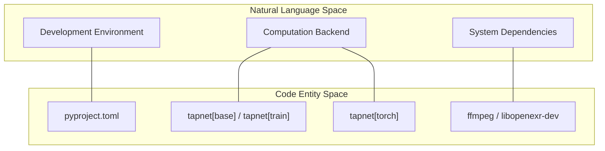
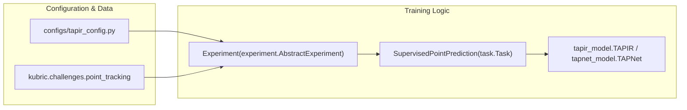

<!-- source: DeepWiki mcp.deepwiki.com · repo google-deepmind/tapnet · page 5 Development · fetched 2026-10-26 -->

# Development

Relevant source files

The following files were used as context for generating this wiki page:

- [configs/causal_tapir_config.py](configs/causal_tapir_config.py)
- [configs/tapir_bootstrap_config.py](configs/tapir_bootstrap_config.py)
- [configs/tapir_config.py](configs/tapir_config.py)
- [tapnet/training/experiment.py](tapnet/training/experiment.py)
- [tapnet/training/supervised_point_prediction.py](tapnet/training/supervised_point_prediction.py)

This document provides a high-level overview for developers who want to work with or extend the TAP models. It covers the environment setup, training framework, evaluation pipelines, and inference methods.

For detailed information on specific areas, see the following child pages:
- **[Training](#5.1)**: Detailed instructions for training TAP models using Kubric and Jaxline.
- **[Model Components](#5.2)**: Breakdown of the building blocks like backbones, SSMs, and coordinate utilities.
- **[Installation and Dependencies](#5.3)**: Comprehensive guide for setting up JAX and PyTorch environments.

## Development Environment Setup

The TAP repository supports both JAX and PyTorch backends. Development requires setting up Python dependencies, system-level packages like `ffmpeg` and `libopenexr-dev`, and configuring the `PYTHONPATH` [README.md:63-87]().

**System to Code Mapping: Environment & Dependencies**

Sources: [pyproject.toml:1-63](), [README.md:63-87]()

## Model Training

Training is managed via the `jaxline` framework, primarily utilizing the `SupervisedPointPrediction` task [tapnet/training/supervised_point_prediction.py:44-50](). The training loop typically consumes synthetic data from the `kubric` dataset [tapnet/training/experiment.py:32-32]().

Configurations are centralized in the `configs/` directory, defining hyperparameters, optimizer settings (typically Adam with cosine decay), and model-specific kwargs [configs/tapir_config.py:24-132]().

**System to Code Mapping: Training Architecture**

Sources: [tapnet/training/experiment.py:47-69](), [tapnet/training/supervised_point_prediction.py:44-110](), [configs/tapir_config.py:72-94]()

## Model Evaluation

Evaluation is integrated into the `Experiment` class, allowing for periodic assessment during training or standalone evaluation runs [tapnet/training/experiment.py:193-198](). The system supports multiple datasets including TAP-Vid-DAVIS, Kinetics, and Robotics points [configs/tapir_config.py:36-41]().

Metrics such as Average Jaccard (AJ) and Occlusion Accuracy (OA) are computed to track model progress [tapnet/training/supervised_point_prediction.py:61-66](). For details on the mathematical definitions of these metrics, see [Evaluation Metrics](#7).

Sources: [tapnet/training/experiment.py:193-198](), [configs/tapir_config.py:36-41](), [tapnet/training/supervised_point_prediction.py:61-66]()

## Running Inference

Inference can be performed through several interfaces:
1.  **Jaxline CLI**: Using the `eval_inference` mode in `experiment.py` [tapnet/training/experiment.py:102-105]().
2.  **Live Demos**: Real-time tracking via `live_demo.py` (JAX) or `pytorch_live_demo.py` (PyTorch).
3.  **Colab Notebooks**: Interactive environments for quick testing and visualization.

For more information on these applications, see [Demos and Applications](#4).

Sources: [tapnet/training/experiment.py:102-105](), [README.md:26-56]()

## Development Workflow

A typical workflow involves selecting a model configuration, training on Kubric, and evaluating on TAP-Vid benchmarks.

| Phase | Primary Code Entities |
| :--- | :--- |
| **Configuration** | `configs/tapir_config.py`, `configs/causal_tapir_config.py` |
| **Training** | `tapnet.training.experiment`, `supervised_point_prediction.py` |
| **Components** | `tapnet.models.tapir_model`, `tapnet.utils.transforms` |
| **Evaluation** | `tapnet.tapvid.evaluation_datasets`, `jaxline_mode=eval_*` |

Sources: [configs/tapir_config.py:1-132](), [tapnet/training/experiment.py:47-69](), [tapnet/training/supervised_point_prediction.py:44-110]()

---

