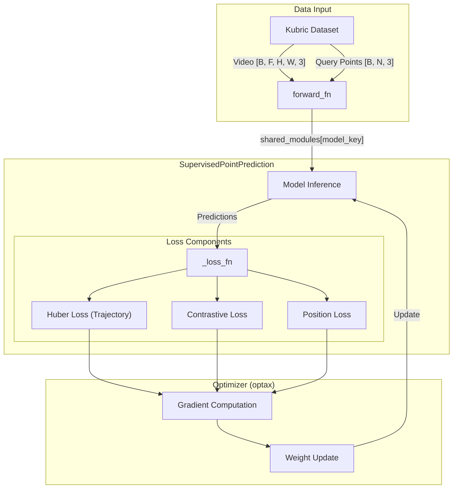
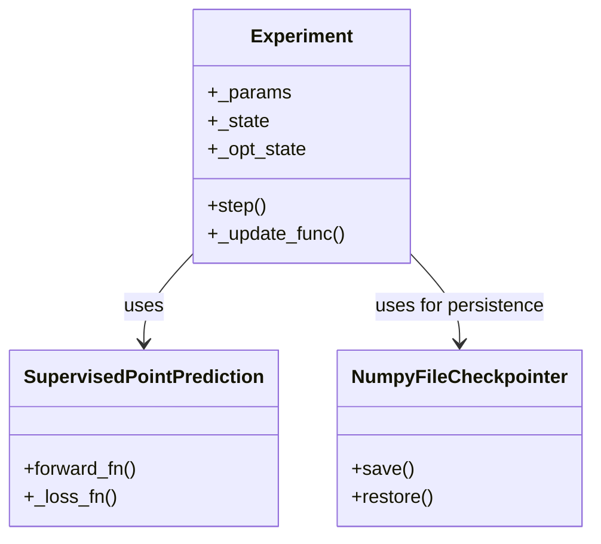

<!-- source: DeepWiki mcp.deepwiki.com · repo google-deepmind/tapnet · page 5.1 Training · fetched 2026-10-26 -->

# Training

<details>
<summary>Relevant source files</summary>

The following files were used as context for generating this wiki page:

- [README.md](README.md)
- [configs/causal_tapir_config.py](configs/causal_tapir_config.py)
- [configs/tapir_bootstrap_config.py](configs/tapir_bootstrap_config.py)
- [configs/tapir_config.py](configs/tapir_config.py)
- [configs/tapnet_config.py](configs/tapnet_config.py)
- [tapnet/training/experiment.py](tapnet/training/experiment.py)
- [tapnet/training/supervised_point_prediction.py](tapnet/training/supervised_point_prediction.py)
- [tapnet/utils/experiment_utils.py](tapnet/utils/experiment_utils.py)
- [tapnet/utils/optimizers.py](tapnet/utils/optimizers.py)

</details>


This document provides technical instructions for training the various point tracking models in the TAP repository, including TAP-Net, TAPIR, Online TAPIR, and BootsTAPIR. It covers environment setup, training configurations, and the supervised training loop using the `jaxline` experiment framework.

## Training Environment Setup

Training is performed using JAX and the `jaxline` framework, primarily utilizing synthetic data generated by Kubric.

### Prerequisites

1.  **System Requirements**:
    *   A machine with GPU support (recommended for reasonable training times).
    *   CUDA drivers compatible with JAX.

2.  **Dependencies**:
    *   **FFmpeg**: Required for video processing.
    *   **OpenEXR**: Required for managing EXR files used by Kubric.
    *   **Kubric**: The synthetic data generation engine.

### Installation Steps

1.  Install system dependencies:
    ```bash
    sudo apt update
    sudo apt install ffmpeg libopenexr-dev
    ```

2.  Clone the repository and configure `PYTHONPATH`:
    ```bash
    git clone https://github.com/google-deepmind/tapnet.git
    cd tapnet
    export PYTHONPATH=`(cd ../ && pwd)`:`pwd`:$PYTHONPATH
    ```

3.  Install Python requirements:
    ```bash
    pip install -r requirements.txt
    ```

Sources: [README.md:27-28](), [tapnet/training/supervised_point_prediction.py:32-33]()

## Training Datasets

The primary training source is the synthetic **Kubric** dataset, which provides dense ground-truth trajectories and occlusion labels.

### Kubric Dataset Configuration
In the experiment configuration files, the Kubric data pipeline is defined within `kubric_kwargs`. The default setup uses a training resolution of 256x256 and a batch size of 8.

```python
kubric_kwargs=dict(
    batch_dims=8,
    shuffle_buffer_size=128,
    train_size=(256, 256),
)
```

Sources: [configs/tapnet_config.py:80-84](), [configs/tapir_config.py:85-89]()

## Configuration Files

Training is driven by `ml_collections` configuration files located in the `configs/` directory. These files define the optimizer, model hyperparameters, and evaluation schedules.

### Optimizer and Schedule
The training utilizes the `Adam` optimizer with a `cosine` decay schedule.

*   **TAP-Net**: Uses a base learning rate of `2e-3` and 5000 warmup steps [configs/tapnet_config.py:54-60]().
*   **TAPIR**: Uses a base learning rate of `1e-3` and 1000 warmup steps [configs/tapir_config.py:54-61]().
*   **Weight Decay**: Standard TAPIR uses a decay of `1e-1` [configs/tapir_config.py:56](), while TAP-Net uses `1e-2` [configs/tapnet_config.py:56]().

### Model Hyperparameters
The `shared_modules` section of the config defines the model architecture used during the experiment.

| Parameter | TAPIR (`tapir_config.py`) | Causal TAPIR (`causal_tapir_config.py`) |
| :--- | :--- | :--- |
| `pyramid_level` | 0 | 1 |
| `use_causal_conv` | `False` | `True` |
| `initial_resolution` | (256, 256) | (256, 256) |
| `extra_convs` | `False` | `False` (True in BootsTAP) |

Sources: [configs/tapir_config.py:76-81](), [configs/causal_tapir_config.py:76-81](), [configs/tapir_bootstrap_config.py:76-83]()

## The Training Loop: SupervisedPointPrediction

The `SupervisedPointPrediction` class in `tapnet/training/supervised_point_prediction.py` defines the core training logic.

### Data Flow and Loss Calculation



Sources: [tapnet/training/supervised_point_prediction.py:111-156](), [tapnet/training/supervised_point_prediction.py:160-174]()

### Key Functions
*   **`forward_fn`**: Executes the model's forward pass. It chunks queries using `query_chunk_size` to manage memory when computing large cost volumes [tapnet/training/supervised_point_prediction.py:111-159]().
*   **`_loss_fn`**: Combines trajectory prediction losses. For TAPNet, this includes Huber loss and softmax cross-entropy for cost volume regression [tapnet/training/supervised_point_prediction.py:160-174]().
*   **`Experiment.step`**: The JAXline entry point that fetches data, calls the update function, and periodically triggers evaluation [tapnet/training/experiment.py:168-199]().

## Training Process Execution

Training is initiated by running the `experiment.py` script with a specific configuration file.

### Starting a Job
```bash
python3 -m tapnet.training.experiment \
    --config ./tapnet/configs/tapir_config.py \
    --jaxline_mode train
```

### Checkpointing
The `NumpyFileCheckpointer` is used to save and restore experiment state. It persists `params`, `state`, and `opt_state` to a `.npy` file on disk [tapnet/utils/experiment_utils.py:110-147]().



Sources: [tapnet/training/experiment.py:74-78](), [tapnet/utils/experiment_utils.py:110-147]()

## Evaluation Modes

The configuration defines several evaluation modes that run periodically during training (controlled by `evaluate_every`).

*   **`eval_davis_points`**: Evaluates on the DAVIS subset of TAP-Vid.
*   **`eval_jhmdb`**: Evaluates on the JHMDB dataset.
*   **`eval_robotics_points`**: Evaluates on the RoboTAP dataset.
*   **`eval_kinetics_points`**: Evaluates on the Kinetics subset of TAP-Vid.

The `Experiment.evaluate` method iterates through these modes, loading the respective datasets via `evaluation_datasets.py` and computing metrics like Average Jaccard (AJ) and Occlusion Accuracy (OA) [tapnet/training/experiment.py:194-196](), [tapnet/training/supervised_point_prediction.py:35]().

Sources: [configs/tapnet_config.py:35-41](), [configs/tapir_config.py:36-41]()

---

