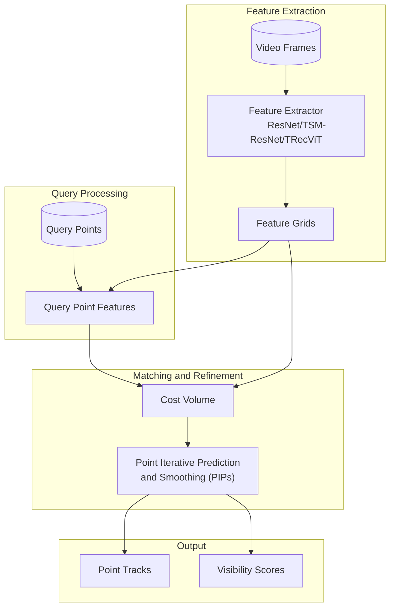
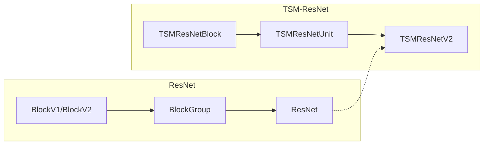

<!-- source: DeepWiki mcp.deepwiki.com · repo google-deepmind/tapnet · page 5.2 Model Components · fetched 2026-10-26 -->

# Model Components

Relevant source files

The following files were used as context for generating this wiki page:

- [tapnet/models/resnet.py](tapnet/models/resnet.py)
- [tapnet/models/tsm_utils.py](tapnet/models/tsm_utils.py)
- [tapnet/tapnext/losses.py](tapnet/tapnext/losses.py)
- [tapnet/utils/index_utils.py](tapnet/utils/index_utils.py)
- [tapnet/utils/model_utils.py](tapnet/utils/model_utils.py)
- [tapnet/utils/ssm_utils.py](tapnet/utils/ssm_utils.py)
- [tapnet/utils/transforms.py](tapnet/utils/transforms.py)

This document provides a detailed description of the building blocks used in the point tracking models within the TAPNet repository. It covers the core architectural components, feature extraction modules, attention mechanisms, and refinement modules that form the foundation of models like TAPIR, TAPNext, and BootsTAPIR.

## Overview of TAP Model Architecture

Point tracking models in this repository follow a general pattern of extracting features from video frames, creating cost volumes to match query points across frames, and refining these matches to produce accurate trajectories. The following diagram illustrates this high-level architecture:

**Sources:** [tapnet/models/video_ssm_tracker.py:124-132]()

## Feature Extraction Components

### ResNet and TSM-ResNet

ResNet (Residual Network) and TSM-ResNet (Temporal Shift Module ResNet) are the backbone feature extractors used in models like TAP-Net and TAPIR.

- **`BlockV1` / `BlockV2`**: Basic building blocks of ResNet that implement the residual connection. `BlockV1` follows the standard ResNet architecture [tapnet/models/resnet.py:27-150](), while `BlockV2` uses pre-activation [tapnet/models/resnet.py:152-273]().
- **`BlockGroup`**: Higher-level block that groups multiple ResNet blocks [tapnet/models/resnet.py:276-328]().
- **`apply_temporal_shift`**: A core utility that performs a temporal shift to enable 2D CNNs to model temporal information without additional parameters [tapnet/models/tsm_utils.py:78-95]().
- **`prepare_inputs` / `prepare_outputs`**: Utilities to handle the merging and unmerging of batch and time dimensions for TSM processing on different hardware (TPU vs GPU) [tapnet/models/tsm_utils.py:25-76]().

**Sources:** [tapnet/models/resnet.py:27-328](), [tapnet/models/tsm_utils.py:25-95]()

## State Space Model (SSM) Utilities

State Space Models provide an efficient way to capture temporal information in videos, especially in the TAPNext architecture. The repository includes utilities to manage the high-dimensional data flow required for SSMs.

### Tensor Reshaping for SSMs

SSMs often require data in specific sequence formats. The `ssm_utils` module provides functions to flatten and unflatten video tensors.

- **`transpose_flatten`**: Rearranges tensors from video shapes to `(batch * num_points) time channels` format [tapnet/utils/ssm_utils.py:36-41]().
- **`unflatten_untranspose`**: Reverses the operation to return tensors to their original spatial-temporal structure [tapnet/utils/ssm_utils.py:44-49]().

### Token Subsampling

For efficient training, the `TokenSubsampling` module randomly drops video "tubes" (temporal sequences of patches).

- **`TokenSubsampling.__call__`**: Randomly masks tokens during training to improve robustness and reduce computational load [tapnet/utils/ssm_utils.py:82-142]().

**Sources:** [tapnet/utils/ssm_utils.py:36-142]()

## Index Manipulation Utilities

The `index_utils` module provides static JAX implementations for scattering data into tensors, which is critical for query point initialization and hint insertion in masked models.

| Function | Description |
| :--- | :--- |
| `scatter` | Scatters data into a target tensor at a specific timestep if a mask is true [tapnet/utils/index_utils.py:43-61](). |
| `scatter_prefix` | Scatters data into a target for all timesteps *before* a specified index [tapnet/utils/index_utils.py:83-113](). |
| `scatter_suffix` | Scatters data into a target for all timesteps *at or after* a specified index [tapnet/utils/index_utils.py:115-144](). |

**Sources:** [tapnet/utils/index_utils.py:26-144]()

## Model Preprocessing and Losses

The `model_utils` module contains shared functions for coordinate transformation, interpolation, and the primary loss functions used to train TAP models.

### Coordinate Transform Utilities

Coordinates must often be converted between different grid resolutions (e.g., from original video resolution to a normalized 256x256 grid for loss calculation).

- **`convert_grid_coordinates`**: Scales coordinates between input and output grid sizes, supporting both 'xy' and 'tyx' formats [tapnet/utils/transforms.py:24-78]().
- **`interp`**: Performs bilinear interpolation to sample features at specific sub-pixel coordinates [tapnet/utils/model_utils.py:177-210]().

### Loss Functions

Training TAP models involves optimizing for position accuracy, occlusion detection, and uncertainty estimation.

- **`huber_loss`**: A robust regression loss for point trajectories, switching from quadratic to linear error beyond a threshold (default 4.0 pixels) [tapnet/utils/model_utils.py:29-50]().
- **`prob_loss`**: A cross-entropy loss used to train the model to predict its own uncertainty (i.e., whether the current prediction is within a certain pixel threshold) [tapnet/utils/model_utils.py:52-71]().
- **`tapnet_loss`**: A composite loss function that combines Huber loss, occlusion loss (BCE), and uncertainty loss [tapnet/utils/model_utils.py:73-174]().

**Sources:** [tapnet/utils/transforms.py:24-78](), [tapnet/utils/model_utils.py:29-210]()

## TAPNext Specific Losses

TAPNext uses a different loss implementation within the Kauldron framework.

- **`Huber`**: Implements the trajectory loss with a magnitude bound to prevent NaNs [tapnet/tapnext/losses.py:29-57]().
- **`CoordinateSoftmaxCrossEntropyWithIntLabels`**: Treats coordinate prediction as a classification task over discretized pixel bins [tapnet/tapnext/losses.py:87-112]().
- **`Certainty`**: Specifically targets the uncertainty term (Equation 1 of the TAPIR paper) to determine if a prediction falls within a threshold of the ground truth [tapnet/tapnext/losses.py:115-145]().

**Sources:** [tapnet/tapnext/losses.py:29-145]()

---

