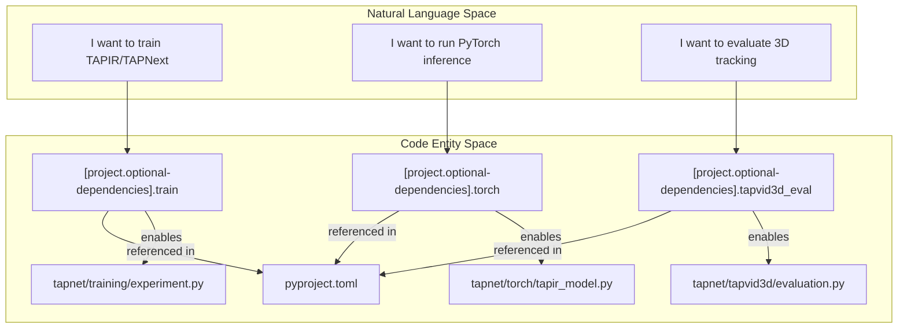
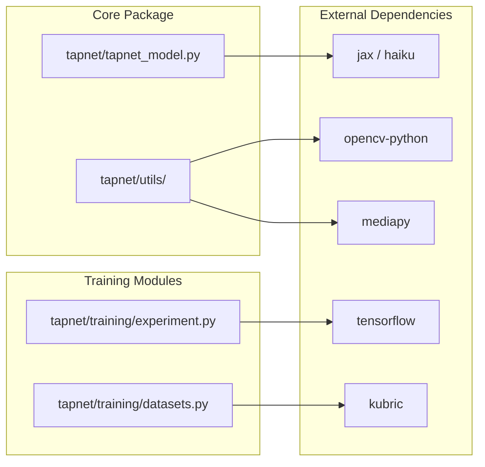

<!-- source: DeepWiki mcp.deepwiki.com · repo google-deepmind/tapnet · page 5.3 Installation and Dependencies · fetched 2026-10-26 -->

# Installation and Dependencies

<details>
<summary>Relevant source files</summary>

The following files were used as context for generating this wiki page:

- [README.md](README.md)
- [configs/tapnet_config.py](configs/tapnet_config.py)
- [pyproject.toml](pyproject.toml)
- [tapnet/tapvid/README.md](tapnet/tapvid/README.md)
- [tapnet/tapvid/requirements.txt](tapnet/tapvid/requirements.txt)
- [tapnet/tapvid3d/LICENSE](tapnet/tapvid3d/LICENSE)
- [tapnet/training/README.md](tapnet/training/README.md)

</details>


This document provides a comprehensive guide for installing the TAP (Tracking Any Point) repository and its dependencies. It covers the basic installation process, dependency management, and specialized setup for different use cases such as training, evaluation, or running the live demo.

## Overview

The TAP repository supports both JAX and PyTorch implementations of tracking models, with distinct dependency requirements for each framework. Specialized tasks like training on synthetic data (Kubric), 3D evaluation (TAPVid-3D), or running the live camera demo require additional optional dependencies.

### Installation Flow and Framework Mapping

The following diagram bridges high-level installation goals to the specific code entities and dependency groups defined in the repository.



Sources: [pyproject.toml:1-58](), [tapnet/training/README.md:1-4]()

## Basic Installation

### Cloning the Repository

To begin, clone the TAP repository from GitHub:

```bash
git clone https://github.com/google-deepmind/tapnet.git
cd tapnet
```

### Installing the Package

The `pyproject.toml` file defines the `tapnet` package and its core requirements [pyproject.toml:1-19](). To install the package in editable mode with minimum dependencies:

```bash
pip install -e .
```

### Setting PYTHONPATH

For running training experiments or local scripts, ensure the root directory is in your `PYTHONPATH`:

```bash
export PYTHONPATH=`(cd ../ && pwd)`:`pwd`:$PYTHONPATH
```

Sources: [tapnet/training/README.md:21-24]()

## Dependency Management

The project uses `pyproject.toml` to manage dependencies, categorized into core and optional groups.

### Core Dependencies
These are required for basic JAX-based inference and visualization [pyproject.toml:5-19]():
*   **JAX Stack**: `jax`, `chex`, `jaxline`, `optax`, `dm-haiku`, `dm-tree`.
*   **Visualization**: `matplotlib`, `mediapy`, `opencv-python`, `ipympl`.
*   **Utilities**: `einshape`, `tqdm`, `typing_extensions`.

### Optional Dependency Groups
You can install specific groups using the `[group]` syntax:

| Group | Command | Key Packages | Purpose |
| :--- | :--- | :--- | :--- |
| **Train** | `pip install ".[train]"` | `tensorflow`, `kubric`, `recurrentgemma` | Model training on Kubric [pyproject.toml:22-31]() |
| **Torch** | `pip install ".[torch]"` | `torch`, `torchvision` | PyTorch model support [pyproject.toml:33-36]() |
| **3D Eval** | `pip install ".[tapvid3d_eval]"` | `einops`, `pillow` | TAPVid-3D metric computation [pyproject.toml:37-43]() |
| **3D Gen** | `pip install ".[tapvid3d_generation]"` | `projectaria-tools`, `visu3d` | Generating 3D ground truth [pyproject.toml:44-58]() |

Sources: [pyproject.toml:1-58]()

## System-Level Dependencies

Certain components require libraries outside of the Python environment.

### Training and Video Processing
Training TAPIR or TAP-Net requires `ffmpeg` for video handling and `OpenEXR` for high-dynamic-range image data used in synthetic datasets.

```bash
# Install ffmpeg
sudo apt update && sudo apt install ffmpeg

# Install OpenEXR for Kubric data processing
sudo apt-get install libopenexr-dev
```

Sources: [tapnet/training/README.md:7-15]()

### Kubric Integration
For training, the Kubric repository must be cloned as a subdirectory or installed via the `train` optional dependency [tapnet/training/README.md:30-32](). The `pyproject.toml` handles this via a direct git link: `kubric@git+https://github.com/google-research/kubric` [pyproject.toml:29-29]().

## Framework-Specific Setup

### JAX with CUDA
Standard `pip install jax` installs the CPU version. For GPU acceleration, follow the official JAX installation guide to match your CUDA and cuDNN versions [tapnet/training/README.md:38-42]().

### PyTorch Support
The PyTorch implementation is used for the `pytorch_live_demo.py` and specific Colab notebooks. It is optimized using `torch.compile` where available [README.md:46-46]().

## Dependency Graph

The following diagram illustrates how different code modules depend on specific external libraries.



Sources: [pyproject.toml:1-63](), [configs/tapnet_config.py:18-19](), [tapnet/tapvid/requirements.txt:1-5]()

## Checkpoint Installation

Models require pre-trained weights, typically stored as `.npy` (JAX/Numpy) or `.pt` (PyTorch) files.

| Model | Format | Source Link (Partial) |
| :--- | :--- | :--- |
| **TAPIR** | `.npy` / `.pt` | `storage.googleapis.com/dm-tapnet/tapir_checkpoint_panning` |
| **TAPNext++** | `.npz` | `storage.googleapis.com/dm-tapnet/tapnext/tapnextpp_ckpt.npz` |
| **Online TAPIR** | `.npy` | `storage.googleapis.com/dm-tapnet/causal_tapir_checkpoint.npy` |

For the live demo, checkpoints should be placed in a `checkpoints/` directory relative to the execution script [README.md:138-151]().

Sources: [README.md:138-151](), [configs/tapnet_config.py:42-42]()

---

