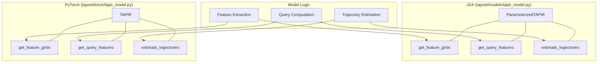
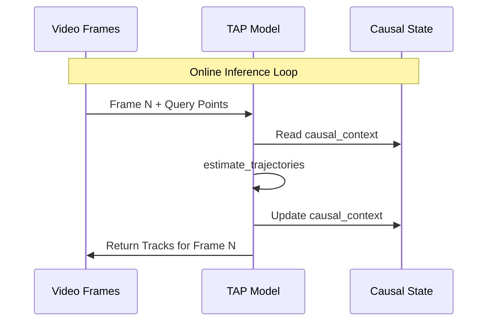

<!-- source: DeepWiki mcp.deepwiki.com · repo google-deepmind/tapnet · page 6 Framework Support · fetched 2026-10-26 -->

# Framework Support

<details>
<summary>Relevant source files</summary>

The following files were used as context for generating this wiki page:

- [colabs/causal_tapir_demo.ipynb](colabs/causal_tapir_demo.ipynb)
- [colabs/tapir_demo.ipynb](colabs/tapir_demo.ipynb)
- [requirements_inference.txt](requirements_inference.txt)
- [tapnet/models/__init__.py](tapnet/models/__init__.py)
- [tapnet/torch/__init__.py](tapnet/torch/__init__.py)

</details>


This page provides an overview of the deep learning frameworks supported by the TAP repository for implementing, training, and running the various point tracking models. The repository primarily supports two frameworks: JAX and PyTorch.

## Overview

The TAP repository offers implementations in both JAX and PyTorch, providing flexibility for researchers and practitioners. The original implementation of TAPIR and related models was in JAX, using **Haiku** and **Flax**. PyTorch implementations were added to improve accessibility for the broader community.

```mermaid
graph TD
    subgraph "Core Models"
        [TAPIR]
        [BootsTAPIR]
        [OnlineTAPIR]
        [TAPNext]
    end
    
    subgraph "Framework Implementations"
        JAX["JAX (Haiku/Flax)"]
        PyTorch["PyTorch"]
    end
    
    subgraph "User Interfaces"
        JaxDemos["JAX Colab Demos"]
        TorchDemos["PyTorch Colab Demos"]
        LiveDemo["Live Camera Demo"]
        Evaluation["Benchmark Evaluation"]
    end
    
    [TAPIR] --> JAX
    [TAPIR] --> PyTorch
    [BootsTAPIR] --> JAX
    [BootsTAPIR] --> PyTorch
    [OnlineTAPIR] --> JAX
    [OnlineTAPIR] --> PyTorch
    [TAPNext] --> JAX
    [TAPNext] --> PyTorch
    
    JAX --> JaxDemos
    PyTorch --> TorchDemos
    PyTorch --> LiveDemo
    JAX --> Evaluation
    PyTorch --> Evaluation
```

Sources: [colabs/tapir_demo.ipynb:82-82](), [colabs/causal_tapir_demo.ipynb:82-82](), [requirements_inference.txt:2-5]()

## Framework Architecture

Both implementations share a common logical flow for point tracking, though they use framework-specific classes. The tracking process is generally split into feature extraction, query feature initialization, and iterative trajectory estimation.



Sources: [colabs/tapir_demo.ipynb:136-152](), [colabs/causal_tapir_demo.ipynb:175-180](), [tapnet/models/tapir_model.py:1-20]()

## Framework Comparison

The following table compares key aspects of the JAX and PyTorch implementations as used in the repository:

| Feature | JAX Implementation | PyTorch Implementation |
|---------|-------------------|------------------------|
| **Checkpoint Format** | `.npy` or `.npz` files | `.pt` files |
| **Model Loading** | `np.load()` into `ParameterizedTAPIR` | `torch.load()` into `TAPIR` |
| **Optimization** | `jax.jit()` compilation | `torch.compile` (in newer versions) |
| **Device Mgmt** | Managed by JAX/XLA | Explicit `.to(device)` |
| **Main Class** | `ParameterizedTAPIR` | `TAPIR` |
| **Import Path** | `tapnet.models.tapir_model` | `tapnet.torch.tapir_model` |

Sources: [colabs/tapir_demo.ipynb:139-151](), [colabs/causal_tapir_demo.ipynb:138-154](), [requirements_inference.txt:1-5]()

## JAX Implementation

The JAX implementation is the primary research framework for TAP models. It utilizes `jaxline` for training experiments and `dm-haiku` for neural network modules.

For details, see [JAX Implementation](#6.1).

### Example Model Loading
In JAX, the checkpoint is often a dictionary of parameters and state loaded via `numpy`:
```python
ckpt_state = np.load(checkpoint_path, allow_pickle=True).item()
params, state = ckpt_state['params'], ckpt_state['state']
tapir = tapir_model.ParameterizedTAPIR(params, state, tapir_kwargs=kwargs)
```
Sources: [colabs/tapir_demo.ipynb:143-151](), [colabs/causal_tapir_demo.ipynb:142-154]()

## PyTorch Implementation

The PyTorch implementation is designed for easier integration into standard computer vision pipelines. It includes a conversion utility to restore models from JAX checkpoints.

For details, see [PyTorch Implementation](#6.2).

### Example Model Loading
PyTorch models follow the standard `nn.Module` pattern:
```python
model = tapir_model.TAPIR(pyramid_level=1)
model.load_state_dict(torch.load(checkpoint_path))
model.to(device).eval()
```
Sources: [colabs/tapir_demo.ipynb:71-71](), [tapnet/torch/__init__.py:1-16]()

## Online vs. Offline Inference

Both frameworks support causal (online) processing where frames are handled sequentially using a `causal_context` state.



Sources: [colabs/causal_tapir_demo.ipynb:175-180](), [colabs/causal_tapir_demo.ipynb:188-217]()

## Checkpoints

The repository provides pre-trained weights for various model versions. JAX checkpoints are hosted as `.npy` or `.npz` files, while PyTorch equivalents are provided as `.pt` files.

| Model | JAX Checkpoint | PyTorch Checkpoint |
|-------|---------------|-------------------|
| **TAPIR** | `tapir_checkpoint_panning.npy` | `tapir_checkpoint_panning.pt` |
| **Online TAPIR** | `causal_tapir_checkpoint.npy` | `causal_tapir_checkpoint.pt` |
| **BootsTAPIR** | `bootstapir_checkpoint_v2.npy` | `bootstapir_checkpoint_v2.pt` |
| **TAPNext** | `bootstapnext_ckpt.npz` | - |

Sources: [colabs/tapir_demo.ipynb:97-100](), [colabs/causal_tapir_demo.ipynb:97-100]()

## Dependencies

### JAX Dependencies
Requires `chex`, `jax`, `jaxline`, `optax`, and `dm-haiku`.
Sources: [requirements_inference.txt:1-5]()

### PyTorch Dependencies
Requires `torch`, `torchvision`, and standard scientific Python libraries like `numpy` and `matplotlib`.
Sources: [requirements_inference.txt:8-12]()

---

