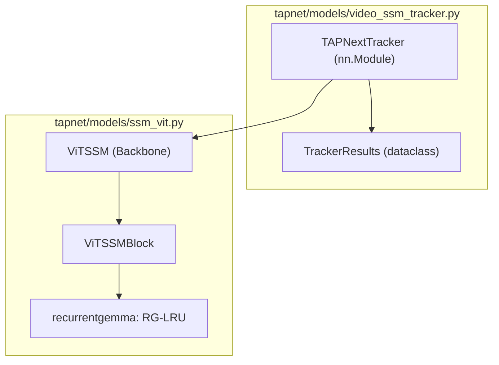
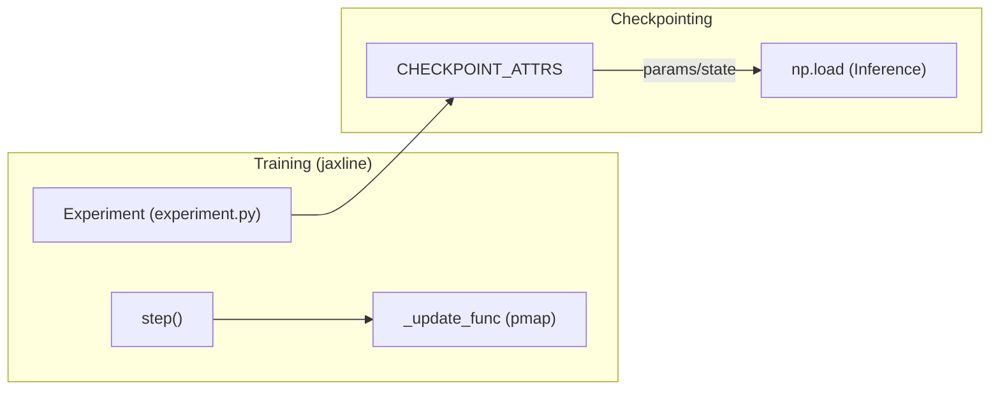

<!-- source: DeepWiki mcp.deepwiki.com · repo google-deepmind/tapnet · page 6.1 JAX Implementation · fetched 2026-10-26 -->

# JAX Implementation

Relevant source files

The following files were used as context for generating this wiki page:

- [colabs/causal_tapir_demo.ipynb](colabs/causal_tapir_demo.ipynb)
- [colabs/tapir_demo.ipynb](colabs/tapir_demo.ipynb)
- [colabs/tapnext_demo.ipynb](colabs/tapnext_demo.ipynb)
- [requirements.txt](requirements.txt)
- [requirements_inference.txt](requirements_inference.txt)
- [tapnet/models/ssm_vit.py](tapnet/models/ssm_vit.py)
- [tapnet/models/video_ssm_tracker.py](tapnet/models/video_ssm_tracker.py)
- [tapnet/training/experiment.py](tapnet/training/experiment.py)

This document details the JAX implementation of tracking models in the TAP (Tracking Any Point) repository. JAX forms the foundation of the original implementations for TAP-Net, TAPIR, BootsTAPIR, and the newer SSM-based TAPNext models.

## Overview of JAX Implementation

JAX is the primary implementation framework for all TAP models, chosen for its performance benefits and research-oriented design. The implementation utilizes **Flax** and **Haiku** for neural network modules and **Jaxline** as the training framework.

Key characteristics include:
- **JIT Compilation**: Functions are compiled for efficient execution using `jax.jit` [colabs/tapir_demo.ipynb:216-217]().
- **SSM Integration**: Integration of Structured State Space Models (SSM) via `recurrentgemma` for temporal modeling in TAPNext [tapnet/models/ssm_vit.py:32-34]().
- **Modular Training**: Uses `jaxline` to manage experiments, parameters, and state transformations [tapnet/training/experiment.py:29-31]().

## JAX Model Architecture and Components

### TAPIR and TAPNet
TAPIR and TAP-Net are implemented using **Haiku**. The `ParameterizedTAPIR` class serves as a convenience wrapper that injects Haiku state and parameters into the model for easier inference [tapnet/models/tapir_model.py:1126-1145]().

### TAPNext (SSM-based ViT)
TAPNext represents a shift towards next-token prediction using a combination of Vision Transformers (ViT) and Real-Gated Linear Recurrent Units (RG-LRU) [tapnet/models/ssm_vit.py:137-155]().

**Entity Mapping: TAPNext Architecture**

Sources: [tapnet/models/video_ssm_tracker.py:56-59](), [tapnet/models/ssm_vit.py:137-155]()

## Training Framework Integration

The repository uses **Jaxline** for training. The `Experiment` class in `tapnet/training/experiment.py` handles the multi-task setup, gradient aggregation, and checkpointing [tapnet/training/experiment.py:47-69]().

### Checkpoint Loading
Checkpoints are typically stored as `.npy` or `.npz` files containing a dictionary of `params` and `state`.
- **TAPIR/BootsTAPIR**: Loaded via `np.load` and passed to `ParameterizedTAPIR` [colabs/tapir_demo.ipynb:136-152]().
- **TAPNext**: Uses `NumpyFileCheckpointer` (conceptually handled by Jaxline) or manual loading from `.npz` files [colabs/tapnext_demo.ipynb:34-40]().

**Entity Mapping: Training & Checkpointing**

Sources: [tapnet/training/experiment.py:74-78](), [tapnet/training/experiment.py:138-139](), [colabs/tapir_demo.ipynb:143-144]()

## SSM and Recurrent Modules

TAPNext utilizes `recurrentgemma` modules to implement temporal gating. The `ViTSSMBlock` chains a temporal SSM block with a spatial ViT block [tapnet/models/ssm_vit.py:137-155]().

- **RG-LRU**: Real-Gated Linear Recurrent Unit used for long-range temporal dependencies [colabs/tapnext_demo.ipynb:168-190]().
- **Scan Types**: Supports `LINEAR_NATIVE` scans for efficient temporal processing [tapnet/models/ssm_vit.py:148]().
- **Causal State**: Online inference is supported by passing a `cache` (state) through the `ViTSSMBlock` [tapnet/models/ssm_vit.py:157-166]().

## Inference Pipelines

### Offline (Batch) Inference
Standard TAPIR inference processes the entire video at once, using `get_feature_grids` and `estimate_trajectories` [colabs/tapir_demo.ipynb:183-213]().

### Online (Causal) Inference
Causal models (like Online TAPIR or TAPNext in stepping mode) process frames one by one, maintaining a `causal_context` or `state` [colabs/causal_tapir_demo.ipynb:175-217]().

| Model Component | Function/Method | Purpose |
| :--- | :--- | :--- |
| **Feature Extraction** | `get_feature_grids` | Extracts hierarchical ResNet features [tapnet/models/tapir_model.py:850]() |
| **Trajectory Head** | `prediction_heads` | Converts SSM features to tracks and visibility [tapnet/models/video_ssm_tracker.py:92-125]() |
| **Online State** | `construct_initial_causal_state` | Initializes memory for causal tracking [tapnet/models/tapir_model.py:756]() |

## JAX-specific Optimizations

1.  **Vectorization**: Extensive use of `jax.vmap` for interpolating features across multiple query points [tapnet/models/tapir_model.py:821-835]().
2.  **Precision**: Supports `bfloat16` for SSM backbones to reduce memory usage on TPUs [tapnet/models/video_ssm_tracker.py:173-177]().
3.  **Sharding**: Uses `ssm_utils.get_sharding_spec()` to distribute SSM scans across devices [tapnet/models/ssm_vit.py:179]().

Sources: [tapnet/models/ssm_vit.py](), [tapnet/models/video_ssm_tracker.py](), [tapnet/training/experiment.py](), [colabs/tapir_demo.ipynb](), [colabs/causal_tapir_demo.ipynb](), [colabs/tapnext_demo.ipynb]()

---

