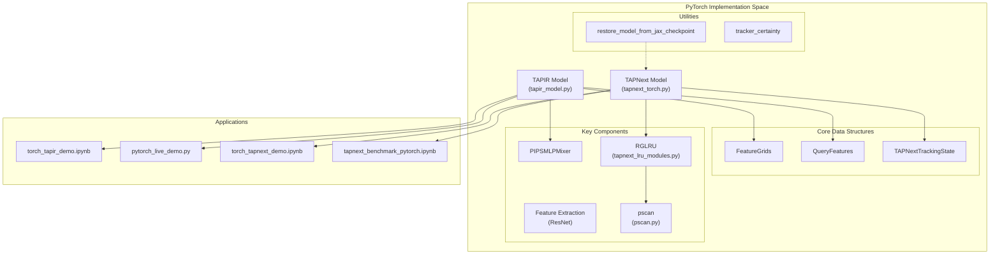

<!-- source: DeepWiki mcp.deepwiki.com · repo google-deepmind/tapnet · page 6.2 PyTorch Implementation · fetched 2026-10-26 -->

# PyTorch Implementation

Relevant source files

The following files were used as context for generating this wiki page:

- [colabs/torch_causal_tapir_demo.ipynb](colabs/torch_causal_tapir_demo.ipynb)
- [colabs/torch_tapir_demo.ipynb](colabs/torch_tapir_demo.ipynb)
- [colabs/torch_tapnext_demo.ipynb](colabs/torch_tapnext_demo.ipynb)
- [tapnet/models/__init__.py](tapnet/models/__init__.py)
- [tapnet/pytorch_live_demo.py](tapnet/pytorch_live_demo.py)
- [tapnet/tapnext/pscan.py](tapnet/tapnext/pscan.py)
- [tapnet/tapnext/tapnext_benchmark_pytorch.ipynb](tapnet/tapnext/tapnext_benchmark_pytorch.ipynb)
- [tapnet/tapnext/tapnext_lru_modules.py](tapnet/tapnext/tapnext_lru_modules.py)
- [tapnet/tapnext/tapnext_torch.py](tapnet/tapnext/tapnext_torch.py)
- [tapnet/tapnext/tapnext_torch_utils.py](tapnet/tapnext/tapnext_torch_utils.py)
- [tapnet/tapnext/torch_losses.py](tapnet/tapnext/torch_losses.py)
- [tapnet/torch/__init__.py](tapnet/torch/__init__.py)
- [tapnet/torch/tapir_model.py](tapnet/torch/tapir_model.py)

This page documents the PyTorch implementation of the TAP (Tracking Any Point) models in the repository. While the original implementation was in JAX, the PyTorch implementation provides additional flexibility and accessibility, especially for users preferring PyTorch or requiring real-time applications. For information about the JAX implementation, see [JAX Implementation](6.1).

## Overview of the PyTorch Implementation

The PyTorch implementation of TAPIR (Tracking Any Point with per-frame Initialization and temporal Refinement) and TAPNext provides equivalent functionality to the JAX versions. This implementation supports batch processing, causal/online processing, and leverages `torch.compile` for performance optimization.

Sources: [tapnet/torch/tapir_model.py:16-138](), [tapnet/tapnext/tapnext_torch.py:16-160](), [tapnet/tapnext/tapnext_torch_utils.py:60-61](), [tapnet/pytorch_live_demo.py:16-25]()

## TAPIR PyTorch Architecture

The TAPIR PyTorch implementation is centered around the `TAPIR` class in `tapnet/torch/tapir_model.py`. It utilizes a ResNet backbone for feature extraction and a MLP-Mixer for iterative refinement.

### Core Data Structures

The PyTorch implementation uses two primary named tuples to organize the data:

1.  **FeatureGrids**: Per-frame outputs of the encoding ResNet [tapnet/torch/tapir_model.py:30-46]().
2.  **QueryFeatures**: Descriptors sampled from query frames, reusable across videos [tapnet/torch/tapir_model.py:48-68]().

### Workflow

The `TAPIR` model follows a multi-stage pipeline:
1.  **Feature Extraction**: `get_feature_grids` uses `nets.ResNet` to extract multi-resolution features [tapnet/torch/tapir_model.py:293-392]().
2.  **Query Extraction**: `get_query_features` samples features at query point locations [tapnet/torch/tapir_model.py:217-291]().
3.  **Trajectory Estimation**: `estimate_trajectories` computes initial tracks via cost volumes (`tracks_from_cost_volume`) and refines them using `refine_pips` [tapnet/torch/tapir_model.py:394-578]().

Sources: [tapnet/torch/tapir_model.py:30-68](), [tapnet/torch/tapir_model.py:70-200]()

## TAPNext PyTorch Implementation

TAPNext is implemented in `tapnet/tapnext/tapnext_torch.py` as a next-token prediction model. It combines Vision Transformers (ViT) with Real-Gated Linear Recurrent Units (RG-LRU) for temporal modeling.

### TRecViT Backbone
The model uses `TRecViTBlock` which alternates between an SSM block (`tapnext_lru_modules.ResidualBlock`) and a ViT encoder block [tapnet/tapnext/tapnext_torch.py:44-73](). 

### Temporal Modeling (RG-LRU)
The `RGLRU` class in `tapnet/tapnext/tapnext_lru_modules.py` implements the recurrence [tapnet/tapnext/tapnext_lru_modules.py:165-226](). It uses a parallel scan (`pscan`) operation for efficient training and a linear scan for sequential inference [tapnet/tapnext/pscan.py:29-105]().

### State Management
Online tracking is supported via `TAPNextTrackingState`, which stores the `step`, `query_points`, and `hidden_state` (list of `RecurrentBlockCache`) [tapnet/tapnext/tapnext_torch.py:76-83]().

Sources: [tapnet/tapnext/tapnext_torch.py:44-160](), [tapnet/tapnext/tapnext_lru_modules.py:165-226](), [tapnet/tapnext/pscan.py:29-105]()

## JAX-to-PyTorch Checkpoint Conversion

Because models are primarily trained in JAX, the repository provides utilities to restore PyTorch models from JAX-produced `.npz` checkpoints.

### TAPNext Restoration
The function `restore_model_from_jax_checkpoint` in `tapnet/tapnext/tapnext_torch_utils.py` performs manual weight mapping between JAX/Haiku keys and PyTorch `nn.Module` parameters:
- Maps `backbone/embedding` to `model.lin_proj` [tapnet/tapnext/tapnext_torch_utils.py:63-66]().
- Converts SSM parameters, transposing weights where necessary [tapnet/tapnext/tapnext_torch_utils.py:80-94]().
- Maps `MultiHeadDotProductAttention` to PyTorch's `self_attention.in_proj_weight` by concatenating Q, K, and V kernels [tapnet/tapnext/tapnext_torch_utils.py:113-131]().

Sources: [tapnet/tapnext/tapnext_torch_utils.py:60-204]()

## Optimization and Inference

### torch.compile
For high-performance inference, especially in TAPNext, `torch.compile` is used to fuse kernels. In the benchmark script, the forward pass is compiled to reduce latency [tapnet/tapnext/tapnext_benchmark_pytorch.ipynb:199-215]().

### Causal Inference
Both TAPIR and TAPNext support causal inference for real-time applications:
- **TAPIR**: Uses `causal_context` in `estimate_trajectories` to maintain state [tapnet/torch/tapir_model.py:403-404]().
- **TAPNext**: The `forward` method accepts a `state` argument (of type `TAPNextTrackingState`). If provided, the model performs a single-step update [tapnet/tapnext/tapnext_torch.py:260-272]().

### Live Demo
The `pytorch_live_demo.py` script demonstrates real-time tracking using the causal TAPIR variant. It initializes query features via `online_model_init` and updates the trajectory per-frame using `online_model_predict` [tapnet/pytorch_live_demo.py:44-85]().

Sources: [tapnet/tapnext/tapnext_benchmark_pytorch.ipynb:199-215](), [tapnet/pytorch_live_demo.py:44-85](), [tapnet/tapnext/tapnext_torch.py:260-272]()

## Training and Losses

While training is typically done in JAX, `tapnet/tapnext/torch_losses.py` provides PyTorch implementations of the loss functions for fine-tuning or training in PyTorch:
- **`huber_coordinate_loss`**: Computes Huber loss between predicted and target coordinates [tapnet/tapnext/torch_losses.py:23-52]().
- **`coordinate_softmax`**: Computes cross-entropy loss on discretized coordinate bins [tapnet/tapnext/torch_losses.py:55-83]().
- **`tapnext_loss_and_grad`**: A wrapper that combines coordinate and visibility losses [tapnet/tapnext/torch_losses.py:86-127]().

Sources: [tapnet/tapnext/torch_losses.py:23-127]()

---

