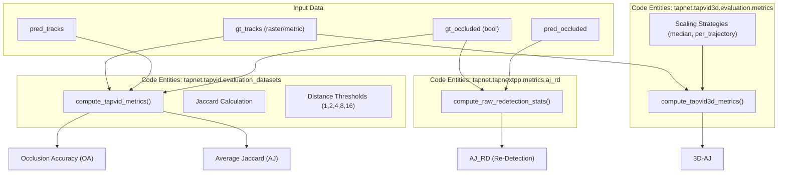
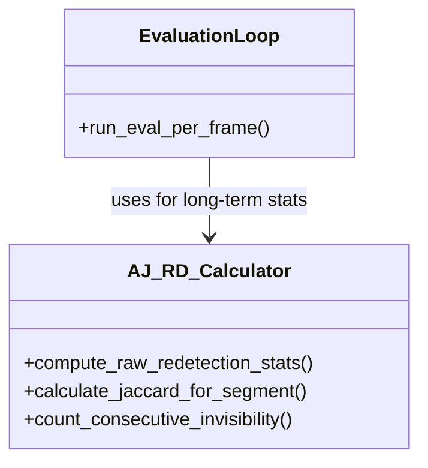

<!-- source: DeepWiki mcp.deepwiki.com · repo google-deepmind/tapnet · page 7 Evaluation Metrics · fetched 2026-10-26 -->

# Evaluation Metrics

Relevant source files

The following files were used as context for generating this wiki page:

- [colabs/torch_tapnextpp_demo.ipynb](colabs/torch_tapnextpp_demo.ipynb)
- [tapnet/__init__.py](tapnet/__init__.py)
- [tapnet/tapnextpp/augmentations/homography.py](tapnet/tapnextpp/augmentations/homography.py)
- [tapnet/tapnextpp/augmentations/homography_visualization.py](tapnet/tapnextpp/augmentations/homography_visualization.py)
- [tapnet/tapnextpp/augmentations/roll.py](tapnet/tapnextpp/augmentations/roll.py)
- [tapnet/tapnextpp/augmentations/roll_visualization.py](tapnet/tapnextpp/augmentations/roll_visualization.py)
- [tapnet/tapnextpp/metrics/aj_rd.py](tapnet/tapnextpp/metrics/aj_rd.py)
- [tapnet/tapvid/evaluation_datasets.py](tapnet/tapvid/evaluation_datasets.py)
- [tapnet/tapvid3d/evaluation/metrics.py](tapnet/tapvid3d/evaluation/metrics.py)

This document details the metrics used to evaluate point tracking models in the TAP (Tracking Any Point) repository. The evaluation metrics are essential for measuring the accuracy and reliability of models like TAPIR, BootsTAPIR, and TAPNext in tracking points through video sequences. For information about the specific models being evaluated, see [Models]().

## Overview of Evaluation Metrics

The TAP repository uses several specialized metrics to evaluate point tracking performance. These metrics are designed to measure both the spatial accuracy of tracked points and the correctness of occlusion prediction. Different metrics are used for 2D and 3D tracking tasks, as well as specific metrics for long-term re-detection.

The metrics can be generally categorized into:

1.  **Spatial accuracy metrics**: measuring how close predicted point locations are to ground truth.
2.  **Occlusion prediction metrics**: measuring how well a model predicts when a point becomes invisible.
3.  **Combined metrics**: accounting for both spatial accuracy and occlusion prediction (e.g., Jaccard).
4.  **Re-detection metrics**: measuring the ability to recover a track after long periods of occlusion.

Sources: [tapnet/tapvid/evaluation_datasets.py:48-67](), [tapnet/tapvid3d/evaluation/metrics.py:16-32](), [tapnet/tapnextpp/metrics/aj_rd.py:16-21]()

## Metric Computation Workflow

The diagram below associates the evaluation concepts with the specific implementation functions in the codebase.

### Evaluation Data Flow

Sources: [tapnet/tapvid/evaluation_datasets.py:48-105](), [tapnet/tapvid3d/evaluation/metrics.py:90-160](), [tapnet/tapnextpp/metrics/aj_rd.py:88-116]()

## 2D Tracking Metrics (TAP-Vid)

The `compute_tapvid_metrics` function [tapnet/tapvid/evaluation_datasets.py:48-56]() is the primary entry point for 2D evaluation.

### Average Jaccard (AJ)
The Jaccard metric measures the ratio of true positives to the sum of true positives, false positives, and false negatives.
*   **True Positives**: Points within the pixel threshold where both ground truth and prediction are visible [tapnet/tapvid/evaluation_datasets.py:162-164]().
*   **False Positives**: Points predicted visible but either ground truth is occluded or the prediction is too far from ground truth [tapnet/tapvid/evaluation_datasets.py:173-177]().
*   **Average Jaccard**: The mean of Jaccard scores calculated at thresholds of 1, 2, 4, 8, and 16 pixels [tapnet/tapvid/evaluation_datasets.py:139-182]().

### Average Points Within Threshold (PTS)
Often referred to as PCK, this measures the fraction of points predicted within a threshold among those visible in ground truth, ignoring the model's own occlusion prediction [tapnet/tapvid/evaluation_datasets.py:148-160]().

### Occlusion Accuracy (OA)
Measures how often `pred_occluded` equals `gt_occluded` for evaluation frames [tapnet/tapvid/evaluation_datasets.py:127-131]().

Sources: [tapnet/tapvid/evaluation_datasets.py:107-185]()

## 3D Tracking Metrics (TAPVid-3D)

For 3D tracking, metrics are computed in metric space using camera intrinsics [tapnet/tapvid3d/evaluation/metrics.py:90-102]().

### 3D Average Jaccard (3D-AJ)
This is the 3D analogue to AJ. It uses back-projected pixel thresholds [tapnet/tapvid3d/evaluation/metrics.py:165-170](). The thresholds are typically depth-adaptive unless `use_fixed_metric_threshold` is set [tapnet/tapvid3d/evaluation/metrics.py:153-155]().

### Average Position Discrepancy (APD)
Measures the L2 distance between predicted and ground truth tracks in 3D metric space [tapnet/tapvid3d/evaluation/metrics.py:103-105]().

### Depth Scaling Strategies
Because many models predict relative depth, `compute_tapvid3d_metrics` supports several `scaling` modes [tapnet/tapvid3d/evaluation/metrics.py:136-149]():
*   `median`: Scale by the median norm of visible points.
*   `per_trajectory`: Rescale so the predicted depth on the query frame matches ground truth.
*   `local_neighborhood`: Uses `create_local_tracks` [tapnet/tapvid3d/evaluation/metrics.py:41-47]() to gather points within `local_neighborhood_thresh` to treat as a single track for scaling.

Sources: [tapnet/tapvid3d/evaluation/metrics.py:32-160]()

## Re-Detection Metrics (AJ_RD)

Introduced in **TAPNext++**, the `AJ_RD` (Re-Detection Average Jaccard) specifically evaluates a model's ability to re-detect a point after it reappears from a long occlusion.

### Re-Detection Logic
The logic identifies "eligible reappearance events" where a point becomes visible after being occluded for a duration $d$.
1.  **Consecutive Invisibility**: `count_consecutive_invisibility` [tapnet/tapnextpp/metrics/aj_rd.py:64-85]() tracks how long a point has been hidden.
2.  **Eligible Events**: An event is eligible if the current invisibility duration is greater than any previous duration for that specific track [tapnet/tapnextpp/metrics/aj_rd.py:141-160]().
3.  **AJ_RD Calculation**: For each eligible event, `calculate_jaccard_for_segment` [tapnet/tapnextpp/metrics/aj_rd.py:23-29]() computes the Jaccard score from the moment of reappearance ($t_r$) until the end of the video [tapnet/tapnextpp/metrics/aj_rd.py:192-201]().

### AJ_RD Implementation Space

Sources: [tapnet/tapnextpp/metrics/aj_rd.py:23-205](), [colabs/torch_tapnextpp_demo.ipynb:167-214]()

## Query Modes

The evaluation behavior changes significantly based on the `query_mode` [tapnet/tapvid/evaluation_datasets.py:54]():

| Mode | Behavior | Implementation Logic |
| :--- | :--- | :--- |
| **First** | Evaluates only frames *after* the query frame. | `np.cumsum(eye, axis=1) - eye` [tapnet/tapvid/evaluation_datasets.py:112-114]() |
| **Strided** | Evaluates all frames *except* the query frame. | `1 - eye` [tapnet/tapvid/evaluation_datasets.py:115-117]() |

Sources: [tapnet/tapvid/evaluation_datasets.py:111-124]()

## Summary Table

| Metric | Code Reference | Description |
| :--- | :--- | :--- |
| **AJ** | `average_jaccard` [tapnet/tapvid/evaluation_datasets.py:104]() | Mean Jaccard across 5 pixel thresholds. |
| **OA** | `occlusion_accuracy` [tapnet/tapvid/evaluation_datasets.py:97]() | Accuracy of binary visibility prediction. |
| **PTS** | `average_pts_within_thresh` [tapnet/tapvid/evaluation_datasets.py:103]() | Average PCK across thresholds. |
| **3D-AJ** | `compute_tapvid3d_metrics` [tapnet/tapvid3d/evaluation/metrics.py:90]() | Jaccard using 3D metric distances. |
| **APD** | `compute_tapvid3d_metrics` [tapnet/tapvid3d/evaluation/metrics.py:103]() | Average 3D position error. |
| **AJ_RD** | `compute_raw_redetection_stats` [tapnet/tapnextpp/metrics/aj_rd.py:88]() | Jaccard focused on post-occlusion recovery. |

Sources: [tapnet/tapvid/evaluation_datasets.py:95-105](), [tapnet/tapvid3d/evaluation/metrics.py:161-175](), [tapnet/tapnextpp/metrics/aj_rd.py:107-115]()

---

