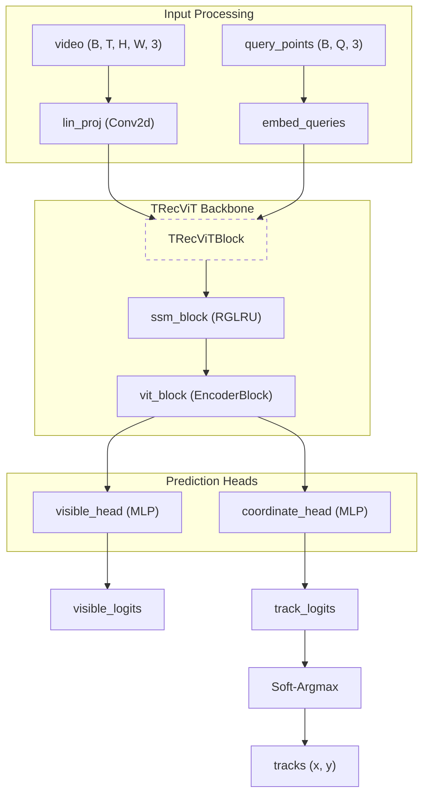
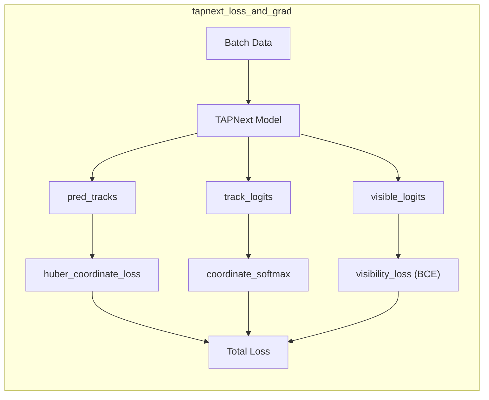

<!-- source: DeepWiki mcp.deepwiki.com · repo google-deepmind/tapnet · page 8 Glossary · fetched 2026-10-26 -->

# Glossary

Relevant source files

The following files were used as context for generating this wiki page:

- [README.md](README.md)
- [colabs/causal_tapir_demo.ipynb](colabs/causal_tapir_demo.ipynb)
- [colabs/tapir_demo.ipynb](colabs/tapir_demo.ipynb)
- [configs/tapnet_config.py](configs/tapnet_config.py)
- [requirements_inference.txt](requirements_inference.txt)
- [tapnet/models/ssm_vit.py](tapnet/models/ssm_vit.py)
- [tapnet/models/video_ssm_tracker.py](tapnet/models/video_ssm_tracker.py)
- [tapnet/tapnext/pscan.py](tapnet/tapnext/pscan.py)
- [tapnet/tapnext/tapnext_lru_modules.py](tapnet/tapnext/tapnext_lru_modules.py)
- [tapnet/tapnext/tapnext_torch.py](tapnet/tapnext/tapnext_torch.py)
- [tapnet/tapnext/torch_losses.py](tapnet/tapnext/torch_losses.py)
- [tapnet/tapnextpp/README.md](tapnet/tapnextpp/README.md)
- [tapnet/tapvid3d/README.md](tapnet/tapvid3d/README.md)
- [tapnet/tapvid3d/colab/load_and_visualize_tapvid3d_samples.ipynb](tapnet/tapvid3d/colab/load_and_visualize_tapvid3d_samples.ipynb)

This page provides definitions for codebase-specific terms, domain concepts, and technical jargon used across the TAP (Tracking Any Point) repository. It serves as a reference for engineers onboarding to the project to understand the relationships between mathematical concepts and their implementations in JAX and PyTorch.

## TAP Task Terminology

*   **TAP (Tracking Any Point):** The task of tracking arbitrary points in a video sequence, regardless of whether they belong to a predefined object class [README.md:1-12]().
*   **Query Point:** The starting coordinate $(t, x, y)$ provided to the model. The model must track this point for all frames $T$ where $t \in [0, T]$ [README.md:146-150]().
*   **Visibility:** A binary state or logit indicating whether a point is visible in a given frame or occluded/outside the field of view [tapnet/models/video_ssm_tracker.py:41-42]().
*   **Occlusion:** A state where a point is physically blocked by another object but still exists in the 3D scene. TAPNext++ specifically targets improved tracking through these states [README.md:17-18]().
*   **Re-detection:** The ability of a model to find a point again after it has been occluded for a significant duration [tapnet/tapnextpp/README.md:10-12]().

## Model Architectures and Components

### TAPNext Architecture Entities
TAPNext formulates tracking as next-token prediction using a combination of Vision Transformers (ViT) and State Space Models (SSM) [README.md:15-16]().

| Code Entity | Description | File Reference |
| :--- | :--- | :--- |
| `TRecViTBlock` | A hybrid block combining a temporal SSM layer and a spatial ViT layer. | [tapnet/tapnext/tapnext_torch.py:44-47]() |
| `RGLRU` | Real-Gated Linear Recurrent Unit; the core temporal modeling component. | [tapnet/tapnext/tapnext_lru_modules.py:165-166]() |
| `TAPNextTracker` | The JAX/Flax high-level wrapper for the tracking model. | [tapnet/models/video_ssm_tracker.py:56-59]() |
| `ssm_vit.py` | Implementation of the masked sequence decoder using SSM and ViT. | [tapnet/models/ssm_vit.py:16-19]() |

**Data Flow: TAPNext Inference (PyTorch)**

Sources: [tapnet/tapnext/tapnext_torch.py:85-161](), [tapnet/tapnext/tapnext_torch.py:44-73](), [tapnet/models/video_ssm_tracker.py:92-125]()

### TAPIR Components
TAPIR uses a two-stage approach: Matching and Refinement [README.md:11]().

*   **Matching Stage:** Independently locates candidates for the query point on every frame.
*   **Refinement Stage:** Updates trajectories based on local correlations.
*   **ParameterizedTAPIR:** The main class used to load and run TAPIR/BootsTAPIR models with specific configurations like `pyramid_level` and `extra_convs` [colabs/tapir_demo.ipynb:151]().

## Coordinate Systems and Transforms

*   **Normalization:** Coordinates are often handled as sub-pixel values. In TAPNext, image features are extracted using `patch_size` (typically 8x8) [tapnet/tapnext/tapnext_torch.py:92-109]().
*   **Grid Sample:** PyTorch implementation uses `F.grid_sample` which expects coordinates normalized in the range $[-1, 1]$ [tapnet/tapnext/tapnext_torch.py:177-188]().
*   **TAP-3D Space:** In TAPVid-3D, points are represented in meters $(x, y, z)$ alongside camera extrinsics `extrinsics_w2c` (4x4 world-to-camera matrix) [tapnet/tapvid3d/README.md:96-112]().

## Evaluation Metrics

*   **AJ (Average Jaccard):** The standard metric for TAP, measuring the intersection over union of predicted vs. ground truth tracks, considering visibility [README.md:23-25]().
*   **$AJ_{RD}$ (Re-Detection AJ):** A metric introduced in TAPNext++ to specifically evaluate the ability to re-acquire points after long occlusions [tapnet/tapnextpp/README.md:10-12]().
*   **OA (Occlusion Accuracy):** Measures how accurately the model predicts the visibility flag [tapnet/tapvid3d/README.md:30-31]().
*   **3D-AJ / APD:** Metrics specific to the 3D tracking task, handling ambiguous depth scales and metric space trajectories [tapnet/tapvid3d/README.md:27-31]().

## Training Concepts

*   **Kubric:** The primary synthetic data engine used to generate ground truth trajectories for training [README.md:27](), [configs/tapnet_config.py:80-84]().
*   **BootsTAP (Bootstrapped Training):** A training procedure using unlabeled real-world video to enforce consistency across spatial transformations and different query points [README.md:13]().
*   **Huber Coordinate Loss:** A loss function used for coordinate regression that is less sensitive to outliers than squared error [tapnet/tapnext/torch_losses.py:23-52]().
*   **Coordinate Softmax:** A loss treating coordinate prediction as a classification task over quantized bins (typically 512 bins) [tapnet/tapnext/torch_losses.py:55-83]().

**System Logic: Training Loss Calculation**

Sources: [tapnet/tapnext/torch_losses.py:86-127](), [tapnet/tapnext/torch_losses.py:23-52]()

## Framework Specifics

*   **Jaxline:** The experiment framework used for JAX-based training, defined in `configs/tapnet_config.py` [configs/tapnet_config.py:18-26]().
*   **Causal Context:** In Online TAPIR, a state variable passed between frames to maintain temporal information without looking at future frames [colabs/causal_tapir_demo.ipynb:172-175]().
*   **Parallel Scan (pscan):** An optimized operation for linear RNNs/SSMs used during training to process sequences in $O(\log T)$ time instead of $O(T)$ [tapnet/tapnext/tapnext_lru_modules.py:102-145]().