# Page: Overview

# Overview

<details>
<summary>Relevant source files</summary>

The following files were used as context for generating this wiki page:

- [.gitignore](.gitignore)
- [CONTRIBUTING.md](CONTRIBUTING.md)
- [README.md](README.md)
- [configs/tapnet_config.py](configs/tapnet_config.py)
- [pyproject.toml](pyproject.toml)

</details>


This document provides a technical introduction to the Tracking Any Point (TAP) repository, which offers a comprehensive ecosystem for point tracking in videos. Point tracking refers to the task of following specific points on objects throughout a video sequence, regardless of object deformation, occlusion, or camera motion.

## What is Point Tracking?

Point tracking involves locating and following specific points on objects or surfaces across video frames. Unlike traditional object tracking (which focuses on bounding boxes), keypoint tracking (which focuses on specific predefined points like human joints), or optical flow (which typically works only between adjacent frames), TAP addresses the more general problem of tracking arbitrary points on any surface over potentially long durations.

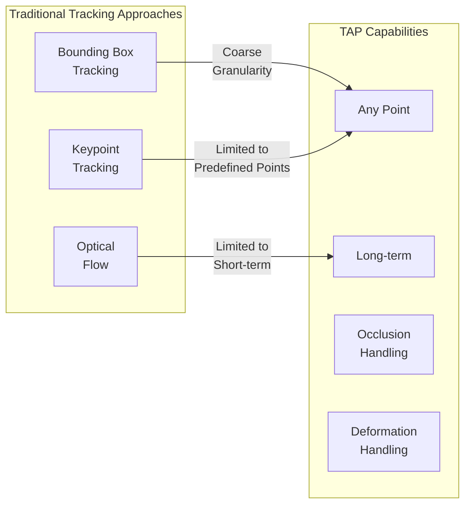

Sources: [README.md:1-17](), [README.md:99-102]()

## Repository Overview

The TAP repository contains several point tracking models with progressively increasing capabilities, along with datasets for evaluation, and tools for visualization and deployment.

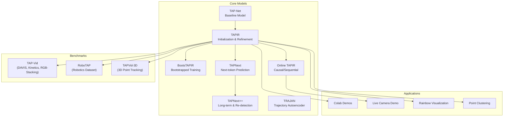

Sources: [README.md:8-17](), [README.md:19-28]()

## Model Evolution

The repository features a progression of models, each improving on previous capabilities:

| Model | Description | Key Innovations | Backbone |
|-------|-------------|-----------------|----------|
| **TAP-Net** | Baseline model | Cost-volume regression | TSM-ResNet18 |
| **TAPIR** | Two-stage algorithm | Per-frame initialization + iterative refinement | ResNet18 |
| **Online TAPIR** | Causal variant | Sequential processing for real-time streaming | ResNet18 |
| **BootsTAPIR** | Bootstrapped version | Self-supervised training on unlabeled real-world video | ResNet18 |
| **TAPNext** | Next-token formulation | Temporal modeling via RG-LRU | TRecViT-B |
| **TAPNext++** | Enhanced TAPNext | 40x longer stable tracking, re-detection, occlusion handling | TRecViT-B |
| **TRAJAN** | Trajectory Autoencoder | Reconstructs trajectories conditioned on support points | N/A |

Sources: [README.md:10-17](), [README.md:41-52](), [configs/tapnet_config.py:86-88]()

## Technical Architecture

The point tracking models generally follow a pipeline of feature extraction followed by trajectory estimation. While earlier models like TAPIR use cost volumes, newer models like TAPNext utilize recurrent token prediction.

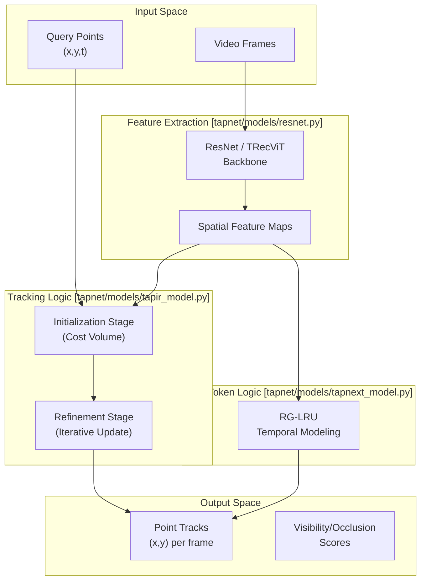

Sources: [README.md:11-15](), [configs/tapnet_config.py:107-113]()

## Framework Implementation

The repository supports both JAX and PyTorch implementations. Training is primarily handled via the JAX-based `jaxline` framework.

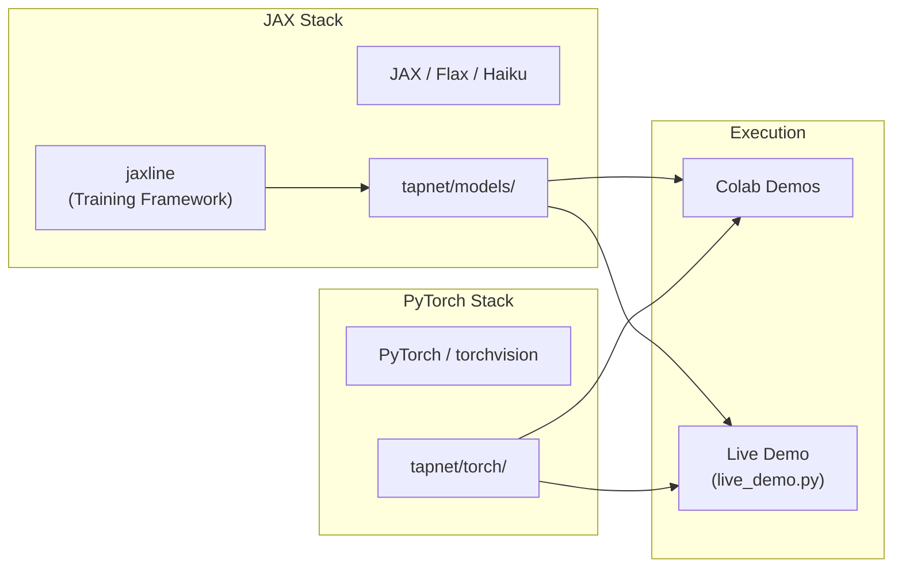

Sources: [pyproject.toml:5-19](), [pyproject.toml:33-36](), [README.md:26-27](), [configs/tapnet_config.py:18-26]()

## Benchmarks and Datasets

1.  **TAP-Vid**: Benchmark for point tracking evaluation using DAVIS, Kinetics, and RGB-Stacking. [README.md:10]()
2.  **RoboTAP**: Dataset for robotics manipulation with ground-truth points on real videos. [README.md:12]()
3.  **TAPVid-3D**: 3D point tracking benchmark with 1M+ trajectories on 4,000+ videos. [README.md:14]()
4.  **Kubric**: Synthetic data generation used for large-scale supervised training. [configs/tapnet_config.py:34](), [pyproject.toml:29]()

## User Interfaces and Applications

| Interface | Description | Implementation |
|-----------|-------------|----------------|
| **Colab Demos** | Web-based testing for all major models | JAX & PyTorch |
| **Live Camera Demo** | Real-time tracking from webcam | `live_demo.py` (JAX), `pytorch_live_demo.py` (Torch) |
| **Rainbow Visualization** | Tracks with motion trails and camera motion correction | `tapir_rainbow_demo.ipynb` |
| **Clustering** | Motion-based object segmentation | `tapir_clustering` module |

Sources: [README.md:21-25](), [README.md:41-55](), [README.md:58-64]()

## System Requirements

The project defines dependencies for multiple environments:
- **Core**: `jax`, `dm-haiku`, `optax`, `mediapy`, `opencv-python`. [pyproject.toml:5-19]()
- **Training**: `tensorflow`, `kubric`, `recurrentgemma`. [pyproject.toml:22-31]()
- **PyTorch**: `torch`, `torchvision`. [pyproject.toml:33-36]()
- **3D Evaluation**: `einops`, `visu3d`, `projectaria-tools`. [pyproject.toml:37-58]()

Sources: [pyproject.toml:1-63]()

---

# Page: Models

# Models

<details>
<summary>Relevant source files</summary>

The following files were used as context for generating this wiki page:

- [README.md](README.md)
- [configs/tapnet_config.py](configs/tapnet_config.py)
- [tapnet/models/ssm_vit.py](tapnet/models/ssm_vit.py)
- [tapnet/models/tapir_model.py](tapnet/models/tapir_model.py)
- [tapnet/models/tapnet_model.py](tapnet/models/tapnet_model.py)
- [tapnet/models/video_ssm_tracker.py](tapnet/models/video_ssm_tracker.py)

</details>


This page provides an overview of the different model architectures in the TAP (Tracking Any Point) repository. These models are designed for tracking arbitrary points in videos, with each model offering different trade-offs between performance, speed, and capability. For training instructions, see [Training](#5.1). For evaluation metrics, see [Evaluation Metrics](#7).

## Model Evolution and Hierarchy

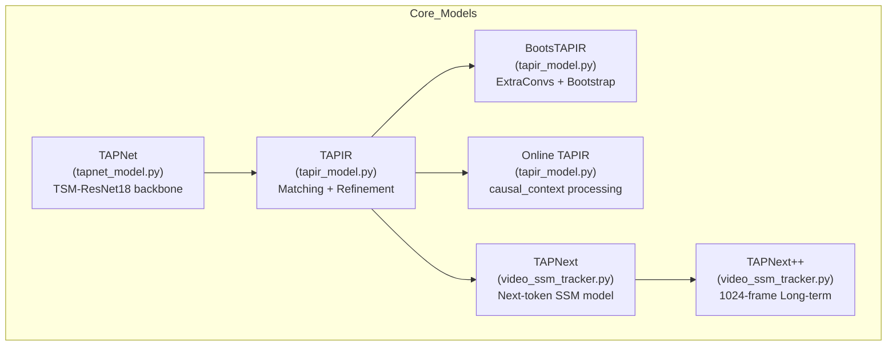

Sources: [README.md:10-17](), [tapnet/models/tapir_model.py:101-157](), [tapnet/models/video_ssm_tracker.py:56-126]()

## Model Architecture Comparison

The TAP repository contains several model variants with different architectures, each designed for specific use cases:

| Model | Backbone | Training Approach | Key Features | Performance (DAVIS First AJ) | Real-time Capable |
|-------|----------|-------------------|--------------|------------------------------|-------------------|
| TAP-Net | TSM-ResNet18 | Supervised | Baseline model | 33.0% | No |
| TAPIR | ResNet18 | Supervised | Two-stage: matching + refinement | 58.5% | No |
| Online TAPIR | ResNet18 | Supervised | Causal variant for streaming | 56.2% | Yes |
| BootsTAPIR | ResNet18 + `ExtraConvs` | Self-supervised + Supervised | Improved with unlabeled data | 62.4% | No |
| TAPNext | TRecViT-B | Self-supervised + Supervised | Next-token prediction (SSM) | 65.25% | Yes |
| TAPNext++ | TRecViT-B | Long-term fine-tuning | 40x longer stable tracking | - | Yes |

Sources: [README.md:11-17](), [tapnet/models/tapir_model.py:159-187]()

## Data Flow in Point Tracking Models

All TAP models follow a general pattern for processing input data and producing tracks:

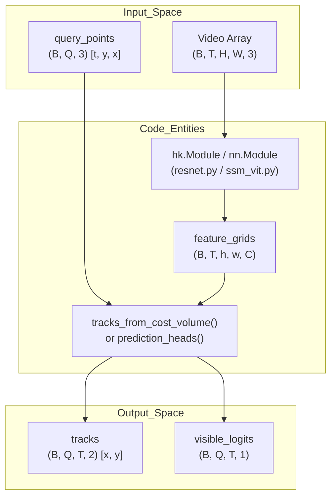

Sources: [tapnet/models/tapnet_model.py:111-171](), [tapnet/models/video_ssm_tracker.py:92-125]()

## TAPIR

TAPIR (Tracking Any Point with per-frame Initialization and Refinement) is a two-stage algorithm. It first performs global matching to find candidates and then uses an iterative refinement stage inspired by PIPs to improve accuracy [tapnet/models/tapir_model.py:16-17]().

For details, see [TAPIR](#2.1).

## BootsTAPIR

BootsTAPIR (Bootstrapped TAPIR) uses a large dataset of unlabeled real-world video to improve accuracy. It employs a consistency loss across different spatial transformations and query point selections [README.md:13-13](). Architecturally, it is similar to TAPIR but often utilizes `ExtraConvs` for enhanced feature representation [tapnet/models/tapir_model.py:159-187]().

For details, see [BootsTAPIR](#2.2).

## Online TAPIR

Online TAPIR is the sequential causal variant that allows for online tracking. It uses a `causal_context` to maintain state across frames, enabling real-time GPU processing without access to future frames [tapnet/models/tapir_model.py:43-89]().

For details, see [Online TAPIR](#2.3).

## TAPNext

TAPNext formulates point tracking as a next-token prediction problem [README.md:15-15](). It utilizes a `TRecViT-B` backbone which combines Vision Transformers (ViT) for spatial attention and Real-Gated Linear Recurrent Units (RG-LRU) for temporal modeling [tapnet/models/ssm_vit.py:137-234]().

For details, see [TAPNext](#2.4).

## TAPNext++

TAPNext++ is an improved version of TAPNext fine-tuned on 1024-frame sequences (PointOdyssey and Kubric-1024) [README.md:41-41](). It features significantly improved long-term stability and re-detection capabilities through occlusions [README.md:17-17]().

For details, see [TAPNext++](#2.5).

## TAP-Net

TAP-Net is the original baseline model that uses a `TSMResNetV2` backbone [tapnet/models/tapnet_model.py:70-77](). It tracks points by computing a cost volume between interpolated query features and the video feature grid, followed by cost-volume regression [tapnet/models/tapnet_model.py:145-171]().

For details, see [TAP-Net](#2.6).

## TRAJAN

TRAJAN (Point Trajectory Autoencoder) is designed to reconstruct held-out point trajectories conditioned on support points [README.md:16-16](). It is primarily used to evaluate motion realism and consistency in generated videos rather than for direct tracking tasks.

For details, see [TRAJAN](#2.7).

## Framework Support

Models are implemented in both **JAX** (using Haiku and Flax) and **PyTorch**.
*   **JAX Implementation:** The primary development framework. JAX models like `TAPNet` and `TAPIR` are defined using Haiku [tapnet/models/tapnet_model.py:44](), [tapnet/models/tapir_model.py:653](), while `TAPNext` uses Flax [tapnet/models/video_ssm_tracker.py:56]().
*   **PyTorch Implementation:** Available for inference and deployment. PyTorch versions are designed to match JAX outputs exactly by restoring from JAX checkpoints [README.md:46-46]().

Sources: [README.md:26-27](), [tapnet/models/tapir_model.py:653](), [tapnet/models/video_ssm_tracker.py:56]()

---

# Page: TAPIR

# TAPIR

<details>
<summary>Relevant source files</summary>

The following files were used as context for generating this wiki page:

- [colabs/causal_tapir_demo.ipynb](colabs/causal_tapir_demo.ipynb)
- [colabs/tapir_demo.ipynb](colabs/tapir_demo.ipynb)
- [requirements_inference.txt](requirements_inference.txt)
- [tapnet/models/resnet.py](tapnet/models/resnet.py)
- [tapnet/models/tapir_model.py](tapnet/models/tapir_model.py)
- [tapnet/models/tsm_utils.py](tapnet/models/tsm_utils.py)

</details>


## Purpose and Scope

This document details **TAPIR** (Tracking Any Point with per-frame Initialization and Refinement), the core point tracking model in the TAP repository. TAPIR is designed to track arbitrary points on objects through video sequences with high accuracy. It introduces a two-stage approach: a matching stage that performs independent per-frame initialization to avoid drift, and a refinement stage that uses temporal context to smooth trajectories and handle occlusions [colabs/tapir_demo.ipynb:31-31]().

## TAPIR Overview

TAPIR combines the strengths of global matching and local refinement. It employs the following key innovations:
- **Independent matching** on each frame to initialize tracking, preventing the error accumulation common in optical-flow-based methods.
- **Iterative refinement** of both trajectories and query features using a specialized MLP-Mixer architecture [tapnet/models/tapir_model.py:127-138]().
- **Per-point tracking**, allowing the model to track any coordinate $(x, y)$ regardless of whether it belongs to a predefined object class.
- **Occlusion detection** through an "expected distance" and occlusion probability estimation [tapnet/models/tapir_model.py:657-674]().

### TAPIR Architecture

The architecture consists of a feature backbone, a query extraction mechanism, and a refinement pipeline.

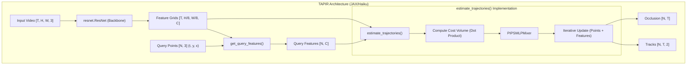
Sources: [tapnet/models/tapir_model.py:539-623](), [tapnet/models/tapir_model.py:127-157]()

---

## Key Components

### Feature Extraction
TAPIR utilizes a ResNet18 backbone to extract feature grids from video frames. By default, it uses a ResNet V1 architecture [tapnet/models/resnet.py:305-305](). For the standard TAPIR model, the `pyramid_level` is typically set to 0, resulting in a single feature resolution [colabs/tapir_demo.ipynb:146-146]().

- **Offline Mode:** Uses standard `resnet.ResNet`.
- **Online/Causal Mode:** Uses causal convolutions to ensure the model does not "see" the future [tapnet/models/tapir_model.py:104-107]().
- **TSM Variant:** Incorporates a Temporal Shift Module (`apply_temporal_shift`) to move channels across the time dimension without adding parameters, improving temporal awareness [tapnet/models/tsm_utils.py:78-95]().

Sources: [tapnet/models/resnet.py:305-447](), [tapnet/models/tsm_utils.py:78-95]()

### Query Feature Extraction
When a user selects a point to track, the model calls `get_query_features`. This function samples the feature grid at the query frame and coordinates using bilinear interpolation [tapnet/models/tapir_model.py:557-567]().
- It extracts a local feature vector that represents the "identity" of the point.
- These features are later refined iteratively alongside the coordinates to adapt to appearance changes [tapnet/models/tapir_model.py:146-156]().

Sources: [tapnet/models/tapir_model.py:539-573](), [colabs/causal_tapir_demo.ipynb:175-184]()

### Cost Volume and Refinement (PIPs)
The refinement stage is inspired by PIPs (Particle Video Revisited). It computes a local cost volume by taking the dot product between query features and the feature grid in a search window around the current estimate [tapnet/models/tapir_model.py:214-230]().

The `PIPSMLPMixer` is the core refinement engine:
- It consists of `PIPsConvBlock` units [tapnet/models/tapir_model.py:101-124]().
- It uses `depthwise_conv_residual` for temporal smoothing [tapnet/models/tapir_model.py:39-89]().
- It outputs coordinate deltas, occlusion logits, and updated query features for the next iteration [tapnet/models/tapir_model.py:146-156]().

Sources: [tapnet/models/tapir_model.py:101-157](), [tapnet/models/tapir_model.py:214-230]()

---

## Data Flow and Code Entities

The following diagram maps the logical data flow to specific classes and functions in `tapir_model.py`.

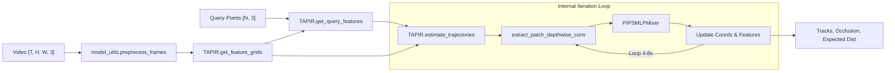
Sources: [tapnet/models/tapir_model.py:539-674](), [tapnet/utils/model_utils.py:136-150]()

---

## Offline vs. Online Variants

### Standard TAPIR (Offline)
The offline model processes the entire video sequence as a single batch. It uses non-causal convolutions in the refinement stage, allowing the trajectory at time $t$ to be influenced by frames at $t+n$.
- **Initialization:** `ParameterizedTAPIR` is initialized with `use_causal_conv=False` [colabs/tapir_demo.ipynb:146-151]().
- **Use Case:** High-accuracy batch processing of existing videos.

### Online TAPIR (Causal)
The online variant processes frames one by one. It maintains a `causal_context` (a dictionary of arrays) to store temporal features from previous frames [tapnet/models/tapir_model.py:43-45]().
- **Initialization:** Uses `use_causal_conv=True` [colabs/causal_tapir_demo.ipynb:145-149]().
- **State Management:** The `PIPSMLPMixer` returns a `new_causal_context` which must be passed into the next frame's prediction [tapnet/models/tapir_model.py:146-156]().
- **Key Functions:** `online_model_init` and `online_model_predict` [colabs/causal_tapir_demo.ipynb:175-215]().

Sources: [tapnet/models/tapir_model.py:146-156](), [colabs/causal_tapir_demo.ipynb:145-215]()

---

## Coordinate Handling

TAPIR uses a normalized coordinate system where $(0,0)$ is the top-left and $(1,1)$ is the bottom-right of the image.
- **Internal Scaling:** Coordinates are converted to raster space (pixels) during cost volume extraction using `transforms.convert_grid_coordinates` [tapnet/models/tapir_model.py:611-615]().
- **Resolution Independence:** Because features are sampled bilinearly, the model can theoretically track at resolutions higher than the training resolution (typically 256x256).

Sources: [tapnet/models/tapir_model.py:611-615](), [tapnet/utils/transforms.py:46-64]()

## Performance Summary

| Model Variant | Feature Backbone | Resolution | Temporal Handling |
| :--- | :--- | :--- | :--- |
| **TAPIR** | ResNet18 | 256 / 512 | Non-causal Conv |
| **Online TAPIR** | ResNet18 | 256 | Causal Conv + State |
| **BootsTAPIR** | ResNet18 + ExtraConvs | 512 | Non-causal + Pyramid |

Sources: [README.md:143-150](), [colabs/tapir_demo.ipynb:147-150]()

---

# Page: BootsTAPIR

# BootsTAPIR

<details>
<summary>Relevant source files</summary>

The following files were used as context for generating this wiki page:

- [colabs/causal_tapir_demo.ipynb](colabs/causal_tapir_demo.ipynb)
- [colabs/tapir_demo.ipynb](colabs/tapir_demo.ipynb)
- [configs/causal_tapir_config.py](configs/causal_tapir_config.py)
- [configs/tapir_bootstrap_config.py](configs/tapir_bootstrap_config.py)
- [configs/tapir_config.py](configs/tapir_config.py)
- [requirements_inference.txt](requirements_inference.txt)
- [tapnet/models/tapir_model.py](tapnet/models/tapir_model.py)

</details>


BootsTAPIR is an enhanced version of TAPIR (Tracking Any Point with per-frame Initialization and Refinement) that employs a bootstrapping training technique called BootsTAP. This model substantially improves tracking accuracy over the base TAPIR model while maintaining the same interface and usage patterns.

## Bootstrapped Training (BootsTAP)

BootsTAP (Bootstrapped Training for TAP) uses a large dataset of unlabeled, real-world video to improve tracking accuracy. The key insight behind this approach is training the model to give consistent predictions across spatial transformations and different query point selections. This self-supervised consistency training allows the model to learn robust features from unlabeled data.

### Consistency Constraints
The training procedure enforces that the model's predictions remain stable when the input undergoes:
1.  **Spatial Transformations**: Rotations, scaling, or translations of the video frames.
2.  **Corruptions**: Synthetic noise or blur applied to the video.
3.  **Query Point Selection**: Different choices of query points on the same physical object should yield trajectories consistent with the object's motion.

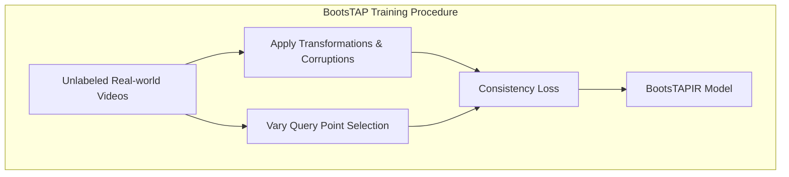
Sources: [colabs/tapir_demo.ipynb:82-83](), [colabs/causal_tapir_demo.ipynb:82-83]()

## Architectural Enhancements

While BootsTAPIR maintains the core `tapir_model.py` architecture, it is instantiated with specific hyperparameters that distinguish it from the baseline TAPIR.

### Key Parameter Differences

| Parameter | TAPIR (Baseline) | BootsTAPIR |
| :--- | :--- | :--- |
| `pyramid_level` | 0 | 1 |
| `extra_convs` | False | True |
| `softmax_temperature` | 1.0 (default) | 10.0 |
| `use_causal_conv` | False | False (True for Online) |

### Implementation Details
*   **Feature Pyramid**: By setting `pyramid_level=1`, the model utilizes higher-resolution feature maps for the cost volume computation [configs/tapir_bootstrap_config.py:78-78]().
*   **Extra Convolutions**: The `ExtraConvs` module [tapnet/models/tapir_model.py:159-186]() is enabled. This module adds 5 layers of depthwise-convolutional residual blocks with GELU activations to the feature extraction backbone [tapnet/models/tapir_model.py:174-186]().
*   **Softmax Temperature**: A temperature of 10.0 is applied during training to the cost volume, which affects the sharpness of the point initialization [configs/tapir_bootstrap_config.py:82-82]().

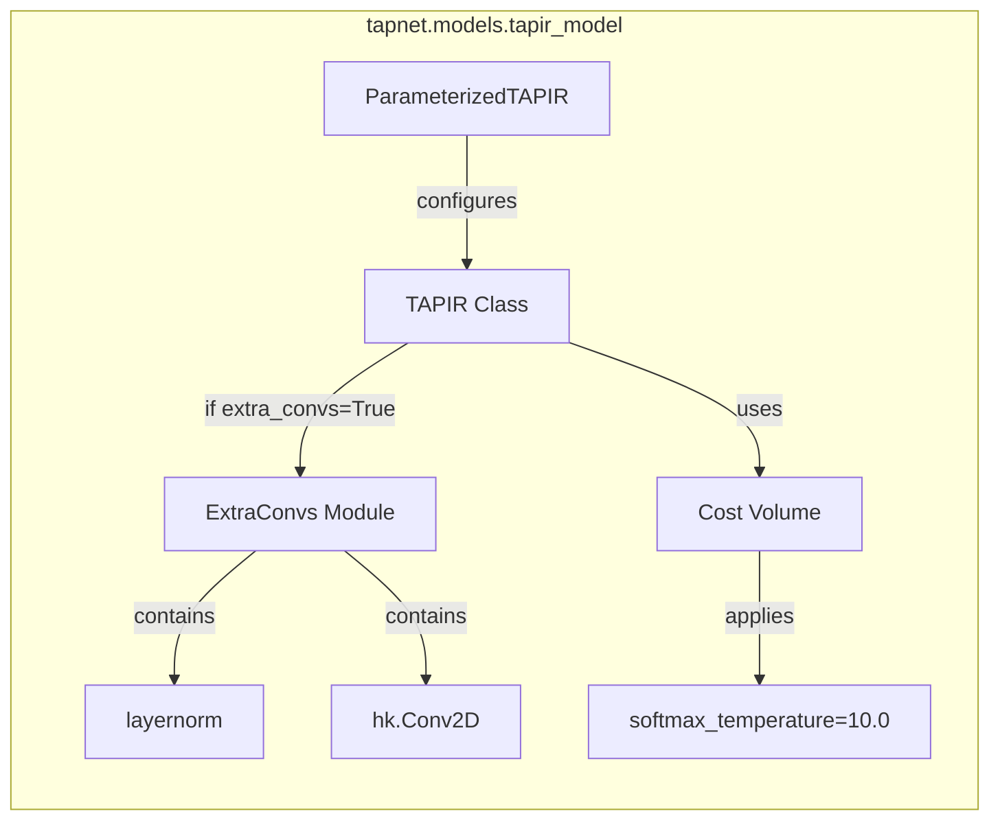
Sources: [tapnet/models/tapir_model.py:159-186](), [configs/tapir_bootstrap_config.py:76-83](), [colabs/tapir_demo.ipynb:146-151]()

## Point Tracking Workflow

The point tracking workflow in BootsTAPIR follows the standard TAPIR approach but with the enhanced feature processing path.

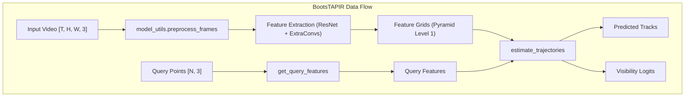
Sources: [tapnet/models/tapir_model.py:653-690](), [colabs/tapir_demo.ipynb:183-213]()

## Model Variants

BootsTAPIR is available in two configurations, defined by their respective `jaxline` configs:

1.  **Standard BootsTAPIR**: Defined in `configs/tapir_bootstrap_config.py`. It processes the entire video sequence and is non-causal.
    *   `use_causal_conv=False` [configs/tapir_bootstrap_config.py:79-79]()
2.  **Online BootsTAPIR**: Defined in `configs/causal_tapir_config.py` (when using BootsTAP weights). It processes frames sequentially for real-time applications.
    *   `use_causal_conv=True` [configs/causal_tapir_config.py:79-79]()
    *   Utilizes the `causal_context` in `PIPsMLPMixer` to maintain temporal state [tapnet/models/tapir_model.py:146-157]().

Sources: [configs/tapir_bootstrap_config.py:76-83](), [configs/causal_tapir_config.py:76-81](), [colabs/causal_tapir_demo.ipynb:138-154]()

## Usage and Checkpoints

BootsTAPIR checkpoints are distributed as `.npy` files for JAX/Haiku.

### Loading the Model (JAX)
The model is typically instantiated via `ParameterizedTAPIR`, which handles the parameter mapping between the saved checkpoint and the Haiku module.

```python
# Configuration for BootsTAPIR
kwargs = dict(
    bilinear_interp_with_depthwise_conv=False,
    pyramid_level=1, 
    extra_convs=True, 
    softmax_temperature=10.0
)

# Load checkpoint
ckpt_state = np.load('bootstapir_checkpoint_v2.npy', allow_pickle=True).item()
tapir = tapir_model.ParameterizedTAPIR(
    ckpt_state['params'], 
    ckpt_state['state'], 
    tapir_kwargs=kwargs
)
```
Sources: [colabs/tapir_demo.ipynb:142-151](), [colabs/causal_tapir_demo.ipynb:141-154]()

### Available Checkpoints
*   **Standard**: `https://storage.googleapis.com/dm-tapnet/bootstap/bootstapir_checkpoint_v2.npy` [colabs/tapir_demo.ipynb:100-100]()
*   **Causal**: `https://storage.googleapis.com/dm-tapnet/bootstap/causal_bootstapir_checkpoint.npy` [colabs/causal_tapir_demo.ipynb:100-100]()

---

# Page: Online TAPIR

# Online TAPIR

<details>
<summary>Relevant source files</summary>

The following files were used as context for generating this wiki page:

- [colabs/causal_tapir_demo.ipynb](colabs/causal_tapir_demo.ipynb)
- [colabs/tapir_demo.ipynb](colabs/tapir_demo.ipynb)
- [colabs/torch_causal_tapir_demo.ipynb](colabs/torch_causal_tapir_demo.ipynb)
- [colabs/torch_tapir_demo.ipynb](colabs/torch_tapir_demo.ipynb)
- [requirements_inference.txt](requirements_inference.txt)
- [tapnet/live_demo.py](tapnet/live_demo.py)
- [tapnet/models/tsm_resnet.py](tapnet/models/tsm_resnet.py)
- [tapnet/pytorch_live_demo.py](tapnet/pytorch_live_demo.py)
- [tapnet/torch/nets.py](tapnet/torch/nets.py)
- [tapnet/torch/tapir_model.py](tapnet/torch/tapir_model.py)
- [tapnet/torch/utils.py](tapnet/torch/utils.py)

</details>


Online TAPIR is a causal variant of TAPIR (Tracking Any Point with per-frame Initialization and Refinement) that processes video frames sequentially in real-time. Unlike standard TAPIR described in [TAPIR](2.1), which operates on all frames of a video simultaneously, Online TAPIR maintains a state between frames to enable streaming applications like live camera tracking.

## Overview

Online TAPIR modifies the standard TAPIR architecture to use causal convolutions and maintain state between frames, allowing it to process video streams one frame at a time without requiring future frames. This makes it suitable for real-time applications where latency is critical.

### Architecture Data Flow
The diagram below shows how the `causal_context` flows through the system during sequential processing.

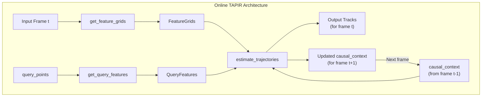

Sources: [tapnet/torch/tapir_model.py:70-89](), [tapnet/live_demo.py:62-77](), [tapnet/pytorch_live_demo.py:62-85]()

## Key Components

Online TAPIR introduces several key modifications to the standard TAPIR architecture:

1.  **Causal Convolutions**: Instead of standard convolutions that can access future frames, Online TAPIR uses causal convolutions that only operate on the current and past frames.
2.  **State Management**: A `causal_context` is maintained between frames to preserve temporal information.
3.  **Sequential Processing**: Frames are processed one at a time, with the model state updated after each frame.

### Causal vs Standard Execution
The following diagram bridges the logical concept of causal processing to the specific `PIPSMLPMixer` implementation.

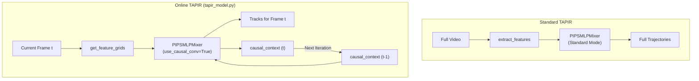

Sources: [tapnet/torch/tapir_model.py:128-132](), [tapnet/torch/nets.py:189-200](), [tapnet/torch/nets.py:234-245]()

## Implementation Details

### Causal Convolutions

The core of Online TAPIR's sequential processing capability comes from replacing standard convolutions with causal convolutions in the temporal dimension. In the PyTorch implementation, this is handled within `PIPsConvBlock`.

When `use_causal_conv` is enabled, the model pads the input features such that the convolution kernel only overlaps with current and past time steps. The hidden states required for the next frame's convolution are stored in the `causal_context`.

Sources: [tapnet/torch/nets.py:110-115](), [tapnet/torch/nets.py:149-178](), [tapnet/torch/tapir_model.py:106-107]()

### Causal State Management

Online TAPIR maintains a causal state between frames, which includes hidden states from previous frames needed for the causal convolutions. The initial state is created using `construct_initial_causal_state`.

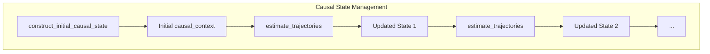

Sources: [tapnet/torch/tapir_model.py:763-772](), [tapnet/pytorch_live_demo.py:143-146]()

### Sequential Tracking Process

The online tracking process involves initializing query features and then updating tracks frame by frame:

1.  **Initialization**:
    *   Extract features from the first frame via `get_feature_grids`.
    *   Initialize `QueryFeatures` for the points to track using `get_query_features`.
    *   Create initial `causal_context` via `construct_initial_causal_state`.
2.  **Sequential Processing**:
    *   For each new frame, call `estimate_trajectories` with `get_causal_context=True`.
    *   The model returns both the predicted tracks and the updated `causal_context`.

Sources: [tapnet/pytorch_live_demo.py:44-85](), [tapnet/torch/tapir_model.py:192-200](), [tapnet/torch/tapir_model.py:763-772]()

## Model Components and Code Structure

The key components of Online TAPIR are implemented across several files:

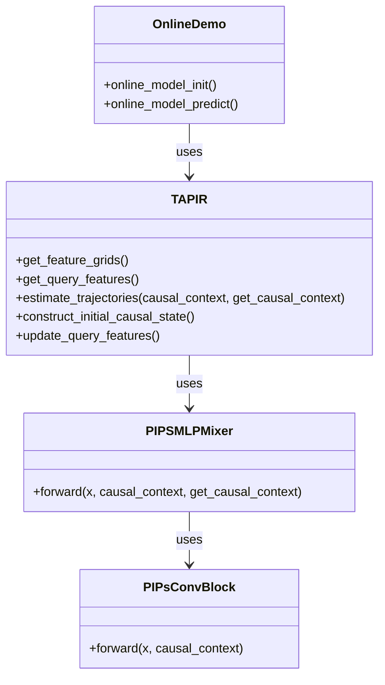

Sources: [tapnet/torch/tapir_model.py:70-132](), [tapnet/torch/nets.py:107-142](), [tapnet/pytorch_live_demo.py:62-85]()

## Usage and API

### Initialization

To use Online TAPIR, you first need to create a model with causal convolutions enabled:

```python
# PyTorch implementation
from tapnet.torch import tapir_model
model = tapir_model.TAPIR(pyramid_level=1, use_casual_conv=True)
model.load_state_dict(torch.load("tapnet/checkpoints/causal_bootstapir_checkpoint.pt"))
```

Sources: [tapnet/pytorch_live_demo.py:110-114](), [tapnet/torch/tapir_model.py:88-89]()

### Query Feature Initialization

Query features are initialized for the points you want to track:

```python
# In tapnet/pytorch_live_demo.py
query_features = online_model_init(
    frames=frame[None, None], 
    points=query_points[None, :]
)

causal_state = model.construct_initial_causal_state(
    NUM_POINTS, len(query_features.resolutions) - 1
)
```

Sources: [tapnet/pytorch_live_demo.py:139-146](), [tapnet/torch/tapir_model.py:763-772]()

### Frame-by-Frame Processing

For each new frame, the model updates the tracks and causal state:

```python
# In tapnet/pytorch_live_demo.py
tracks, visibles, causal_state = online_model_predict(
    frames=frame[None, None],
    features=query_features,
    causal_context=causal_state,
)
```

Sources: [tapnet/pytorch_live_demo.py:202-206](), [tapnet/pytorch_live_demo.py:62-85]()

### Adding New Query Points

Online TAPIR supports dynamic addition of points. The `update_query_features` method allows replacing or adding points to the active tracking set without resetting the entire `causal_context`.

```python
# Update the existing query features with a new point
query_features, causal_state = model.update_query_features(
    query_features=query_features,
    new_query_features=init_query_features,
    idx_to_update=np.array([next_query_idx]),
    causal_state=causal_state,
)
```

Sources: [tapnet/pytorch_live_demo.py:192-197](), [tapnet/torch/tapir_model.py:774-806]()

## Implementation Details

### Causal Context Structure

The `causal_context` is a dictionary where keys correspond to block names and values are the temporal buffers required for causal convolutions.

```python
# Structure of causal_context in tapnet/torch/nets.py
{
    'block_0_causal_1': torch.Tensor, # shape [batch, num_points, kernel_size-1, channels]
    'block_0_causal_2': torch.Tensor,
    ...
}
```

Sources: [tapnet/torch/nets.py:146-168](), [tapnet/torch/tapir_model.py:763-772]()

## Performance and Applications

Online TAPIR is optimized for low-latency streaming. While slightly less accurate than the full-batch TAPIR due to the lack of future context, it is suitable for real-time robotics and UI interaction.

### Live Demo
The repository provides two live demo scripts that use the online model:
*   `tapnet/live_demo.py`: JAX implementation.
*   `tapnet/pytorch_live_demo.py`: PyTorch implementation.

These scripts demonstrate capturing camera frames via OpenCV, performing online inference, and visualizing tracks in real-time.

Sources: [tapnet/live_demo.py:16-25](), [tapnet/pytorch_live_demo.py:16-25](), [tapnet/pytorch_live_demo.py:98-105]()

---

# Page: TAPNext

# TAPNext

<details>
<summary>Relevant source files</summary>

The following files were used as context for generating this wiki page:

- [colabs/tapnext_demo.ipynb](colabs/tapnext_demo.ipynb)
- [colabs/torch_tapnext_demo.ipynb](colabs/torch_tapnext_demo.ipynb)
- [requirements.txt](requirements.txt)
- [tapnet/models/ssm_vit.py](tapnet/models/ssm_vit.py)
- [tapnet/models/video_ssm_tracker.py](tapnet/models/video_ssm_tracker.py)
- [tapnet/tapnext/pscan.py](tapnet/tapnext/pscan.py)
- [tapnet/tapnext/tapnext_benchmark_pytorch.ipynb](tapnet/tapnext/tapnext_benchmark_pytorch.ipynb)
- [tapnet/tapnext/tapnext_lru_modules.py](tapnet/tapnext/tapnext_lru_modules.py)
- [tapnet/tapnext/tapnext_torch.py](tapnet/tapnext/tapnext_torch.py)
- [tapnet/tapnext/tapnext_torch_utils.py](tapnet/tapnext/tapnext_torch_utils.py)
- [tapnet/tapnext/torch_losses.py](tapnet/tapnext/torch_losses.py)

</details>


TAPNext is a point tracking model in the TAP (Tracking Any Point) ecosystem that formulates tracking as a **next token prediction** task. It utilizes a **TRecViT-B** backbone, which combines Vision Transformers (ViT) for spatial modeling with Real-Gated Linear Recurrent Units (RG-LRU) for temporal modeling. Unlike the two-stage refinement process of TAPIR, TAPNext employs a simpler, single-pass sequence prediction framework optimized for high-speed inference and long-term temporal consistency.

For information about the improved variant fine-tuned for 1024-frame sequences, see [TAPNext++](#2.5).

## Architecture Overview

TAPNext architecture bridges the gap between spatial feature extraction and temporal state propagation. It treats video frames and query points as sequences of tokens.

### System Mapping: Conceptual to Code

The following diagram maps the high-level tracking components to their specific implementations in the `tapnext_torch.py` and `tapnext_lru_modules.py` files.

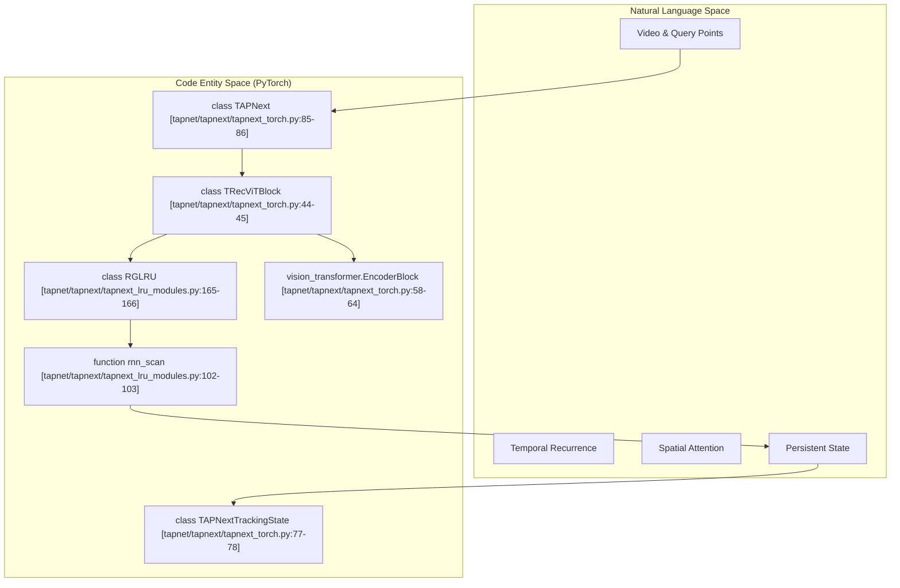
Sources: [tapnet/tapnext/tapnext_torch.py:44-160](), [tapnet/tapnext/tapnext_lru_modules.py:102-226]().

## TRecViT Backbone

The core of TAPNext is the **TRecViTBlock** [tapnet/tapnext/tapnext_torch.py:44-45](). Each block alternates between temporal processing via a State Space Model (SSM) and spatial processing via a Transformer.

### Temporal Modeling: RG-LRU
The temporal component uses a **Real-Gated Linear Recurrent Unit (RG-LRU)** [tapnet/tapnext/tapnext_lru_modules.py:165-166]().
- **Gating Mechanism**: It employs `input_gate` and `a_gate` to control information flow [tapnet/tapnext/tapnext_lru_modules.py:185-198]().
- **Recurrence**: The recurrence is defined as $h_t = a \odot h_{t-1} + \text{gated\_x} \odot \sqrt{1 - a^2}$ [tapnet/tapnext/tapnext_lru_modules.py:210-220]().
- **Parallel Scan**: During training or batch processing, it uses `pscan` (Parallel Scan) to compute the recurrence in $O(\log T)$ time [tapnet/tapnext/tapnext_lru_modules.py:143-145]().

### Spatial Modeling: ViT
After the temporal update, features are rearranged to apply spatial attention using a standard `vision_transformer.EncoderBlock` [tapnet/tapnext/tapnext_torch.py:58-64](). This allows query tokens to attend to image patch tokens within the same frame.

Sources: [tapnet/tapnext/tapnext_torch.py:44-73](), [tapnet/tapnext/tapnext_lru_modules.py:165-226](), [tapnet/tapnext/pscan.py:29-105]().

## Data Flow and Tokenization

TAPNext represents the video as a set of tokens. The sequence length is $(H/8 \times W/8) + Q$, where $Q$ is the number of query points.

1.  **Image Tokenization**: A 2D Convolution `lin_proj` with $8 \times 8$ stride converts frames into patch embeddings [tapnet/tapnext/tapnext_torch.py:104-109]().
2.  **Query Tokenization**: `embed_queries` creates tokens for query points [tapnet/tapnext/tapnext_torch.py:162-163](). It uses `posemb_sincos_2d` to encode the spatial $(x, y)$ location of the query [tapnet/tapnext/tapnext_torch.py:31-41]().
3.  **Token Types**:
    *   **Mask Token**: Used for future frames or frames where the query is not yet active [tapnet/tapnext/tapnext_torch.py:122-124]().
    *   **Unknown Token**: Used for frames before the query point appears [tapnet/tapnext/tapnext_torch.py:125-127]().
    *   **Point Query Token**: The actual representation of the tracked point at its query time [tapnet/tapnext/tapnext_torch.py:128-130]().

### Online Tracking Data Flow
In online mode, the model processes one frame at a time while maintaining a `TAPNextTrackingState` [tapnet/tapnext/tapnext_torch.py:77-83]().

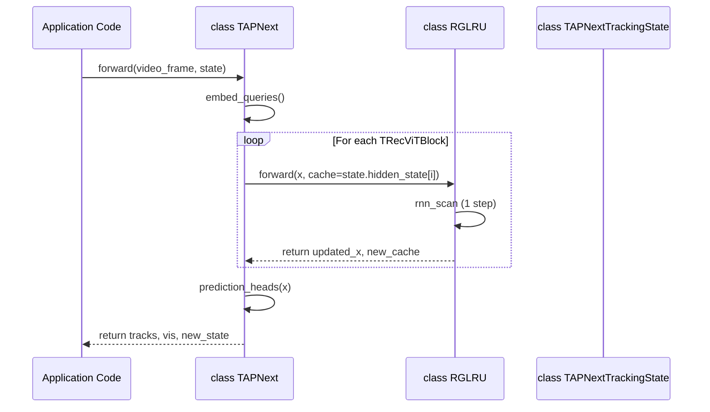
Sources: [tapnet/tapnext/tapnext_torch.py:162-260](), [tapnet/tapnext/tapnext_lru_modules.py:102-145]().

## Prediction Heads and Loss Functions

TAPNext uses two MLP heads for output generation [tapnet/tapnext/tapnext_torch.py:143-160]():

1.  **Coordinate Head**: Predicts $x$ and $y$ coordinates by outputting 512 bins for each axis [tapnet/tapnext/tapnext_torch.py:152-160](). These are converted to sub-pixel coordinates via a **soft argmax** over a window defined by `radius` [tapnet/tapnext/tapnext_torch_utils.py:24-35]().
2.  **Visible Head**: Predicts a single logit representing the probability that the point is visible [tapnet/tapnext/tapnext_torch.py:143-151]().

### Training Objectives
The model is trained using a combination of losses implemented in `torch_losses.py`:
*   **Huber Loss**: Applied to the continuous coordinate predictions [tapnet/tapnext/torch_losses.py:23-52]().
*   **Cross Entropy (Softmax) Loss**: Applied to the 512-bin coordinate logits to improve localization [tapnet/tapnext/torch_losses.py:55-83]().
*   **Binary Cross Entropy**: Applied to the visibility logits [tapnet/tapnext/torch_losses.py:122-124]().

Sources: [tapnet/tapnext/tapnext_torch.py:262-289](), [tapnet/tapnext/torch_losses.py:86-127](), [tapnet/tapnext/tapnext_torch_utils.py:38-57]().

## Checkpoint Compatibility

TAPNext provides utilities to load weights from JAX `.npz` checkpoints into the PyTorch implementation. The function `restore_model_from_jax_checkpoint` maps JAX parameter names (e.g., `backbone/Transformer/encoderblock_0/ssm_block`) to PyTorch `nn.Module` parameters, handling weight transposition where necessary [tapnet/tapnext/tapnext_torch_utils.py:60-205]().

Sources: [tapnet/tapnext/tapnext_torch_utils.py:60-205](), [colabs/torch_tapnext_demo.ipynb:23-24]().

---

# Page: TAPNext++

# TAPNext++

<details>
<summary>Relevant source files</summary>

The following files were used as context for generating this wiki page:

- [colabs/torch_tapnextpp_demo.ipynb](colabs/torch_tapnextpp_demo.ipynb)
- [tapnet/__init__.py](tapnet/__init__.py)
- [tapnet/tapnextpp/README.md](tapnet/tapnextpp/README.md)
- [tapnet/tapnextpp/augmentations/homography.py](tapnet/tapnextpp/augmentations/homography.py)
- [tapnet/tapnextpp/augmentations/homography_visualization.py](tapnet/tapnextpp/augmentations/homography_visualization.py)
- [tapnet/tapnextpp/augmentations/roll.py](tapnet/tapnextpp/augmentations/roll.py)
- [tapnet/tapnextpp/augmentations/roll_visualization.py](tapnet/tapnextpp/augmentations/roll_visualization.py)
- [tapnet/tapnextpp/metrics/aj_rd.py](tapnet/tapnextpp/metrics/aj_rd.py)
- [tapnet/tapnextpp/votsp2026/README.md](tapnet/tapnextpp/votsp2026/README.md)
- [tapnet/tapnextpp/votsp2026/model.py](tapnet/tapnextpp/votsp2026/model.py)
- [tapnet/tapnextpp/votsp2026/tracker.py](tapnet/tapnextpp/votsp2026/tracker.py)
- [tapnet/tapnextpp/votsp2026/trackers.ini](tapnet/tapnextpp/votsp2026/trackers.ini)
- [tapnet/tapnextpp/votsp2026/utils.py](tapnet/tapnextpp/votsp2026/utils.py)

</details>


TAPNext++ is an enhanced version of the TAPNext model, specifically optimized for long-duration point tracking (up to 1024 frames) and improved re-detection capabilities [tapnet/tapnextpp/README.md:1-11](). It introduces specialized augmentations, a new evaluation metric for re-detection, and a high-level wrapper for causal, frame-by-frame inference [tapnet/tapnextpp/votsp2026/model.py:16-17]().

## Overview and Key Improvements

TAPNext++ improves upon the base TAPNext architecture through:
*   **Extended Context:** Fine-tuned on **PointOdyssey v1.2** and **Kubric-1024** using 1024-frame sequences [tapnet/tapnextpp/README.md:9-16]().
*   **Advanced Augmentations:** Introduction of **Roll** and **Homography** augmentations to improve robustness against camera motion and perspective shifts [tapnet/tapnextpp/README.md:48-50]().
*   **Re-Detection Focus:** Introduction of the **$AJ_{RD}$ (Re-Detection Average Jaccard)** metric to specifically measure the ability to recover tracks after occlusion [tapnet/tapnextpp/README.md:10-11]().
*   **High-Resolution Fine-tuning:** Checkpoints available for both 256x256 and 512x512 input resolutions [tapnet/tapnextpp/votsp2026/README.md:9-12]().

## Implementation Details

The implementation provides a high-level wrapper, `TAPNextPP`, which encapsulates the `tapnext_torch.TAPNext` model and handles coordinate transformations between display space and model space [tapnet/tapnextpp/votsp2026/model.py:30-47]().

### Inference Data Flow
The model operates in a strictly causal, online fashion. For each frame, it consumes the current BGR image and the recurrent state from the previous step [tapnet/tapnextpp/votsp2026/README.md:7-8]().

#### TAPNext++ Inference Pipeline
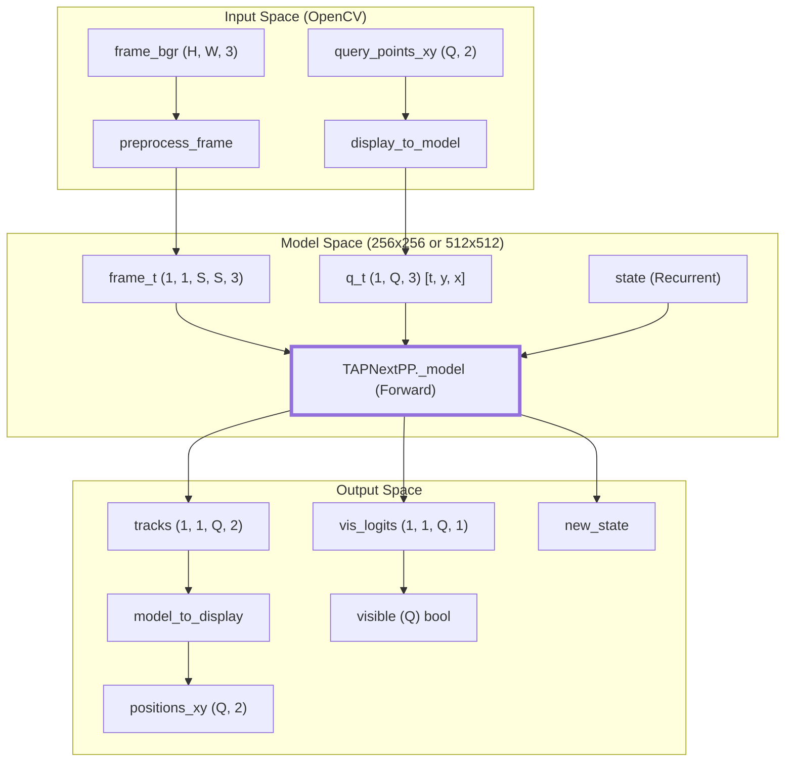
**Sources:** [tapnet/tapnextpp/votsp2026/model.py:116-169](), [tapnet/tapnextpp/votsp2026/utils.py:25-52]()

### Key Classes and Functions

| Entity | Location | Description |
| :--- | :--- | :--- |
| `TAPNextPP` | [tapnet/tapnextpp/votsp2026/model.py:30]() | Main PyTorch wrapper for online inference. |
| `track_frame` | [tapnet/tapnextpp/votsp2026/model.py:116]() | Processes a single frame and updates the recurrent state. |
| `preprocess_frame` | [tapnet/tapnextpp/votsp2026/utils.py:25]() | Resizes and normalizes BGR frames to model-ready tensors. |
| `display_to_model` | [tapnet/tapnextpp/votsp2026/utils.py:55]() | Scales pixel coordinates to the model's internal square resolution. |
| `compute_redetection_metrics` | [tapnet/tapnextpp/metrics/aj_rd.py:46]() | Implements the $AJ_{RD}$ metric calculation. |

**Sources:** [tapnet/tapnextpp/votsp2026/model.py:30-170](), [tapnet/tapnextpp/votsp2026/utils.py:25-100](), [tapnet/tapnextpp/README.md:46]()

## Augmentations

TAPNext++ utilizes two specific augmentations during training to improve temporal consistency and re-detection.

### Roll Augmentation
The `RollAugmentation` mimics camera roll and jitter by applying sinusoidal shifts and rotations to video frames [tapnet/tapnextpp/augmentations/roll.py:22-28]().
*   **Frequency Modeling:** Uses low-frequency and high-frequency sinusoids to generate shifts (`shift_x_arr`, `shift_y_arr`) and angles (`angle_arr`) [tapnet/tapnextpp/augmentations/roll.py:102-136]().
*   **Trajectory Sync:** Automatically adjusts the `trajs_2d` coordinates to match the transformed frames [tapnet/tapnextpp/augmentations/roll.py:151-175]().

### Homography Augmentation
The `HomographyAugmentation` applies projective transformations to mimic complex camera motions [tapnet/tapnextpp/augmentations/homography.py:44-50]().
*   **Corner Perturbation:** Perturbs the four corners of the image using sinusoidal functions [tapnet/tapnextpp/augmentations/homography.py:83-103]().
*   **Safety Margins:** Uses a reflection function (`_reflect`) to ensure corners stay within valid margins, preventing image flipping [tapnet/tapnextpp/augmentations/homography.py:127-137]().

**Sources:** [tapnet/tapnextpp/augmentations/roll.py:22-193](), [tapnet/tapnextpp/augmentations/homography.py:44-153]()

## VOTSp2026 Submission

For the VOTSp2026 competition, TAPNext++ utilizes a **support point** strategy to improve tracking stability [tapnet/tapnextpp/votsp2026/README.md:9-12]().

### Support Point Mechanism
For every query point provided by the challenge, the tracker generates a local grid of **64 support points** within a 32-pixel radius (in model space) [tapnet/tapnextpp/votsp2026/tracker.py:27-31](). These points are:
1.  **Co-tracked:** Processed via the same attention mechanism as the real query point.
2.  **Discarded:** Used only for internal context and never included in the final output files [tapnet/tapnextpp/votsp2026/tracker.py:29-30]().

#### Support Point Generation Logic
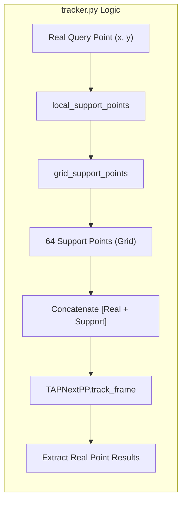
**Sources:** [tapnet/tapnextpp/votsp2026/tracker.py:96-129](), [tapnet/tapnextpp/votsp2026/tracker.py:201-220]()

## Evaluation Metrics: $AJ_{RD}$

The **Re-Detection Average Jaccard ($AJ_{RD}$)** is a key metric introduced for TAPNext++. It focuses on the model's ability to re-acquire a point after it has been occluded for a significant period.

| Dataset | Metric | Value |
| :--- | :--- | :--- |
| **PointOdyssey** | $AJ_{RD}$ | 23.3 |
| **RoboTAP** | $AJ_{RD}$ | 52.6 |

**Sources:** [tapnet/tapnextpp/README.md:18-34](), [tapnet/tapnextpp/metrics/aj_rd.py:46]()

---

# Page: TAP-Net

# TAP-Net

<details>
<summary>Relevant source files</summary>

The following files were used as context for generating this wiki page:

- [README.md](README.md)
- [configs/tapnet_config.py](configs/tapnet_config.py)
- [tapnet/models/resnet.py](tapnet/models/resnet.py)
- [tapnet/models/tapnet_model.py](tapnet/models/tapnet_model.py)
- [tapnet/models/tsm_utils.py](tapnet/models/tsm_utils.py)

</details>


## Purpose and Scope

This page documents the **TAP-Net** model, the baseline architecture introduced in the original TAP-Vid paper. It employs a **TSM-ResNet18** backbone for temporal-aware feature extraction and a **cost-volume regression** head to predict point trajectories and occlusion states. TAP-Net serves as the technical foundation for subsequent models in the repository, including [TAPIR](2.1) and [TAPNext](2.4).

Sources:
- [tapnet/models/tapnet_model.py:16-17]()
- [configs/tapnet_config.py:16-16]()
- [README.md:10-15]()

## Architecture and Implementation

TAP-Net is implemented as a Haiku module (`TAPNet`) that processes video sequences to produce coordinate tracks and occlusion logits.

### Model Components Diagram
The following diagram maps the logical components of TAP-Net to their specific implementations in the `tapnet/models` directory.

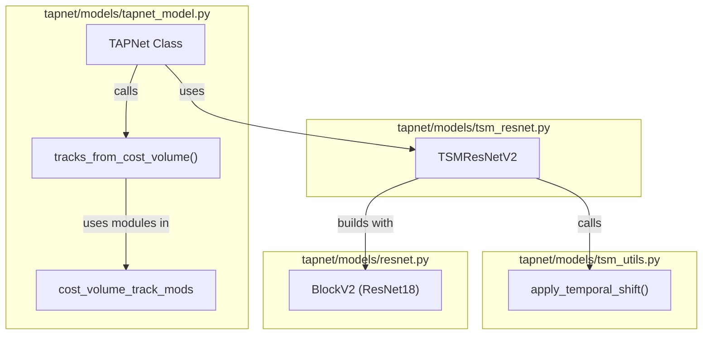

Sources:
- [tapnet/models/tapnet_model.py:44-109]()
- [tapnet/models/tsm_resnet.py:24-30]()
- [tapnet/models/tsm_utils.py:78-83]()

### Feature Extraction: TSM-ResNet18
The backbone is a **Temporal Shift Module (TSM)** ResNet. Unlike standard 2D ResNets, TSM enables temporal modeling by shifting a fraction of channels along the time dimension between frames without adding 3D convolution parameters.

*   **Backbone**: `tsm_resnet.TSMResNetV2` [tapnet/models/tapnet_model.py:70-77]().
*   **Shift Mechanism**: Implemented in `apply_temporal_shift` [tapnet/models/tsm_utils.py:78-95](), which supports both GPU-style (reshape-based) and TPU-optimized (mask-and-sum) shifting.
*   **Channel Shift**: Defaults to 12.5% (`0.125`) of channels shifted forward and 12.5% backward [tapnet/models/tapnet_model.py:75-75]().
*   **Stride**: Defaults to a feature grid stride of 8 [tapnet/models/tapnet_model.py:49-49]().

### Cost Volume and Regression
Tracking is formulated as a similarity search between a query feature and the feature grid of every frame in the video.

1.  **Feature Sampling**: Query features are extracted from the `feature_grid` using bilinear interpolation at the `query_points` coordinates via `model_utils.extract_interp_features` [tapnet/models/tapnet_model.py:218-223]().
2.  **Cost Volume**: Computed using `jnp.einsum` between query features and the full feature grid [tapnet/models/tapnet_model.py:145-149]().
3.  **Regression Head**: A series of 3D and Linear layers process the cost volume to produce:
    *   **Points**: Converted from heatmaps via `model_utils.heatmaps_to_points` [tapnet/models/tapnet_model.py:159-161]().
    *   **Occlusion**: Logits where higher values indicate the point is occluded [tapnet/models/tapnet_model.py:163-171]().

Sources:
- [tapnet/models/tapnet_model.py:111-171]()
- [tapnet/models/tsm_utils.py:114-146]()

## Data Flow

The `__call__` method of `TAPNet` manages the execution pipeline from raw video to tracked coordinates.

```mermaid
flowchart LR
    Video["video [B, T, H, W, 3]"] --> TSM["TSMResNetV2"]
    TSM --> FGrid["feature_grid [B, T, h, w, C]"]
    
    Query["query_points [B, N, 3]"] --> Sample["extract_interp_features"]
    FGrid --> Sample
    Sample --> QFeat["interp_feature_heads"]
    
    QFeat --> CV["Cost Volume Computation"]
    FGrid --> CV
    
    CV --> Reg["cost_volume_track_mods"]
    Reg --> Tracks["tracks [B, N, T, 2]"]
    Reg --> Occ["occlusion [B, N, T]"]
```

Sources:
- [tapnet/models/tapnet_model.py:173-238]()
- [tapnet/models/tapnet_model.py:143-171]()

## Configuration and Training

The model is configured via `configs/tapnet_config.py`. It is designed to be trained using the **Jaxline** framework on synthetic datasets like **Kubric**.

### Training Hyperparameters
| Parameter | Value | Code Pointer |
| :--- | :--- | :--- |
| **Backbone** | TSM-ResNet18 | [tapnet/models/tapnet_model.py:70]() |
| **Optimizer** | Adam (b1=0.9, b2=0.95) | [configs/tapnet_config.py:63-69]() |
| **Learning Rate** | 2e-3 (Cosine Decay) | [configs/tapnet_config.py:54-57]() |
| **Weight Decay** | 1e-2 | [configs/tapnet_config.py:56-56]() |
| **Training Steps** | 100,000 | [configs/tapnet_config.py:29-29]() |
| **Input Resolution**| 256 x 256 | [configs/tapnet_config.py:83-83]() |
| **Prediction Algo** | `cost_volume_regressor` | [configs/tapnet_config.py:87-87]() |

Sources:
- [configs/tapnet_config.py:24-116]()

## Evaluation Metrics

TAP-Net evaluation is integrated into the `jaxline` experiment loop, supporting multiple datasets:
*   **DAVIS** (`eval_davis_points`)
*   **JHMDB** (`eval_jhmdb`)
*   **Kinetics** (`eval_kinetics_points`)
*   **RoboTAP** (`eval_robotics_points`)

The baseline performance targets the **Average Jaccard (AJ)** metric, which measures the precision of the predicted tracks relative to ground truth, accounting for occlusion.

Sources:
- [configs/tapnet_config.py:35-41]()
- [README.md:144-150]()

## Comparison with Successors

While TAP-Net introduced the cost-volume approach, it lacks the iterative refinement found in **TAPIR**. TAPIR replaces the TSM backbone with a standard ResNet and adds a second stage that uses local correlations to refine the trajectory and query features, leading to significant performance gains (e.g., ~33% AJ for TAP-Net vs ~58% AJ for TAPIR on DAVIS).

Sources:
- [README.md:10-15]()
- [README.md:144-150]()

---

# Page: TRAJAN

# TRAJAN

<details>
<summary>Relevant source files</summary>

The following files were used as context for generating this wiki page:

- [colabs/trajan_demo.ipynb](colabs/trajan_demo.ipynb)
- [tapnet/trajan/__init__.py](tapnet/trajan/__init__.py)
- [tapnet/trajan/attention.py](tapnet/trajan/attention.py)
- [tapnet/trajan/track_autoencoder.py](tapnet/trajan/track_autoencoder.py)

</details>


TRAJAN (Point Trajectory Autoencoder) is a model designed to reconstruct held-out point trajectories conditioned on a set of support points. In the context of the TAP repository, it is primarily used as a direct motion model for assessing the realism and consistency of generated videos by evaluating how well the model can predict the motion of unseen points given a sparse set of observations.

Sources: [colabs/trajan_demo.ipynb:31-31](), [tapnet/trajan/track_autoencoder.py:16-16]()

## Overview and Purpose

The TRAJAN architecture formulates motion modeling as an autoencoding task where:
1.  **Support Tracks**: A set of known point trajectories (x, y coordinates and visibility) are provided as input.
2.  **Latent Representation**: The encoder compresses these tracks into a set of latent tokens.
3.  **Query Reconstruction**: The decoder reconstructs the full trajectory of specific query points, conditioned on the latent representation and the query point's initial location.

This model is particularly useful for evaluating whether a video generator produces motion that follows physical constraints and temporal consistency observed in real-world data.

Sources: [tapnet/trajan/track_autoencoder.py:71-85](), [tapnet/trajan/track_autoencoder.py:132-135]()

## System Architecture

The model is implemented in JAX/Flax and relies heavily on a custom transformer architecture.

### Code Entity Map: Trajectory Processing

The following diagram illustrates how the code entities in `track_autoencoder.py` map to the logical stages of trajectory encoding and decoding.

```mermaid
graph TD
    subgraph "Input Space"
        A["Support Tracks (B, Q, T, 2)"]
        B["Visibility (B, Q, T, 1)"]
        C["Query Points (B, Q, 3)"]
    end

    subgraph "track_autoencoder.py Entities"
        D["SinusoidalEmbedding"]
        E["embed_track_pos_visible()"]
        F["TrackAutoEncoder.encoder"]
        G["TrackAutoEncoder.decoder"]
        H["ImprovedTransformer"]
    end

    A --> E
    B --> E
    E --> D
    E --> F
    F --> H
    H --> G
    C --> G
    G --> I["TrackAutoEncoderResults"]
```
Sources: [tapnet/trajan/track_autoencoder.py:33-53](), [tapnet/trajan/track_autoencoder.py:132-189](), [tapnet/trajan/track_autoencoder.py:200-213]()

### Implementation Details

#### 1. Sinusoidal Embedding
Trajectories and point identities are projected into a high-dimensional space using `SinusoidalEmbedding` [tapnet/trajan/track_autoencoder.py:33-54](). This class creates Fourier features by concatenating sine and cosine transformations of the input coordinates scaled by various frequencies [tapnet/trajan/track_autoencoder.py:43-51]().

#### 2. The Encoder
The encoder transforms input tracks into latent tokens through several stages:
*   **Track Embedding**: `embed_track_pos_visible` combines track coordinates and visibility flags into a single embedding [tapnet/trajan/track_autoencoder.py:200-213]().
*   **Track Transformation**: The `input_track_transformer` (an `ImprovedTransformer` instance) processes the embeddings [tapnet/trajan/track_autoencoder.py:163-168]().
*   **Latent Compression**: The `tracks_to_latents` transformer reduces the information into a fixed number of latent tokens (`num_latent_tokens`) [tapnet/trajan/track_autoencoder.py:169-174]().

#### 3. The Decoder
The decoder reconstructs the trajectories for `query_points` [tapnet/trajan/track_autoencoder.py:83-83]():
*   **Identity Encoding**: `encode_point_identities` embeds the query point locations [tapnet/trajan/track_autoencoder.py:190-199]().
*   **Cross-Attention**: The `track_readout_attn` uses cross-attention between the query embeddings and the latent tokens to retrieve relevant motion information [tapnet/trajan/track_autoencoder.py:181-186]().
*   **Prediction**: A final `Dense` layer (`track_predictor`) outputs the coordinates and visibility/certainty logits [tapnet/trajan/track_autoencoder.py:188-188]().

### Attention Mechanism
TRAJAN uses a specialized `ImprovedTransformer` which implements features from ViT-22B:
*   **Normalization**: Uses `RMSNorm` for keys and queries before the dot-product [tapnet/trajan/attention.py:188-189]().
*   **Parallel Operations**: Self-attention and cross-attention are computed and summed before the MLP stage [tapnet/trajan/attention.py:99-119]().

```mermaid
graph TD
    subgraph "ImprovedTransformerBlock"
        In["Input Queries"]
        LN1["LayerNorm (norm_q)"]
        SA["ImprovedMHDPAttention (Self)"]
        CA["ImprovedMHDPAttention (Cross)"]
        Add1["Add & Resid"]
        LN2["LayerNorm (norm_attn)"]
        MLP["MLP (Dense + GELU)"]
        Out["Output"]
    end

    In --> LN1
    LN1 --> SA
    LN1 --> CA
    In --> Add1
    SA --> Add1
    CA --> Add1
    Add1 --> LN2
    LN2 --> MLP
    Add1 --> Out
    MLP --> Out
```
Sources: [tapnet/trajan/attention.py:72-126](), [tapnet/trajan/attention.py:129-207]()

## Data Flow and Output

The model returns a `TrackAutoEncoderResults` dataclass containing:
*   `tracks`: Predicted (x, y) locations over time [tapnet/trajan/track_autoencoder.py:101-101]().
*   `visible_logits`: Raw visibility predictions [tapnet/trajan/track_autoencoder.py:103-103]().
*   `certain_logits`: Raw certainty predictions [tapnet/trajan/track_autoencoder.py:105-105]().

The class provides properties to convert these logits into hard masks (`visible`, `certain`) or a combined `visible_and_certain` flag [tapnet/trajan/track_autoencoder.py:108-120]().

Sources: [tapnet/trajan/track_autoencoder.py:87-121]()

## Usage in Demos

In the provided Colab demo, TRAJAN is typically used alongside a tracking model like TAPIR. TAPIR extracts initial trajectories from a video, which are then passed to the `TrackAutoEncoder` to verify motion consistency or reconstruct missing segments.

Key functions for inference:
*   `TrackAutoEncoder.__call__`: The main entry point for the Flax module [tapnet/trajan/track_autoencoder.py:238-278]().
*   `TrackAutoEncoder.encode`: Specifically runs the encoding path to generate latents [tapnet/trajan/track_autoencoder.py:280-302]().

Sources: [colabs/trajan_demo.ipynb:136-136](), [tapnet/trajan/track_autoencoder.py:238-302]()

---

# Page: Benchmarks and Datasets

# Benchmarks and Datasets

<details>
<summary>Relevant source files</summary>

The following files were used as context for generating this wiki page:

- [README.md](README.md)
- [configs/tapnet_config.py](configs/tapnet_config.py)
- [tapnet/tapvid/README.md](tapnet/tapvid/README.md)
- [tapnet/tapvid/evaluation_datasets.py](tapnet/tapvid/evaluation_datasets.py)
- [tapnet/tapvid/requirements.txt](tapnet/tapvid/requirements.txt)
- [tapnet/tapvid3d/LICENSE](tapnet/tapvid3d/LICENSE)
- [tapnet/training/README.md](tapnet/training/README.md)

</details>


This page provides a high-level overview of the benchmarks and datasets used for training and evaluating point tracking algorithms in the TAP repository. These benchmarks test the ability of models to track arbitrary points on solid physical surfaces across video frames in 2D, 3D, and robotics contexts.

## Overview of Benchmarks

The TAP repository supports three primary benchmarks for evaluating point tracking capabilities, each targeting different spatial and task requirements.

### Benchmark Data Hierarchy

```mermaid
flowchart TD
    subgraph "TAP Benchmarks"
        tapvid["TAP-Vid\n2D Point Tracking"]
        robotap["RoboTAP\nRobotics Manipulation"]
        tapvid3d["TAPVid-3D\n3D Metric Tracking"]
    end
    
    tapvid --> davis["DAVIS Val Set\n(30 real videos)"]
    tapvid --> kinetics["Kinetics Val Set\n(1000 real videos)"]
    tapvid --> rgb_stacking["RGB-Stacking\n(50 synthetic videos)"]
    tapvid --> kubric["Kubric\n(Synthetic training)"]
    
    robotap --> robotap_data["RoboTAP Data\n(265 real videos)"]
    
    tapvid3d --> adt["Aria Digital Twin\n(ADT)"]
    tapvid3d --> waymo["Waymo/DriveTrack"]
    tapvid3d --> pstudio["Panoptic Studio"]
```
Sources: [README.md:9-15](), [tapnet/tapvid/README.md:7-9](), [tapnet/tapvid/README.md:77-81]()

### System Evaluation Flow

This diagram bridges the conceptual evaluation flow to the code entities responsible for processing and measuring performance.

```mermaid
flowchart LR
    subgraph "Data Loading"
        reader["evaluation_datasets.py\n(Readers)"]
    end
    
    subgraph "Model Inference"
        model["TAPNet/TAPIR/TAPNext\n(forward pass)"]
    end
    
    subgraph "Metrics Computation"
        calc["compute_tapvid_metrics"]
        calc3d["compute_tapvid_3d_metrics"]
    end

    reader -- "query_points, gt_tracks" --> model
    model -- "pred_tracks, pred_occluded" --> calc
    model -- "predicted_tracks_3d" --> calc3d
```
Sources: [tapnet/tapvid/evaluation_datasets.py:48-56](), [tapnet/tapvid/README.md:13-31]()

## TAP-Vid

TAP-Vid is the core 2D benchmark for "Tracking Any Point." It evaluates tracking on deformable surfaces, long-term sequences, and class-agnostic objects [tapnet/tapvid/README.md:5-9]().

*   **Datasets**: Includes DAVIS (real), Kinetics (real), and RGB-Stacking (synthetic) [tapnet/tapvid/README.md:7-8]().
*   **Training**: Models are primarily trained on the synthetic **Kubric** dataset [tapnet/tapvid/README.md:7-9]().
*   **Evaluation Modes**: Supports `first` (querying the first visible point) and `strided` (querying multiple times per trajectory) [tapnet/tapvid/evaluation_datasets.py:112-120]().
*   **Key Metrics**: Average Jaccard (AJ), Occlusion Accuracy (OA), and Points Within Threshold [tapnet/tapvid/evaluation_datasets.py:97-105]().

For detailed data formats, downloading instructions, and reader implementation, see **[TAP-Vid](#3.1)**.

## RoboTAP

RoboTAP is a dataset and system focused on utilizing point tracks for robotics manipulation tasks through few-shot imitation [README.md:12-12]().

*   **Content**: 265 real-world robotics manipulation videos with manual annotations [tapnet/tapvid/README.md:79-81]().
*   **Format**: Follows the same pickle-based annotation format as TAP-Vid (frames, points, occlusions) [tapnet/tapvid/README.md:79-84]().
*   **Applications**: Used for motion clustering to segment objects and visual imitation learning [README.md:24-24]().

For details on the robotics-specific annotations and clustering utilities, see **[RoboTAP](#3.2)**.

## TAPVid-3D

TAPVid-3D extends tracking into 3D metric space, featuring over 1 million trajectories on 4,000+ real-world videos [README.md:14-14]().

*   **Data Sources**: Derived from Aria Digital Twin (ADT), Waymo Open Dataset (DriveTrack), and Panoptic Studio [tapnet/tapvid3d/README.md:10-17]().
*   **Data Format**: Stored as `.npz` files containing `images_jpeg_bytes`, `intrinsics`, `extrinsics_w2c`, and `tracks_xyz` [tapnet/tapvid3d/README.md:86-113]().
*   **Metrics**: Introduces 3D-specific metrics including **3D-AJ** (3D Average Jaccard) and **APD** (Average Position Discrepancy) [tapnet/tapvid3d/README.md:27-35]().

For the 3D annotation generation pipeline and metric definitions, see **[TAPVid-3D](#3.3)**.

## Benchmark Summary Table

| Benchmark | Dimension | Primary Metrics | Key Dataset Subsets |
| :--- | :--- | :--- | :--- |
| **TAP-Vid** | 2D | AJ, OA, Pts @ Threshold | DAVIS, Kinetics, Kubric |
| **RoboTAP** | 2D | AJ, OA | Robotics Manipulation |
| **TAPVid-3D** | 3D | 3D-AJ, APD, OA | ADT, DriveTrack, PStudio |

Sources: [tapnet/tapvid/evaluation_datasets.py:97-105](), [tapnet/tapvid3d/README.md:27-35](), [configs/tapnet_config.py:36-41]()

---

# Page: TAP-Vid

# TAP-Vid

<details>
<summary>Relevant source files</summary>

The following files were used as context for generating this wiki page:

- [colabs/optical_flow_track_assist.ipynb](colabs/optical_flow_track_assist.ipynb)
- [tapnet/tapvid/README.md](tapnet/tapvid/README.md)
- [tapnet/tapvid/__init__.py](tapnet/tapvid/__init__.py)
- [tapnet/tapvid/evaluation_datasets.py](tapnet/tapvid/evaluation_datasets.py)
- [tapnet/tapvid/generate_tapvid.py](tapnet/tapvid/generate_tapvid.py)
- [tapnet/tapvid/requirements.txt](tapnet/tapvid/requirements.txt)
- [tapnet/tapvid/visualize.py](tapnet/tapvid/visualize.py)
- [tapnet/tapvid3d/LICENSE](tapnet/tapvid3d/LICENSE)
- [tapnet/training/README.md](tapnet/training/README.md)
- [tapnet/training/task.py](tapnet/training/task.py)
- [tapnet/utils/__init__.py](tapnet/utils/__init__.py)

</details>


## Purpose and Scope

TAP-Vid is a benchmark dataset and evaluation suite for the task of Tracking Any Point (TAP) in a video. Unlike traditional object tracking which focuses on bounding boxes or segments, TAP-Vid requires tracking specific physical points on any solid surface with pixel-level precision. The benchmark evaluates three key capabilities:
1.  **Coordinate Prediction**: Determining the $(x, y)$ location of a point if it is visible.
2.  **Occlusion Prediction**: Determining whether the point is currently visible or occluded.
3.  **Long-term Consistency**: Maintaining the track across the entire video duration, potentially through deformations and long-term occlusions.

Sources: [tapnet/tapvid/README.md:1-10](), [tapnet/tapvid/evaluation_datasets.py:57-67]()

## Dataset Subsets

The benchmark incorporates four distinct data sources to provide a comprehensive evaluation across real-world and synthetic scenarios:

| Subset | Scale | Type | Source / Annotation |
| :--- | :--- | :--- | :--- |
| **DAVIS** | 30 videos | Real-world | Manually annotated with optical flow assistance. [tapnet/tapvid/README.md:7-7]() |
| **Kinetics** | 1000 videos | Real-world | Manually annotated validation clips from Kinetics-700-2020. [tapnet/tapvid/README.md:7-7](), [tapnet/tapvid/generate_tapvid.py:45-48]() |
| **RGB-Stacking** | 50 videos | Synthetic | DeepMind Robotics simulation with perfect ground truth. [tapnet/tapvid/README.md:7-7]() |
| **Kubric** | Infinite | Synthetic | Large-scale training data with full physical ground truth. [tapnet/tapvid/README.md:7-7]() |

### Data Format
Data is typically stored in `.pkl` (pickle) files. For DAVIS and RGB-Stacking, the format is a dictionary or list where each entry contains:
*   `video`: A 4D `uint8` tensor `[frames, height, width, 3]`. [tapnet/tapvid/README.md:54-57]()
*   `points`: A 3D `float32` tensor `[num_points, num_frames, 2]` containing normalized $(x, y)$ coordinates. [tapnet/tapvid/README.md:54-57]()
*   `occluded`: A 2D `bool` tensor `[num_points, num_frames]` where `True` indicates occlusion. [tapnet/tapvid/README.md:54-57]()

Sources: [tapnet/tapvid/README.md:54-57](), [tapnet/tapvid/generate_tapvid.py:158-199]()

## Evaluation Methodology

### Query Modes
The benchmark supports two modes for selecting the "query" (the starting point provided to the algorithm):
1.  **First Mode (`first`)**: The algorithm is given the first frame where a point is visible. It must track the point for all subsequent frames. Frames before the query are ignored in evaluation. [tapnet/tapvid/evaluation_datasets.py:85-88](), [tapnet/tapvid/evaluation_datasets.py:112-114]()
2.  **Strided Mode (`strided`)**: Each trajectory is queried multiple times at a fixed stride. The algorithm must track the point both forward and backward in time for all frames except the query frame itself. [tapnet/tapvid/evaluation_datasets.py:85-88](), [tapnet/tapvid/evaluation_datasets.py:115-117]()

### Key Metrics
Metrics are computed using `compute_tapvid_metrics` in `evaluation_datasets.py` [tapnet/tapvid/evaluation_datasets.py:48-56]().

*   **Average Jaccard (AJ)**: The primary metric. It combines coordinate precision and occlusion accuracy. A point is a "True Positive" if it is predicted as visible, is ground-truth visible, and the distance is within a threshold $\delta$. [tapnet/tapvid/evaluation_datasets.py:101-104](), [tapnet/tapvid/evaluation_datasets.py:162-180]()
*   **Occlusion Accuracy (OA)**: Simple accuracy of the binary occlusion prediction. [tapnet/tapvid/evaluation_datasets.py:97-97](), [tapnet/tapvid/evaluation_datasets.py:127-131]()
*   **Points Within Threshold (PTS)**: The fraction of visible points predicted within a pixel threshold (evaluated at 1, 2, 4, 8, and 16 pixels). [tapnet/tapvid/evaluation_datasets.py:98-100](), [tapnet/tapvid/evaluation_datasets.py:148-160]()

Sources: [tapnet/tapvid/evaluation_datasets.py:48-181](), [tapnet/tapvid/README.md:27-30]()

## Implementation Details

### Data Flow and Evaluation Logic
The following diagram bridges the logical benchmark concepts to the specific Python entities in `evaluation_datasets.py`.

**Benchmark to Code Mapping**
```mermaid
graph TD
    subgraph "Logic Space"
        Input["Video + Query Points"]
        EvalMode["Query Mode (First/Strided)"]
        Preds["Model Predictions"]
    end

    subgraph "Code Entity Space (evaluation_datasets.py)"
        Loader["Reader Functions (e.g., create_davis_dataset)"]
        Sampler["sample_queries_first() / sample_queries_strided()"]
        MetricsFunc["compute_tapvid_metrics()"]
    end

    Input --> Loader
    Loader --> Sampler
    EvalMode --> Sampler
    Sampler --> MetricsFunc
    Preds --> MetricsFunc
```
Sources: [tapnet/tapvid/evaluation_datasets.py:48-56](), [tapnet/tapvid/evaluation_datasets.py:490-502](), [tapnet/tapvid/evaluation_datasets.py:535-548]()

### Metric Computation Flow
The `compute_tapvid_metrics` function processes batches of trajectories.

**Metric Calculation Sequence**
```mermaid
flowchart TD
    Start["compute_tapvid_metrics()"] --> Mask["Generate evaluation_points mask based on query_mode"]
    Mask --> OccAcc["Calculate occlusion_accuracy"]
    OccAcc --> Loop["Loop through thresholds [1, 2, 4, 8, 16]"]
    Loop --> Dist["Compute squared distance (pred_tracks vs gt_tracks)"]
    Dist --> PCK["Calculate pts_within_threshold"]
    PCK --> Jaccard["Calculate jaccard (TP / (GT_Pos + FP))"]
    Jaccard --> Final["Average across thresholds for AJ and Average PTS"]
```
Sources: [tapnet/tapvid/evaluation_datasets.py:111-124](), [tapnet/tapvid/evaluation_datasets.py:139-181]()

## Dataset Preparation

### Kinetics Generation
Since Kinetics videos are large, the repository provides `generate_tapvid.py` to process raw MP4 clips into the evaluation format.
1.  **CSV Parsing**: `csv_to_dataset` reads YouTube IDs and timestamps. [tapnet/tapvid/generate_tapvid.py:75-123]()
2.  **Frame Extraction**: `extract_frames` uses `ffmpeg` to pull JPEGs at 25 FPS. [tapnet/tapvid/generate_tapvid.py:145-155]()
3.  **Coordinate Scaling**: Coordinates are converted from absolute pixels to normalized $[0, 1]$ range in `generate_example`. [tapnet/tapvid/generate_tapvid.py:185-197]()

Sources: [tapnet/tapvid/generate_tapvid.py:75-200](), [tapnet/tapvid/README.md:58-76]()

### Reader Utilities
`evaluation_datasets.py` contains several `create_*_dataset` functions that yield `DatasetElement` objects. These readers handle:
*   **Resizing**: Resizing videos to 256x256 via `resize_video`. [tapnet/tapvid/evaluation_datasets.py:41-45]()
*   **Query Sampling**: Applying `sample_queries_first` or `sample_queries_strided` to the ground truth tracks. [tapnet/tapvid/evaluation_datasets.py:490-533](), [tapnet/tapvid/evaluation_datasets.py:535-608]()

Sources: [tapnet/tapvid/evaluation_datasets.py:41-45](), [tapnet/tapvid/evaluation_datasets.py:490-608]()

---

# Page: RoboTAP

# RoboTAP

<details>
<summary>Relevant source files</summary>

The following files were used as context for generating this wiki page:

- [colabs/tapir_clustering.ipynb](colabs/tapir_clustering.ipynb)
- [colabs/tapir_rainbow_demo.ipynb](colabs/tapir_rainbow_demo.ipynb)
- [tapnet/robotap/tapir_clustering.py](tapnet/robotap/tapir_clustering.py)
- [tapnet/tapvid/README.md](tapnet/tapvid/README.md)
- [tapnet/tapvid/requirements.txt](tapnet/tapvid/requirements.txt)
- [tapnet/tapvid3d/LICENSE](tapnet/tapvid3d/LICENSE)
- [tapnet/training/README.md](tapnet/training/README.md)

</details>


RoboTAP is a system that utilizes TAPIR point tracks to execute robotics manipulation tasks through efficient imitation in the real world. It includes a dataset with ground-truth points annotated on real robotics manipulation videos and a motion-based clustering algorithm for object segmentation.

## RoboTAP Dataset

The RoboTAP dataset extends the TAP-Vid benchmark, providing real-world robotics manipulation videos with manually annotated point trajectories [tapnet/tapvid/README.md:77-79](). Unlike TAP-Vid-RGB-Stacking, which contains synthetic robotics videos, RoboTAP consists of real manipulation scenarios [tapnet/tapvid/README.md:7-8]().

The dataset includes 265 videos for evaluation purposes only [tapnet/tapvid/README.md:81-81](). It follows the same annotation format as TAP-Vid-DAVIS [tapnet/tapvid/README.md:79-80]():
- **Frames**: 4D uint8 tensor `[T, H, W, 3]`.
- **Points**: float32 tensor with 3 axes `[N, T, 2]` (point ID, time, and x/y coordinates).
- **Occlusions**: boolean tensor with 2 axes `[N, T]` (point ID, time).

### Dataset Access
The data is contained in pickle files available for download:
- **RoboTAP**: [https://storage.googleapis.com/dm-tapnet/robotap/robotap.zip](https://storage.googleapis.com/dm-tapnet/robotap/robotap.zip) [tapnet/tapvid/README.md:79-79]().

Sources: [tapnet/tapvid/README.md:7-8](), [tapnet/tapvid/README.md:77-84]()

## Point Track Clustering

RoboTAP uses a clustering functionality to segment objects based on independent motion patterns. This allows a robot to identify coherent objects in a scene by observing how points move relative to each other over time [tapnet/robotap/tapir_clustering.py:16-16]().

### Clustering Logic Space to Code Entity Space

The following diagram maps the logical steps of motion-based clustering to the specific functions in `tapnet/robotap/tapir_clustering.py`.

```mermaid
flowchart TD
    subgraph "Logic: Motion Modeling"
        Proj["Project 3D to 2D"]
        Mat["Generate Orthonormal Matrix"]
    end

    subgraph "Logic: Optimization Loop"
        Loss["Compute Motion Loss"]
        Step["Update Parameters"]
    end

    subgraph "Code: tapir_clustering.py"
        direction TB
        F1["project()"]
        F2["make_projection_matrix()"]
        F3["loss_fn()"]
        F4["update()"]
        F5["compute_clusters()"]
    end

    Proj -.-> F1
    Mat -.-> F2
    Loss -.-> F3
    Step -.-> F4
    F5 -- "Calls" --> F4
    F4 -- "Calls" --> F3
    F3 -- "Calls" --> F1
    F1 -- "Uses" --> F2
```
Sources: [tapnet/robotap/tapir_clustering.py:42-91](), [tapnet/robotap/tapir_clustering.py:94-110](), [tapnet/robotap/tapir_clustering.py:406-445](), [tapnet/robotap/tapir_clustering.py:448-472](), [tapnet/robotap/tapir_clustering.py:500-505]()

### Implementation Details

The core algorithm is implemented in `compute_clusters` [tapnet/robotap/tapir_clustering.py:500-505](). It fits projective motion models to point tracks, modeling 3D motion and its projection into 2D space.

Key features include:
*   **Recursive Splitting**: The algorithm optimizes candidate clusters to either split (creating new clusters) or delete based on error minimization [tapnet/robotap/tapir_clustering.py:688-755]().
*   **Gram-Schmidt Orthonormalization**: The `make_projection_matrix` function uses Gram-Schmidt to ensure the 3x3 rotation component of the projection matrix remains orthonormal [tapnet/robotap/tapir_clustering.py:46-90]().
*   **Projection with Depth Penalties**: The `project` function handles 3D to 2D conversion while penalizing depth values that fall out of a reasonable range (0.5 to 2.0) [tapnet/robotap/tapir_clustering.py:94-109]().

### Configuration Parameters
The `compute_clusters` function accepts parameters to tune the segmentation:

| Parameter | Description | File Reference |
| :--- | :--- | :--- |
| `max_num_cats` | Maximum clusters allowed before merging/deletion. | [tapnet/robotap/tapir_clustering.py:503]() |
| `final_num_cats` | The target number of motion segments. | [tapnet/robotap/tapir_clustering.py:504]() |
| `fourdof` | If True, restricts motion to 4 degrees of freedom. | [tapnet/robotap/tapir_clustering.py:506]() |
| `cam_focal_length` | Focal length used for the projection model. | [tapnet/robotap/tapir_clustering.py:507]() |

Sources: [tapnet/robotap/tapir_clustering.py:42-110](), [tapnet/robotap/tapir_clustering.py:500-515](), [tapnet/robotap/tapir_clustering.py:688-755]()

## Multi-point Tracking Pipeline

Before clustering, RoboTAP must generate dense tracks. The `track_many_points` function serves as the entry point for large-scale tracking across multiple episodes [tapnet/robotap/tapir_clustering.py:1023-1030]().

### Data Flow for Dense Tracking

This diagram illustrates how video data flows through TAPIR models to produce the input for clustering.

```mermaid
flowchart LR
    subgraph "Input Data"
        Vids["demo_videos\n(Dict of episodes)"]
    end

    subgraph "tapir_clustering.py"
        TMP["track_many_points()"]
        BM["build_models()"]
        PF["preprocess_frames()"]
        PV["predictions_to_tracks_visibility()"]
    end

    subgraph "TAPIR Model (Haiku)"
        Init["tapir_model.TAPIR(..)\n(Query Init)"]
        Pred["tapir_model.TAPIR(..)\n(Tracking)"]
    end

    Vids --> TMP
    TMP --> BM
    BM --> Init
    BM --> Pred
    TMP --> PF
    PF --> Init
    Init --> Pred
    Pred --> PV
    PV --> TMP
    TMP -- "Returns" --> Tracks["track_dict\n(Tracks & Visibility)"]
```
Sources: [tapnet/robotap/tapir_clustering.py:918-936](), [tapnet/robotap/tapir_clustering.py:986-993](), [tapnet/robotap/tapir_clustering.py:1009-1014](), [tapnet/robotap/tapir_clustering.py:1023-1179]()

### Key Pipeline Functions
*   **`build_models`**: Wraps the `tapir_model.TAPIR` into initialization and prediction functions using `hk.transform_with_state` [tapnet/robotap/tapir_clustering.py:918-966]().
*   **`preprocess_frames`**: Normalizes video frames to the `[-1, 1]` range required by TAPIR [tapnet/robotap/tapir_clustering.py:1009-1021]().
*   **`predictions_to_tracks_visibility`**: Processes raw model outputs, applying softmax to occlusion logits and concatenating results into standard track formats [tapnet/robotap/tapir_clustering.py:986-1006]().

Sources: [tapnet/robotap/tapir_clustering.py:918-1179]()

## Usage and Visualization

RoboTAP provides a Colab demo for experimenting with the clustering algorithm [colabs/tapir_clustering.ipynb:1-3]().

### Running Clustering in Python
Users can run the clustering pipeline by first tracking points and then calling `compute_clusters`:
```python
# From tapir_clustering.ipynb
track_dict = tapir_clustering.track_many_points(
    demo_videos,
    demo_episode_ids,
    checkpoint_path,
    point_batch_size=1024,
    points_per_frame=10,
)

clustered = tapir_clustering.compute_clusters(
    track_dict['separation_tracks'],
    track_dict['separation_visibility'],
    track_dict['demo_episode_ids'],
    track_dict['video_shape'],
    track_dict['query_features'],
    max_num_cats=12,
    final_num_cats=7,
)
```
Sources: [colabs/tapir_clustering.ipynb:91-118]()

### Visualizing the Dataset
The RoboTAP dataset (in `.pkl` format) can be visualized using the `visualize.py` script [tapnet/tapvid/README.md:85-93]():
```bash
python3 visualize.py \
  --input_path=<path_to_robotap.pkl> \
  --output_path=<path_to_output_video.mp4> \
  --alsologtostderr
```
Sources: [tapnet/tapvid/README.md:85-93]()

---

# Page: TAPVid-3D

# TAPVid-3D

<details>
<summary>Relevant source files</summary>

The following files were used as context for generating this wiki page:

- [colabs/kubric_for_tapvid(3d).ipynb](colabs/kubric_for_tapvid(3d).ipynb)
- [tapnet/tapvid3d/README.md](tapnet/tapvid3d/README.md)
- [tapnet/tapvid3d/annotation_generation/adt_utils.py](tapnet/tapvid3d/annotation_generation/adt_utils.py)
- [tapnet/tapvid3d/annotation_generation/adt_v1v2_mappings.py](tapnet/tapvid3d/annotation_generation/adt_v1v2_mappings.py)
- [tapnet/tapvid3d/annotation_generation/gcs_utils.py](tapnet/tapvid3d/annotation_generation/gcs_utils.py)
- [tapnet/tapvid3d/colab/load_and_visualize_tapvid3d_samples.ipynb](tapnet/tapvid3d/colab/load_and_visualize_tapvid3d_samples.ipynb)
- [tapnet/tapvid3d/evaluation/metrics.py](tapnet/tapvid3d/evaluation/metrics.py)
- [tapnet/tapvid3d/splits/tapvid3d_splits.py](tapnet/tapvid3d/splits/tapvid3d_splits.py)

</details>


This page documents TAPVid-3D, a dataset and benchmark for evaluating the task of long-range Tracking Any Point in 3D (TAP-3D). TAPVid-3D features over 4,000 real-world videos spanning a variety of object types, motion patterns, and environments, along with their corresponding metric 3D position point trajectories and camera parameters.

## Overview

TAPVid-3D was developed to extend the 2D point tracking capabilities of the original TAP-Vid benchmark (see [TAP-Vid](3.1)) into 3D space. It addresses the challenges of tracking points in 3D across video frames, including handling occlusions, depth ambiguity, and camera motion.

### TAPVid-3D Dataset Structure

```mermaid
graph TD
    subgraph "Data Sources"
        ADT["Aria Digital Twin (ADT)"]
        WOD["Waymo Open Dataset (DriveTrack)"]
        PStudio["Panoptic Studio"]
    end
    
    subgraph "TAPVid-3D Dataset"
        NPZ["NPZ Files (4,500 videos)"]
        Images["images_jpeg_bytes"]
        Intrinsics["intrinsics (fx, fy, cx, cy)"]
        Tracks["tracks_xyz (3D trajectories)"]
        Visibility["visibility"]
        Queries["queries_xyt"]
        Extrinsics["extrinsics_w2c (optional)"]
    end
    
    subgraph "Evaluation"
        Metrics["TAPVid-3D Metrics"]
        ThreeDAJ["3D-AJ (3D Average Jaccard)"]
        APD["APD (Average Position Discrepancy)"]
        OA["OA (Occlusion Accuracy)"]
    end
    
    ADT --> NPZ
    WOD --> NPZ
    PStudio --> NPZ
    
    NPZ --> Images
    NPZ --> Intrinsics
    NPZ --> Tracks
    NPZ --> Visibility
    NPZ --> Queries
    NPZ --> Extrinsics
    
    NPZ --> Metrics
    Metrics --> ThreeDAJ
    Metrics --> APD
    Metrics --> OA
```

Sources:
- [tapnet/tapvid3d/README.md:10-17]()
- [tapnet/tapvid3d/README.md:19-26]()
- [tapnet/tapvid3d/README.md:87-88]()

The dataset consists of videos from three different sources:

1. **Aria Digital Twin (ADT)**: Indoor scenes with a moving camera, featuring various human activities.
2. **Waymo Open Dataset (DriveTrack)**: Outdoor driving scenes with a moving camera.
3. **Panoptic Studio**: Indoor scenes with a static camera, featuring multiple people performing various activities.

> **Important**: To use the dataset, you must accept the licenses of the constituent original video data sources that you use. You must adhere to the terms of service outlined by [Aria Digital Twin](https://www.projectaria.com/datasets/adt/license/), [Waymo Open Dataset](https://waymo.com/open/terms/), and [Panoptic Studio](http://domedb.perception.cs.cmu.edu/).

## Data Format

Each TAPVid-3D `.npz` file contains a single video with its annotations. The data structure is as follows:

| Field | Shape | Description |
|-------|-------|-------------|
| `images_jpeg_bytes` | `[# of frames, height, width, 3]` | Video frames stored as JPEG bytes that must be decoded [tapnet/tapvid3d/README.md:91-92]() |
| `intrinsics` | `(fx, fy, cx, cy)` | Camera intrinsics parameters [tapnet/tapvid3d/README.md:94-94]() |
| `tracks_xyz` | `[# of frames, # of point tracks, 3]` | 3D point trajectories in meters (x, y, z) [tapnet/tapvid3d/README.md:96-98]() |
| `visibility` | `[# of frames, # of point tracks]` | Boolean visibility mask [tapnet/tapvid3d/README.md:100-101]() |
| `queries_xyt` | `[# of point tracks, 3]` | Query points (x, y, t) where t is the frame index [tapnet/tapvid3d/README.md:103-107]() |
| `extrinsics_w2c` | `[# of frames, 4, 4]` | World-to-camera transform (present for moving cameras in WOD and ADT) [tapnet/tapvid3d/README.md:108-113]() |

The intrinsic matrix has the form:
```
[[fx,  0, cx],
 [ 0, fy, cy],
 [ 0,  0,  1]]
```

Sources:
- [tapnet/tapvid3d/README.md:85-113]()
- [tapnet/tapvid3d/annotation_generation/adt_utils.py:179-188]()

## Annotation Generation Pipeline

The pipeline converts raw data from sources like ADT into the standard TAPVid-3D format.

```mermaid
graph LR
    subgraph "ADT Generation Pipeline"
        RawADT["Raw ADT Sequences"]
        Provider["AriaDigitalTwinDataProvider"]
        Calib["CameraCalibration"]
        Processor["ADTVideoProcessor"]
        NPZ["Final .npz"]
    end

    RawADT --> Provider
    Provider --> Processor
    Processor --> Calib
    Calib --> |"Distort/Rectify"| Processor
    Processor --> |"Extract Images/Depth"| NPZ
```

Key generation entities:
- `ADTVideoProcessor`: Loads raw Aria data, timestamps, and ground truth [tapnet/tapvid3d/annotation_generation/adt_utils.py:44-50]().
- `extract_image_data`: Rectifies and distorts images/depth maps to a standard 512x512 resolution with fixed focal length [tapnet/tapvid3d/annotation_generation/adt_utils.py:71-141]().
- `process_vid`: Main loop that handles chunking (300 frames) and saving the final `.npz` [tapnet/tapvid3d/annotation_generation/adt_utils.py:144-188]().

Sources:
- [tapnet/tapvid3d/annotation_generation/adt_utils.py:37-41]()
- [tapnet/tapvid3d/annotation_generation/adt_utils.py:44-141]()

## Evaluation Metrics

TAPVid-3D introduces metrics that extend the Jaccard-based metrics from 2D TAP to handle the complexities of 3D tracking.

### TAPVid-3D Metrics and Evaluation Pipeline

```mermaid
graph TD
    subgraph "Input Space"
        PredTracks["pred_tracks"]
        PredVis["pred_occluded"]
        GTTracks["gt_tracks"]
        GTVis["gt_occluded"]
        Intrinsics["intrinsics_params"]
    end
    
    subgraph "Scaling Logic"
        Scale["compute_tapvid3d_metrics"]
        
        Strategies["Scaling Strategy (scaling)"]
        Median["median: median norm (default)"]
        Mean["mean: Euclidean mean"]
        PerTraj["per_trajectory: match query frame depth"]
        Local["local_neighborhood: cluster points"]
        
        Strategies --> Median
        Strategies --> Mean
        Strategies --> PerTraj
        Strategies --> Local
    end
    
    subgraph "Metric Calculation"
        OccAcc["occlusion_accuracy"]
        PtsThr["pts_within_x (1,2,4,8,16)"]
        Jaccard["3D-AJ (Average Jaccard)"]
        APD["APD (Avg Position Discrepancy)"]
    end
    
    PredTracks --> Scale
    GTTracks --> Scale
    
    Scale --> OccAcc
    Scale --> PtsThr
    Scale --> Jaccard
    Scale --> APD
```

1. **3D-AJ (3D Average Jaccard)**: Evaluates how well predicted trajectories align with ground truth in 3D space. Computed across threshold values (1, 2, 4, 8, 16) and averaged [tapnet/tapvid3d/evaluation/metrics.py:167-172]().
2. **APD (Average Position Discrepancy)**: Measures the average 3D position error between predicted and ground truth trajectories [tapnet/tapvid3d/evaluation/metrics.py:173-174]().
3. **OA (Occlusion Accuracy)**: Measures the accuracy of occlusion prediction [tapnet/tapvid3d/evaluation/metrics.py:164-164]().

A key challenge in 3D point tracking is handling different depth scales between ground truth and predictions. The `compute_tapvid3d_metrics` function in `tapnet/tapvid3d/evaluation/metrics.py` supports several scaling strategies via the `scaling` argument [tapnet/tapvid3d/evaluation/metrics.py:136-149]().

Sources:
- [tapnet/tapvid3d/evaluation/metrics.py:90-160]()
- [tapnet/tapvid3d/evaluation/metrics.py:161-175]()

## Using TAPVid-3D

### Installation

TAPVid-3D can be installed using pip with specific extras:

```bash
# For evaluation only
pip install "git+https://github.com/google-deepmind/tapnet.git"[tapvid3d_eval]

# For dataset generation and evaluation
pip install "git+https://github.com/google-deepmind/tapnet.git"[tapvid3d_eval,tapvid3d_generation]
```

Sources:
- [tapnet/tapvid3d/README.md:37-55]()

### Dataset Splits

The dataset is organized into three splits defined in `tapvid3d_splits.py`:
- **minival**: A small validation set (e.g., 50 videos for ADT, 44 for DriveTrack) for quick testing [tapnet/tapvid3d/splits/tapvid3d_splits.py:22-120]().
- **full_eval**: The full evaluation set.
- **all**: All available data.

Downloading is handled by `gcs_utils.py` which fetches files from the Google Cloud Storage bucket [tapnet/tapvid3d/annotation_generation/gcs_utils.py:29-46]().

Sources:
- [tapnet/tapvid3d/annotation_generation/gcs_utils.py:34-62]()
- [tapnet/tapvid3d/splits/tapvid3d_splits.py:22-120]()

### Model Evaluation

The model evaluation pipeline is implemented in `evaluate_model.py`. It takes a folder of predicted `.npz` files and computes the metrics against ground truth [tapnet/tapvid3d/README.md:114-131]().

Sources:
- [tapnet/tapvid3d/README.md:114-131]()

## Visualization Tools

TAPVid-3D provides a Colab notebook for visualizing samples from the dataset. It uses `scenepic` for 3D visualization and `mediapy` for video handling [tapnet/tapvid3d/colab/load_and_visualize_tapvid3d_samples.ipynb:48-84]().

The visualization logic involves:
1. **Downloading** a sample `.npz` [tapnet/tapvid3d/colab/load_and_visualize_tapvid3d_samples.ipynb:103-115]().
2. **Projecting** 3D tracks to 2D image coordinates using camera intrinsics [colabs/kubric_for_tapvid(3d).ipynb:148-153]().
3. **Rendering** trajectories using HSV color mapping to distinguish points.

Sources:
- [tapnet/tapvid3d/README.md:132-134]()
- [tapnet/tapvid3d/colab/load_and_visualize_tapvid3d_samples.ipynb:1-85]()
- [colabs/kubric_for_tapvid(3d).ipynb:148-153]()

---

# Page: Demos and Applications

# Demos and Applications

<details>
<summary>Relevant source files</summary>

The following files were used as context for generating this wiki page:

- [README.md](README.md)
- [colabs/causal_tapir_demo.ipynb](colabs/causal_tapir_demo.ipynb)
- [colabs/tapir_demo.ipynb](colabs/tapir_demo.ipynb)
- [configs/tapnet_config.py](configs/tapnet_config.py)
- [requirements_inference.txt](requirements_inference.txt)

</details>


This page provides an overview of the various demos and applications available in the TAP (Tracking Any Point) repository. These tools allow users to experience and interact with the point tracking models through user-friendly interfaces, ranging from browser-based Colab notebooks to real-time local camera applications.

## Overview of Available Demos

The TAP repository offers several ways to experience and utilize the point tracking capabilities of models like **TAPIR**, **BootsTAPIR**, **TAPNext**, and **TAPNext++**.

```mermaid
flowchart TB
    subgraph "Natural Language Space"
        DemoUI["User Interface"]
        LiveFeed["Live Camera"]
        MotionSeg["Motion Segmentation"]
    end

    subgraph "Code Entity Space"
        subgraph "Demos"
            Colab["Colab Notebooks"]
            LiveScript["live_demo.py / pytorch_live_demo.py"]
            Rainbow["tapir_rainbow_demo.ipynb"]
            Cluster["tapir_clustering.py"]
        end

        subgraph "Core Modules"
            TAPIR["tapnet/models/tapir_model.py"]
            TAPNext["tapnet/models/tapnext_model.py"]
            VizUtils["tapnet/utils/viz_utils.py"]
        end
    end

    DemoUI --> Colab
    LiveFeed --> LiveScript
    MotionSeg --> Cluster
    
    Colab --> TAPIR
    Colab --> TAPNext
    LiveScript --> TAPIR
    Cluster --> VizUtils
```

Sources: [README.md:19-28](), [README.md:29-58]()

## Colab Demos
For details, see [Colab Demos](#4.1).

The simplest way to run the models is via interactive Colab notebooks. These notebooks handle environment setup, dependency installation, and model weight downloading automatically.

*   **TAPNext++**: Optimized for long-term tracking (1024 frames) and re-detection [README.md:41-41]().
*   **BootsTAPNext**: The high-performance online model using Vision Transformers and RG-LRUs [README.md:43-46]().
*   **Standard TAPIR**: The offline model that processes entire videos to achieve maximum accuracy [README.md:49-49]().
*   **Online TAPIR**: A causal implementation for sequential, frame-by-frame tracking [README.md:52-52]().

Sources: [README.md:34-58](), [colabs/tapir_demo.ipynb:1-151](), [colabs/causal_tapir_demo.ipynb:1-154]()

## Live Camera Demo
For details, see [Live Camera Demo](#4.2).

The repository includes scripts to run causal models on a local camera feed. This application demonstrates the efficiency of the `Online TAPIR` variant, which maintains a `causal_context` state to track points without looking at future frames.

*   **JAX Version**: Uses `live_demo.py` [README.md:95-95]().
*   **PyTorch Version**: Uses `pytorch_live_demo.py` for users preferring the Torch ecosystem.
*   **Performance**: Capable of ~17 FPS on consumer-grade GPUs [README.md:96-97]().

Sources: [README.md:59-97](), [colabs/causal_tapir_demo.ipynb:175-218]()

## Rainbow Visualization
For details, see [Rainbow Visualization](#4.3).

The Rainbow Visualization is a specialized tool for generating high-quality motion trails. It uses the `plot_tracks_tails` utility to render historical paths of points.

*   **Camera Motion Correction**: Uses homography estimation to separate object motion from camera motion [README.md:55-55]().
*   **Segmentation**: Implements RANSAC-based foreground/background segmentation to highlight moving objects.

Sources: [README.md:55-55](), [colabs/tapir_demo.ipynb:124-124]()

## Clustering Demo
For details, see [Clustering Demo](#4.4).

This application focuses on grouping point trajectories that exhibit similar motion patterns. It is a core component of the **RoboTAP** system for identifying objects in robotics manipulation tasks.

*   **Trajectory Grouping**: Uses `compute_clusters` to segment videos based on motion [README.md:116-117]().
*   **Dense Tracking**: Leverages `track_many_points` to provide enough spatial density for meaningful clustering.

```mermaid
flowchart LR
    subgraph "Application Logic"
        Track["track_many_points"]
        Group["compute_clusters"]
    end

    subgraph "RoboTAP Workflow"
        Input["Video Stream"]
        Tracks["Point Trajectories"]
        Objects["Segmented Objects"]
    end

    Input --> Track
    Track --> Tracks
    Tracks --> Group
    Group --> Objects
```

Sources: [README.md:12-12](), [README.md:116-117]()

---

# Page: Colab Demos

# Colab Demos

<details>
<summary>Relevant source files</summary>

The following files were used as context for generating this wiki page:

- [colabs/causal_tapir_demo.ipynb](colabs/causal_tapir_demo.ipynb)
- [colabs/tapir_demo.ipynb](colabs/tapir_demo.ipynb)
- [colabs/tapnext_demo.ipynb](colabs/tapnext_demo.ipynb)
- [colabs/torch_causal_tapir_demo.ipynb](colabs/torch_causal_tapir_demo.ipynb)
- [colabs/torch_tapir_demo.ipynb](colabs/torch_tapir_demo.ipynb)
- [colabs/torch_tapnext_demo.ipynb](colabs/torch_tapnext_demo.ipynb)
- [colabs/torch_tapnextpp_demo.ipynb](colabs/torch_tapnextpp_demo.ipynb)
- [colabs/trajan_demo.ipynb](colabs/trajan_demo.ipynb)
- [requirements.txt](requirements.txt)
- [requirements_inference.txt](requirements_inference.txt)
- [tapnet/__init__.py](tapnet/__init__.py)
- [tapnet/tapnext/tapnext_benchmark_pytorch.ipynb](tapnet/tapnext/tapnext_benchmark_pytorch.ipynb)
- [tapnet/tapnext/tapnext_torch_utils.py](tapnet/tapnext/tapnext_torch_utils.py)

</details>


## Purpose and Overview

This page documents the Google Colab demonstrations available in the TAP (Tracking Any Point) repository. These demos provide an accessible way to experiment with various point tracking models (TAPIR, BootsTAPIR, TAPNext, TAPNext++, and TRAJAN) without setting up a local environment. For instructions on running demos locally on your own hardware, see [Live Camera Demo](#4.2).

The Colab demos allow users to:
- Run point tracking models on example videos or custom uploads.
- Interactively select points to track.
- Visualize tracking results with motion trails and occlusion handling.
- Evaluate model performance on benchmark datasets like TAPVid-DAVIS.
- Analyze motion consistency using trajectory autoencoders (TRAJAN).

Sources: [colabs/tapir_demo.ipynb:8-60](), [colabs/trajan_demo.ipynb:8-68]()

## Available Demos

The repository provides multiple Colab notebooks for experimenting with different models and frameworks:

| Demo | Model | Framework | Mode | Primary Features |
|------|-------|-----------|----------------|-----------------|
| [TAPNext++](https://colab.research.google.com/github/google-deepmind/tapnet/blob/main/colabs/torch_tapnextpp_demo.ipynb) | TAPNext++ | PyTorch | Online | SOTA tracking for 1024-frame sequences; VOTSp2026 entry. |
| [BootsTAPNext](https://colab.research.google.com/github/google-deepmind/tapnet/blob/main/colabs/tapnext_demo.ipynb) | BootsTAPNext | JAX | Online | High-performance temporal modeling using RG-LRUs. |
| [BootsTAPNext PyTorch](https://colab.research.google.com/github/google-deepmind/tapnet/blob/master/colabs/torch_tapnext_demo.ipynb) | BootsTAPNext | PyTorch | Online | PyTorch implementation of BootsTAPNext. |
| [Standard TAPIR](https://colab.research.google.com/github/google-deepmind/tapnet/blob/master/colabs/tapir_demo.ipynb) | TAPIR/BootsTAPIR | JAX | Offline | Processes whole videos at once for highest accuracy. |
| [Online TAPIR](https://colab.research.google.com/github/google-deepmind/tapnet/blob/master/colabs/causal_tapir_demo.ipynb) | TAPIR/BootsTAPIR | JAX | Online | Sequential causal tracking for real-time use. |
| [TRAJAN Demo](https://colab.research.google.com/github/google-deepmind/tapnet/blob/master/colabs/trajan_demo.ipynb) | TRAJAN | JAX | Analysis | Point trajectory autoencoder for motion realism. |
| [PyTorch TAPIR](https://colab.research.google.com/github/google-deepmind/tapnet/blob/master/colabs/torch_tapir_demo.ipynb) | TAPIR/BootsTAPIR | PyTorch | Offline | PyTorch implementation of standard TAPIR. |
| [PyTorch Online TAPIR](https://colab.research.google.com/github/google-deepmind/tapnet/blob/master/colabs/torch_causal_tapir_demo.ipynb) | BootsTAPIR | PyTorch | Online | PyTorch implementation of causal TAPIR. |

Sources: [colabs/torch_tapnextpp_demo.ipynb:9-15](), [colabs/trajan_demo.ipynb:31-57](), [colabs/tapir_demo.ipynb:30-51]()

## Demo Architecture

The following diagram maps the relationship between Colab notebook entities and the underlying code modules they import.

### System Mapping: Demos to Code Space
```mermaid
graph TD
    subgraph "Colab Interface Space"
        DemoTAPIR["tapir_demo.ipynb"]
        DemoCausal["causal_tapir_demo.ipynb"]
        DemoNextPP["torch_tapnextpp_demo.ipynb"]
        DemoTRAJAN["trajan_demo.ipynb"]
    end
    
    subgraph "Code Entity Space"
        JAX_TAPIR["tapnet.models.tapir_model.ParameterizedTAPIR"]
        TORCH_TAPIR["tapnet.torch.tapir_model.TAPIR"]
        JAX_TRAJAN["tapnet.trajan.track_autoencoder.TrackAutoencoder"]
        TORCH_NEXTPP["tapnet.tapnextpp.votsp2026.model.TAPNextPP"]
        EVAL_UTILS["tapnet.tapvid.evaluation_datasets"]
    end
    
    DemoTAPIR -- imports --> JAX_TAPIR
    DemoCausal -- imports --> JAX_TAPIR
    DemoNextPP -- imports --> TORCH_NEXTPP
    DemoTRAJAN -- imports --> JAX_TRAJAN
    DemoTRAJAN -- imports --> JAX_TAPIR
    
    DemoNextPP -- uses --> EVAL_UTILS
    DemoTAPIR -- uses --> EVAL_UTILS
```
Sources: [colabs/tapir_demo.ipynb:121-124](), [colabs/torch_tapnextpp_demo.ipynb:153-156](), [colabs/trajan_demo.ipynb:131-136]()

## Standard Demo Workflow

The typical workflow for using any TAP Colab demo follows these steps:

```mermaid
flowchart TD
    A["!pip install tapnet"] --> B["Download Checkpoint (.npy or .pt)"]
    B --> C["media.read_video()"]
    C --> D["Initialize model class"]
    D --> E["Interactive Point Selection<br>(mpl_connect)"]
    E --> F["model.inference() or model.forward()"]
    F --> G["viz_utils.paint_point_track()"]
    G --> H["evaluation_datasets.create_davis_dataset()"]
```

Sources: [colabs/tapir_demo.ipynb:71-168](), [colabs/torch_tapnextpp_demo.ipynb:36-127]()

## Key Demo Implementation Details

### TAPNext++ (Torch)
The TAPNext++ demo demonstrates tracking for long sequences (up to 1024 frames) using the `TAPNextPP` wrapper. It handles scaling between display coordinates and the internal 256x256 model resolution.

**Inference Pattern:**
1. Scaling query points: `q_points[..., 1] = q_points[..., 1] * (256.0 / h)` [colabs/torch_tapnextpp_demo.ipynb:179-180]().
2. Running the model: The model is called per-frame, maintaining a `tracking_state` [colabs/torch_tapnextpp_demo.ipynb:198-206]().
3. Post-processing: Uses `tracker_certainty` to filter unreliable tracks [colabs/torch_tapnextpp_demo.ipynb:216-220]().

### TRAJAN (Motion Analysis)
The TRAJAN demo (`trajan_demo.ipynb`) uses a trajectory autoencoder to evaluate the consistency of point tracks generated by TAPIR.

**Key Components:**
- **Inference**: Generates tracks using `tapir_model.ParameterizedTAPIR` [colabs/trajan_demo.ipynb:163]().
- **Autoencoding**: Encodes the generated trajectories and reconstructs them using `track_autoencoder.TrackAutoencoder` to measure reconstruction error, which serves as a proxy for motion realism [colabs/trajan_demo.ipynb:136]().

### Online TAPIR (JAX)
The online demo (`causal_tapir_demo.ipynb`) highlights the causal state management required for real-time tracking.

**Causal Flow:**
1. **Init**: `online_model_init` extracts features for query points on the first frame [colabs/causal_tapir_demo.ipynb:175-182]().
2. **State Construction**: `tapir.construct_initial_causal_state` creates the recurrent context [colabs/causal_tapir_demo.ipynb:296]().
3. **Prediction**: `online_model_predict` processes one frame and updates the `causal_context` [colabs/causal_tapir_demo.ipynb:200-215]().

## Benchmark Evaluation in Colabs

Demos for TAPNext and TAPNext++ include integrated evaluation against the TAPVid-DAVIS dataset.

**Evaluation Logic:**
- **Dataset Creation**: `evaluation_datasets.create_davis_dataset` loads the `.pkl` annotations [colabs/torch_tapnextpp_demo.ipynb:122-127]().
- **Metrics**: The `run_eval_per_frame` function computes Average Jaccard (AJ) and Occlusion Accuracy (OA) by comparing predicted tracks against ground truth in `batch['target_points']` [colabs/torch_tapnextpp_demo.ipynb:167-240]().

| Metric | Code Reference |
|---|---|
| **Average Jaccard (AJ)** | `evaluation_datasets.compute_tapvid_metrics` |
| **Occlusion Accuracy (OA)** | `postprocess_occlusions` [colabs/torch_tapir_demo.ipynb:165-167]() |
| **Certainty Filtering** | `tracker_certainty` [tapnet/tapnext/tapnext_torch_utils.py:38-57]() |

Sources: [colabs/torch_tapnext_demo.ipynb:129-144](), [colabs/torch_tapnextpp_demo.ipynb:167-240]()

## Implementation: Interactive Point Selection
All demos utilize a standard Matplotlib interaction pattern to allow users to pick points on the first frame of a video.

```python
# Standard pattern across JAX/Torch demos
def on_click(event):
  if event.button == 1 and event.inaxes == ax:
    x, y = int(np.round(event.xdata)), int(np.round(event.ydata))
    select_points.append(np.array([x, y]))
    # ... plotting logic ...

fig.canvas.mpl_connect('button_press_event', on_click)
```
Sources: [colabs/tapir_demo.ipynb:416-431](), [colabs/causal_tapir_demo.ipynb:428-443]()

---

# Page: Live Camera Demo

# Live Camera Demo

<details>
<summary>Relevant source files</summary>

The following files were used as context for generating this wiki page:

- [tapnet/live_demo.py](tapnet/live_demo.py)
- [tapnet/models/tsm_resnet.py](tapnet/models/tsm_resnet.py)
- [tapnet/pytorch_live_demo.py](tapnet/pytorch_live_demo.py)
- [tapnet/torch/nets.py](tapnet/torch/nets.py)
- [tapnet/torch/tapir_model.py](tapnet/torch/tapir_model.py)
- [tapnet/torch/utils.py](tapnet/torch/utils.py)

</details>


The Live Camera Demo provides a real-time implementation of point tracking using the causal variants of TAPIR (Tracking Any Point with per-frame Initialization and Refinement). This page explains the setup, underlying architecture, and data flow for both the JAX and PyTorch implementations.

## Overview

The Live Camera Demo enables users to track points in real-time using a webcam. Users select points on the video stream by clicking, and the system tracks those points across frames using a causal state that does not require access to future frames [tapnet/live_demo.py:62-74](), [tapnet/pytorch_live_demo.py:62-75]().

```mermaid
flowchart TD
    subgraph "Live Demo System"
        VC["cv2.VideoCapture(0)"]
        GUI["OpenCV Window 'Point Tracking'"]
        Model["Causal TAPIR Model"]
        State["causal_context / causal_state"]
        
        VC --> |"get_frame()"| GUI
        GUI --> |"mouse_click()"| Model
        Model <--> |"Recurrent State Update"| State
        Model --> |"track, visibles"| GUI
    end
```
Sources: [tapnet/live_demo.py:102-221](), [tapnet/pytorch_live_demo.py:121-236]()

## Implementation Variants

The demo is provided in two frameworks, sharing the same logic but utilizing different backends and checkpoints.

| Framework | Entry Point | Model Class | Checkpoint |
| :--- | :--- | :--- | :--- |
| **JAX** | `tapnet/live_demo.py` | `ParameterizedTAPIR` [tapnet/live_demo.py:42-48]() | `causal_tapir_checkpoint.npy` [tapnet/live_demo.py:38-40]() |
| **PyTorch** | `tapnet/pytorch_live_demo.py` | `tapir_model.TAPIR` [tapnet/pytorch_live_demo.py:110]() | `causal_bootstapir_checkpoint.pt` [tapnet/pytorch_live_demo.py:112-114]() |

Sources: [tapnet/live_demo.py:16-49](), [tapnet/pytorch_live_demo.py:16-118]()

## Key Components and Data Flow

The demo utilizes a recurrent processing loop where the model maintains a `causal_context` (or `causal_state`) to remember point features and temporal information.

### 1. Initialization and Feature Extraction
When a user clicks a point, the demo calls `online_model_init`. This function extracts a high-dimensional descriptor for the point from the current frame's feature grid [tapnet/live_demo.py:51-59](), [tapnet/pytorch_live_demo.py:44-54]().

### 2. Recursive Prediction
For every new frame from the camera, `online_model_predict` is called. It takes the current frame, the query features, and the previous `causal_context` to produce the new point locations and an updated state [tapnet/live_demo.py:62-77](), [tapnet/pytorch_live_demo.py:62-85]().

```mermaid
sequenceDiagram
    participant User
    participant App as "Demo Application"
    participant Model as "TAPIR Model"
    participant State as "Causal Context"

    User->>App: Click (x, y)
    App->>Model: online_model_init(frame, points)
    Model-->>App: query_features
    App->>Model: update_query_features(query_features, new_features)
    Model-->>App: updated_query_features, updated_causal_state

    loop Every Frame
        App->>Model: online_model_predict(frame, features, causal_state)
        Model->>Model: estimate_trajectories(..., causal_context=state)
        Model-->>App: tracks, visibles, new_causal_state
        App->>State: Update state
        App->>User: Render circles on frame
    end
```
Sources: [tapnet/live_demo.py:171-206](), [tapnet/pytorch_live_demo.py:183-221](), [tapnet/torch/tapir_model.py:763-806]()

## Technical Implementation Details

### Frame Preprocessing
Frames are captured via OpenCV, cropped to square, and normalized.
- **JAX:** Uses `model_utils.preprocess_frames` [tapnet/live_demo.py:123]().
- **PyTorch:** Uses a local `preprocess_frames` function that scales `[0, 255]` uint8 to `[-1, 1]` float32 [tapnet/pytorch_live_demo.py:30-41]().

### Causal State Management
The `causal_context` is a dictionary of tensors containing buffered features for the `PIPSMLPMixer`'s causal convolutions [tapnet/torch/nets.py:149-186](). In PyTorch, this is initialized via `model.construct_initial_causal_state` [tapnet/pytorch_live_demo.py:143-145]().

### Occlusion Post-processing
Visibility is determined by combining the occlusion logit and the expected distance (uncertainty) logit.
- **Logic:** `visibles = (1 - sigmoid(occlusion)) * (1 - sigmoid(expected_dist)) > 0.5` [tapnet/pytorch_live_demo.py:58-59]().
- In JAX, this is handled by `model_utils.postprocess_occlusions` [tapnet/live_demo.py:196]().

### Code Entity Mapping

| System Concept | JAX Entity | PyTorch Entity |
| :--- | :--- | :--- |
| **Model Wrapper** | `ParameterizedTAPIR` [tapnet/live_demo.py:42]() | `tapir_model.TAPIR` [tapnet/pytorch_live_demo.py:110]() |
| **State Init** | `construct_initial_causal_state` [tapnet/live_demo.py:132]() | `construct_initial_causal_state` [tapnet/pytorch_live_demo.py:143]() |
| **Feature Update** | `update_query_features` [tapnet/live_demo.py:179]() | `update_query_features` [tapnet/pytorch_live_demo.py:192]() |
| **Inference Call** | `estimate_trajectories` [tapnet/live_demo.py:65]() | `estimate_trajectories` [tapnet/pytorch_live_demo.py:66]() |

Sources: [tapnet/live_demo.py:42-184](), [tapnet/pytorch_live_demo.py:110-197](), [tapnet/torch/tapir_model.py:763-806]()

## Execution Instructions

1. **Requirements:** A working webcam and a GPU (recommended for >12 fps) [tapnet/live_demo.py:91-92]().
2. **Environment:** Ensure `PYTHONPATH` includes the repository root.
3. **Run JAX:**
   ```bash
   python3 tapnet/live_demo.py
   ```
4. **Run PyTorch:**
   ```bash
   python3 tapnet/pytorch_live_demo.py
   ```
5. **Interaction:**
   - **Click:** Select a point to track. The demo supports up to `NUM_POINTS = 8` [tapnet/live_demo.py:28](), [tapnet/pytorch_live_demo.py:27]().
   - **ESC:** Exit the application [tapnet/live_demo.py:217](), [tapnet/pytorch_live_demo.py:232]().

Sources: [tapnet/live_demo.py:18-221](), [tapnet/pytorch_live_demo.py:18-236]()

---

# Page: Rainbow Visualization

# Rainbow Visualization

<details>
<summary>Relevant source files</summary>

The following files were used as context for generating this wiki page:

- [colabs/tapir_clustering.ipynb](colabs/tapir_clustering.ipynb)
- [colabs/tapir_rainbow_demo.ipynb](colabs/tapir_rainbow_demo.ipynb)
- [tapnet/utils/viz_utils.py](tapnet/utils/viz_utils.py)

</details>


Rainbow Visualization is a specialized visualization technique that leverages TAPIR's point tracking capabilities to create motion trails showing how objects move through space. It corrects for camera motion and performs automatic foreground/background segmentation, making it particularly effective for visualizing the true motion paths of objects in videos where the camera might be following the action.

For standard point tracking without motion trails, see [Colab Demos](#4.1).

## Technical Overview

Rainbow Visualization builds upon TAPIR's point tracking to create a visually informative representation of object motion in videos. The approach involves several key steps that transform raw point tracks into trails that show motion paths through space.

### Data Flow and Pipeline

```mermaid
flowchart TD
    subgraph "Input Space"
        Video["Video Frames"]
    end
    
    subgraph "Code Entity Space: Point Tracking"
        GridPoints["sample_grid_points()"]
        TAPIR["ParameterizedTAPIR"]
        Tracks["tracks, visibles"]
    end
    
    subgraph "Code Entity Space: Camera Motion Estimation"
        RANSAC["get_homographies_wrt_frame()"]
        Homography["Homography Estimation"]
        Refinement["num_refinement_passes"]
    end
    
    subgraph "Code Entity Space: Foreground Extraction"
        BackgroundRemoval["is_fg = ratio <= foreground_frac"]
        ForegroundSegmentation["Foreground Masking"]
    end
    
    subgraph "Code Entity Space: Visualization"
        MotionTrails["plot_tracks_tails()"]
        Rainbow["Rainbow Coloring"]
        FinalViz["media.show_video()"]
    end
    
    Video --> GridPoints
    GridPoints --> TAPIR
    Video --> TAPIR
    TAPIR --> Tracks
    Tracks --> RANSAC
    RANSAC --> Homography
    Homography --> Refinement
    Refinement --> BackgroundRemoval
    Tracks --> BackgroundRemoval
    BackgroundRemoval --> ForegroundSegmentation
    ForegroundSegmentation --> MotionTrails
    MotionTrails --> Rainbow
    Rainbow --> FinalViz
    Video --> FinalViz
```

Sources: [colabs/tapir_rainbow_demo.ipynb:35-40](), [colabs/tapir_rainbow_demo.ipynb:298-316](), [colabs/tapir_rainbow_demo.ipynb:120-132]()

### How It Works

1.  **Dense Point Tracking**: The process begins by sampling a dense grid of points using `sample_grid_points` [colabs/tapir_rainbow_demo.ipynb:155-163]() on a specific frame (usually the first) and tracking these points through all video frames using either TAPIR or BootsTAPIR [colabs/tapir_rainbow_demo.ipynb:65-65]().
2.  **Camera Motion Estimation**: `get_homographies_wrt_frame` [tapnet/utils/viz_utils.py:202-211]() uses RANSAC (Random Sample Consensus) to estimate a homography matrix between frames, representing the camera motion. This assumes either a planar background or a camera that rotates but does not translate substantially [colabs/tapir_rainbow_demo.ipynb:35-40]().
3.  **Background/Foreground Separation**: Points that move according to the estimated homography (inliers) are classified as background. Points with motion patterns different from the camera movement (outliers) are retained as foreground objects based on `foreground_frac` [colabs/tapir_rainbow_demo.ipynb:307-311]().
4.  **Motion Trail Generation**: The trajectories of foreground points are visualized as "tails" or trails using `plot_tracks_tails` [tapnet/utils/viz_utils.py:282-295](). These trails appear frozen in space relative to the camera motion by applying the inverse homographies to the point coordinates [tapnet/utils/viz_utils.py:339-346]().

Sources: [colabs/tapir_rainbow_demo.ipynb:35-40](), [colabs/tapir_rainbow_demo.ipynb:155-163](), [colabs/tapir_rainbow_demo.ipynb:282-316](), [tapnet/utils/viz_utils.py:202-346]()

## Implementation Details

The Rainbow Visualization is implemented primarily in the `tapir_rainbow_demo.ipynb` Colab notebook and relies on the `viz_utils` module.

### Component Relationship

```mermaid
classDiagram
    class "ParameterizedTAPIR" {
        +get_feature_grids()
        +__call__()
    }
    
    class "model_utils" {
        +preprocess_frames()
        +postprocess_occlusions()
    }
    
    class "transforms" {
        +convert_grid_coordinates()
    }
    
    class "viz_utils" {
        +get_homographies_wrt_frame()
        +plot_tracks_v2()
        +plot_tracks_tails()
    }
    
    class "RainbowDemo" {
        +sample_grid_points()
        +chunk_inference()
    }
    
    "RainbowDemo" --> "ParameterizedTAPIR" : uses for inference
    "RainbowDemo" --> "model_utils" : uses for frame scaling
    "RainbowDemo" --> "transforms" : uses for coordinate mapping
    "RainbowDemo" --> "viz_utils" : uses for homography & trails
```

Sources: [colabs/tapir_rainbow_demo.ipynb:97-104](), [colabs/tapir_rainbow_demo.ipynb:114-117](), [colabs/tapir_rainbow_demo.ipynb:132-132]()

### Key Functions

1.  **`sample_grid_points`**: Creates a grid of points on a specific frame to track [colabs/tapir_rainbow_demo.ipynb:155-163]().
2.  **`get_homographies_wrt_frame`**: Estimates the homography matrices representing camera motion between frames. It returns the homographies, the squared error for each point, and a "canonical" frame index [tapnet/utils/viz_utils.py:202-211]().
3.  **`plot_tracks_tails`**: Generates the rainbow visualization by drawing motion trails for the foreground points. It applies the estimated homographies to ensure the trails stay fixed in "world" space rather than "camera" space [tapnet/utils/viz_utils.py:282-295]().
4.  **`paint_point_track`**: A utility used within standard visualizations to convert point sequences into color-coded videos [tapnet/utils/viz_utils.py:47-63]().

Sources: [colabs/tapir_rainbow_demo.ipynb:155-163](), [tapnet/utils/viz_utils.py:202-295](), [tapnet/utils/viz_utils.py:47-63]()

## Configuration Parameters

Rainbow Visualization requires careful tuning of several parameters to produce optimal results:

| Parameter | Description | Default Value |
| :--- | :--- | :--- |
| `ransac_inlier_threshold` | Threshold for RANSAC inliers in normalized coordinates [colabs/tapir_rainbow_demo.ipynb:283-283]() | 0.07 |
| `ransac_track_inlier_frac` | Required fraction of points to be inliers for a trustworthy trajectory [colabs/tapir_rainbow_demo.ipynb:284-284]() | 0.95 |
| `num_refinement_passes` | Number of refinement passes for homography adjustment [colabs/tapir_rainbow_demo.ipynb:285-285]() | 2 |
| `foreground_inlier_threshold` | Threshold for classifying points as outliers after homography estimation [colabs/tapir_rainbow_demo.ipynb:286-286]() | 0.07 |
| `foreground_frac` | Maximum fraction of inlier points for a track to be considered foreground [colabs/tapir_rainbow_demo.ipynb:287-287]() | 0.6 |
| `stride` | Spacing between sampled grid points [colabs/tapir_rainbow_demo.ipynb:196-196]() | 8 |

Sources: [colabs/tapir_rainbow_demo.ipynb:282-296](), [colabs/tapir_rainbow_demo.ipynb:195-198]()

## Usage Process

The Rainbow Visualization procedure follows these steps:

1.  **Load a TAPIR/BootsTAPIR model**: Initialize `ParameterizedTAPIR` with a pre-trained checkpoint [colabs/tapir_rainbow_demo.ipynb:120-132]().
2.  **Preprocess and track points**: Resize video and sample a grid of `query_points` [colabs/tapir_rainbow_demo.ipynb:200-215](). Run `chunk_inference` to get `tracks` and `visibles` [colabs/tapir_rainbow_demo.ipynb:265-271]().
3.  **Estimate camera motion**: Call `viz_utils.get_homographies_wrt_frame` to compute the background motion [colabs/tapir_rainbow_demo.ipynb:299-306]().
4.  **Segment foreground**: Identify `is_fg` tracks where the motion error relative to the homography is high [colabs/tapir_rainbow_demo.ipynb:307-311]().
5.  **Generate rainbow visualization**: Call `viz_utils.plot_tracks_tails` using the filtered foreground tracks and estimated homographies [colabs/tapir_rainbow_demo.ipynb:313-315]().

Sources: [colabs/tapir_rainbow_demo.ipynb:120-132](), [colabs/tapir_rainbow_demo.ipynb:200-316](), [tapnet/utils/viz_utils.py:282-295]()

## Limitations and Considerations

*   **Semi-automatic process**: The visualization is considered "semi-automatic" because it requires tuning thresholds for different video types [colabs/tapir_rainbow_demo.ipynb:35-40]().
*   **Background assumptions**: The homography model fails if the background is not planar or if the camera has significant translation (parallax) [colabs/tapir_rainbow_demo.ipynb:35-40]().
*   **Tracking failures**: Errors in tracking background points can lead to them being incorrectly classified as foreground [colabs/tapir_rainbow_demo.ipynb:35-40]().
*   **Coloring**: `plot_tracks_tails` uses the input order of points to choose colors; points should be sorted appropriately for specific rainbow effects [colabs/tapir_rainbow_demo.ipynb:35-40]().

Sources: [colabs/tapir_rainbow_demo.ipynb:35-40]()

---

# Page: Clustering Demo

# Clustering Demo

<details>
<summary>Relevant source files</summary>

The following files were used as context for generating this wiki page:

- [colabs/tapir_clustering.ipynb](colabs/tapir_clustering.ipynb)
- [colabs/tapir_rainbow_demo.ipynb](colabs/tapir_rainbow_demo.ipynb)
- [tapnet/robotap/tapir_clustering.py](tapnet/robotap/tapir_clustering.py)

</details>


## Purpose and Overview

The Clustering Demo showcases the motion-based clustering capabilities of the TAP framework, specifically targeting the **RoboTAP** use case for identifying independent motion. It demonstrates how TAPIR's point tracking can be extended to segment objects in a video by grouping tracked points that move together. This allows for unsupervised segmentation of moving objects based on rigid-body motion constraints rather than semantic features.

The implementation is primarily contained in the `tapnet.robotap.tapir_clustering` module, which provides interfaces for dense point tracking and subsequent motion-based optimization.

Sources: [tapnet/robotap/tapir_clustering.py:16-17](), [colabs/tapir_clustering.ipynb:1-158]()

## Technical Overview

The clustering pipeline follows a two-stage process:

1.  **Dense Point Tracking**: Using `track_many_points`, the system samples points across the video (often using a grid or random sampling) and tracks them using a TAPIR model (typically the causal/online variant).
2.  **Motion-Based Optimization**: The `compute_clusters` function takes these trajectories and attempts to explain them as a set of rigid 3D objects moving relative to a camera.

### Data Flow: From Pixels to Clusters

The following diagram maps the high-level conceptual flow to the specific functions and modules in the codebase.

```mermaid
flowchart TD
    subgraph "Data Input"
        Video["Video Frames (numpy/jax)"]
        CKPT["causal_tapir_checkpoint.npy"]
    end
    
    subgraph "tapnet/robotap/tapir_clustering.py"
        TMP["track_many_points()"]
        CC["compute_clusters()"]
        LFN["loss_fn()"]
        FWD["forward()"]
        UPD["update()"]
    end

    subgraph "tapnet/models/tapir_model.py"
        TAPIR["ParameterizedTAPIR"]
    end
    
    Video --> TMP
    CKPT --> TMP
    TMP --> TAPIR
    TAPIR --> |"Trajectories & Visibility"| CC
    CC --> LFN
    LFN --> FWD
    LFN --> UPD
    UPD --> |"Optimized Cluster IDs"| Result["Clustered Point Tracks"]
```

Sources: [tapnet/robotap/tapir_clustering.py:500-510](), [tapnet/robotap/tapir_clustering.py:1023-1033](), [colabs/tapir_clustering.ipynb:86-97]()

## Core Algorithm: Recursive Cluster Splitting

The algorithm performs clustering by optimizing a 3D reconstruction loss. It assumes that points belonging to the same cluster can be explained by a shared 3D rigid motion and a set of 3D coordinates.

The `compute_clusters` function manages a recursive splitting and merging process:
1.  **Splitting**: It starts with a single cluster and iteratively splits clusters to minimize the projection error until `max_num_cats` is reached.
2.  **Merging**: After reaching the maximum, it merges clusters back down to `final_num_cats` to consolidate redundant segments.

```mermaid
flowchart TD
    Start["Init: Single Cluster"]
    Split["Split Cluster (max_num_cats)"]
    Opt["Optimize 3D Projection Loss"]
    Merge["Merge Redundant Clusters"]
    Final["Final Cluster Assignment"]
    
    Start --> Split
    Split --> Opt
    Opt --> |"Repeat until max reached"| Split
    Opt --> Merge
    Merge --> |"Target: final_num_cats"| Final
```

Sources: [tapnet/robotap/tapir_clustering.py:617-653](), [tapnet/robotap/tapir_clustering.py:734-758]()

## Using the Clustering Demo

### 1. Extracting Tracks
The `track_many_points` function is the entry point for generating the raw data needed for clustering. It handles batching and model initialization.

```python
track_dict = tapir_clustering.track_many_points(
    demo_videos,
    demo_episode_ids,
    checkpoint_path,
    point_batch_size=1024,
    points_per_frame=10,
)
```
Sources: [colabs/tapir_clustering.ipynb:86-97](), [tapnet/robotap/tapir_clustering.py:1023-1033]()

### 2. Computing Clusters
The `compute_clusters` function executes the optimization loop. It uses a Haiku-based model (`forward`) to predict 3D positions and projection matrices.

```python
clustered = tapir_clustering.compute_clusters(
    track_dict['separation_tracks'],
    track_dict['separation_visibility'],
    track_dict['demo_episode_ids'],
    track_dict['video_shape'],
    track_dict['query_features'],
    max_num_cats=12,
    final_num_cats=7,
)
```
Sources: [colabs/tapir_clustering.ipynb:107-118](), [tapnet/robotap/tapir_clustering.py:500-544]()

## Implementation Details

### Mathematical Projection
The module uses a custom projection logic to map learned 3D points back to 2D space for loss calculation. The `make_projection_matrix` function uses Gram-Schmidt to ensure the learned 3x3 matrices remain orthonormal [tapnet/robotap/tapir_clustering.py:42-91](). The `project` function then applies these matrices to the learned 3D coordinates [tapnet/robotap/tapir_clustering.py:94-109]().

### Key Components

| Component | File:Line | Description |
| :--- | :--- | :--- |
| `TrainingState` | [tapnet/robotap/tapir_clustering.py:32-40]() | NamedTuple containing Haiku params, state, and Optax state. |
| `forward` | [tapnet/robotap/tapir_clustering.py:112-255]() | The Haiku model that predicts 3D positions (`pos_pred`) and projection parameters. |
| `loss_fn` | [tapnet/robotap/tapir_clustering.py:257-389]() | Computes the squared error between projected 3D points and TAPIR's 2D tracks. |
| `update` | [tapnet/robotap/tapir_clustering.py:391-447]() | JIT-compiled function that applies gradients using the `optax` optimizer. |

### Logic Association Diagram

This diagram connects the logical clustering steps to the specific internal functions that implement them.

```mermaid
graph LR
    subgraph "Logic: Optimization Loop"
        A["Cluster Assignment"]
        B["3D Reconstruction"]
        C["Gradient Update"]
    end

    subgraph "Code: tapir_clustering.py"
        A --- D["forward()"]
        B --- E["project()"]
        C --- F["update()"]
    end

    D --> |"computes"| G["dists / Softmax"]
    E --> |"uses"| H["make_projection_matrix()"]
    F --> |"calls"| I["loss_fn()"]
```

Sources: [tapnet/robotap/tapir_clustering.py:112-255](), [tapnet/robotap/tapir_clustering.py:42-109](), [tapnet/robotap/tapir_clustering.py:391-447]()

## Configuration Parameters

The behavior of `compute_clusters` is governed by several hyper-parameters:

| Parameter | Default | Description |
| :--- | :--- | :--- |
| `fourdof` | `True` | Restricts the learned projection to 4 degrees of freedom (rotation around Z, and translation). |
| `cam_focal_length` | `1.0` | The focal length used in the perspective projection. |
| `use_em` | `False` | If True, uses an Expectation-Maximization style update for soft cluster assignments. |
| `low_visibility_threshold` | `0.1` | Trajectories with visibility lower than this are discarded before clustering. |

Sources: [tapnet/robotap/tapir_clustering.py:500-510](), [tapnet/robotap/tapir_clustering.py:557-563]()

---

# Page: Development

# Development

<details>
<summary>Relevant source files</summary>

The following files were used as context for generating this wiki page:

- [configs/causal_tapir_config.py](configs/causal_tapir_config.py)
- [configs/tapir_bootstrap_config.py](configs/tapir_bootstrap_config.py)
- [configs/tapir_config.py](configs/tapir_config.py)
- [tapnet/training/experiment.py](tapnet/training/experiment.py)
- [tapnet/training/supervised_point_prediction.py](tapnet/training/supervised_point_prediction.py)

</details>


This document provides a high-level overview for developers who want to work with or extend the TAP models. It covers the environment setup, training framework, evaluation pipelines, and inference methods.

For detailed information on specific areas, see the following child pages:
- **[Training](#5.1)**: Detailed instructions for training TAP models using Kubric and Jaxline.
- **[Model Components](#5.2)**: Breakdown of the building blocks like backbones, SSMs, and coordinate utilities.
- **[Installation and Dependencies](#5.3)**: Comprehensive guide for setting up JAX and PyTorch environments.

## Development Environment Setup

The TAP repository supports both JAX and PyTorch backends. Development requires setting up Python dependencies, system-level packages like `ffmpeg` and `libopenexr-dev`, and configuring the `PYTHONPATH` [README.md:63-87]().

**System to Code Mapping: Environment & Dependencies**
```mermaid
flowchart TD
    subgraph "Natural Language Space"
        env["Development Environment"]
        backend["Computation Backend"]
        ext["System Dependencies"]
    end

    subgraph "Code Entity Space"
        pyproj["pyproject.toml"]
        jaxDeps["tapnet[base] / tapnet[train]"]
        torchDeps["tapnet[torch]"]
        sysPkg["ffmpeg / libopenexr-dev"]
    end

    env --- pyproj
    backend --- jaxDeps
    backend --- torchDeps
    ext --- sysPkg
```
Sources: [pyproject.toml:1-63](), [README.md:63-87]()

## Model Training

Training is managed via the `jaxline` framework, primarily utilizing the `SupervisedPointPrediction` task [tapnet/training/supervised_point_prediction.py:44-50](). The training loop typically consumes synthetic data from the `kubric` dataset [tapnet/training/experiment.py:32-32]().

Configurations are centralized in the `configs/` directory, defining hyperparameters, optimizer settings (typically Adam with cosine decay), and model-specific kwargs [configs/tapir_config.py:24-132]().

**System to Code Mapping: Training Architecture**
```mermaid
flowchart LR
    subgraph "Training Logic"
        Exp["Experiment(experiment.AbstractExperiment)"]
        Task["SupervisedPointPrediction(task.Task)"]
        Model["tapir_model.TAPIR / tapnet_model.TAPNet"]
    end

    subgraph "Configuration & Data"
        Cfg["configs/tapir_config.py"]
        Data["kubric.challenges.point_tracking"]
    end

    Exp --> Task
    Task --> Model
    Cfg --> Exp
    Data --> Exp
```
Sources: [tapnet/training/experiment.py:47-69](), [tapnet/training/supervised_point_prediction.py:44-110](), [configs/tapir_config.py:72-94]()

## Model Evaluation

Evaluation is integrated into the `Experiment` class, allowing for periodic assessment during training or standalone evaluation runs [tapnet/training/experiment.py:193-198](). The system supports multiple datasets including TAP-Vid-DAVIS, Kinetics, and Robotics points [configs/tapir_config.py:36-41]().

Metrics such as Average Jaccard (AJ) and Occlusion Accuracy (OA) are computed to track model progress [tapnet/training/supervised_point_prediction.py:61-66](). For details on the mathematical definitions of these metrics, see [Evaluation Metrics](#7).

Sources: [tapnet/training/experiment.py:193-198](), [configs/tapir_config.py:36-41](), [tapnet/training/supervised_point_prediction.py:61-66]()

## Running Inference

Inference can be performed through several interfaces:
1.  **Jaxline CLI**: Using the `eval_inference` mode in `experiment.py` [tapnet/training/experiment.py:102-105]().
2.  **Live Demos**: Real-time tracking via `live_demo.py` (JAX) or `pytorch_live_demo.py` (PyTorch).
3.  **Colab Notebooks**: Interactive environments for quick testing and visualization.

For more information on these applications, see [Demos and Applications](#4).

Sources: [tapnet/training/experiment.py:102-105](), [README.md:26-56]()

## Development Workflow

A typical workflow involves selecting a model configuration, training on Kubric, and evaluating on TAP-Vid benchmarks.

| Phase | Primary Code Entities |
| :--- | :--- |
| **Configuration** | `configs/tapir_config.py`, `configs/causal_tapir_config.py` |
| **Training** | `tapnet.training.experiment`, `supervised_point_prediction.py` |
| **Components** | `tapnet.models.tapir_model`, `tapnet.utils.transforms` |
| **Evaluation** | `tapnet.tapvid.evaluation_datasets`, `jaxline_mode=eval_*` |

Sources: [configs/tapir_config.py:1-132](), [tapnet/training/experiment.py:47-69](), [tapnet/training/supervised_point_prediction.py:44-110]()

---

# Page: Training

# Training

<details>
<summary>Relevant source files</summary>

The following files were used as context for generating this wiki page:

- [README.md](README.md)
- [configs/causal_tapir_config.py](configs/causal_tapir_config.py)
- [configs/tapir_bootstrap_config.py](configs/tapir_bootstrap_config.py)
- [configs/tapir_config.py](configs/tapir_config.py)
- [configs/tapnet_config.py](configs/tapnet_config.py)
- [tapnet/training/experiment.py](tapnet/training/experiment.py)
- [tapnet/training/supervised_point_prediction.py](tapnet/training/supervised_point_prediction.py)
- [tapnet/utils/experiment_utils.py](tapnet/utils/experiment_utils.py)
- [tapnet/utils/optimizers.py](tapnet/utils/optimizers.py)

</details>


This document provides technical instructions for training the various point tracking models in the TAP repository, including TAP-Net, TAPIR, Online TAPIR, and BootsTAPIR. It covers environment setup, training configurations, and the supervised training loop using the `jaxline` experiment framework.

## Training Environment Setup

Training is performed using JAX and the `jaxline` framework, primarily utilizing synthetic data generated by Kubric.

### Prerequisites

1.  **System Requirements**:
    *   A machine with GPU support (recommended for reasonable training times).
    *   CUDA drivers compatible with JAX.

2.  **Dependencies**:
    *   **FFmpeg**: Required for video processing.
    *   **OpenEXR**: Required for managing EXR files used by Kubric.
    *   **Kubric**: The synthetic data generation engine.

### Installation Steps

1.  Install system dependencies:
    ```bash
    sudo apt update
    sudo apt install ffmpeg libopenexr-dev
    ```

2.  Clone the repository and configure `PYTHONPATH`:
    ```bash
    git clone https://github.com/google-deepmind/tapnet.git
    cd tapnet
    export PYTHONPATH=`(cd ../ && pwd)`:`pwd`:$PYTHONPATH
    ```

3.  Install Python requirements:
    ```bash
    pip install -r requirements.txt
    ```

Sources: [README.md:27-28](), [tapnet/training/supervised_point_prediction.py:32-33]()

## Training Datasets

The primary training source is the synthetic **Kubric** dataset, which provides dense ground-truth trajectories and occlusion labels.

### Kubric Dataset Configuration
In the experiment configuration files, the Kubric data pipeline is defined within `kubric_kwargs`. The default setup uses a training resolution of 256x256 and a batch size of 8.

```python
kubric_kwargs=dict(
    batch_dims=8,
    shuffle_buffer_size=128,
    train_size=(256, 256),
)
```

Sources: [configs/tapnet_config.py:80-84](), [configs/tapir_config.py:85-89]()

## Configuration Files

Training is driven by `ml_collections` configuration files located in the `configs/` directory. These files define the optimizer, model hyperparameters, and evaluation schedules.

### Optimizer and Schedule
The training utilizes the `Adam` optimizer with a `cosine` decay schedule.

*   **TAP-Net**: Uses a base learning rate of `2e-3` and 5000 warmup steps [configs/tapnet_config.py:54-60]().
*   **TAPIR**: Uses a base learning rate of `1e-3` and 1000 warmup steps [configs/tapir_config.py:54-61]().
*   **Weight Decay**: Standard TAPIR uses a decay of `1e-1` [configs/tapir_config.py:56](), while TAP-Net uses `1e-2` [configs/tapnet_config.py:56]().

### Model Hyperparameters
The `shared_modules` section of the config defines the model architecture used during the experiment.

| Parameter | TAPIR (`tapir_config.py`) | Causal TAPIR (`causal_tapir_config.py`) |
| :--- | :--- | :--- |
| `pyramid_level` | 0 | 1 |
| `use_causal_conv` | `False` | `True` |
| `initial_resolution` | (256, 256) | (256, 256) |
| `extra_convs` | `False` | `False` (True in BootsTAP) |

Sources: [configs/tapir_config.py:76-81](), [configs/causal_tapir_config.py:76-81](), [configs/tapir_bootstrap_config.py:76-83]()

## The Training Loop: SupervisedPointPrediction

The `SupervisedPointPrediction` class in `tapnet/training/supervised_point_prediction.py` defines the core training logic.

### Data Flow and Loss Calculation

```mermaid
graph TD
    subgraph "Data Input"
        K["Kubric Dataset"] -->|"Video [B, F, H, W, 3]"| F["forward_fn"]
        K -->|"Query Points [B, N, 3]"| F
    end

    subgraph "SupervisedPointPrediction"
        F -->|"shared_modules[model_key]"| M["Model Inference"]
        M -->|"Predictions"| L["_loss_fn"]
        
        subgraph "Loss Components"
            L --> H["Huber Loss (Trajectory)"]
            L --> C["Contrastive Loss"]
            L --> P["Position Loss"]
        end
    end

    subgraph "Optimizer (optax)"
        H & C & P --> G["Gradient Computation"]
        G --> U["Weight Update"]
    end
    
    U -->|"Update"| M
```

Sources: [tapnet/training/supervised_point_prediction.py:111-156](), [tapnet/training/supervised_point_prediction.py:160-174]()

### Key Functions
*   **`forward_fn`**: Executes the model's forward pass. It chunks queries using `query_chunk_size` to manage memory when computing large cost volumes [tapnet/training/supervised_point_prediction.py:111-159]().
*   **`_loss_fn`**: Combines trajectory prediction losses. For TAPNet, this includes Huber loss and softmax cross-entropy for cost volume regression [tapnet/training/supervised_point_prediction.py:160-174]().
*   **`Experiment.step`**: The JAXline entry point that fetches data, calls the update function, and periodically triggers evaluation [tapnet/training/experiment.py:168-199]().

## Training Process Execution

Training is initiated by running the `experiment.py` script with a specific configuration file.

### Starting a Job
```bash
python3 -m tapnet.training.experiment \
    --config ./tapnet/configs/tapir_config.py \
    --jaxline_mode train
```

### Checkpointing
The `NumpyFileCheckpointer` is used to save and restore experiment state. It persists `params`, `state`, and `opt_state` to a `.npy` file on disk [tapnet/utils/experiment_utils.py:110-147]().

```mermaid
classDiagram
    class Experiment {
        +_params
        +_state
        +_opt_state
        +step()
        +_update_func()
    }
    class SupervisedPointPrediction {
        +forward_fn()
        +_loss_fn()
    }
    class NumpyFileCheckpointer {
        +save()
        +restore()
    }
    Experiment --> SupervisedPointPrediction : uses
    Experiment --> NumpyFileCheckpointer : uses for persistence
```

Sources: [tapnet/training/experiment.py:74-78](), [tapnet/utils/experiment_utils.py:110-147]()

## Evaluation Modes

The configuration defines several evaluation modes that run periodically during training (controlled by `evaluate_every`).

*   **`eval_davis_points`**: Evaluates on the DAVIS subset of TAP-Vid.
*   **`eval_jhmdb`**: Evaluates on the JHMDB dataset.
*   **`eval_robotics_points`**: Evaluates on the RoboTAP dataset.
*   **`eval_kinetics_points`**: Evaluates on the Kinetics subset of TAP-Vid.

The `Experiment.evaluate` method iterates through these modes, loading the respective datasets via `evaluation_datasets.py` and computing metrics like Average Jaccard (AJ) and Occlusion Accuracy (OA) [tapnet/training/experiment.py:194-196](), [tapnet/training/supervised_point_prediction.py:35]().

Sources: [configs/tapnet_config.py:35-41](), [configs/tapir_config.py:36-41]()

---

# Page: Model Components

# Model Components

<details>
<summary>Relevant source files</summary>

The following files were used as context for generating this wiki page:

- [tapnet/models/resnet.py](tapnet/models/resnet.py)
- [tapnet/models/tsm_utils.py](tapnet/models/tsm_utils.py)
- [tapnet/tapnext/losses.py](tapnet/tapnext/losses.py)
- [tapnet/utils/index_utils.py](tapnet/utils/index_utils.py)
- [tapnet/utils/model_utils.py](tapnet/utils/model_utils.py)
- [tapnet/utils/ssm_utils.py](tapnet/utils/ssm_utils.py)
- [tapnet/utils/transforms.py](tapnet/utils/transforms.py)

</details>


This document provides a detailed description of the building blocks used in the point tracking models within the TAPNet repository. It covers the core architectural components, feature extraction modules, attention mechanisms, and refinement modules that form the foundation of models like TAPIR, TAPNext, and BootsTAPIR.

## Overview of TAP Model Architecture

Point tracking models in this repository follow a general pattern of extracting features from video frames, creating cost volumes to match query points across frames, and refining these matches to produce accurate trajectories. The following diagram illustrates this high-level architecture:

```mermaid
flowchart TD
    subgraph "Feature Extraction"
        FeatureExtractor["Feature Extractor
        ResNet/TSM-ResNet/TRecViT"]
        Video[("Video Frames")]
        FeatureGrids["Feature Grids"]
        Video --> FeatureExtractor
        FeatureExtractor --> FeatureGrids
    end
    
    subgraph "Query Processing"
        QueryPoints[("Query Points")]
        QueryFeatures["Query Point Features"]
        QueryPoints --> QueryFeatures
        FeatureGrids --> QueryFeatures
    end
    
    subgraph "Matching and Refinement"
        CostVolume["Cost Volume"]
        PIPs["Point Iterative Prediction
        and Smoothing (PIPs)"]
        
        QueryFeatures --> CostVolume
        FeatureGrids --> CostVolume
        CostVolume --> PIPs
    end
    
    subgraph "Output"
        Tracks["Point Tracks"]
        Visibility["Visibility Scores"]
        
        PIPs --> Tracks
        PIPs --> Visibility
    end
```

**Sources:** [tapnet/models/video_ssm_tracker.py:124-132]()

## Feature Extraction Components

### ResNet and TSM-ResNet

ResNet (Residual Network) and TSM-ResNet (Temporal Shift Module ResNet) are the backbone feature extractors used in models like TAP-Net and TAPIR.

```mermaid
flowchart LR
    subgraph "ResNet"
        ResNetBlock["BlockV1/BlockV2"]
        BlockGroup["BlockGroup"]
        ResNetModel["ResNet"]
        
        ResNetBlock --> BlockGroup
        BlockGroup --> ResNetModel
    end
    
    subgraph "TSM-ResNet"
        TSMResNetBlock["TSMResNetBlock"]
        TSMResNetUnit["TSMResNetUnit"]
        TSMResNetV2["TSMResNetV2"]
        
        TSMResNetBlock --> TSMResNetUnit
        TSMResNetUnit --> TSMResNetV2
    end
    
    ResNetModel -.-> TSMResNetV2
```

- **`BlockV1` / `BlockV2`**: Basic building blocks of ResNet that implement the residual connection. `BlockV1` follows the standard ResNet architecture [tapnet/models/resnet.py:27-150](), while `BlockV2` uses pre-activation [tapnet/models/resnet.py:152-273]().
- **`BlockGroup`**: Higher-level block that groups multiple ResNet blocks [tapnet/models/resnet.py:276-328]().
- **`apply_temporal_shift`**: A core utility that performs a temporal shift to enable 2D CNNs to model temporal information without additional parameters [tapnet/models/tsm_utils.py:78-95]().
- **`prepare_inputs` / `prepare_outputs`**: Utilities to handle the merging and unmerging of batch and time dimensions for TSM processing on different hardware (TPU vs GPU) [tapnet/models/tsm_utils.py:25-76]().

**Sources:** [tapnet/models/resnet.py:27-328](), [tapnet/models/tsm_utils.py:25-95]()

## State Space Model (SSM) Utilities

State Space Models provide an efficient way to capture temporal information in videos, especially in the TAPNext architecture. The repository includes utilities to manage the high-dimensional data flow required for SSMs.

### Tensor Reshaping for SSMs

SSMs often require data in specific sequence formats. The `ssm_utils` module provides functions to flatten and unflatten video tensors.

- **`transpose_flatten`**: Rearranges tensors from video shapes to `(batch * num_points) time channels` format [tapnet/utils/ssm_utils.py:36-41]().
- **`unflatten_untranspose`**: Reverses the operation to return tensors to their original spatial-temporal structure [tapnet/utils/ssm_utils.py:44-49]().

### Token Subsampling

For efficient training, the `TokenSubsampling` module randomly drops video "tubes" (temporal sequences of patches).

- **`TokenSubsampling.__call__`**: Randomly masks tokens during training to improve robustness and reduce computational load [tapnet/utils/ssm_utils.py:82-142]().

**Sources:** [tapnet/utils/ssm_utils.py:36-142]()

## Index Manipulation Utilities

The `index_utils` module provides static JAX implementations for scattering data into tensors, which is critical for query point initialization and hint insertion in masked models.

| Function | Description |
| :--- | :--- |
| `scatter` | Scatters data into a target tensor at a specific timestep if a mask is true [tapnet/utils/index_utils.py:43-61](). |
| `scatter_prefix` | Scatters data into a target for all timesteps *before* a specified index [tapnet/utils/index_utils.py:83-113](). |
| `scatter_suffix` | Scatters data into a target for all timesteps *at or after* a specified index [tapnet/utils/index_utils.py:115-144](). |

**Sources:** [tapnet/utils/index_utils.py:26-144]()

## Model Preprocessing and Losses

The `model_utils` module contains shared functions for coordinate transformation, interpolation, and the primary loss functions used to train TAP models.

### Coordinate Transform Utilities

Coordinates must often be converted between different grid resolutions (e.g., from original video resolution to a normalized 256x256 grid for loss calculation).

- **`convert_grid_coordinates`**: Scales coordinates between input and output grid sizes, supporting both 'xy' and 'tyx' formats [tapnet/utils/transforms.py:24-78]().
- **`interp`**: Performs bilinear interpolation to sample features at specific sub-pixel coordinates [tapnet/utils/model_utils.py:177-210]().

### Loss Functions

Training TAP models involves optimizing for position accuracy, occlusion detection, and uncertainty estimation.

- **`huber_loss`**: A robust regression loss for point trajectories, switching from quadratic to linear error beyond a threshold (default 4.0 pixels) [tapnet/utils/model_utils.py:29-50]().
- **`prob_loss`**: A cross-entropy loss used to train the model to predict its own uncertainty (i.e., whether the current prediction is within a certain pixel threshold) [tapnet/utils/model_utils.py:52-71]().
- **`tapnet_loss`**: A composite loss function that combines Huber loss, occlusion loss (BCE), and uncertainty loss [tapnet/utils/model_utils.py:73-174]().

**Sources:** [tapnet/utils/transforms.py:24-78](), [tapnet/utils/model_utils.py:29-210]()

## TAPNext Specific Losses

TAPNext uses a different loss implementation within the Kauldron framework.

- **`Huber`**: Implements the trajectory loss with a magnitude bound to prevent NaNs [tapnet/tapnext/losses.py:29-57]().
- **`CoordinateSoftmaxCrossEntropyWithIntLabels`**: Treats coordinate prediction as a classification task over discretized pixel bins [tapnet/tapnext/losses.py:87-112]().
- **`Certainty`**: Specifically targets the uncertainty term (Equation 1 of the TAPIR paper) to determine if a prediction falls within a threshold of the ground truth [tapnet/tapnext/losses.py:115-145]().

**Sources:** [tapnet/tapnext/losses.py:29-145]()

---

# Page: Installation and Dependencies

# Installation and Dependencies

<details>
<summary>Relevant source files</summary>

The following files were used as context for generating this wiki page:

- [README.md](README.md)
- [configs/tapnet_config.py](configs/tapnet_config.py)
- [pyproject.toml](pyproject.toml)
- [tapnet/tapvid/README.md](tapnet/tapvid/README.md)
- [tapnet/tapvid/requirements.txt](tapnet/tapvid/requirements.txt)
- [tapnet/tapvid3d/LICENSE](tapnet/tapvid3d/LICENSE)
- [tapnet/training/README.md](tapnet/training/README.md)

</details>


This document provides a comprehensive guide for installing the TAP (Tracking Any Point) repository and its dependencies. It covers the basic installation process, dependency management, and specialized setup for different use cases such as training, evaluation, or running the live demo.

## Overview

The TAP repository supports both JAX and PyTorch implementations of tracking models, with distinct dependency requirements for each framework. Specialized tasks like training on synthetic data (Kubric), 3D evaluation (TAPVid-3D), or running the live camera demo require additional optional dependencies.

### Installation Flow and Framework Mapping

The following diagram bridges high-level installation goals to the specific code entities and dependency groups defined in the repository.

```mermaid
graph TD
    subgraph "Natural Language Space"
        UserGoal1["I want to train TAPIR/TAPNext"]
        UserGoal2["I want to run PyTorch inference"]
        UserGoal3["I want to evaluate 3D tracking"]
    end

    subgraph "Code Entity Space"
        PyProject["pyproject.toml"]
        TrainDep["[project.optional-dependencies].train"]
        TorchDep["[project.optional-dependencies].torch"]
        Vid3DDep["[project.optional-dependencies].tapvid3d_eval"]
        
        ExpFile["tapnet/training/experiment.py"]
        TorchModel["tapnet/torch/tapir_model.py"]
        Eval3D["tapnet/tapvid3d/evaluation.py"]
    end

    UserGoal1 --> TrainDep
    UserGoal2 --> TorchDep
    UserGoal3 --> Vid3DDep

    TrainDep -- "referenced in" --> PyProject
    TorchDep -- "referenced in" --> PyProject
    Vid3DDep -- "referenced in" --> PyProject

    TrainDep -- "enables" --> ExpFile
    TorchDep -- "enables" --> TorchModel
    Vid3DDep -- "enables" --> Eval3D
```

Sources: [pyproject.toml:1-58](), [tapnet/training/README.md:1-4]()

## Basic Installation

### Cloning the Repository

To begin, clone the TAP repository from GitHub:

```bash
git clone https://github.com/google-deepmind/tapnet.git
cd tapnet
```

### Installing the Package

The `pyproject.toml` file defines the `tapnet` package and its core requirements [pyproject.toml:1-19](). To install the package in editable mode with minimum dependencies:

```bash
pip install -e .
```

### Setting PYTHONPATH

For running training experiments or local scripts, ensure the root directory is in your `PYTHONPATH`:

```bash
export PYTHONPATH=`(cd ../ && pwd)`:`pwd`:$PYTHONPATH
```

Sources: [tapnet/training/README.md:21-24]()

## Dependency Management

The project uses `pyproject.toml` to manage dependencies, categorized into core and optional groups.

### Core Dependencies
These are required for basic JAX-based inference and visualization [pyproject.toml:5-19]():
*   **JAX Stack**: `jax`, `chex`, `jaxline`, `optax`, `dm-haiku`, `dm-tree`.
*   **Visualization**: `matplotlib`, `mediapy`, `opencv-python`, `ipympl`.
*   **Utilities**: `einshape`, `tqdm`, `typing_extensions`.

### Optional Dependency Groups
You can install specific groups using the `[group]` syntax:

| Group | Command | Key Packages | Purpose |
| :--- | :--- | :--- | :--- |
| **Train** | `pip install ".[train]"` | `tensorflow`, `kubric`, `recurrentgemma` | Model training on Kubric [pyproject.toml:22-31]() |
| **Torch** | `pip install ".[torch]"` | `torch`, `torchvision` | PyTorch model support [pyproject.toml:33-36]() |
| **3D Eval** | `pip install ".[tapvid3d_eval]"` | `einops`, `pillow` | TAPVid-3D metric computation [pyproject.toml:37-43]() |
| **3D Gen** | `pip install ".[tapvid3d_generation]"` | `projectaria-tools`, `visu3d` | Generating 3D ground truth [pyproject.toml:44-58]() |

Sources: [pyproject.toml:1-58]()

## System-Level Dependencies

Certain components require libraries outside of the Python environment.

### Training and Video Processing
Training TAPIR or TAP-Net requires `ffmpeg` for video handling and `OpenEXR` for high-dynamic-range image data used in synthetic datasets.

```bash
# Install ffmpeg
sudo apt update && sudo apt install ffmpeg

# Install OpenEXR for Kubric data processing
sudo apt-get install libopenexr-dev
```

Sources: [tapnet/training/README.md:7-15]()

### Kubric Integration
For training, the Kubric repository must be cloned as a subdirectory or installed via the `train` optional dependency [tapnet/training/README.md:30-32](). The `pyproject.toml` handles this via a direct git link: `kubric@git+https://github.com/google-research/kubric` [pyproject.toml:29-29]().

## Framework-Specific Setup

### JAX with CUDA
Standard `pip install jax` installs the CPU version. For GPU acceleration, follow the official JAX installation guide to match your CUDA and cuDNN versions [tapnet/training/README.md:38-42]().

### PyTorch Support
The PyTorch implementation is used for the `pytorch_live_demo.py` and specific Colab notebooks. It is optimized using `torch.compile` where available [README.md:46-46]().

## Dependency Graph

The following diagram illustrates how different code modules depend on specific external libraries.

```mermaid
graph LR
    subgraph "Core Package"
        TAPNetMod["tapnet/tapnet_model.py"]
        Utils["tapnet/utils/"]
    end

    subgraph "External Dependencies"
        JAXLib["jax / haiku"]
        CVLib["opencv-python"]
        MediaLib["mediapy"]
        TFLib["tensorflow"]
        KubricLib["kubric"]
    end

    TAPNetMod --> JAXLib
    Utils --> CVLib
    Utils --> MediaLib
    
    subgraph "Training Modules"
        Experiment["tapnet/training/experiment.py"]
        Dataset["tapnet/training/datasets.py"]
    end

    Experiment --> TFLib
    Dataset --> KubricLib
```

Sources: [pyproject.toml:1-63](), [configs/tapnet_config.py:18-19](), [tapnet/tapvid/requirements.txt:1-5]()

## Checkpoint Installation

Models require pre-trained weights, typically stored as `.npy` (JAX/Numpy) or `.pt` (PyTorch) files.

| Model | Format | Source Link (Partial) |
| :--- | :--- | :--- |
| **TAPIR** | `.npy` / `.pt` | `storage.googleapis.com/dm-tapnet/tapir_checkpoint_panning` |
| **TAPNext++** | `.npz` | `storage.googleapis.com/dm-tapnet/tapnext/tapnextpp_ckpt.npz` |
| **Online TAPIR** | `.npy` | `storage.googleapis.com/dm-tapnet/causal_tapir_checkpoint.npy` |

For the live demo, checkpoints should be placed in a `checkpoints/` directory relative to the execution script [README.md:138-151]().

Sources: [README.md:138-151](), [configs/tapnet_config.py:42-42]()

---

# Page: Framework Support

# Framework Support

<details>
<summary>Relevant source files</summary>

The following files were used as context for generating this wiki page:

- [colabs/causal_tapir_demo.ipynb](colabs/causal_tapir_demo.ipynb)
- [colabs/tapir_demo.ipynb](colabs/tapir_demo.ipynb)
- [requirements_inference.txt](requirements_inference.txt)
- [tapnet/models/__init__.py](tapnet/models/__init__.py)
- [tapnet/torch/__init__.py](tapnet/torch/__init__.py)

</details>


This page provides an overview of the deep learning frameworks supported by the TAP repository for implementing, training, and running the various point tracking models. The repository primarily supports two frameworks: JAX and PyTorch.

## Overview

The TAP repository offers implementations in both JAX and PyTorch, providing flexibility for researchers and practitioners. The original implementation of TAPIR and related models was in JAX, using **Haiku** and **Flax**. PyTorch implementations were added to improve accessibility for the broader community.

```mermaid
graph TD
    subgraph "Core Models"
        [TAPIR]
        [BootsTAPIR]
        [OnlineTAPIR]
        [TAPNext]
    end
    
    subgraph "Framework Implementations"
        JAX["JAX (Haiku/Flax)"]
        PyTorch["PyTorch"]
    end
    
    subgraph "User Interfaces"
        JaxDemos["JAX Colab Demos"]
        TorchDemos["PyTorch Colab Demos"]
        LiveDemo["Live Camera Demo"]
        Evaluation["Benchmark Evaluation"]
    end
    
    [TAPIR] --> JAX
    [TAPIR] --> PyTorch
    [BootsTAPIR] --> JAX
    [BootsTAPIR] --> PyTorch
    [OnlineTAPIR] --> JAX
    [OnlineTAPIR] --> PyTorch
    [TAPNext] --> JAX
    [TAPNext] --> PyTorch
    
    JAX --> JaxDemos
    PyTorch --> TorchDemos
    PyTorch --> LiveDemo
    JAX --> Evaluation
    PyTorch --> Evaluation
```

Sources: [colabs/tapir_demo.ipynb:82-82](), [colabs/causal_tapir_demo.ipynb:82-82](), [requirements_inference.txt:2-5]()

## Framework Architecture

Both implementations share a common logical flow for point tracking, though they use framework-specific classes. The tracking process is generally split into feature extraction, query feature initialization, and iterative trajectory estimation.

```mermaid
graph TD
    subgraph "Model Logic"
        FE["Feature Extraction"]
        QC["Query Computation"]
        TE["Trajectory Estimation"]
    end
    
    subgraph "JAX (tapnet/models/tapir_model.py)"
        JaxTAPIR["ParameterizedTAPIR"]
        JaxGFG["get_feature_grids"]
        JaxGQF["get_query_features"]
        JaxET["estimate_trajectories"]
    end
    
    subgraph "PyTorch (tapnet/torch/tapir_model.py)"
        TorchTAPIR["TAPIR"]
        TorchGFG["get_feature_grids"]
        TorchGQF["get_query_features"]
        TorchET["estimate_trajectories"]
    end
    
    FE --> JaxGFG
    FE --> TorchGFG
    
    QC --> JaxGQF
    QC --> TorchGQF
    
    TE --> JaxET
    TE --> TorchET
    
    JaxTAPIR --- JaxGFG
    JaxTAPIR --- JaxGQF
    JaxTAPIR --- JaxET
    
    TorchTAPIR --- TorchGFG
    TorchTAPIR --- TorchGQF
    TorchTAPIR --- TorchET
```

Sources: [colabs/tapir_demo.ipynb:136-152](), [colabs/causal_tapir_demo.ipynb:175-180](), [tapnet/models/tapir_model.py:1-20]()

## Framework Comparison

The following table compares key aspects of the JAX and PyTorch implementations as used in the repository:

| Feature | JAX Implementation | PyTorch Implementation |
|---------|-------------------|------------------------|
| **Checkpoint Format** | `.npy` or `.npz` files | `.pt` files |
| **Model Loading** | `np.load()` into `ParameterizedTAPIR` | `torch.load()` into `TAPIR` |
| **Optimization** | `jax.jit()` compilation | `torch.compile` (in newer versions) |
| **Device Mgmt** | Managed by JAX/XLA | Explicit `.to(device)` |
| **Main Class** | `ParameterizedTAPIR` | `TAPIR` |
| **Import Path** | `tapnet.models.tapir_model` | `tapnet.torch.tapir_model` |

Sources: [colabs/tapir_demo.ipynb:139-151](), [colabs/causal_tapir_demo.ipynb:138-154](), [requirements_inference.txt:1-5]()

## JAX Implementation

The JAX implementation is the primary research framework for TAP models. It utilizes `jaxline` for training experiments and `dm-haiku` for neural network modules.

For details, see [JAX Implementation](#6.1).

### Example Model Loading
In JAX, the checkpoint is often a dictionary of parameters and state loaded via `numpy`:
```python
ckpt_state = np.load(checkpoint_path, allow_pickle=True).item()
params, state = ckpt_state['params'], ckpt_state['state']
tapir = tapir_model.ParameterizedTAPIR(params, state, tapir_kwargs=kwargs)
```
Sources: [colabs/tapir_demo.ipynb:143-151](), [colabs/causal_tapir_demo.ipynb:142-154]()

## PyTorch Implementation

The PyTorch implementation is designed for easier integration into standard computer vision pipelines. It includes a conversion utility to restore models from JAX checkpoints.

For details, see [PyTorch Implementation](#6.2).

### Example Model Loading
PyTorch models follow the standard `nn.Module` pattern:
```python
model = tapir_model.TAPIR(pyramid_level=1)
model.load_state_dict(torch.load(checkpoint_path))
model.to(device).eval()
```
Sources: [colabs/tapir_demo.ipynb:71-71](), [tapnet/torch/__init__.py:1-16]()

## Online vs. Offline Inference

Both frameworks support causal (online) processing where frames are handled sequentially using a `causal_context` state.

```mermaid
sequenceDiagram
    participant V as Video Frames
    participant M as TAP Model
    participant S as Causal State
    
    Note over V, S: Online Inference Loop
    V->>M: Frame N + Query Points
    M->>S: Read causal_context
    M->>M: estimate_trajectories
    M->>S: Update causal_context
    M->>V: Return Tracks for Frame N
```

Sources: [colabs/causal_tapir_demo.ipynb:175-180](), [colabs/causal_tapir_demo.ipynb:188-217]()

## Checkpoints

The repository provides pre-trained weights for various model versions. JAX checkpoints are hosted as `.npy` or `.npz` files, while PyTorch equivalents are provided as `.pt` files.

| Model | JAX Checkpoint | PyTorch Checkpoint |
|-------|---------------|-------------------|
| **TAPIR** | `tapir_checkpoint_panning.npy` | `tapir_checkpoint_panning.pt` |
| **Online TAPIR** | `causal_tapir_checkpoint.npy` | `causal_tapir_checkpoint.pt` |
| **BootsTAPIR** | `bootstapir_checkpoint_v2.npy` | `bootstapir_checkpoint_v2.pt` |
| **TAPNext** | `bootstapnext_ckpt.npz` | - |

Sources: [colabs/tapir_demo.ipynb:97-100](), [colabs/causal_tapir_demo.ipynb:97-100]()

## Dependencies

### JAX Dependencies
Requires `chex`, `jax`, `jaxline`, `optax`, and `dm-haiku`.
Sources: [requirements_inference.txt:1-5]()

### PyTorch Dependencies
Requires `torch`, `torchvision`, and standard scientific Python libraries like `numpy` and `matplotlib`.
Sources: [requirements_inference.txt:8-12]()

---

# Page: JAX Implementation

# JAX Implementation

<details>
<summary>Relevant source files</summary>

The following files were used as context for generating this wiki page:

- [colabs/causal_tapir_demo.ipynb](colabs/causal_tapir_demo.ipynb)
- [colabs/tapir_demo.ipynb](colabs/tapir_demo.ipynb)
- [colabs/tapnext_demo.ipynb](colabs/tapnext_demo.ipynb)
- [requirements.txt](requirements.txt)
- [requirements_inference.txt](requirements_inference.txt)
- [tapnet/models/ssm_vit.py](tapnet/models/ssm_vit.py)
- [tapnet/models/video_ssm_tracker.py](tapnet/models/video_ssm_tracker.py)
- [tapnet/training/experiment.py](tapnet/training/experiment.py)

</details>


This document details the JAX implementation of tracking models in the TAP (Tracking Any Point) repository. JAX forms the foundation of the original implementations for TAP-Net, TAPIR, BootsTAPIR, and the newer SSM-based TAPNext models.

## Overview of JAX Implementation

JAX is the primary implementation framework for all TAP models, chosen for its performance benefits and research-oriented design. The implementation utilizes **Flax** and **Haiku** for neural network modules and **Jaxline** as the training framework.

Key characteristics include:
- **JIT Compilation**: Functions are compiled for efficient execution using `jax.jit` [colabs/tapir_demo.ipynb:216-217]().
- **SSM Integration**: Integration of Structured State Space Models (SSM) via `recurrentgemma` for temporal modeling in TAPNext [tapnet/models/ssm_vit.py:32-34]().
- **Modular Training**: Uses `jaxline` to manage experiments, parameters, and state transformations [tapnet/training/experiment.py:29-31]().

## JAX Model Architecture and Components

### TAPIR and TAPNet
TAPIR and TAP-Net are implemented using **Haiku**. The `ParameterizedTAPIR` class serves as a convenience wrapper that injects Haiku state and parameters into the model for easier inference [tapnet/models/tapir_model.py:1126-1145]().

### TAPNext (SSM-based ViT)
TAPNext represents a shift towards next-token prediction using a combination of Vision Transformers (ViT) and Real-Gated Linear Recurrent Units (RG-LRU) [tapnet/models/ssm_vit.py:137-155]().

**Entity Mapping: TAPNext Architecture**
```mermaid
graph TD
    subgraph "tapnet/models/video_ssm_tracker.py"
        TAPNextTracker["TAPNextTracker (nn.Module)"]
        TrackerResults["TrackerResults (dataclass)"]
    end
    
    subgraph "tapnet/models/ssm_vit.py"
        ViTSSM["ViTSSM (Backbone)"]
        ViTSSMBlock["ViTSSMBlock"]
        RG_LRU["recurrentgemma: RG-LRU"]
    end
    
    TAPNextTracker --> ViTSSM
    ViTSSM --> ViTSSMBlock
    ViTSSMBlock --> RG_LRU
    TAPNextTracker --> TrackerResults
```
Sources: [tapnet/models/video_ssm_tracker.py:56-59](), [tapnet/models/ssm_vit.py:137-155]()

## Training Framework Integration

The repository uses **Jaxline** for training. The `Experiment` class in `tapnet/training/experiment.py` handles the multi-task setup, gradient aggregation, and checkpointing [tapnet/training/experiment.py:47-69]().

### Checkpoint Loading
Checkpoints are typically stored as `.npy` or `.npz` files containing a dictionary of `params` and `state`.
- **TAPIR/BootsTAPIR**: Loaded via `np.load` and passed to `ParameterizedTAPIR` [colabs/tapir_demo.ipynb:136-152]().
- **TAPNext**: Uses `NumpyFileCheckpointer` (conceptually handled by Jaxline) or manual loading from `.npz` files [colabs/tapnext_demo.ipynb:34-40]().

**Entity Mapping: Training & Checkpointing**
```mermaid
graph LR
    subgraph "Training (jaxline)"
        Exp["Experiment (experiment.py)"]
        Update["_update_func (pmap)"]
        Step["step()"]
    end
    
    subgraph "Checkpointing"
        CKPT["CHECKPOINT_ATTRS"]
        NumpyLoad["np.load (Inference)"]
    end

    Step --> Update
    Exp --> CKPT
    CKPT --"params/state"--> NumpyLoad
```
Sources: [tapnet/training/experiment.py:74-78](), [tapnet/training/experiment.py:138-139](), [colabs/tapir_demo.ipynb:143-144]()

## SSM and Recurrent Modules

TAPNext utilizes `recurrentgemma` modules to implement temporal gating. The `ViTSSMBlock` chains a temporal SSM block with a spatial ViT block [tapnet/models/ssm_vit.py:137-155]().

- **RG-LRU**: Real-Gated Linear Recurrent Unit used for long-range temporal dependencies [colabs/tapnext_demo.ipynb:168-190]().
- **Scan Types**: Supports `LINEAR_NATIVE` scans for efficient temporal processing [tapnet/models/ssm_vit.py:148]().
- **Causal State**: Online inference is supported by passing a `cache` (state) through the `ViTSSMBlock` [tapnet/models/ssm_vit.py:157-166]().

## Inference Pipelines

### Offline (Batch) Inference
Standard TAPIR inference processes the entire video at once, using `get_feature_grids` and `estimate_trajectories` [colabs/tapir_demo.ipynb:183-213]().

### Online (Causal) Inference
Causal models (like Online TAPIR or TAPNext in stepping mode) process frames one by one, maintaining a `causal_context` or `state` [colabs/causal_tapir_demo.ipynb:175-217]().

| Model Component | Function/Method | Purpose |
| :--- | :--- | :--- |
| **Feature Extraction** | `get_feature_grids` | Extracts hierarchical ResNet features [tapnet/models/tapir_model.py:850]() |
| **Trajectory Head** | `prediction_heads` | Converts SSM features to tracks and visibility [tapnet/models/video_ssm_tracker.py:92-125]() |
| **Online State** | `construct_initial_causal_state` | Initializes memory for causal tracking [tapnet/models/tapir_model.py:756]() |

## JAX-specific Optimizations

1.  **Vectorization**: Extensive use of `jax.vmap` for interpolating features across multiple query points [tapnet/models/tapir_model.py:821-835]().
2.  **Precision**: Supports `bfloat16` for SSM backbones to reduce memory usage on TPUs [tapnet/models/video_ssm_tracker.py:173-177]().
3.  **Sharding**: Uses `ssm_utils.get_sharding_spec()` to distribute SSM scans across devices [tapnet/models/ssm_vit.py:179]().

Sources: [tapnet/models/ssm_vit.py](), [tapnet/models/video_ssm_tracker.py](), [tapnet/training/experiment.py](), [colabs/tapir_demo.ipynb](), [colabs/causal_tapir_demo.ipynb](), [colabs/tapnext_demo.ipynb]()

---

# Page: PyTorch Implementation

# PyTorch Implementation

<details>
<summary>Relevant source files</summary>

The following files were used as context for generating this wiki page:

- [colabs/torch_causal_tapir_demo.ipynb](colabs/torch_causal_tapir_demo.ipynb)
- [colabs/torch_tapir_demo.ipynb](colabs/torch_tapir_demo.ipynb)
- [colabs/torch_tapnext_demo.ipynb](colabs/torch_tapnext_demo.ipynb)
- [tapnet/models/__init__.py](tapnet/models/__init__.py)
- [tapnet/pytorch_live_demo.py](tapnet/pytorch_live_demo.py)
- [tapnet/tapnext/pscan.py](tapnet/tapnext/pscan.py)
- [tapnet/tapnext/tapnext_benchmark_pytorch.ipynb](tapnet/tapnext/tapnext_benchmark_pytorch.ipynb)
- [tapnet/tapnext/tapnext_lru_modules.py](tapnet/tapnext/tapnext_lru_modules.py)
- [tapnet/tapnext/tapnext_torch.py](tapnet/tapnext/tapnext_torch.py)
- [tapnet/tapnext/tapnext_torch_utils.py](tapnet/tapnext/tapnext_torch_utils.py)
- [tapnet/tapnext/torch_losses.py](tapnet/tapnext/torch_losses.py)
- [tapnet/torch/__init__.py](tapnet/torch/__init__.py)
- [tapnet/torch/tapir_model.py](tapnet/torch/tapir_model.py)

</details>


This page documents the PyTorch implementation of the TAP (Tracking Any Point) models in the repository. While the original implementation was in JAX, the PyTorch implementation provides additional flexibility and accessibility, especially for users preferring PyTorch or requiring real-time applications. For information about the JAX implementation, see [JAX Implementation](6.1).

## Overview of the PyTorch Implementation

The PyTorch implementation of TAPIR (Tracking Any Point with per-frame Initialization and temporal Refinement) and TAPNext provides equivalent functionality to the JAX versions. This implementation supports batch processing, causal/online processing, and leverages `torch.compile` for performance optimization.

```mermaid
flowchart TD
    subgraph "PyTorch Implementation Space"
        TAPIRModel["TAPIR Model<br>(tapir_model.py)"]
        TAPNextModel["TAPNext Model<br>(tapnext_torch.py)"]
        
        subgraph "Core Data Structures"
            FG["FeatureGrids"]
            QF["QueryFeatures"]
            TS["TAPNextTrackingState"]
        end
        
        subgraph "Key Components"
            FE["Feature Extraction<br>(ResNet)"]
            PIPs["PIPSMLPMixer"]
            LRU["RGLRU<br>(tapnext_lru_modules.py)"]
            PS["pscan<br>(pscan.py)"]
        end
        
        subgraph "Utilities"
            RJ["restore_model_from_jax_checkpoint"]
            TC["tracker_certainty"]
        end
        
        TAPIRModel --> FG
        TAPIRModel --> QF
        TAPIRModel --> PIPs
        
        TAPNextModel --> TS
        TAPNextModel --> LRU
        LRU --> PS
        
        RJ -.-> TAPNextModel
    end
    
    subgraph "Applications"
        TD["torch_tapir_demo.ipynb"]
        LCD["pytorch_live_demo.py"]
        TND["torch_tapnext_demo.ipynb"]
        TNB["tapnext_benchmark_pytorch.ipynb"]
    end
    
    TAPIRModel --> TD
    TAPIRModel --> LCD
    TAPNextModel --> TND
    TAPNextModel --> TNB
```

Sources: [tapnet/torch/tapir_model.py:16-138](), [tapnet/tapnext/tapnext_torch.py:16-160](), [tapnet/tapnext/tapnext_torch_utils.py:60-61](), [tapnet/pytorch_live_demo.py:16-25]()

## TAPIR PyTorch Architecture

The TAPIR PyTorch implementation is centered around the `TAPIR` class in `tapnet/torch/tapir_model.py`. It utilizes a ResNet backbone for feature extraction and a MLP-Mixer for iterative refinement.

### Core Data Structures

The PyTorch implementation uses two primary named tuples to organize the data:

1.  **FeatureGrids**: Per-frame outputs of the encoding ResNet [tapnet/torch/tapir_model.py:30-46]().
2.  **QueryFeatures**: Descriptors sampled from query frames, reusable across videos [tapnet/torch/tapir_model.py:48-68]().

### Workflow

The `TAPIR` model follows a multi-stage pipeline:
1.  **Feature Extraction**: `get_feature_grids` uses `nets.ResNet` to extract multi-resolution features [tapnet/torch/tapir_model.py:293-392]().
2.  **Query Extraction**: `get_query_features` samples features at query point locations [tapnet/torch/tapir_model.py:217-291]().
3.  **Trajectory Estimation**: `estimate_trajectories` computes initial tracks via cost volumes (`tracks_from_cost_volume`) and refines them using `refine_pips` [tapnet/torch/tapir_model.py:394-578]().

Sources: [tapnet/torch/tapir_model.py:30-68](), [tapnet/torch/tapir_model.py:70-200]()

## TAPNext PyTorch Implementation

TAPNext is implemented in `tapnet/tapnext/tapnext_torch.py` as a next-token prediction model. It combines Vision Transformers (ViT) with Real-Gated Linear Recurrent Units (RG-LRU) for temporal modeling.

### TRecViT Backbone
The model uses `TRecViTBlock` which alternates between an SSM block (`tapnext_lru_modules.ResidualBlock`) and a ViT encoder block [tapnet/tapnext/tapnext_torch.py:44-73](). 

### Temporal Modeling (RG-LRU)
The `RGLRU` class in `tapnet/tapnext/tapnext_lru_modules.py` implements the recurrence [tapnet/tapnext/tapnext_lru_modules.py:165-226](). It uses a parallel scan (`pscan`) operation for efficient training and a linear scan for sequential inference [tapnet/tapnext/pscan.py:29-105]().

### State Management
Online tracking is supported via `TAPNextTrackingState`, which stores the `step`, `query_points`, and `hidden_state` (list of `RecurrentBlockCache`) [tapnet/tapnext/tapnext_torch.py:76-83]().

Sources: [tapnet/tapnext/tapnext_torch.py:44-160](), [tapnet/tapnext/tapnext_lru_modules.py:165-226](), [tapnet/tapnext/pscan.py:29-105]()

## JAX-to-PyTorch Checkpoint Conversion

Because models are primarily trained in JAX, the repository provides utilities to restore PyTorch models from JAX-produced `.npz` checkpoints.

### TAPNext Restoration
The function `restore_model_from_jax_checkpoint` in `tapnet/tapnext/tapnext_torch_utils.py` performs manual weight mapping between JAX/Haiku keys and PyTorch `nn.Module` parameters:
- Maps `backbone/embedding` to `model.lin_proj` [tapnet/tapnext/tapnext_torch_utils.py:63-66]().
- Converts SSM parameters, transposing weights where necessary [tapnet/tapnext/tapnext_torch_utils.py:80-94]().
- Maps `MultiHeadDotProductAttention` to PyTorch's `self_attention.in_proj_weight` by concatenating Q, K, and V kernels [tapnet/tapnext/tapnext_torch_utils.py:113-131]().

Sources: [tapnet/tapnext/tapnext_torch_utils.py:60-204]()

## Optimization and Inference

### torch.compile
For high-performance inference, especially in TAPNext, `torch.compile` is used to fuse kernels. In the benchmark script, the forward pass is compiled to reduce latency [tapnet/tapnext/tapnext_benchmark_pytorch.ipynb:199-215]().

### Causal Inference
Both TAPIR and TAPNext support causal inference for real-time applications:
- **TAPIR**: Uses `causal_context` in `estimate_trajectories` to maintain state [tapnet/torch/tapir_model.py:403-404]().
- **TAPNext**: The `forward` method accepts a `state` argument (of type `TAPNextTrackingState`). If provided, the model performs a single-step update [tapnet/tapnext/tapnext_torch.py:260-272]().

### Live Demo
The `pytorch_live_demo.py` script demonstrates real-time tracking using the causal TAPIR variant. It initializes query features via `online_model_init` and updates the trajectory per-frame using `online_model_predict` [tapnet/pytorch_live_demo.py:44-85]().

Sources: [tapnet/tapnext/tapnext_benchmark_pytorch.ipynb:199-215](), [tapnet/pytorch_live_demo.py:44-85](), [tapnet/tapnext/tapnext_torch.py:260-272]()

## Training and Losses

While training is typically done in JAX, `tapnet/tapnext/torch_losses.py` provides PyTorch implementations of the loss functions for fine-tuning or training in PyTorch:
- **`huber_coordinate_loss`**: Computes Huber loss between predicted and target coordinates [tapnet/tapnext/torch_losses.py:23-52]().
- **`coordinate_softmax`**: Computes cross-entropy loss on discretized coordinate bins [tapnet/tapnext/torch_losses.py:55-83]().
- **`tapnext_loss_and_grad`**: A wrapper that combines coordinate and visibility losses [tapnet/tapnext/torch_losses.py:86-127]().

Sources: [tapnet/tapnext/torch_losses.py:23-127]()

---

# Page: Evaluation Metrics

# Evaluation Metrics

<details>
<summary>Relevant source files</summary>

The following files were used as context for generating this wiki page:

- [colabs/torch_tapnextpp_demo.ipynb](colabs/torch_tapnextpp_demo.ipynb)
- [tapnet/__init__.py](tapnet/__init__.py)
- [tapnet/tapnextpp/augmentations/homography.py](tapnet/tapnextpp/augmentations/homography.py)
- [tapnet/tapnextpp/augmentations/homography_visualization.py](tapnet/tapnextpp/augmentations/homography_visualization.py)
- [tapnet/tapnextpp/augmentations/roll.py](tapnet/tapnextpp/augmentations/roll.py)
- [tapnet/tapnextpp/augmentations/roll_visualization.py](tapnet/tapnextpp/augmentations/roll_visualization.py)
- [tapnet/tapnextpp/metrics/aj_rd.py](tapnet/tapnextpp/metrics/aj_rd.py)
- [tapnet/tapvid/evaluation_datasets.py](tapnet/tapvid/evaluation_datasets.py)
- [tapnet/tapvid3d/evaluation/metrics.py](tapnet/tapvid3d/evaluation/metrics.py)

</details>


This document details the metrics used to evaluate point tracking models in the TAP (Tracking Any Point) repository. The evaluation metrics are essential for measuring the accuracy and reliability of models like TAPIR, BootsTAPIR, and TAPNext in tracking points through video sequences. For information about the specific models being evaluated, see [Models]().

## Overview of Evaluation Metrics

The TAP repository uses several specialized metrics to evaluate point tracking performance. These metrics are designed to measure both the spatial accuracy of tracked points and the correctness of occlusion prediction. Different metrics are used for 2D and 3D tracking tasks, as well as specific metrics for long-term re-detection.

The metrics can be generally categorized into:

1.  **Spatial accuracy metrics**: measuring how close predicted point locations are to ground truth.
2.  **Occlusion prediction metrics**: measuring how well a model predicts when a point becomes invisible.
3.  **Combined metrics**: accounting for both spatial accuracy and occlusion prediction (e.g., Jaccard).
4.  **Re-detection metrics**: measuring the ability to recover a track after long periods of occlusion.

Sources: [tapnet/tapvid/evaluation_datasets.py:48-67](), [tapnet/tapvid3d/evaluation/metrics.py:16-32](), [tapnet/tapnextpp/metrics/aj_rd.py:16-21]()

## Metric Computation Workflow

The diagram below associates the evaluation concepts with the specific implementation functions in the codebase.

### Evaluation Data Flow
```mermaid
flowchart TD
    subgraph "Input Data"
        GT_Tracks["gt_tracks (raster/metric)"]
        GT_Occ["gt_occluded (bool)"]
        Pred_Tracks["pred_tracks"]
        Pred_Occ["pred_occluded"]
    end
    
    subgraph "Code Entities: tapnet.tapvid.evaluation_datasets"
        direction TB
        ComputeTAPVid["compute_tapvid_metrics()"]
        JaccardCalc["Jaccard Calculation"]
        DistThresh["Distance Thresholds (1,2,4,8,16)"]
    end

    subgraph "Code Entities: tapnet.tapvid3d.evaluation.metrics"
        ComputeTAPVid3D["compute_tapvid3d_metrics()"]
        Scaling["Scaling Strategies (median, per_trajectory)"]
    end

    subgraph "Code Entities: tapnet.tapnextpp.metrics.aj_rd"
        ComputeAJRD["compute_raw_redetection_stats()"]
    end
    
    GT_Tracks --> ComputeTAPVid
    Pred_Tracks --> ComputeTAPVid
    GT_Occ --> ComputeTAPVid
    
    GT_Tracks --> ComputeTAPVid3D
    Scaling --> ComputeTAPVid3D
    
    GT_Occ --> ComputeAJRD
    Pred_Occ --> ComputeAJRD
    
    ComputeTAPVid --> AJ["Average Jaccard (AJ)"]
    ComputeTAPVid --> OA["Occlusion Accuracy (OA)"]
    ComputeTAPVid3D --> AJ3D["3D-AJ"]
    ComputeAJRD --> AJRD["AJ_RD (Re-Detection)"]
```
Sources: [tapnet/tapvid/evaluation_datasets.py:48-105](), [tapnet/tapvid3d/evaluation/metrics.py:90-160](), [tapnet/tapnextpp/metrics/aj_rd.py:88-116]()

## 2D Tracking Metrics (TAP-Vid)

The `compute_tapvid_metrics` function [tapnet/tapvid/evaluation_datasets.py:48-56]() is the primary entry point for 2D evaluation.

### Average Jaccard (AJ)
The Jaccard metric measures the ratio of true positives to the sum of true positives, false positives, and false negatives.
*   **True Positives**: Points within the pixel threshold where both ground truth and prediction are visible [tapnet/tapvid/evaluation_datasets.py:162-164]().
*   **False Positives**: Points predicted visible but either ground truth is occluded or the prediction is too far from ground truth [tapnet/tapvid/evaluation_datasets.py:173-177]().
*   **Average Jaccard**: The mean of Jaccard scores calculated at thresholds of 1, 2, 4, 8, and 16 pixels [tapnet/tapvid/evaluation_datasets.py:139-182]().

### Average Points Within Threshold (PTS)
Often referred to as PCK, this measures the fraction of points predicted within a threshold among those visible in ground truth, ignoring the model's own occlusion prediction [tapnet/tapvid/evaluation_datasets.py:148-160]().

### Occlusion Accuracy (OA)
Measures how often `pred_occluded` equals `gt_occluded` for evaluation frames [tapnet/tapvid/evaluation_datasets.py:127-131]().

Sources: [tapnet/tapvid/evaluation_datasets.py:107-185]()

## 3D Tracking Metrics (TAPVid-3D)

For 3D tracking, metrics are computed in metric space using camera intrinsics [tapnet/tapvid3d/evaluation/metrics.py:90-102]().

### 3D Average Jaccard (3D-AJ)
This is the 3D analogue to AJ. It uses back-projected pixel thresholds [tapnet/tapvid3d/evaluation/metrics.py:165-170](). The thresholds are typically depth-adaptive unless `use_fixed_metric_threshold` is set [tapnet/tapvid3d/evaluation/metrics.py:153-155]().

### Average Position Discrepancy (APD)
Measures the L2 distance between predicted and ground truth tracks in 3D metric space [tapnet/tapvid3d/evaluation/metrics.py:103-105]().

### Depth Scaling Strategies
Because many models predict relative depth, `compute_tapvid3d_metrics` supports several `scaling` modes [tapnet/tapvid3d/evaluation/metrics.py:136-149]():
*   `median`: Scale by the median norm of visible points.
*   `per_trajectory`: Rescale so the predicted depth on the query frame matches ground truth.
*   `local_neighborhood`: Uses `create_local_tracks` [tapnet/tapvid3d/evaluation/metrics.py:41-47]() to gather points within `local_neighborhood_thresh` to treat as a single track for scaling.

Sources: [tapnet/tapvid3d/evaluation/metrics.py:32-160]()

## Re-Detection Metrics (AJ_RD)

Introduced in **TAPNext++**, the `AJ_RD` (Re-Detection Average Jaccard) specifically evaluates a model's ability to re-detect a point after it reappears from a long occlusion.

### Re-Detection Logic
The logic identifies "eligible reappearance events" where a point becomes visible after being occluded for a duration $d$.
1.  **Consecutive Invisibility**: `count_consecutive_invisibility` [tapnet/tapnextpp/metrics/aj_rd.py:64-85]() tracks how long a point has been hidden.
2.  **Eligible Events**: An event is eligible if the current invisibility duration is greater than any previous duration for that specific track [tapnet/tapnextpp/metrics/aj_rd.py:141-160]().
3.  **AJ_RD Calculation**: For each eligible event, `calculate_jaccard_for_segment` [tapnet/tapnextpp/metrics/aj_rd.py:23-29]() computes the Jaccard score from the moment of reappearance ($t_r$) until the end of the video [tapnet/tapnextpp/metrics/aj_rd.py:192-201]().

### AJ_RD Implementation Space
```mermaid
classDiagram
    class AJ_RD_Calculator {
        +compute_raw_redetection_stats()
        +calculate_jaccard_for_segment()
        +count_consecutive_invisibility()
    }
    class EvaluationLoop {
        +run_eval_per_frame()
    }
    EvaluationLoop --> AJ_RD_Calculator : uses for long-term stats
```
Sources: [tapnet/tapnextpp/metrics/aj_rd.py:23-205](), [colabs/torch_tapnextpp_demo.ipynb:167-214]()

## Query Modes

The evaluation behavior changes significantly based on the `query_mode` [tapnet/tapvid/evaluation_datasets.py:54]():

| Mode | Behavior | Implementation Logic |
| :--- | :--- | :--- |
| **First** | Evaluates only frames *after* the query frame. | `np.cumsum(eye, axis=1) - eye` [tapnet/tapvid/evaluation_datasets.py:112-114]() |
| **Strided** | Evaluates all frames *except* the query frame. | `1 - eye` [tapnet/tapvid/evaluation_datasets.py:115-117]() |

Sources: [tapnet/tapvid/evaluation_datasets.py:111-124]()

## Summary Table

| Metric | Code Reference | Description |
| :--- | :--- | :--- |
| **AJ** | `average_jaccard` [tapnet/tapvid/evaluation_datasets.py:104]() | Mean Jaccard across 5 pixel thresholds. |
| **OA** | `occlusion_accuracy` [tapnet/tapvid/evaluation_datasets.py:97]() | Accuracy of binary visibility prediction. |
| **PTS** | `average_pts_within_thresh` [tapnet/tapvid/evaluation_datasets.py:103]() | Average PCK across thresholds. |
| **3D-AJ** | `compute_tapvid3d_metrics` [tapnet/tapvid3d/evaluation/metrics.py:90]() | Jaccard using 3D metric distances. |
| **APD** | `compute_tapvid3d_metrics` [tapnet/tapvid3d/evaluation/metrics.py:103]() | Average 3D position error. |
| **AJ_RD** | `compute_raw_redetection_stats` [tapnet/tapnextpp/metrics/aj_rd.py:88]() | Jaccard focused on post-occlusion recovery. |

Sources: [tapnet/tapvid/evaluation_datasets.py:95-105](), [tapnet/tapvid3d/evaluation/metrics.py:161-175](), [tapnet/tapnextpp/metrics/aj_rd.py:107-115]()

---

# Page: Glossary

# Glossary

<details>
<summary>Relevant source files</summary>

The following files were used as context for generating this wiki page:

- [README.md](README.md)
- [colabs/causal_tapir_demo.ipynb](colabs/causal_tapir_demo.ipynb)
- [colabs/tapir_demo.ipynb](colabs/tapir_demo.ipynb)
- [configs/tapnet_config.py](configs/tapnet_config.py)
- [requirements_inference.txt](requirements_inference.txt)
- [tapnet/models/ssm_vit.py](tapnet/models/ssm_vit.py)
- [tapnet/models/video_ssm_tracker.py](tapnet/models/video_ssm_tracker.py)
- [tapnet/tapnext/pscan.py](tapnet/tapnext/pscan.py)
- [tapnet/tapnext/tapnext_lru_modules.py](tapnet/tapnext/tapnext_lru_modules.py)
- [tapnet/tapnext/tapnext_torch.py](tapnet/tapnext/tapnext_torch.py)
- [tapnet/tapnext/torch_losses.py](tapnet/tapnext/torch_losses.py)
- [tapnet/tapnextpp/README.md](tapnet/tapnextpp/README.md)
- [tapnet/tapvid3d/README.md](tapnet/tapvid3d/README.md)
- [tapnet/tapvid3d/colab/load_and_visualize_tapvid3d_samples.ipynb](tapnet/tapvid3d/colab/load_and_visualize_tapvid3d_samples.ipynb)

</details>


This page provides definitions for codebase-specific terms, domain concepts, and technical jargon used across the TAP (Tracking Any Point) repository. It serves as a reference for engineers onboarding to the project to understand the relationships between mathematical concepts and their implementations in JAX and PyTorch.

## TAP Task Terminology

*   **TAP (Tracking Any Point):** The task of tracking arbitrary points in a video sequence, regardless of whether they belong to a predefined object class [README.md:1-12]().
*   **Query Point:** The starting coordinate $(t, x, y)$ provided to the model. The model must track this point for all frames $T$ where $t \in [0, T]$ [README.md:146-150]().
*   **Visibility:** A binary state or logit indicating whether a point is visible in a given frame or occluded/outside the field of view [tapnet/models/video_ssm_tracker.py:41-42]().
*   **Occlusion:** A state where a point is physically blocked by another object but still exists in the 3D scene. TAPNext++ specifically targets improved tracking through these states [README.md:17-18]().
*   **Re-detection:** The ability of a model to find a point again after it has been occluded for a significant duration [tapnet/tapnextpp/README.md:10-12]().

## Model Architectures and Components

### TAPNext Architecture Entities
TAPNext formulates tracking as next-token prediction using a combination of Vision Transformers (ViT) and State Space Models (SSM) [README.md:15-16]().

| Code Entity | Description | File Reference |
| :--- | :--- | :--- |
| `TRecViTBlock` | A hybrid block combining a temporal SSM layer and a spatial ViT layer. | [tapnet/tapnext/tapnext_torch.py:44-47]() |
| `RGLRU` | Real-Gated Linear Recurrent Unit; the core temporal modeling component. | [tapnet/tapnext/tapnext_lru_modules.py:165-166]() |
| `TAPNextTracker` | The JAX/Flax high-level wrapper for the tracking model. | [tapnet/models/video_ssm_tracker.py:56-59]() |
| `ssm_vit.py` | Implementation of the masked sequence decoder using SSM and ViT. | [tapnet/models/ssm_vit.py:16-19]() |

**Data Flow: TAPNext Inference (PyTorch)**
```mermaid
graph TD
    subgraph "Input Processing"
        V["video (B, T, H, W, 3)"] --> LP["lin_proj (Conv2d)"]
        QP["query_points (B, Q, 3)"] --> EQ["embed_queries"]
    end

    subgraph "TRecViT Backbone"
        LP --> TRB["TRecViTBlock"]
        EQ --> TRB
        TRB --> SSM["ssm_block (RGLRU)"]
        SSM --> VIT["vit_block (EncoderBlock)"]
    end

    subgraph "Prediction Heads"
        VIT --> VH["visible_head (MLP)"]
        VIT --> CH["coordinate_head (MLP)"]
    end

    VH --> VL["visible_logits"]
    CH --> TL["track_logits"]
    TL --> SA["Soft-Argmax"]
    SA --> TR["tracks (x, y)"]

    style TRB fill:none,stroke-dasharray: 5 5
```
Sources: [tapnet/tapnext/tapnext_torch.py:85-161](), [tapnet/tapnext/tapnext_torch.py:44-73](), [tapnet/models/video_ssm_tracker.py:92-125]()

### TAPIR Components
TAPIR uses a two-stage approach: Matching and Refinement [README.md:11]().

*   **Matching Stage:** Independently locates candidates for the query point on every frame.
*   **Refinement Stage:** Updates trajectories based on local correlations.
*   **ParameterizedTAPIR:** The main class used to load and run TAPIR/BootsTAPIR models with specific configurations like `pyramid_level` and `extra_convs` [colabs/tapir_demo.ipynb:151]().

## Coordinate Systems and Transforms

*   **Normalization:** Coordinates are often handled as sub-pixel values. In TAPNext, image features are extracted using `patch_size` (typically 8x8) [tapnet/tapnext/tapnext_torch.py:92-109]().
*   **Grid Sample:** PyTorch implementation uses `F.grid_sample` which expects coordinates normalized in the range $[-1, 1]$ [tapnet/tapnext/tapnext_torch.py:177-188]().
*   **TAP-3D Space:** In TAPVid-3D, points are represented in meters $(x, y, z)$ alongside camera extrinsics `extrinsics_w2c` (4x4 world-to-camera matrix) [tapnet/tapvid3d/README.md:96-112]().

## Evaluation Metrics

*   **AJ (Average Jaccard):** The standard metric for TAP, measuring the intersection over union of predicted vs. ground truth tracks, considering visibility [README.md:23-25]().
*   **$AJ_{RD}$ (Re-Detection AJ):** A metric introduced in TAPNext++ to specifically evaluate the ability to re-acquire points after long occlusions [tapnet/tapnextpp/README.md:10-12]().
*   **OA (Occlusion Accuracy):** Measures how accurately the model predicts the visibility flag [tapnet/tapvid3d/README.md:30-31]().
*   **3D-AJ / APD:** Metrics specific to the 3D tracking task, handling ambiguous depth scales and metric space trajectories [tapnet/tapvid3d/README.md:27-31]().

## Training Concepts

*   **Kubric:** The primary synthetic data engine used to generate ground truth trajectories for training [README.md:27](), [configs/tapnet_config.py:80-84]().
*   **BootsTAP (Bootstrapped Training):** A training procedure using unlabeled real-world video to enforce consistency across spatial transformations and different query points [README.md:13]().
*   **Huber Coordinate Loss:** A loss function used for coordinate regression that is less sensitive to outliers than squared error [tapnet/tapnext/torch_losses.py:23-52]().
*   **Coordinate Softmax:** A loss treating coordinate prediction as a classification task over quantized bins (typically 512 bins) [tapnet/tapnext/torch_losses.py:55-83]().

**System Logic: Training Loss Calculation**
```mermaid
graph LR
    subgraph "tapnext_loss_and_grad"
        B["Batch Data"] --> M["TAPNext Model"]
        M --> PT["pred_tracks"]
        M --> TL["track_logits"]
        M --> VL["visible_logits"]
        
        PT --> HL["huber_coordinate_loss"]
        TL --> CL["coordinate_softmax"]
        VL --> VIL["visibility_loss (BCE)"]
        
        HL --> TLOSS["Total Loss"]
        CL --> TLOSS
        VIL --> TLOSS
    end
```
Sources: [tapnet/tapnext/torch_losses.py:86-127](), [tapnet/tapnext/torch_losses.py:23-52]()

## Framework Specifics

*   **Jaxline:** The experiment framework used for JAX-based training, defined in `configs/tapnet_config.py` [configs/tapnet_config.py:18-26]().
*   **Causal Context:** In Online TAPIR, a state variable passed between frames to maintain temporal information without looking at future frames [colabs/causal_tapir_demo.ipynb:172-175]().
*   **Parallel Scan (pscan):** An optimized operation for linear RNNs/SSMs used during training to process sequences in $O(\log T)$ time instead of $O(T)$ [tapnet/tapnext/tapnext_lru_modules.py:102-145]().