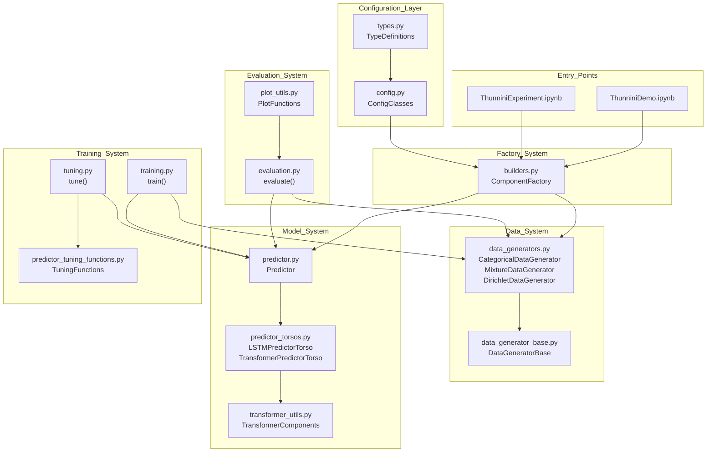
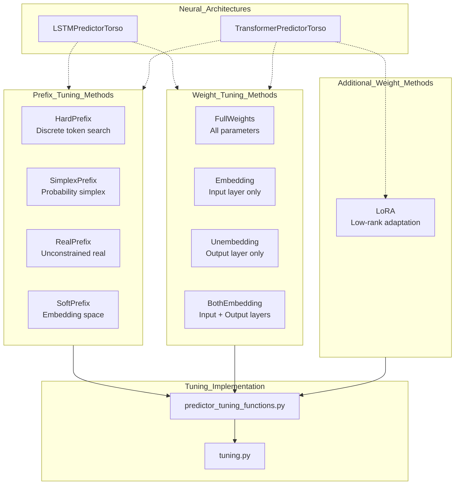
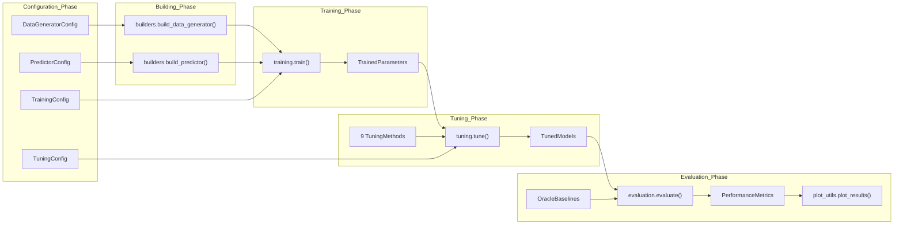

<!-- source: DeepWiki mcp.deepwiki.com · repo google-deepmind/thunnini · page 1 Overview · fetched 2026-10-26 -->

# Overview

Relevant source files

The following files were used as context for generating this wiki page:

- [README.md](README.md)

This document introduces the Thunnini repository, a research library designed for studying fine-tuning methods for neural sequence predictors. Thunnini enables systematic experimentation with nine different tuning methods across LSTM and Transformer architectures using synthetic data distributions where optimal baselines are analytically tractable.

For step-by-step usage instructions, see [Quick Start Guide](#1.1) and [Running Experiments](#1.2). For detailed architecture documentation, see [System Architecture](#2).

## Purpose and Scope

Thunnini is an experimentation library focused on understanding fundamental aspects of fine-tuning methods for neural sequence predictors. The library provides a controlled environment for studying conceptual questions about prompt tuning, parameter-efficient fine-tuning, and their connections to meta-learning and Bayesian inference.

**Core capabilities:**
- **Pretraining**: Neural sequence predictors via log loss minimization on synthetic data
- **Fine-tuning**: Nine different tuning methods including prefix tuning, weight tuning, and LoRA
- **Evaluation**: Performance assessment against optimal oracle and Bayesian baselines  
- **Comparison**: Systematic comparison across architectures and tuning methods

**Scope limitations:**
- Designed for single-GPU experiments completing within minutes
- Uses synthetic data distributions with tractable optimal predictors
- Focuses on sequence prediction rather than LLM-scale language modeling

Sources: [README.md:11-54]()

## System Architecture

The Thunnini system follows a modular architecture with clear separation between configuration, data generation, model definition, training, and evaluation components.

### Core Component Overview

Sources: [README.md:215-247](), [src/builders.py](), [src/config.py](), [src/types.py]()

### Fine-Tuning Method Taxonomy

Thunnini implements nine fine-tuning methods organized into three categories, each targeting different aspects of the neural predictor.

Sources: [README.md:152-182](), [src/predictor_tuning_functions.py](), [src/tuning.py](), [src/predictor_torsos.py]()

## Data Generation System

Thunnini provides three categories of synthetic data generators that enable controlled experimentation with known optimal baselines.

| Generator Type | Description | Use Case | Optimal Baseline |
|---|---|---|---|
| `CategoricalDataGenerator` | Fixed categorical distribution | Simple prediction tasks | Oracle predictor |
| `MixtureDataGenerator` | Mixture of categoricals | Multi-modal distributions | Mixture oracle |
| `DirichletDataGenerator` | Dirichlet-categorical conjugate | Bayesian learning scenarios | Beta-binomial predictor |

Each data generator implements the `DataGeneratorBase` interface and provides:
- Sample generation with ground-truth probabilities
- Bayesian predictor computation for optimal baselines
- Configuration through dataclass specifications

Sources: [README.md:192-207](), [src/data_generator_base.py](), [src/data_generators.py]()

## Experimental Workflow

The typical Thunnini workflow progresses through four main phases, coordinated by the configuration system and component factories.

Sources: [README.md:19-42](), [src/training.py](), [src/tuning.py](), [src/evaluation.py](), [src/plot_utils.py]()

## Key Design Principles

**Configuration-Driven**: All experiments are specified through dataclass configurations in [src/config.py](), ensuring reproducibility and systematic parameter exploration.

**Modular Architecture**: Clear separation between data generation, model definition, training, and evaluation enables independent extension of each component.

**Baseline Integration**: Built-in computation of optimal oracle and Bayesian predictors provides rigorous performance baselines for evaluating fine-tuning methods.

**Extensibility**: New neural architectures can be added as `PredictorTorso` implementations, and new data generators through the `DataGeneratorBase` interface.

The library targets researchers studying fundamental questions about fine-tuning rather than practitioners working with large-scale language models. For implementation details of specific components, see [System Architecture](#2).

Sources: [README.md:32-54](), [README.md:249-276]()

---

