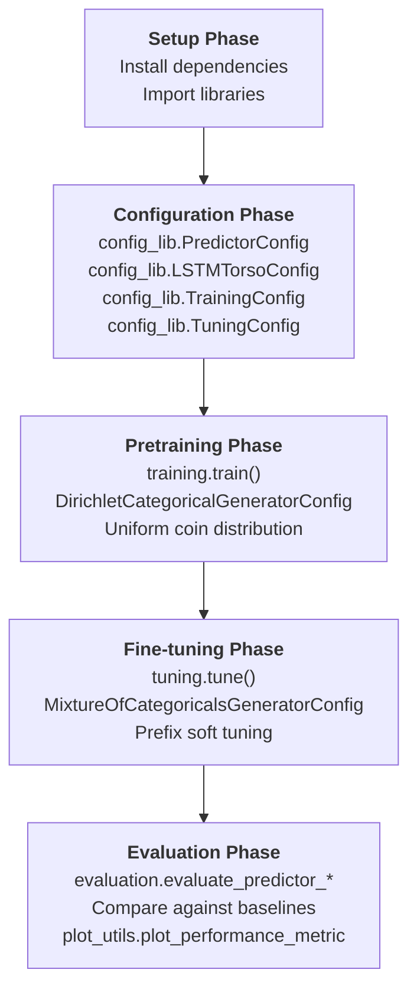
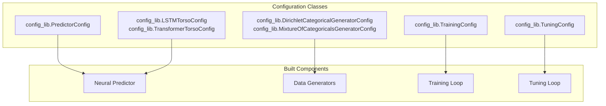
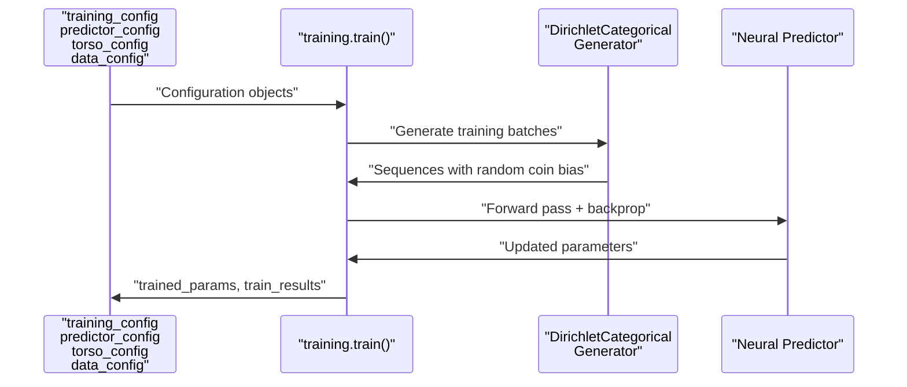
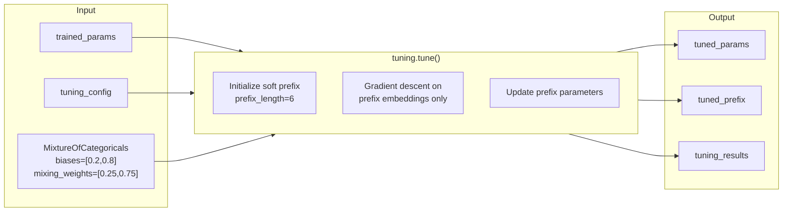
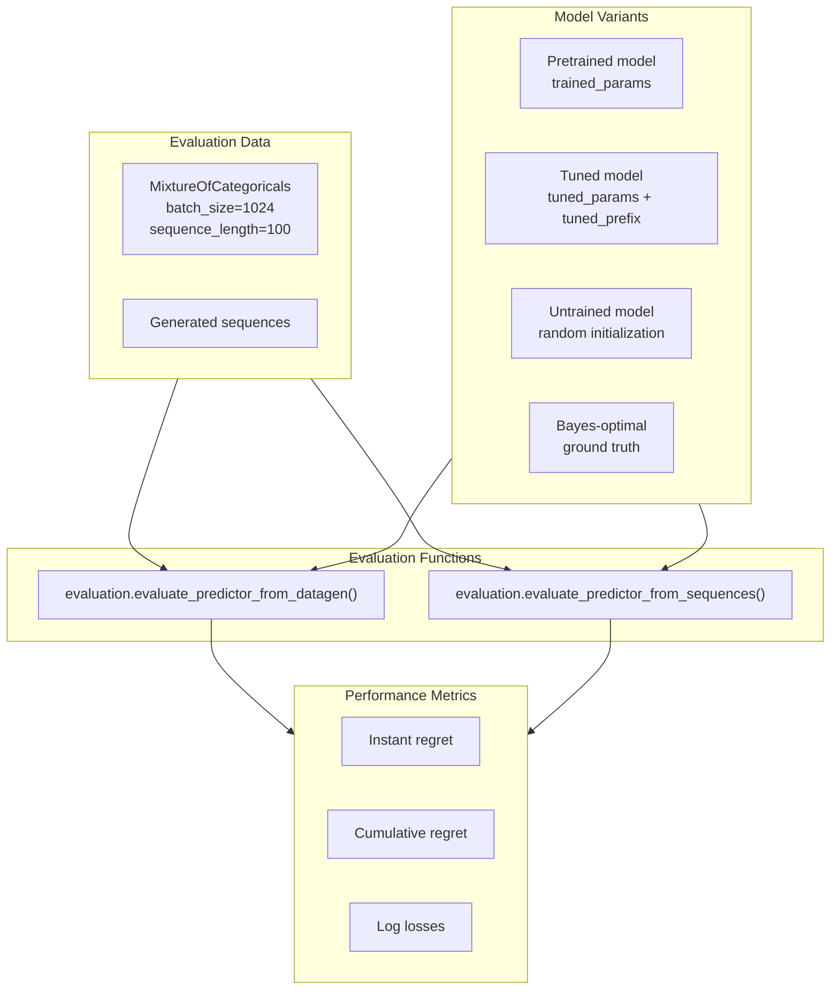

<!-- source: DeepWiki mcp.deepwiki.com · repo google-deepmind/thunnini · page 1.1 Quick Start Guide · fetched 2026-10-26 -->

# Quick Start Guide

Relevant source files

The following files were used as context for generating this wiki page:

- [colabs/ThunniniDemo.ipynb](colabs/ThunniniDemo.ipynb)

This guide walks through the basic Thunnini workflow using the `ThunniniDemo.ipynb` notebook. You'll learn how to configure, train, fine-tune, and evaluate a neural predictor on synthetic sequence data. The demo showcases pretraining an LSTM or Transformer on uniformly distributed coin flips, then fine-tuning it on a specific mixture of biased coins using soft prefix tuning.

For comprehensive experimentation with multiple tuning methods and evaluation pipelines, see [Running Experiments](#1.2). For detailed information about the configuration system, see [Configuration System](#2.1).

## Overview and Setup

The demo notebook provides a minimal but complete example of Thunnini's core functionality. It demonstrates the three-phase workflow: pretraining, fine-tuning, and evaluation.

### Demo Workflow

Sources: [colabs/ThunniniDemo.ipynb:9-14]()

### Installation

The notebook handles installation automatically when running on Google Colab:

| Environment | Setup Method |
|-------------|--------------|
| Google Colab | Automatic clone and pip install |
| Local | Manual setup required |

The demo imports core Thunnini modules: `builders`, `config`, `evaluation`, `plot_utils`, `training`, and `tuning`.

Sources: [colabs/ThunniniDemo.ipynb:55-82]()

## Configuration Workflow

Thunnini uses dataclass-based configuration objects to parameterize all components. The demo configures four main aspects: predictor architecture, training data, tuning data, and evaluation data.

### Configuration Components

### Key Configuration Parameters

| Component | Key Parameters | Purpose |
|-----------|---------------|---------|
| `PredictorConfig` | `token_dimensionality=2`, `embedding_dimensionality=16` | Binary tokens, embedding size |
| `LSTMTorsoConfig` | `hidden_sizes=[64, 32]`, `is_trainable=True` | LSTM architecture |
| `TransformerTorsoConfig` | `num_attention_heads=4`, `use_lora=True` | Transformer architecture |
| `TrainingConfig` | `num_training_steps=1000`, `learning_rate=5e-3` | Pretraining hyperparameters |
| `TuningConfig` | `tuning_method="prefix_soft"`, `prefix_length=6` | Soft prefix tuning setup |

Sources: [colabs/ThunniniDemo.ipynb:101-189]()

## Pretraining Workflow

Pretraining uses the `training.train()` function with a `DirichletCategoricalGeneratorConfig` to create sequences from coins with uniformly random bias.

### Pretraining Process

The `DirichletCategoricalGeneratorConfig` generates sequences where each sequence comes from a coin with bias sampled from `Dirichlet([1, 1])` (uniform distribution).

### Training Parameters

| Parameter | Value | Purpose |
|-----------|-------|---------|
| `batch_size` | 128 | Sequences per batch |
| `sequence_length` | 50 | Tokens per sequence |
| `vocab_size` | 2 | Binary tokens (0, 1) |
| `alphas` | `[1, 1]` | Uniform Dirichlet prior |
| `num_training_steps` | 1000 | Training iterations |

Sources: [colabs/ThunniniDemo.ipynb:145-158](), [colabs/ThunniniDemo.ipynb:229-238]()

## Fine-tuning Workflow

Fine-tuning uses `tuning.tune()` with soft prefix tuning on a `MixtureOfCategoricalsGeneratorConfig` that generates sequences from a mixture of two biased coins.

### Tuning Process

The tuning method `"prefix_soft"` optimizes only the embeddings of the first 6 tokens while keeping the pretrained model weights frozen.

### Tuning Data Configuration

| Parameter | Value | Purpose |
|-----------|-------|---------|
| `biases` | `[[0.2, 0.8], [0.8, 0.2]]` | Two coin types with opposite biases |
| `mixing_weights` | `[0.25, 0.75]` | 25% type 1, 75% type 2 |
| `tuning_method` | `"prefix_soft"` | Optimize prefix embeddings |
| `prefix_length` | 6 | First 6 tokens are tunable |

Sources: [colabs/ThunniniDemo.ipynb:171-189](), [colabs/ThunniniDemo.ipynb:314-324]()

## Evaluation Workflow

Evaluation compares the tuned model against multiple baselines using `evaluation.evaluate_predictor_from_datagen()` and `evaluation.evaluate_predictor_from_sequences()`.

### Evaluation Pipeline

### Baseline Comparisons

| Model | Configuration | Purpose |
|-------|---------------|---------|
| Bayes-optimal | Ground truth probabilities | Theoretical lower bound |
| Pretrained | `trained_params` only | Performance without tuning |
| Tuned | `tuned_params` + `tuned_prefix` | Performance with prefix tuning |
| Untrained | Random initialization | Performance without training |

Sources: [colabs/ThunniniDemo.ipynb:361-395](), [colabs/ThunniniDemo.ipynb:403-420]()

## Results Visualization

The demo uses `plot_utils.plot_performance_metric()` to visualize training curves, tuning curves, and evaluation results comparing instant and cumulative regret across models.

### Visualization Components

```mermaid
graph LR
    subgraph PlotData["Plot Data"]
        TrainLoss["train_results['loss']"]
        TuneLoss["tuning_results['loss']"]
        InstRegret["instant_regret dict"]
        CumRegret["cumulative_regret dict"]
    end
    
    subgraph PlotFunc["plot_utils.plot_performance_metric()"]
        PlotConfig["aggregate_fn_only=True<br/>show_gridlines=True"]
    end
    
    subgraph Outputs["Visualization Outputs"]
        TrainCurve["Training loss curve"]
        TuneCurve["Tuning loss curve"]
        RegretPlots["Regret comparison plots"]
        TrajPlot["Single trajectory predictions"]
    end
    
    PlotData --> PlotFunc
    PlotFunc --> Outputs
```

The visualization includes:
- Training and tuning loss curves
- Instant regret comparison across models
- Cumulative regret over sequence positions
- Single trajectory showing predictions vs ground truth

Sources: [colabs/ThunniniDemo.ipynb:246-255](), [colabs/ThunniniDemo.ipynb:332-343](), [colabs/ThunniniDemo.ipynb:448-502]()

---

