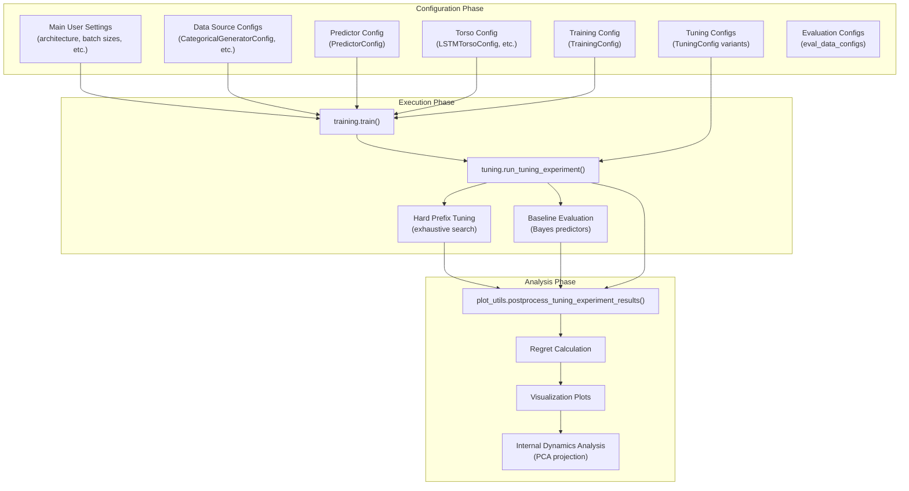
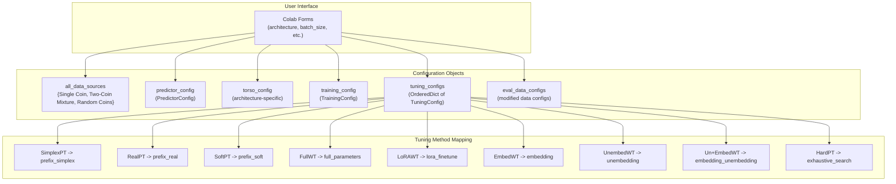
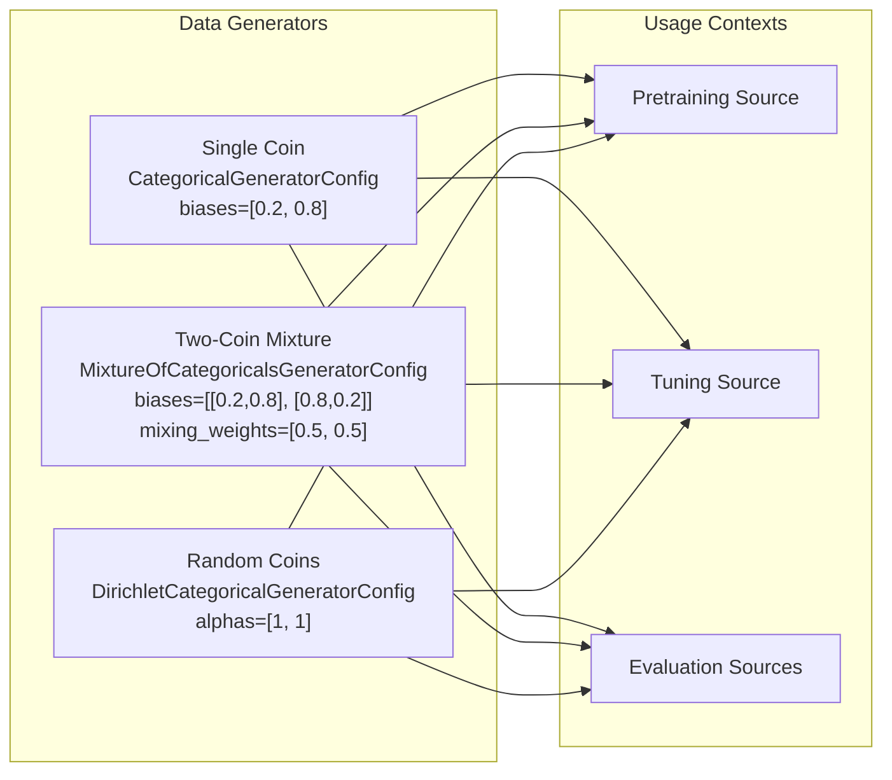
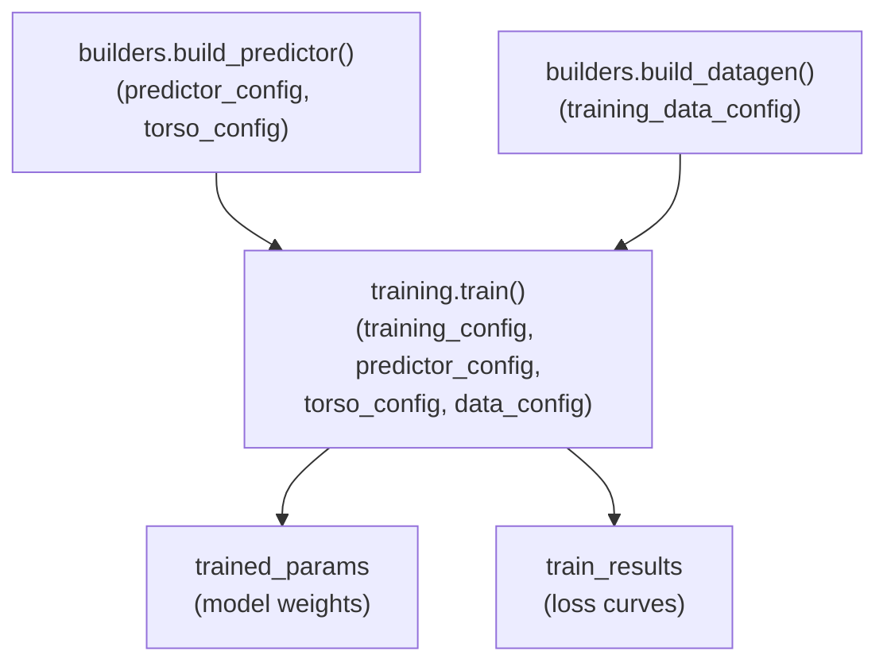
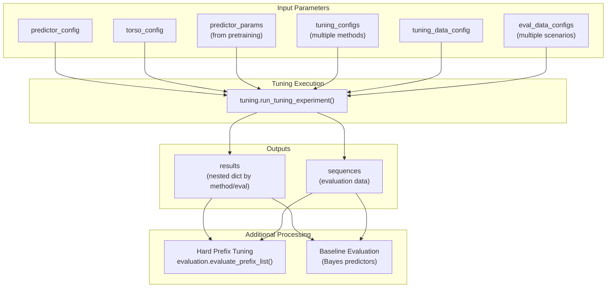
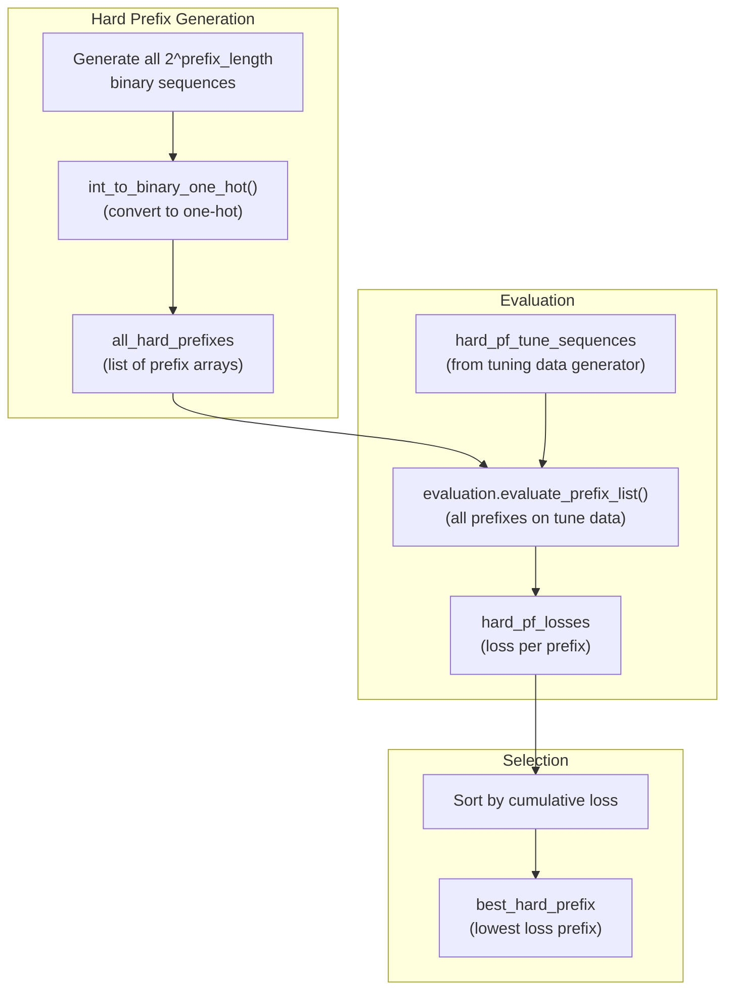
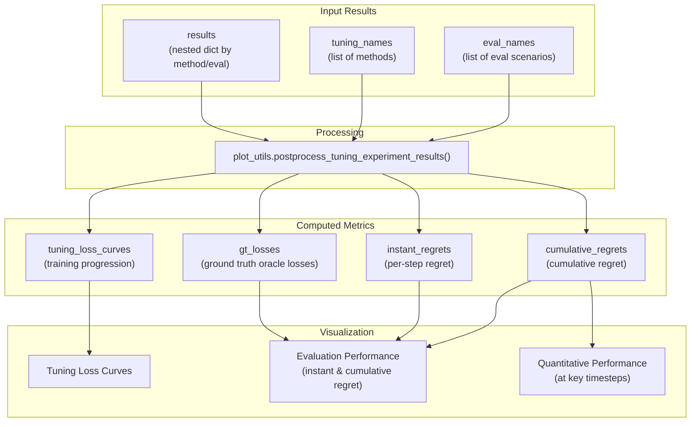
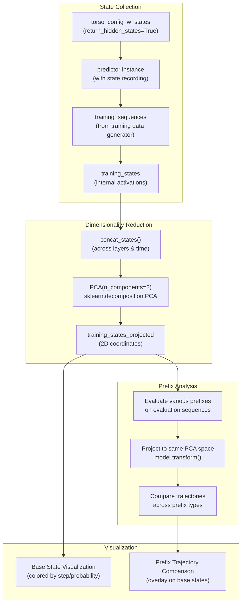

<!-- source: DeepWiki mcp.deepwiki.com · repo google-deepmind/thunnini · page 1.2 Running Experiments · fetched 2026-10-26 -->

# Running Experiments

Relevant source files

The following files were used as context for generating this wiki page:

- [colabs/ThunniniExperiment.ipynb](colabs/ThunniniExperiment.ipynb)

This page covers comprehensive experimentation using the `ThunniniExperiment.ipynb` notebook, which provides a full pipeline for training, tuning, and evaluating multiple models with different fine-tuning methods. This includes configuring complex experiments, running multiple tuning approaches simultaneously, and analyzing comparative results across different evaluation scenarios.

For basic single-model workflows, see [Quick Start Guide](#1.1). For detailed information about individual system components, see [System Architecture](#2).

## Overview

The `ThunniniExperiment.ipynb` notebook implements a complete experimental pipeline that systematically compares multiple fine-tuning approaches. The workflow encompasses four main phases: configuration, pretraining, tuning with multiple methods, and comprehensive evaluation with visualization.

**Pipeline Architecture**
Sources: [colabs/ThunniniExperiment.ipynb:10-75]()

## Configuration System

The experiment configuration uses a hierarchical system of dataclass configurations that parameterize every aspect of the experimental pipeline. The notebook provides both high-level form controls and detailed configuration objects.

### Main Configuration Categories

| Configuration Type | Class | Purpose |
|-------------------|-------|---------|
| Architecture | `PredictorConfig`, `LSTMTorsoConfig`, `TransformerTorsoConfig`, `LinearTorsoConfig` | Define model architecture and capacity |
| Data Generation | `CategoricalGeneratorConfig`, `MixtureOfCategoricalsGeneratorConfig`, `DirichletCategoricalGeneratorConfig` | Specify synthetic data distributions |
| Training | `TrainingConfig` | Control pretraining parameters |
| Tuning | `TuningConfig` (multiple variants) | Configure fine-tuning methods |
| Evaluation | Data configs with modified parameters | Set evaluation scenarios |

**Configuration Hierarchy and Tuning Methods**
Sources: [colabs/ThunniniExperiment.ipynb:171-449]()

### Data Source Configuration

The experiment supports three families of categorical distributions, configured through specific generator config classes:

**Data Generator Configuration**
Sources: [colabs/ThunniniExperiment.ipynb:277-299]()

## Execution Workflow

### Pretraining Phase

The pretraining phase uses the `training.train()` function with the configured architecture and data source:

**Pretraining Execution Flow**
Sources: [colabs/ThunniniExperiment.ipynb:608-615]()

### Tuning and Evaluation Phase

The main experimental phase uses `tuning.run_tuning_experiment()` to execute multiple tuning methods simultaneously:

**Main Tuning and Evaluation Pipeline**
Sources: [colabs/ThunniniExperiment.ipynb:693-705]()

### Hard Prefix Tuning

Hard prefix tuning uses exhaustive search over all possible token sequences of the specified length:

**Hard Prefix Tuning Process**
Sources: [colabs/ThunniniExperiment.ipynb:734-771]()

## Result Analysis and Visualization

### Performance Metrics

The primary evaluation metric is regret, which measures excess prediction error relative to an oracle predictor:

$$\mathcal{R}_\xi(\pi_\theta) = \frac{1}{D} \sum_{k=1}^D \left[ \sum_{i=1}^N -\log \pi_\theta(x^k_i | x^k_{<i}) + \log \xi(x^k_i | x^k_{<i}, \tau=\tau^*) \right]$$

The analysis pipeline processes results through `plot_utils.postprocess_tuning_experiment_results()`:

**Analysis and Visualization Pipeline**
Sources: [colabs/ThunniniExperiment.ipynb:977-983]()

### Visualization Types

The notebook generates several types of performance visualizations:

1. **Tuning Loss Curves**: Show training progression for each tuning method
2. **Evaluation Performance**: Instant and cumulative regret over time
3. **Quantitative Performance**: Bar plots at key timesteps (tuning length, training length, evaluation length)
4. **Method Comparison**: Grouped by prefix tuning, weight tuning, and baselines

Sources: [colabs/ThunniniExperiment.ipynb:1064-1338]()

## Advanced Features

### Internal Dynamics Analysis

The notebook includes sophisticated analysis of model internal states using PCA projection:

**Internal Dynamics Analysis Pipeline**
Sources: [colabs/ThunniniExperiment.ipynb:1358-1755]()

The analysis reveals how different prefix types affect the model's internal representation space, with different prefixes setting different initial points in the same activation space while weight tuning methods reshape the space itself.

Sources: [colabs/ThunniniExperiment.ipynb:70-75]()

---

