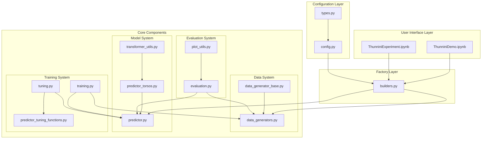
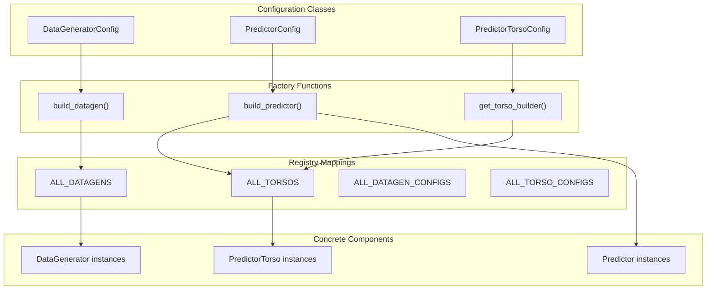
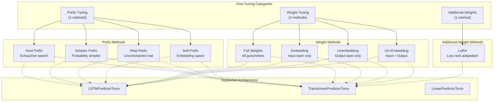
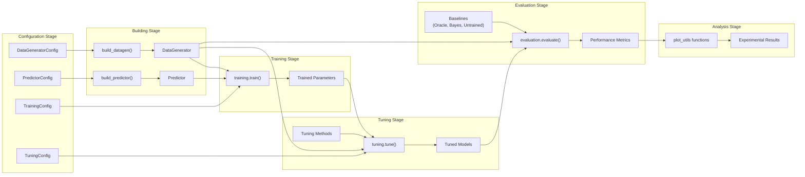
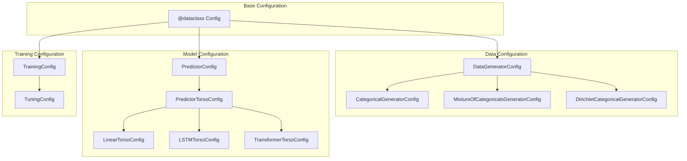

<!-- source: DeepWiki mcp.deepwiki.com · repo google-deepmind/thunnini · page 2 System Architecture · fetched 2026-10-26 -->

# System Architecture

Relevant source files

The following files were used as context for generating this wiki page:

- [README.md](README.md)
- [src/builders.py](src/builders.py)

This document provides an overview of the core system components in Thunnini and how they interact to enable fine-tuning research. Thunnini is designed as a modular experimentation library where components can be configured, combined, and extended to study different aspects of neural sequence prediction and fine-tuning methods.

For specific implementation details of individual components, see the relevant subsection pages: [Configuration System](#2.1), [Component Factory](#2.2), [Data Generation](#2.3), [Model Architecture](#2.4), [Training and Tuning](#2.5), and [Evaluation and Visualization](#2.6).

## Overall System Overview

Thunnini's architecture follows a layered design where high-level interfaces orchestrate lower-level components through a configuration-driven factory pattern. The system enables researchers to experiment with 9 different fine-tuning methods across multiple neural architectures and synthetic data distributions.

### Core System Components

*Sources: [README.md:1-354](), [src/builders.py:1-101]()*

The system is organized into several distinct layers:

| Layer | Purpose | Key Components |
|-------|---------|----------------|
| **User Interface** | Entry points for experiments | `ThunniniDemo.ipynb`, `ThunniniExperiment.ipynb` |
| **Configuration** | Type-safe parameter specification | `config.py`, `types.py` |
| **Factory** | Component instantiation from configs | `builders.py` |
| **Data System** | Synthetic data generation | `data_generator_base.py`, `data_generators.py` |
| **Model System** | Neural architectures and prediction | `predictor.py`, `predictor_torsos.py` |
| **Training System** | Pretraining and fine-tuning loops | `training.py`, `tuning.py` |
| **Evaluation System** | Performance assessment and visualization | `evaluation.py`, `plot_utils.py` |

## Component Factory Pattern

Thunnini uses a centralized factory pattern implemented in `builders.py` to instantiate components from configurations. This design ensures type safety and extensibility while maintaining a clean separation between configuration and implementation.

### Factory Architecture

*Sources: [src/builders.py:29-101]()*

The factory maintains four key registries that map string identifiers to component classes:

- `ALL_DATAGENS`: Maps data generator type names to implementation classes
- `ALL_TORSOS`: Maps neural architecture type names to torso classes  
- `ALL_DATAGEN_CONFIGS`: Maps generator types to their configuration classes
- `ALL_TORSO_CONFIGS`: Maps torso types to their configuration classes

## Fine-Tuning Methods Architecture

Thunnini implements 9 fine-tuning methods organized into three categories. The system is designed so that all methods work uniformly across different neural architectures through the `Predictor` wrapper class.

### Tuning Method Taxonomy

*Sources: [README.md:152-182](), [src/predictor_tuning_functions.py]()*

## Data Flow Architecture

The experimental workflow in Thunnini follows a clear data flow from configuration through training to evaluation. Each stage transforms data and parameters while maintaining provenance and reproducibility.

### Experimental Data Flow

*Sources: [README.md:21-31](), [src/training.py](), [src/tuning.py](), [src/evaluation.py]()*

## Key System Abstractions

Thunnini's architecture is built around several key abstractions that enable modularity and extensibility:

### Core Abstract Interfaces

| Interface | Purpose | Key Methods | Implementations |
|-----------|---------|-------------|-----------------|
| `DataGenerator` | Defines data generation protocol | `sample()`, `log_prob()`, `bayesian_update()` | `CategoricalGenerator`, `MixtureOfCategoricalsGenerator`, `DirichletCategoricalGenerator` |
| `PredictorTorso` | Defines neural architecture interface | `__call__()`, `init()` | `LSTMPredictorTorso`, `TransformerPredictorTorso`, `LinearPredictorTorso` |
| `Predictor` | Unified prediction interface | `forward()`, `loss()`, `update()` | Single implementation wrapping torsos |

### Configuration Hierarchy

*Sources: [src/config.py](), [src/types.py]()*

The configuration system uses Python dataclasses with type annotations to provide compile-time safety and runtime validation. All configurations inherit from a base `Config` class and are organized hierarchically to reflect the system's component structure.

This architecture enables Thunnini to be both easy to use for standard experiments and highly extensible for research into new fine-tuning methods, neural architectures, and data distributions.

---

