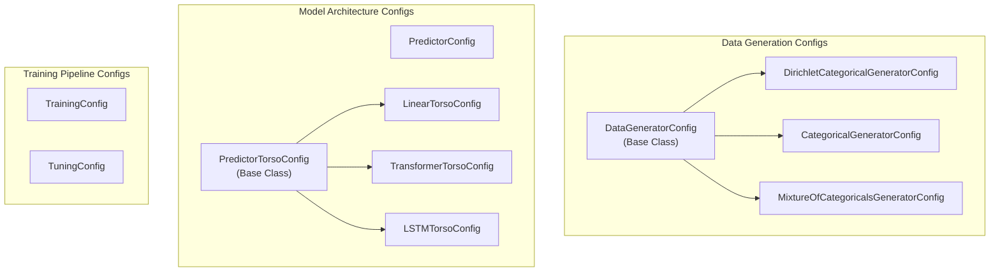
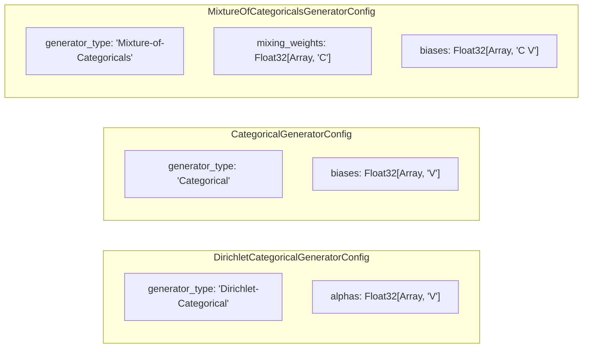
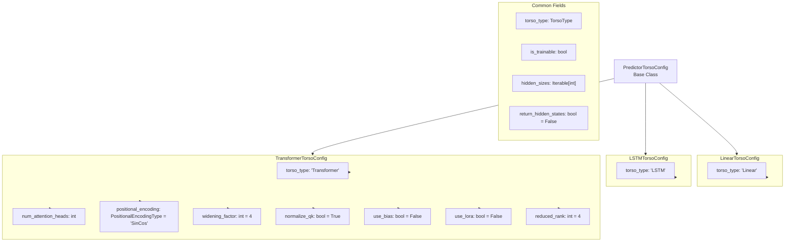
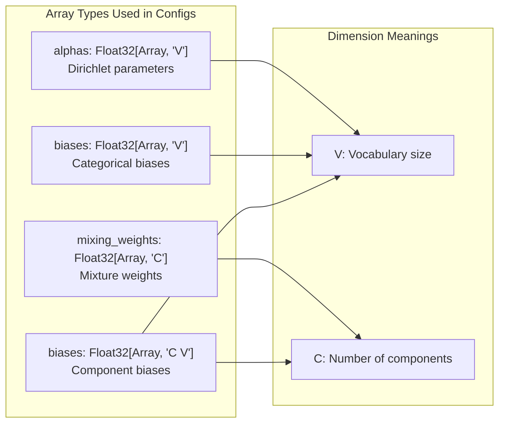

<!-- source: DeepWiki mcp.deepwiki.com · repo google-deepmind/thunnini · page 2.1 Configuration System · fetched 2026-10-26 -->

# Configuration System

Relevant source files

The following files were used as context for generating this wiki page:

- [src/config.py](src/config.py)
- [src/types.py](src/types.py)

The configuration system provides a structured, type-safe way to parameterize all components of the Thunnini fine-tuning library. It uses frozen dataclasses to define immutable configuration objects that can be serialized to plain text and reconstructed, enabling reproducible experiments and easy parameter management.

For information about how configurations are used to build components, see [Component Factory](#2.2). For details about the training and tuning processes that these configurations parameterize, see [Training and Tuning](#2.5).

## Design Principles

The configuration system follows specific design principles outlined in [src/config.py:16-22]():

- **Serialization Support**: All configurations can be converted to dictionaries and serialized to plain text
- **No Nesting**: Configuration dataclasses do not contain other dataclasses as fields
- **Immutable**: All configurations use `frozen=True` to prevent modification after creation
- **Keyword-Only**: All configurations use `kw_only=True` to require explicit parameter naming
- **No Post-Instantiation Logic**: Default values are set at the dataclass level without requiring post-creation manipulation

Sources: [src/config.py:16-22]()

## Configuration Hierarchy

The configuration system is organized into several main categories, each serving a specific purpose in the experimental pipeline.

Sources: [src/config.py:32-118]()

## Data Generator Configurations

Data generator configurations define the parameters for synthetic data generation used in experiments.

### Base Configuration

The `DataGeneratorConfig` class provides common fields for all data generators:

| Field | Type | Description |
|-------|------|-------------|
| `generator_type` | `types.DataGenType` | Type of data generator |
| `batch_size` | `int` | Number of sequences per batch |
| `sequence_length` | `int` | Length of each sequence |
| `vocab_size` | `int` | Size of the vocabulary |

Sources: [src/config.py:32-38]()

### Concrete Generator Configurations

Each concrete data generator has specific additional parameters:

Sources: [src/config.py:40-57]()

## Training and Tuning Configurations

These configurations control the training and fine-tuning processes.

### TrainingConfig

Defines parameters for the initial pretraining phase:

| Field | Type | Description |
|-------|------|-------------|
| `num_training_steps` | `int` | Number of training iterations |
| `learning_rate` | `float` | Optimizer learning rate |
| `max_grad_norm` | `float` | Gradient clipping threshold |
| `data_gen_seed` | `int` | Random seed for data generation |
| `predictor_init_seed` | `int` | Random seed for model initialization |

Sources: [src/config.py:59-66]()

### TuningConfig

Defines parameters for the fine-tuning phase with additional options for prefix tuning:

| Field | Type | Default | Description |
|-------|------|---------|-------------|
| `num_tuning_steps` | `int` | - | Number of fine-tuning iterations |
| `learning_rate` | `float` | - | Optimizer learning rate |
| `max_grad_norm` | `float` | - | Gradient clipping threshold |
| `data_gen_seed` | `int` | - | Random seed for data generation |
| `prefix_init_seed` | `int` | - | Random seed for prefix initialization |
| `tuning_method` | `types.TuningMethodType` | - | Fine-tuning strategy |
| `num_tuning_repetitions` | `int` | `1` | Number of repetitions |
| `prefix_length` | `int \| None` | `None` | Length of prefix for prefix methods |
| `prefix_init_method` | `types.PrefixInitMethod \| None` | `'simplex'` | Prefix initialization strategy |
| `iterate_datagen_seed_over_repetitions` | `bool` | `True` | Whether to vary data seeds |

Sources: [src/config.py:68-80]()

## Model Architecture Configurations

These configurations define the neural network architectures used in the experiments.

### PredictorConfig

Basic configuration for the predictor wrapper:

| Field | Type | Description |
|-------|------|-------------|
| `token_dimensionality` | `int` | Input token dimensionality |
| `embedding_dimensionality` | `int` | Embedding layer output size |

Sources: [src/config.py:82-86]()

### Torso Configurations

The torso configurations define the main neural network architectures:

Sources: [src/config.py:88-118]()

## Type System Integration

The configuration system is tightly integrated with the type system defined in `types.py`. This provides strong typing and validates configuration choices at instantiation time.

### Key Type Definitions

The configuration system uses several important types:

| Type | Values | Usage |
|------|--------|-------|
| `DataGenType` | `'Dirichlet-Categorical'`, `'Categorical'`, `'Mixture-of-Categoricals'` | Data generator selection |
| `TuningMethodType` | `'prefix_real'`, `'prefix_simplex'`, `'prefix_soft'`, `'full_parameters'`, `'lora_finetune'`, `'embedding'`, `'unembedding'`, `'embedding_unembedding'` | Fine-tuning method selection |
| `TorsoType` | `'Linear'`, `'Transformer'`, `'LSTM'` | Neural architecture selection |
| `PrefixInitMethod` | `'zeros'`, `'simplex'`, `'one_hot'` | Prefix initialization strategy |
| `PositionalEncodingType` | `'SinCos'` | Positional encoding method |

Sources: [src/types.py:43-76]()

### Array Type Annotations

The configuration system uses JAX typing for array specifications:

Sources: [src/config.py:43-56](), [src/types.py:22-29]()

## Configuration Usage Patterns

Configurations are typically created and used in the following pattern:

1. **Creation**: Instantiate configuration objects with keyword arguments
2. **Validation**: Type checking occurs at instantiation time
3. **Serialization**: Convert to dictionaries for storage or logging
4. **Component Building**: Pass to builder functions to create actual components
5. **Immutability**: Once created, configurations cannot be modified

The frozen dataclass design ensures that experimental parameters remain constant throughout an experiment, supporting reproducibility and preventing accidental parameter changes.

Sources: [src/config.py:16-22]()

---

