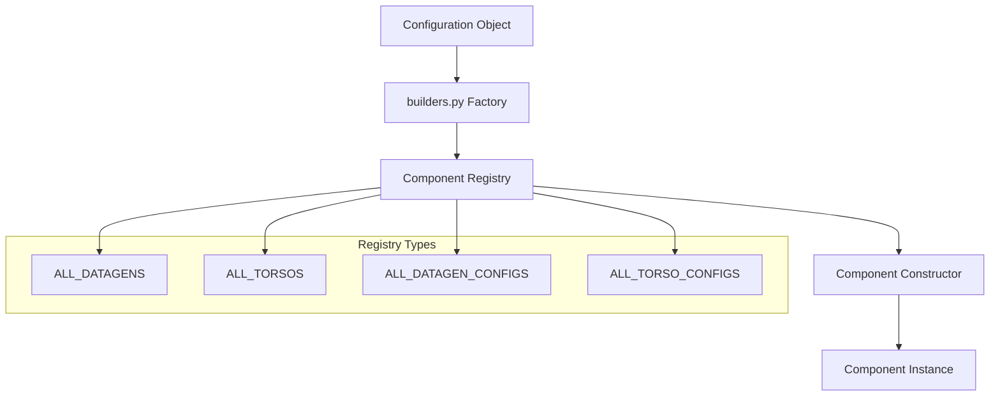
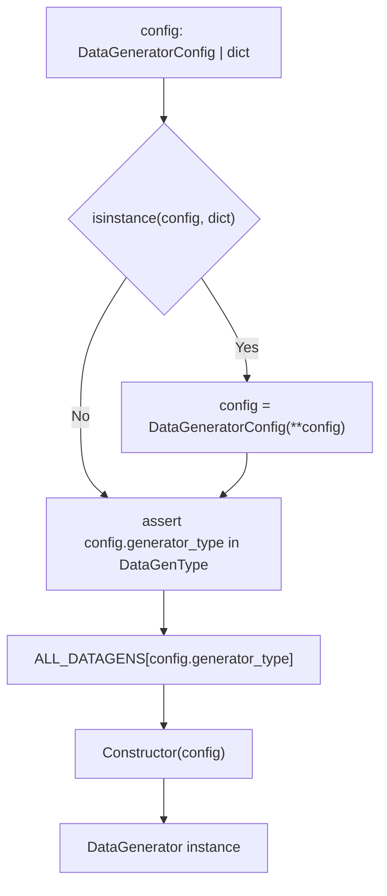
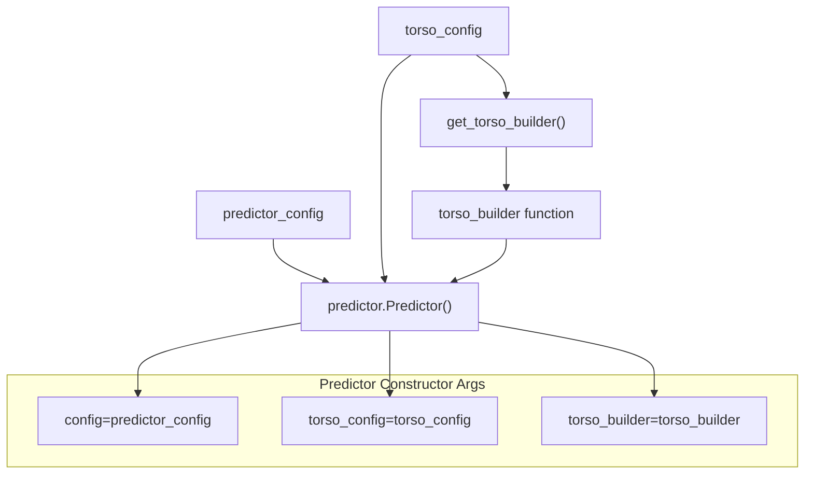
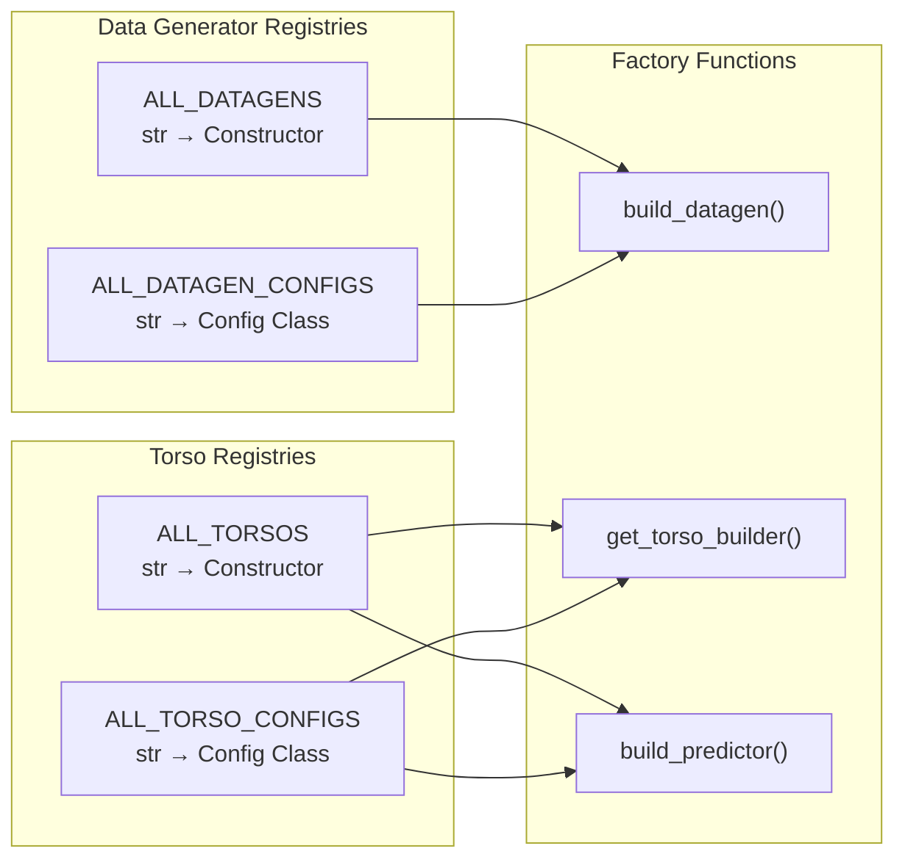

<!-- source: DeepWiki mcp.deepwiki.com · repo google-deepmind/thunnini · page 2.2 Component Factory · fetched 2026-10-26 -->

# Component Factory

Relevant source files

The following files were used as context for generating this wiki page:

- [src/builders.py](src/builders.py)

The Component Factory provides a centralized creation mechanism for instantiating data generators and predictors from configuration objects. It implements the factory pattern to abstract component construction, allowing users to specify what they want through configuration rather than directly instantiating classes.

This document covers the factory functions and component registries in `builders.py`. For information about the configuration system that drives the factory, see [Configuration System](#2.1). For details about the specific components being created, see [Data Generation](#2.3) and [Model Architecture](#2.4).

## Factory Pattern Overview

The Component Factory centralizes component creation through registry dictionaries that map string identifiers to constructor functions. This design enables dynamic component selection based on configuration parameters while maintaining type safety and providing a single point of control for component creation.

Sources: [src/builders.py:29-63]()

## Data Generator Factory

The data generator factory creates instances of data generators from configuration objects. The `build_datagen()` function serves as the main entry point, supporting both typed configuration objects and dictionary inputs.

### Registry Structure

| Generator Type | Constructor | Config Type |
|----------------|-------------|-------------|
| `"Dirichlet-Categorical"` | `data_generators.DirichletCategoricalGenerator` | `config_lib.DirichletCategoricalGeneratorConfig` |
| `"Categorical"` | `data_generators.CategoricalGenerator` | `config_lib.CategoricalGeneratorConfig` |
| `"Mixture-of-Categoricals"` | `data_generators.MixtureOfCategoricalsGenerator` | `config_lib.MixtureOfCategoricalsGeneratorConfig` |

### Factory Function

The `build_datagen()` function handles configuration validation and component instantiation:

Sources: [src/builders.py:66-73]()

## Predictor and Torso Factory

The predictor factory creates predictor instances with embedded torso architectures. It provides both a torso builder function and a complete predictor builder that combines predictor and torso configurations.

### Torso Registry Structure

| Torso Type | Constructor | Config Type |
|------------|-------------|-------------|
| `"Linear"` | `predictor_torsos.LinearPredictorTorso` | `config_lib.LinearTorsoConfig` |
| `"Transformer"` | `predictor_torsos.TransformerPredictorTorso` | `config_lib.TransformerTorsoConfig` |
| `"LSTM"` | `predictor_torsos.LSTMPredictorTorso` | `config_lib.LSTMTorsoConfig` |

### Factory Functions

The torso factory provides two main functions:

1. **`get_torso_builder()`** - Returns a torso constructor function
2. **`build_predictor()`** - Creates a complete predictor with embedded torso

Sources: [src/builders.py:76-100]()

## Component Registration System

The factory uses four registry dictionaries to map string identifiers to constructors and configuration classes. This design supports extensibility by allowing new components to be registered without modifying existing factory logic.

### Type Safety and Validation

The factory functions include runtime type validation using `typing.get_args()` to ensure that component type strings match the allowed values defined in the `types` module. This provides early error detection for invalid component specifications.

Sources: [src/builders.py:29-63](), [src/builders.py:72](), [src/builders.py:82]()

## Usage Patterns

The Component Factory is typically used in two scenarios:

1. **Interactive Configuration** - Users specify components by string name in notebooks or scripts
2. **Programmatic Construction** - Other system components use the factory to create instances from configuration objects

The factory supports both dictionary-based configuration (for flexibility) and typed configuration objects (for type safety), with automatic conversion between the two formats as needed.

Sources: [src/builders.py:16](), [src/builders.py:66-100]()

---

