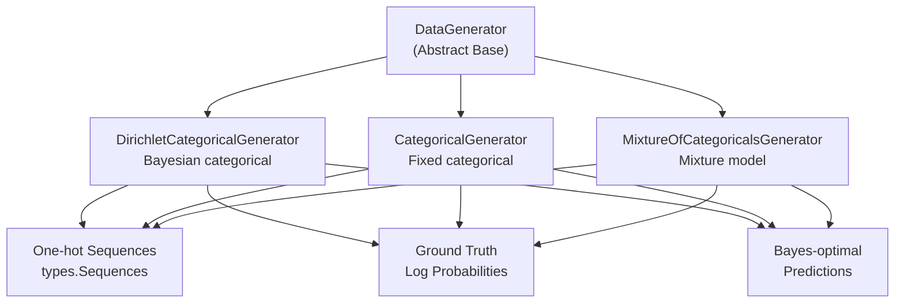
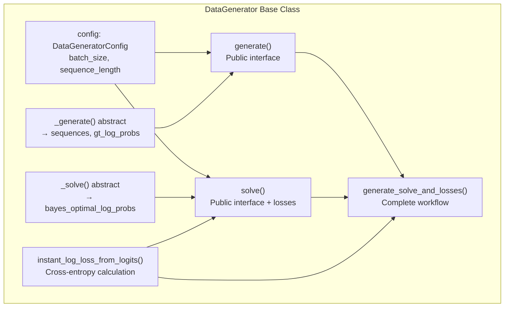
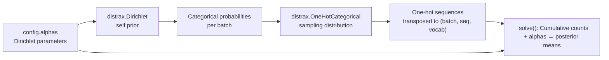
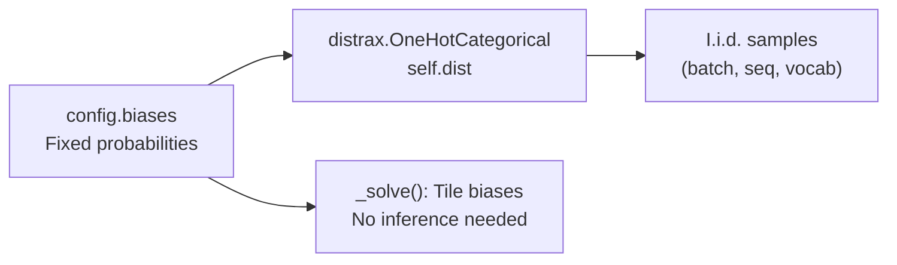
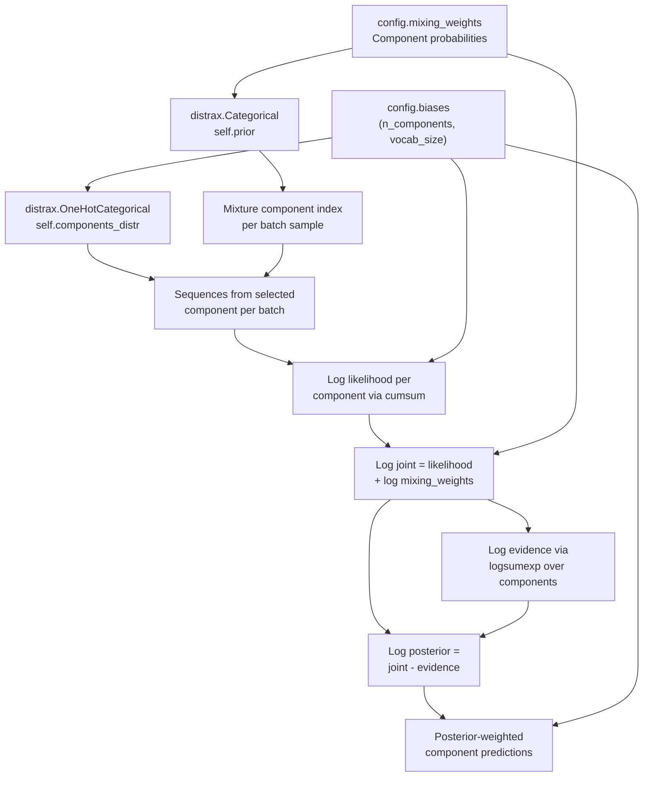
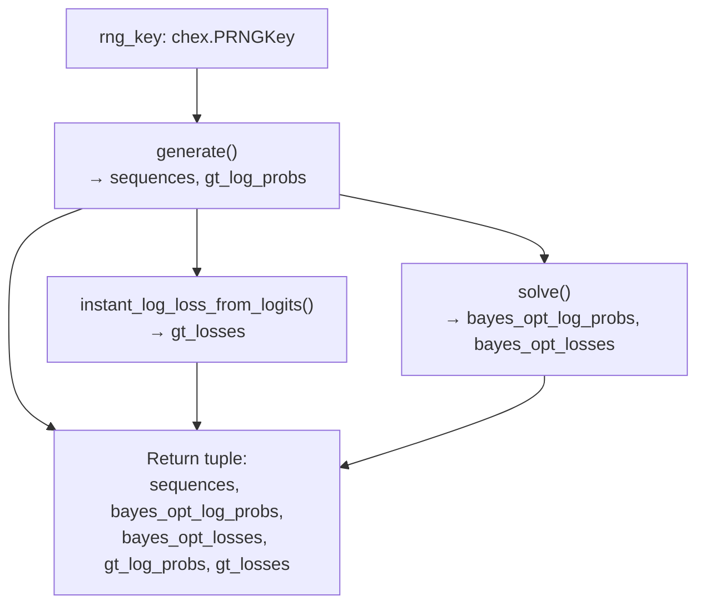

<!-- source: DeepWiki mcp.deepwiki.com · repo google-deepmind/thunnini · page 2.3 Data Generation · fetched 2026-10-26 -->

# Data Generation

Relevant source files

The following files were used as context for generating this wiki page:

- [assets/img/ThunniniTaxonomy.svg](assets/img/ThunniniTaxonomy.svg)
- [src/data_generator_base.py](src/data_generator_base.py)
- [src/data_generators.py](src/data_generators.py)

This document covers the data generation system in Thunnini, which provides synthetic sequence data for fine-tuning research experiments. The system generates one-hot encoded categorical sequences with known ground truth distributions, enabling controlled evaluation of fine-tuning methods.

For information about how data generators are instantiated and configured, see [Component Factory](#2.2). For details about the training pipeline that consumes this data, see [Training and Tuning](#2.5).

## System Overview

The data generation system follows an abstract base class pattern with three concrete implementations for different types of categorical sequence generation. Each generator produces both synthetic sequences and their corresponding ground truth log probabilities, as well as Bayes-optimal predictions.

Sources: [src/data_generator_base.py:27-122](), [src/data_generators.py:38-187]()

## Base Class Architecture

The `DataGenerator` abstract base class defines the core interface and common functionality for all data generators. It requires subclasses to implement two key methods while providing high-level orchestration.

The base class provides validation through `chex.assert_equal_shape()` calls to ensure implementations return correctly shaped tensors.

Sources: [src/data_generator_base.py:27-122]()

## Concrete Generator Implementations

### DirichletCategoricalGenerator

Implements a Bayesian approach where categorical probabilities are drawn from a Dirichlet prior, then sequences are generated i.i.d. from the resulting categorical distribution.

| Component | Implementation | Purpose |
|-----------|----------------|---------|
| Prior | `distrax.Dirichlet(alphas)` | Generates per-batch categorical probabilities |
| Likelihood | `distrax.OneHotCategorical(probs)` | Samples sequences given probabilities |
| Posterior | Dirichlet-categorical conjugacy | Enables exact Bayesian inference |

Sources: [src/data_generators.py:38-81]()

### CategoricalGenerator

Generates i.i.d. sequences from a fixed categorical distribution with no latent variables to infer.

Sources: [src/data_generators.py:83-112]()

### MixtureOfCategoricalsGenerator

Implements a mixture of categorical distributions where the mixture component is sampled once per sequence, then all tokens in that sequence are generated from the selected component.

Sources: [src/data_generators.py:114-187]()

## Data Flow and Key Methods

### Core Generation Workflow

The `generate_solve_and_losses()` method provides the complete workflow used by the training pipeline:

### Loss Calculation

All generators use `optax.safe_softmax_cross_entropy()` for consistent loss computation between predicted log probabilities and one-hot target sequences.

Sources: [src/data_generator_base.py:75-122](), [src/data_generator_base.py:116-121]()

## Integration with Configuration System

Data generators are configured through dataclass configs that specify:

- `batch_size`: Number of sequences per batch
- `sequence_length`: Length of each generated sequence  
- `vocab_size`: Size of the categorical vocabulary
- Generator-specific parameters (e.g., `alphas` for Dirichlet, `biases` for fixed categorical)

The configuration system ensures type safety and parameter validation before generator instantiation.

Sources: [src/data_generator_base.py:33-34](), [src/data_generators.py:42-47](), [src/data_generators.py:86-93](), [src/data_generators.py:117-131]()

---

