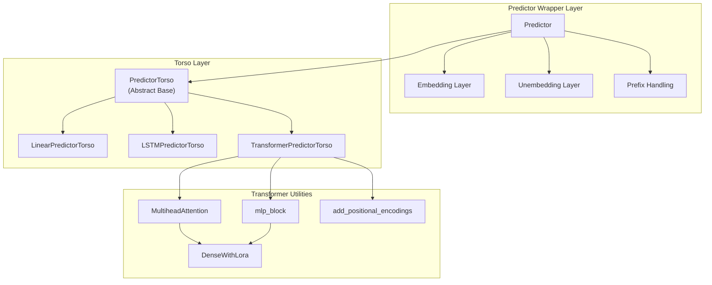
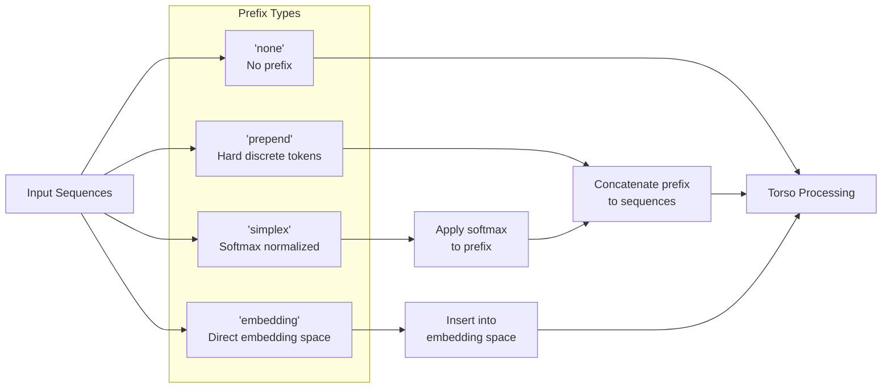
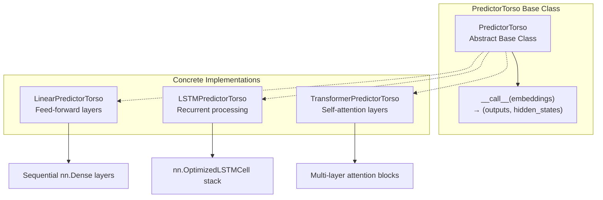
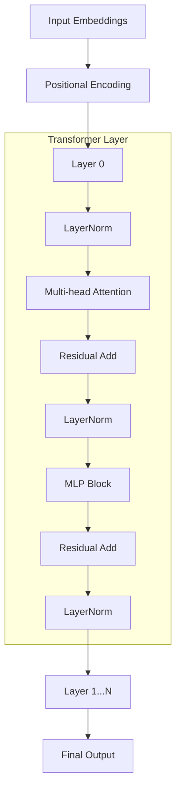
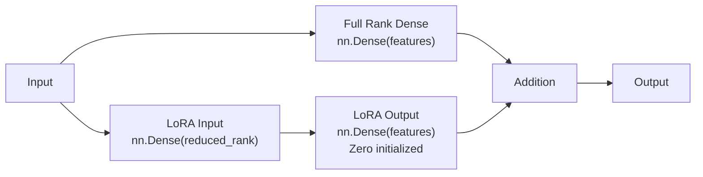
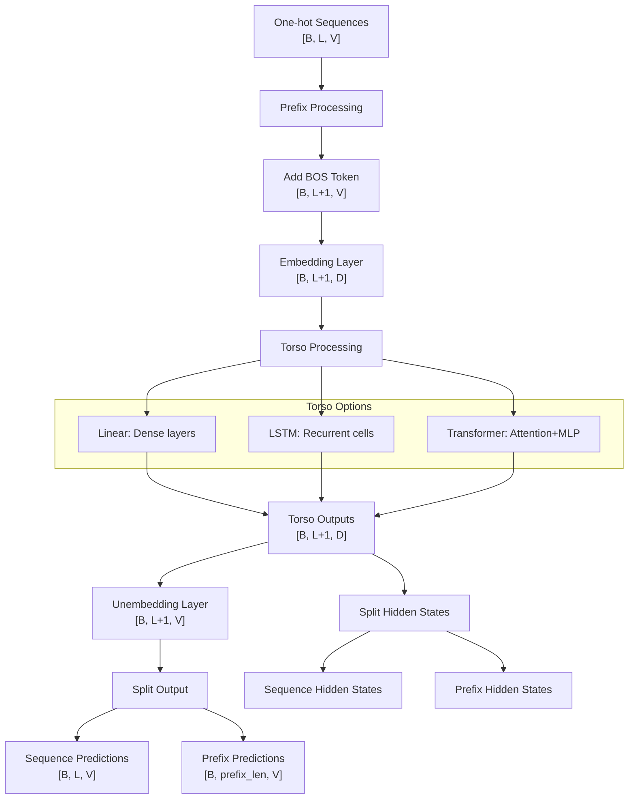

<!-- source: DeepWiki mcp.deepwiki.com · repo google-deepmind/thunnini · page 2.4 Model Architecture · fetched 2026-10-26 -->

# Model Architecture

Relevant source files

The following files were used as context for generating this wiki page:

- [src/predictor.py](src/predictor.py)
- [src/predictor_torsos.py](src/predictor_torsos.py)
- [src/transformer_utils.py](src/transformer_utils.py)

This page documents the model architecture system in Thunnini, which provides the core neural network implementations used for fine-tuning research. The system consists of a predictor wrapper that handles embedding, unembedding, and prefix functionality, along with multiple torso architectures including linear, LSTM, and transformer models.

For information about how these models are configured, see [Configuration System](#2.1). For details on how models are instantiated from configurations, see [Component Factory](#2.2). For information about the training and fine-tuning processes that use these models, see [Training and Tuning](#2.5).

## Architecture Overview

The model architecture follows a layered design where a `Predictor` wrapper class provides common functionality around different neural network "torsos" that implement the core computation.

Sources: [src/predictor.py:50-64](), [src/predictor_torsos.py:16-24](), [src/transformer_utils.py:16]()

## Predictor Wrapper Class

The `Predictor` class serves as the main interface for all neural architectures in Thunnini. It wraps torso implementations with embedding and unembedding layers, and provides support for prefix prompting methods used in fine-tuning.

### Core Functionality

| Component | Purpose | Implementation |
|-----------|---------|----------------|
| Embedding | Converts one-hot sequences to dense vectors | `nn.Dense` layer with configurable dimensionality |
| Torso | Core neural computation | Pluggable architecture (Linear/LSTM/Transformer) |
| Unembedding | Converts hidden states to vocabulary logits | `nn.Dense` layer mapping to vocabulary size |
| Prefix Handling | Supports multiple prefix prompting methods | Four types: none, prepend, simplex, embedding |

The wrapper handles four types of prefix prompting:

Sources: [src/predictor.py:66-197](), [src/predictor.py:104-121]()

### Input and Output Handling

The `Predictor.__call__` method processes sequences and returns predictions along with optional hidden states:

- **Input**: One-hot encoded sequences with optional prefix
- **Output**: Log predictions for sequences, hidden states, prefix predictions, and prefix states
- **Padding**: Adds beginning-of-sequence (BOS) token as zero vector for initial prediction

Sources: [src/predictor.py:66-93](), [src/predictor.py:122-129]()

## Torso Implementations

Three concrete torso architectures implement the abstract `PredictorTorso` base class, each providing different computational patterns suitable for different experimental scenarios.

Sources: [src/predictor.py:30-48](), [src/predictor_torsos.py:41-172]()

### Linear Torso

The `LinearPredictorTorso` provides a simple feed-forward architecture primarily used for testing and baseline comparisons.

| Feature | Implementation |
|---------|----------------|
| Architecture | Sequential `nn.Dense` layers |
| Hidden States | None (no recurrent or attention states) |
| Configuration | `hidden_sizes` list specifies layer dimensions |

Sources: [src/predictor_torsos.py:41-59]()

### LSTM Torso  

The `LSTMPredictorTorso` implements a multi-layer LSTM architecture with proper state handling for recurrent processing.

| Feature | Implementation |
|---------|----------------|
| Architecture | Stack of `nn.OptimizedLSTMCell` layers |
| Hidden States | Cell and hidden states per layer |
| Initialization | Random initialization with fixed seed |
| Scanning | Uses `nn.scan` for efficient unrolling |

The implementation uses a custom unroll function to enable state collection across time steps, since Flax's scan doesn't directly support `return_all_states`.

Sources: [src/predictor_torsos.py:117-172](), [src/predictor_torsos.py:147-162]()

### Transformer Torso

The `TransformerPredictorTorso` implements a multi-layer transformer decoder with self-attention, supporting advanced features like LoRA adaptation.

| Feature | Implementation |
|---------|----------------|
| Architecture | Multi-layer decoder with attention and MLP blocks |
| Attention | Multi-head causal self-attention |
| MLP | Feed-forward with configurable widening factor |
| Normalization | Layer normalization with optional QK normalization |
| LoRA | Optional low-rank adaptation for fine-tuning |

The transformer processes embeddings through alternating attention and MLP blocks:

Sources: [src/predictor_torsos.py:62-114](), [src/predictor_torsos.py:88-113]()

## Transformer Utilities

The `transformer_utils` module provides specialized components for transformer implementation, including attention mechanisms, MLP blocks, positional encodings, and LoRA adapters.

### Attention Implementation

The `MultiheadAttention` class provides causal self-attention with optional LoRA adaptation:

| Component | Purpose |
|-----------|---------|
| Query/Key/Value | Dense projections with optional LoRA |
| Normalization | Optional layer normalization of query and key |
| Masking | Causal masking for autoregressive generation |
| Multi-head | Parallel attention heads with dimension splitting |

Sources: [src/transformer_utils.py:150-218]()

### LoRA Implementation

The `DenseWithLora` class enables low-rank adaptation by adding trainable low-rank matrices in parallel to existing dense layers:

The LoRA layers are initialized to zero, ensuring no contribution until fine-tuned, and use a reduced rank to limit the number of trainable parameters.

Sources: [src/transformer_utils.py:114-148]()

### Positional Encoding

Sinusoidal positional encodings from the original Transformer paper are implemented for sequence position awareness:

- **Encoding**: Alternating sine and cosine functions with different frequencies
- **Addition**: Added directly to input embeddings
- **Configuration**: Configurable maximum timescale parameter

Sources: [src/transformer_utils.py:25-71]()

### MLP Blocks

The MLP implementation uses a standard transformer feed-forward design:

- **Expansion**: Dense layer with configurable widening factor
- **Activation**: GELU activation function
- **Projection**: Dense layer back to input dimensionality
- **Bias**: Configurable bias usage

Sources: [src/transformer_utils.py:74-86]()

## Data Flow Through Architecture

The complete data flow through the model architecture demonstrates how sequences are processed from input to predictions:

The architecture ensures that:
- Input sequences maintain batch and sequence dimensions throughout processing
- Hidden states are properly tracked and split between prefix and sequence portions
- Different torso types can be substituted without changing the wrapper interface
- Prefix prompting is handled transparently by the wrapper layer

Sources: [src/predictor.py:94-197](), [src/predictor.py:154-196]()

---

