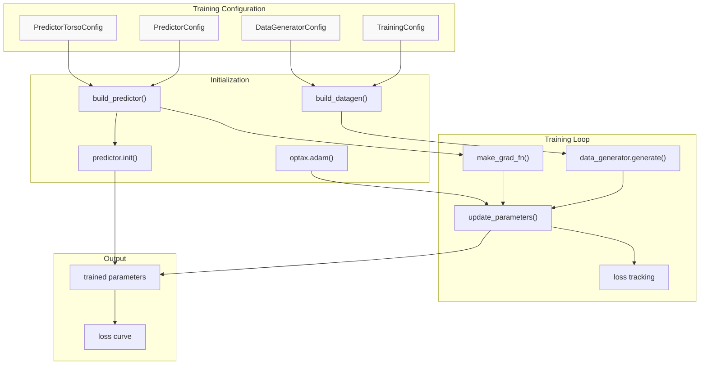
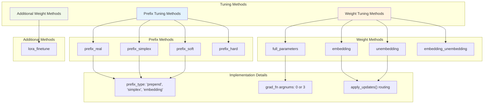
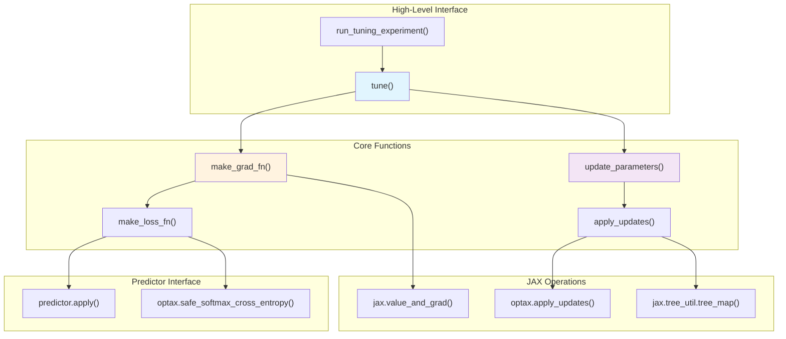
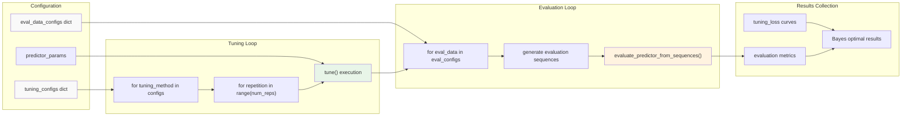

<!-- source: DeepWiki mcp.deepwiki.com · repo google-deepmind/thunnini · page 2.5 Training and Tuning · fetched 2026-10-26 -->

# Training and Tuning

<details>
<summary>Relevant source files</summary>

The following files were used as context for generating this wiki page:

- [src/predictor_tuning_functions.py](src/predictor_tuning_functions.py)
- [src/training.py](src/training.py)
- [src/tuning.py](src/tuning.py)

</details>


This document covers the training and tuning system in Thunnini, which implements pretraining of neural predictors and fine-tuning using nine different methods. The training phase provides initial model parameters through supervised learning on synthetic data, while the tuning phase adapts these parameters using various fine-tuning strategies including prefix tuning, weight tuning, and LoRA.

For information about the model architectures that get trained and tuned, see [Model Architecture](#2.4). For evaluation of trained and tuned models, see [Evaluation and Visualization](#2.6).

## Training System Overview

The training system in Thunnini performs pretraining of neural predictors using synthetic data generators. Training is implemented in the `train()` function and produces initial model parameters that serve as starting points for subsequent fine-tuning.

### Training Workflow



**Training Process Flow**

Sources: [src/training.py:30-95]()

The `train()` function orchestrates the complete pretraining process. It initializes data generators and predictors from configurations, sets up an Adam optimizer with gradient clipping, and runs a training loop for a specified number of steps. Each step generates new synthetic sequences and updates model parameters using full parameter gradients.

For non-trainable torsos (like oracle models), training is skipped entirely and the function returns the initial parameters unchanged.

## Tuning System Overview

The tuning system implements fine-tuning of pretrained models using nine different methods. Fine-tuning adapts models to new data distributions or tasks while preserving learned representations.

### Tuning Methods Taxonomy



**Tuning Methods Classification**

Sources: [src/tuning.py:54-172](), [src/predictor_tuning_functions.py:87-105]()

### Prefix Tuning Methods

Prefix tuning methods optimize learned prefixes that are prepended to input sequences. The prefix acts as a task-specific prompt that guides model behavior without modifying core parameters.

| Method | Prefix Type | Dimensionality | Constraint |
|--------|-------------|----------------|------------|
| `prefix_real` | `'prepend'` | `token_dimensionality` | Unconstrained real values |
| `prefix_simplex` | `'simplex'` | `token_dimensionality` | Probability simplex |
| `prefix_soft` | `'embedding'` | `embedding_dimensionality` | Embedding space |
| `prefix_hard` | `'hard'` | `token_dimensionality` | Discrete token selection |

Sources: [src/tuning.py:102-114](), [src/tuning.py:245-256]()

### Weight Tuning Methods

Weight tuning methods directly update model parameters, either globally or for specific parameter subsets.

| Method | Updated Parameters | Use Case |
|--------|-------------------|----------|
| `full_parameters` | All model weights | Complete fine-tuning |
| `embedding` | Input embedding layer | Input adaptation |
| `unembedding` | Output projection layer | Output adaptation |
| `embedding_unembedding` | Input + output layers | Vocabulary adaptation |

Sources: [src/predictor_tuning_functions.py:92-104]()

### Additional Weight Methods

| Method | Technique | Requirements |
|--------|-----------|--------------|
| `lora_finetune` | Low-rank adaptation | TransformerTorsoConfig with `use_lora=True` |

Sources: [src/predictor_tuning_functions.py:94-95](), [src/predictor_tuning_functions.py:144-150]()

## Core Tuning Functions

The tuning system relies on several core functions that handle loss computation, gradient calculation, and parameter updates.

### Function Call Hierarchy



**Core Function Dependencies**

Sources: [src/predictor_tuning_functions.py:107-196](), [src/tuning.py:130-139]()

### Loss and Gradient Functions

The `make_loss_fn()` function creates a loss function that computes cross-entropy loss over sequences, excluding prefix tokens from the loss calculation. The `make_grad_fn()` function wraps the loss function with `jax.value_and_grad()`, routing gradients to either model parameters or prefix based on the tuning method.

Sources: [src/predictor_tuning_functions.py:107-153]()

### Parameter Update Logic

The `apply_updates()` function routes parameter updates based on tuning method using pattern matching. For prefix methods, updates are applied to the prefix. For weight methods, updates are selectively applied to specific parameter subsets using path-aware filtering.

```python
# Key routing logic in apply_updates()
match tuning_method:
    case 'prefix_real' | 'prefix_simplex' | 'prefix_soft':
        return params, optax.apply_updates(prefix, updates)
    case 'full_parameters':
        return full_update_without_lora(params, updates), prefix
    case 'lora_finetune':
        return partial_update(params, updates, ['LoRA']), prefix
```

Sources: [src/predictor_tuning_functions.py:87-105]()

## Experimental Framework

The `run_tuning_experiment()` function provides a comprehensive framework for running tuning experiments with multiple methods, repetitions, and evaluation datasets.

### Experiment Execution Flow



**Experimental Framework Architecture**

Sources: [src/tuning.py:175-367]()

### Key Experimental Features

The experimental framework supports:

- **Multiple tuning methods**: Each method in `tuning_configs` dict is executed independently
- **Repetition handling**: Multiple runs with different initialization seeds for statistical analysis
- **Cross-evaluation**: Each tuned model is evaluated on all datasets in `eval_data_configs`
- **Baseline comparison**: Automatic inclusion of Bayes optimal and ground truth baselines
- **Optional untuned evaluation**: Comparison against the original pretrained model

The framework returns structured results containing tuning loss curves, evaluation metrics, and optionally the tuned parameters and prefixes for further analysis.

Sources: [src/tuning.py:225-367]()

---

