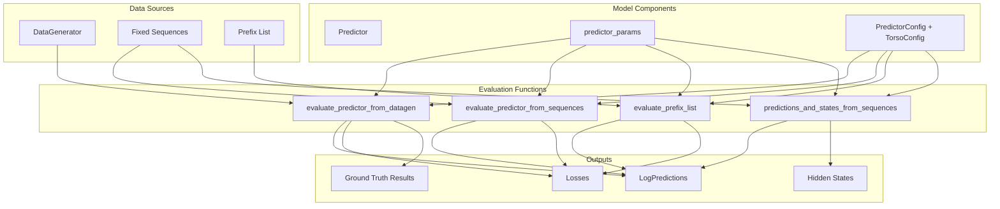
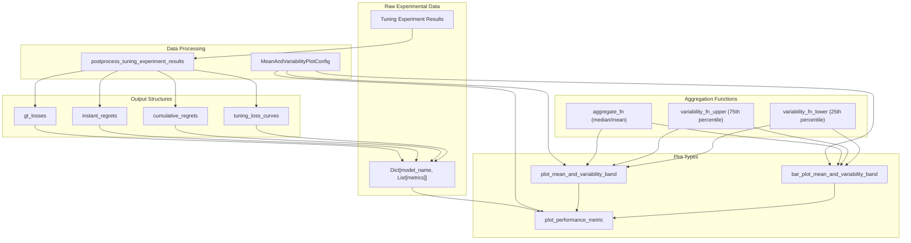
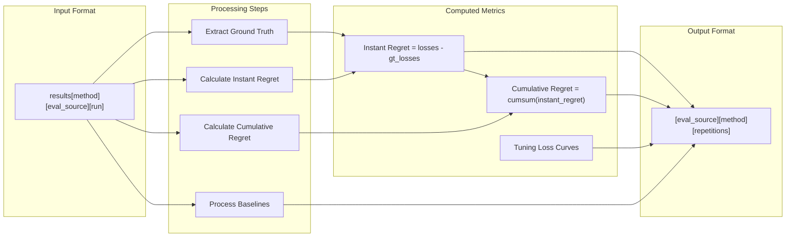

<!-- source: DeepWiki mcp.deepwiki.com · repo google-deepmind/thunnini · page 2.6 Evaluation and Visualization · fetched 2026-10-26 -->

# Evaluation and Visualization

Relevant source files

The following files were used as context for generating this wiki page:

- [src/evaluation.py](src/evaluation.py)
- [src/plot_utils.py](src/plot_utils.py)

This page documents the evaluation and visualization systems in Thunnini, which provide comprehensive tools for assessing fine-tuned model performance and creating publication-quality plots. The evaluation system ([src/evaluation.py]()) offers multiple ways to evaluate predictors against data sources, while the visualization system ([src/plot_utils.py]()) provides utilities for plotting performance metrics with proper statistical aggregation and error bands.

For information about the training and tuning processes that produce the models being evaluated, see [Training and Tuning](#2.5). For details about the data generation systems used in evaluation, see [Data Generation](#2.3).

## Evaluation System Architecture

The evaluation system provides four main evaluation pathways, each designed for different use cases and data sources.

### Evaluation Function Overview

Sources: [src/evaluation.py:31-314]()

### Core Evaluation Functions

**Evaluation from Data Generator**
The `evaluate_predictor_from_datagen` function generates fresh data and evaluates the predictor on it. This is the primary evaluation method used during experiments, as it can optionally return ground truth and Bayes-optimal results for computing regret metrics.

Key features:
- Generates multiple batches for larger evaluation datasets
- Optional return of ground truth and Bayes-optimal predictions
- Supports all prefix types and custom prefixes
- Handles memory management through batching

**Evaluation from Fixed Sequences**
The `evaluate_predictor_from_sequences` function evaluates on pre-generated sequences. This is useful for consistent evaluation across different models or when evaluation data needs to be cached.

Key features:
- Batching support for memory-efficient evaluation of large sequence sets
- Reusable predictor instances for multiple evaluations
- Flexible configuration through either configs or predictor instances

**Prefix Evaluation**
The `evaluate_prefix_list` function efficiently evaluates multiple prefixes on the same predictor and sequences, optimizing for experiments that test different prefix configurations.

**State Extraction**
The `predictions_and_states_from_sequences` function returns internal model states in addition to predictions, enabling analysis of model internals and hidden representations.

Sources: [src/evaluation.py:31-129](), [src/evaluation.py:132-211](), [src/evaluation.py:214-254](), [src/evaluation.py:257-314]()

## Visualization System Architecture

The visualization system provides a comprehensive framework for creating publication-quality plots with proper statistical aggregation across multiple experimental runs.

### Plotting Pipeline

Sources: [src/plot_utils.py:275-371](), [src/plot_utils.py:35-62](), [src/plot_utils.py:204-272]()

### Plot Configuration System

The `MeanAndVariabilityPlotConfig` dataclass provides comprehensive control over plot appearance and statistical aggregation:

| Configuration Parameter | Default Value | Purpose |
|-------------------------|---------------|---------|
| `aggregate_fn` | `np.median` | Function for central tendency (median/mean) |
| `variability_fn_upper` | 75th percentile | Upper bound for error bands |
| `variability_fn_lower` | 25th percentile | Lower bound for error bands |
| `alpha` | 0.25 | Transparency for variability bands |
| `aggregate_linewidth` | 1.5 | Line width for main trend line |
| `show_individual_lines` | False | Whether to show individual repetitions |
| `fill_band` | True | Fill variability band vs. line borders only |

Sources: [src/plot_utils.py:35-62]()

### Statistical Aggregation

The plotting system applies statistical functions along specified axes to handle multiple experimental repetitions:

- **Central Tendency**: Configurable via `aggregate_fn` (typically median or mean)
- **Variability**: Quantile-based (25th/75th percentiles) or standard deviation
- **Individual Lines**: Optional display of all repetitions with transparency
- **Axis Control**: Flexible aggregation along different array dimensions

Sources: [src/plot_utils.py:64-140](), [src/plot_utils.py:143-202]()

## Experimental Results Processing

The `postprocess_tuning_experiment_results` function transforms raw experimental outputs into a standardized format optimized for visualization and analysis.

### Data Transformation Pipeline

The transformation produces four key outputs:

1. **Ground Truth Losses**: Reference losses for regret computation
2. **Instant Regrets**: Per-timestep regret relative to ground truth
3. **Cumulative Regrets**: Running sum of instant regrets
4. **Tuning Loss Curves**: Training losses during fine-tuning process

This standardized format enables direct integration with `plot_performance_metric` for automated visualization across methods and evaluation sources.

Sources: [src/plot_utils.py:275-371]()

## Integration with Training Pipeline

The evaluation and visualization systems integrate seamlessly with the training pipeline to provide end-to-end experimental workflows.

### Typical Evaluation Workflow

1. **Model Training**: Train predictor using [training.py](#2.5)
2. **Fine-tuning**: Apply tuning methods using [tuning.py](#2.5)  
3. **Evaluation**: Assess performance using `evaluate_predictor_from_datagen`
4. **Result Processing**: Transform results using `postprocess_tuning_experiment_results`
5. **Visualization**: Generate plots using `plot_performance_metric`

### Baseline Comparisons

The evaluation system automatically handles three types of baselines:

- **Ground Truth**: Optimal performance with access to true data distribution
- **Bayes Optimal**: Best possible performance given the model architecture
- **NoTuning**: Performance without fine-tuning (pretrained model only)

These baselines are computed during evaluation and integrated into the visualization pipeline for comprehensive performance comparison.

Sources: [src/evaluation.py:87-105](), [src/plot_utils.py:323-338]()

---

