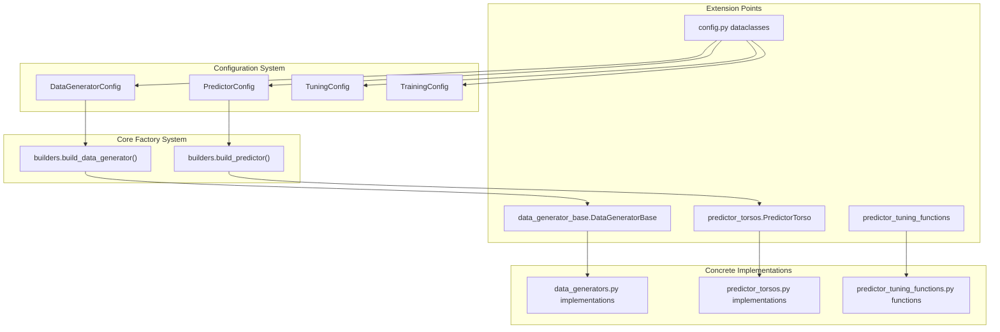
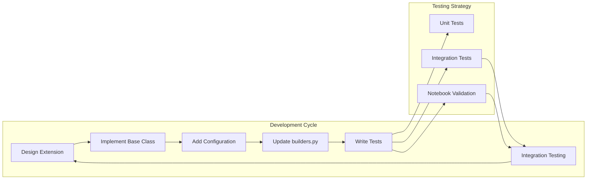

<!-- source: DeepWiki mcp.deepwiki.com · repo google-deepmind/thunnini · page 3 Development Guide · fetched 2026-10-26 -->

# Development Guide

<details>
<summary>Relevant source files</summary>

The following files were used as context for generating this wiki page:

- [.gitignore](.gitignore)
- [CONTRIBUTING.md](CONTRIBUTING.md)

</details>


This document provides essential information for developers who want to extend, modify, or contribute to the Thunnini fine-tuning research library. It covers development environment setup, code organization, extension points, and contribution workflows.

For information about using the library as an end user, see [Overview](#1). For testing procedures, see [Testing](#3.1). For contribution guidelines and community standards, see [Contributing](#3.2).

## Development Environment Setup

### Prerequisites

Thunnini is built on the JAX ecosystem and requires Python 3.8 or higher. The core dependencies include JAX, Flax, Optax, and Distrax for the machine learning components, along with NumPy, SciPy, and matplotlib for scientific computing and visualization.

### Installation for Development

For development, clone the repository and install in editable mode to enable immediate testing of code changes without reinstallation:

```bash
git clone https://github.com/google-deepmind/thunnini.git
cd thunnini
pip install -e .
```

The repository follows standard Python project structure with source code in `src/` and tests organized by component.

Sources: [.gitignore:1-25]()

## Code Organization and Extension Points

The Thunnini library is designed with clear separation of concerns and well-defined extension points for adding new functionality.

### Core Architecture Overview



### Primary Extension Points

The library provides four main extension points for adding new functionality:

| Extension Point | Base Class/Module | Purpose |
|----------------|-------------------|---------|
| **Data Generators** | `data_generator_base.DataGeneratorBase` | Add new synthetic data distributions |
| **Model Architectures** | `predictor_torsos.PredictorTorso` | Implement new neural network architectures |
| **Tuning Methods** | `predictor_tuning_functions` | Create new fine-tuning strategies |
| **Configuration** | `config.py` dataclasses | Define new configuration parameters |

Sources: [System Architecture diagrams]()

### Development Workflow for Extensions



## Extending Data Generators

To add a new data generation strategy, extend the `DataGeneratorBase` class and implement the required abstract methods. The base class defines the interface for generating synthetic sequential data.

### Implementation Steps

1. **Create Implementation Class**: Inherit from `DataGeneratorBase` in `data_generators.py`
2. **Add Configuration**: Define corresponding dataclass in `config.py`
3. **Update Factory**: Add case to `build_data_generator()` in `builders.py`
4. **Write Tests**: Create test cases covering the new generator

The `DataGeneratorBase` class requires implementing methods for sequence generation, vocabulary management, and distribution parameters. Each generator must provide consistent interfaces for training data generation and evaluation.

Sources: [System Architecture diagrams]()

## Extending Model Architectures

New neural network architectures are added by implementing the `PredictorTorso` interface in `predictor_torsos.py`. This abstraction separates the core model logic from the prediction wrapper.

### Architecture Integration

The `Predictor` class in `predictor.py` wraps `PredictorTorso` implementations and provides a consistent interface for training, tuning, and evaluation. When adding new architectures:

1. **Implement PredictorTorso**: Define the neural network forward pass and parameter structure
2. **Add Configuration**: Extend `PredictorConfig` with architecture-specific parameters  
3. **Update Factory**: Modify `build_predictor()` to instantiate the new architecture
4. **Test Integration**: Ensure compatibility with all tuning methods

The library currently supports LSTM, Transformer, and Linear architectures as reference implementations.

Sources: [System Architecture diagrams]()

## Extending Tuning Methods

Fine-tuning strategies are implemented as functions in `predictor_tuning_functions.py`. Each tuning method defines how model parameters are updated during the fine-tuning process.

### Tuning Function Structure

Tuning functions follow a consistent signature pattern and are organized into three categories:

- **Prefix Tuning**: Methods that add learnable prefixes (hard, soft, simplex, real)
- **Weight Tuning**: Methods that update existing parameters (full, embedding, unembedding, both)
- **Additional Weights**: Methods that add new parameters (LoRA)

To add a new tuning method:

1. **Implement Function**: Add tuning function with standard signature
2. **Add Configuration**: Extend `TuningConfig` with method-specific parameters
3. **Update Dispatcher**: Modify tuning dispatch logic in `tuning.py`
4. **Test Compatibility**: Verify functionality across different model architectures

Sources: [System Architecture diagrams]()

## Code Style and Standards

### Type Annotations

The library makes extensive use of type annotations defined in `types.py`. All new code should include comprehensive type hints using the established type aliases and generic types.

### Configuration Management

All configurable aspects of the system use dataclasses defined in `config.py`. This provides type safety, default values, and serialization capabilities. New functionality should follow this pattern rather than using dictionaries or other ad-hoc configuration methods.

### JAX Conventions

Code follows JAX functional programming conventions with pure functions and immutable data structures. Avoid stateful objects and ensure all functions are compatible with JAX transformations like `jit`, `vmap`, and `grad`.

### Testing Requirements

All new functionality requires corresponding test coverage. Tests should be organized by component and include both unit tests for individual functions and integration tests for end-to-end workflows.

Sources: [CONTRIBUTING.md:1-26](), [.gitignore:1-25]()

## Development Tools and Utilities

### Jupyter Notebook Development

The library includes two primary notebook interfaces that serve as both documentation and development tools:

- **ThunniniDemo.ipynb**: Quick start examples for testing new functionality
- **ThunniniExperiment.ipynb**: Full experimental pipeline for comprehensive testing

When developing new features, update these notebooks to demonstrate usage and validate integration with existing components.

### Debugging and Profiling

JAX provides built-in debugging tools that are particularly useful for development:

- Use `jax.debug.print()` for debugging inside JIT-compiled functions
- Enable JAX debug mode for additional error checking during development
- Profile memory usage and computation time for performance optimization

Sources: [System Architecture diagrams]()

---

