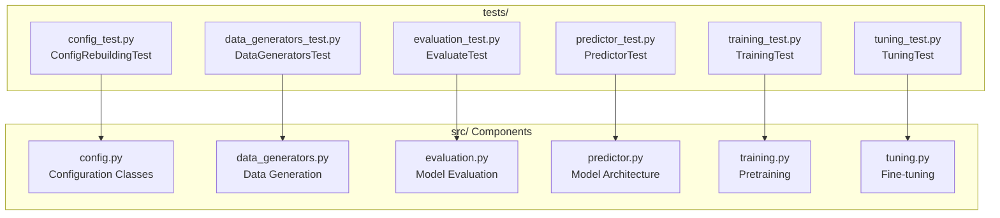
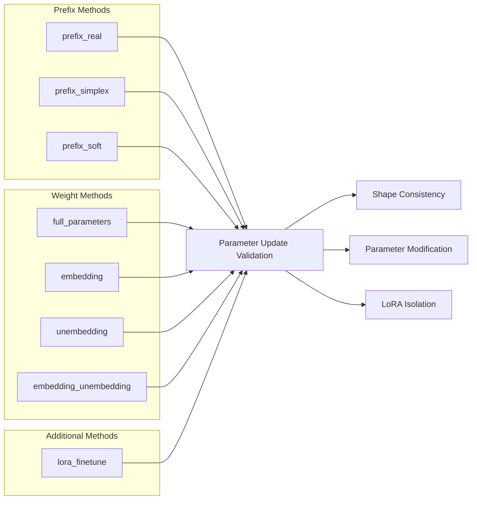
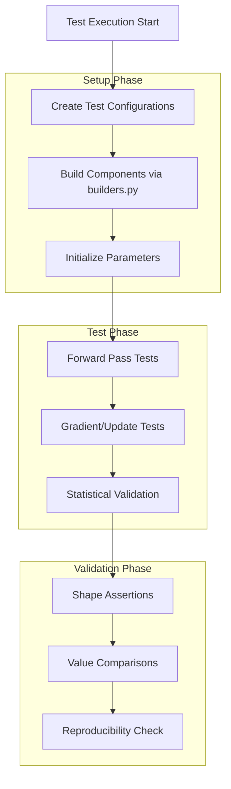

<!-- source: DeepWiki mcp.deepwiki.com · repo google-deepmind/thunnini · page 3.1 Testing · fetched 2026-10-26 -->

# Testing

<details>
<summary>Relevant source files</summary>

The following files were used as context for generating this wiki page:

- [tests/config_test.py](tests/config_test.py)
- [tests/data_generators_test.py](tests/data_generators_test.py)
- [tests/evaluation_test.py](tests/evaluation_test.py)
- [tests/predictor_test.py](tests/predictor_test.py)
- [tests/training_test.py](tests/training_test.py)
- [tests/tuning_test.py](tests/tuning_test.py)

</details>


This document covers the test suite structure and testing methodology for the Thunnini library. It explains how to run tests, understand test organization, and add new tests for different components. For information about the core system architecture being tested, see [System Architecture](#2).

## Test Suite Overview

The Thunnini test suite is organized around the main library components, with each test file corresponding to a specific module or functionality area. Tests are implemented using the `absltest` framework with `parameterized` testing support and `chex` for assertions.

### Test Organization Structure



Sources: [tests/config_test.py:1-238](), [tests/data_generators_test.py:1-188](), [tests/evaluation_test.py:1-132](), [tests/predictor_test.py:1-352](), [tests/training_test.py:1-60](), [tests/tuning_test.py:1-115]()

## Test Categories by Component

### Configuration System Tests

The `ConfigRebuildingTest` class verifies that configuration objects can be correctly instantiated from dictionaries and reconstructed.

| Test Method | Purpose | Key Assertions |
|-------------|---------|----------------|
| `test_config_instantiation` | Config creation from dicts | Shape and content equality |

**Tested Configuration Types:**
- `CategoricalGeneratorConfig`
- `MixtureOfCategoricalsGeneratorConfig`
- `DirichletCategoricalGeneratorConfig`
- `TrainingConfig`
- `PredictorConfig`
- `LinearTorsoConfig`
- `TransformerTorsoConfig`
- `LSTMTorsoConfig`

Sources: [tests/config_test.py:180-234]()

### Data Generator Tests

The `DataGeneratorsTest` class validates data generation functionality across different generator types.

| Test Method | Purpose | Validation Focus |
|-------------|---------|------------------|
| `test_sample_from_datagen` | Basic sampling functionality | Determinism, shape consistency |
| `test_categorical_generator_statistics` | Categorical distribution accuracy | Probability matching |
| `test_dirichlet_categorical_generator_statistics` | Bayesian inference correctness | Convergence properties |
| `test_mixture_of_categorical_generator_statistics` | Mixture model behavior | Component identification |

**Testing Pattern for New Generators:**
1. Add configuration constant at [tests/data_generators_test.py:37-58]()
2. Add to parameterized test list at [tests/data_generators_test.py:64-66]()
3. Implement statistics validation method

Sources: [tests/data_generators_test.py:61-184]()

### Predictor Tests

The `PredictorTest` class comprehensively tests neural network architectures and tuning methods.

**Forward Pass Testing:**
- Standard prediction calls
- Prefix-based predictions (real, simplex, embedding)
- State return validation

**Parameter Update Testing:**
All nine tuning methods are validated:



Sources: [tests/predictor_test.py:76-348]()

### Training and Tuning Tests

**Training Tests:**
- `TrainingTest.test_training_loop` validates the complete pretraining pipeline

**Tuning Tests:**
- Parameter vs. prefix modification validation
- Multiple tuning method support
- Deterministic behavior verification

Sources: [tests/training_test.py:47-56](), [tests/tuning_test.py:59-111]()

### Evaluation Tests

The `EvaluateTest` class verifies model evaluation across different architectures:

| Function Under Test | Validation | Batch Processing |
|---------------------|------------|------------------|
| `evaluate_predictor_from_sequences` | Shape, determinism | Chunked evaluation |
| `evaluate_predictor_from_datagen` | Multi-batch consistency | Generator integration |

Sources: [tests/evaluation_test.py:64-128]()

## Testing Framework and Patterns

### Core Testing Libraries

```python
from absl.testing import absltest
from absl.testing import parameterized
import chex
```

**Framework Usage:**
- `absltest`: Main testing framework
- `parameterized`: Multi-configuration testing
- `chex`: JAX-specific assertions for shapes and numerical equality

### Common Testing Patterns

**Parameterized Testing:**
Tests use `@parameterized.parameters` to run the same test logic across multiple configurations.

**Shape Validation:**
```python
chex.assert_shape(tensor, expected_shape)
chex.assert_equal_shape([tensor1, tensor2])
```

**Determinism Testing:**
Multiple calls with identical random seeds must produce identical results.

**Tree Equality:**
```python
chex.assert_trees_all_equal(tree1, tree2)
chex.assert_trees_all_close(tree1, tree2, rtol=tolerance)
```

Sources: [tests/predictor_test.py:20-24](), [tests/data_generators_test.py:27-34]()

## Running Tests

### Individual Test Files
```bash
python -m tests.config_test
python -m tests.data_generators_test
python -m tests.evaluation_test
python -m tests.predictor_test
python -m tests.training_test
python -m tests.tuning_test
```

### Test Execution Flow



Sources: [tests/predictor_test.py:98-106](), [tests/data_generators_test.py:67-81]()

## Adding New Tests

### For New Data Generators

1. **Add Configuration:** Create test configuration constants following the pattern in [tests/data_generators_test.py:37-58]()

2. **Add to Parameterized Test:** Include in the parameter list at [tests/data_generators_test.py:64-66]()

3. **Implement Statistics Test:** Create a method following the pattern of `test_categorical_generator_statistics`

### For New Tuning Methods

1. **Update Predictor Test:** Add the new tuning method to the iteration in [tests/predictor_test.py:171]()

2. **Implement Update Logic:** Add handling in the match statement at [tests/predictor_test.py:299-347]()

3. **Define Validation:** Specify expected parameter modification behavior

### Test Configuration Pattern

Tests use small-scale configurations for fast execution:

```python
_TEST_CONFIG = config_lib.SomeConfig(
    batch_size=16,      # Small batch for speed
    sequence_length=10, # Short sequences
    vocab_size=2,       # Binary vocabulary
    # Other minimal parameters
)
```

Sources: [tests/training_test.py:24-44](), [tests/tuning_test.py:29-56]()

## Test Dependencies and Imports

All tests follow the same import pattern for consistency:

```python
# Standard testing
from absl.testing import absltest
from absl.testing import parameterized

# JAX ecosystem
import chex
import jax
import jax.numpy as jnp

# Thunnini components
from thunnini.src import builders
from thunnini.src import config as config_lib
# Additional module-specific imports
```

This structure ensures tests can build components through the standard factory pattern and validate behavior using appropriate assertion libraries.

Sources: [tests/predictor_test.py:16-30](), [tests/evaluation_test.py:16-25]()

---

