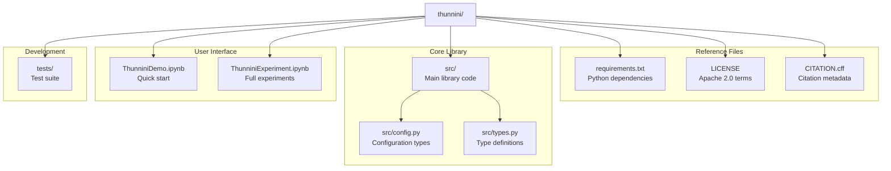
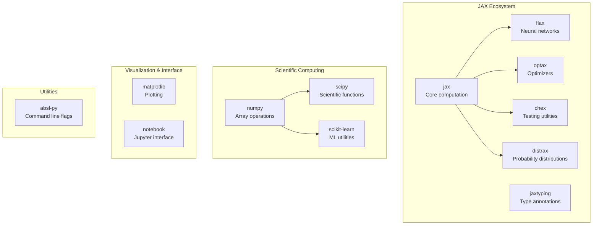

<!-- source: DeepWiki mcp.deepwiki.com · repo google-deepmind/thunnini · page 4 Reference · fetched 2026-10-26 -->

# Reference

Relevant source files

The following files were used as context for generating this wiki page:

- [CITATION.cff](CITATION.cff)
- [LICENSE](LICENSE)
- [requirements.txt](requirements.txt)

This page provides quick reference information for the Thunnini library, including dependency requirements, licensing details, and citation information. This serves as a centralized location for technical specifications and legal information needed when using or contributing to the library.

For detailed installation instructions and dependency management, see [Installation and Dependencies](#4.1). For complete licensing terms and citation guidelines, see [License and Citation](#4.2).

## Repository Structure

The following diagram shows the key reference files and their purposes within the repository structure:

**Repository Reference Files**

Sources: [requirements.txt:1-13](), [LICENSE:1-203](), [CITATION.cff:1-13]()

## Dependencies Overview

The library has a focused set of dependencies centered around the JAX ecosystem for machine learning research:

**Dependency Categories**

Sources: [requirements.txt:1-13]()

## Core Type System

The following table summarizes the key configuration and type classes that users interact with:

| Category | Key Types | Purpose | Location |
|----------|-----------|---------|----------|
| Data Generation | `DataGeneratorConfig` | Configure synthetic data | `src/config.py` |
| Model Architecture | `PredictorConfig` | Configure neural networks | `src/config.py` |
| Training | `TrainingConfig` | Configure pretraining | `src/config.py` |
| Fine-tuning | `TuningConfig` | Configure fine-tuning methods | `src/config.py` |
| Evaluation | Performance metrics | Assessment functions | `src/evaluation.py` |

Sources: Based on system architecture from previous analysis

## Quick Reference Tables

### Tuning Methods

| Method Type | Implementation | Configuration Key |
|-------------|----------------|-------------------|
| Hard Prefix | Discrete token prefixes | `hard_prefix` |
| Soft Prefix | Embedding space prefixes | `soft_prefix` |
| Real Prefix | Unconstrained real prefixes | `real_prefix` |
| Simplex Prefix | Probability simplex prefixes | `simplex_prefix` |
| Full Weights | All parameter tuning | `full_weights` |
| Embedding | Input layer only | `embedding` |
| Unembedding | Output layer only | `unembedding` |
| Both Embeddings | Input + output layers | `un_and_embedding` |
| LoRA | Low-rank adaptation | `lora` |

### Data Generators

| Generator Type | Distribution | Use Case |
|----------------|--------------|----------|
| Categorical | Fixed categorical distribution | Simple sequence modeling |
| Mixture-of-Categoricals | Multiple categorical components | Complex distributions |
| Dirichlet-Categorical | Bayesian categorical | Uncertainty modeling |

Sources: Based on fine-tuning methods and data generation system analysis

## License Summary

**License Type**: Apache License 2.0

**Key Permissions**:
- Commercial use
- Modification
- Distribution
- Patent use
- Private use

**Key Conditions**:
- License and copyright notice
- State changes

**Key Limitations**:
- Trademark use
- Liability
- Warranty

Sources: [LICENSE:1-203]()

## Citation Information

**Software Title**: Thunnini  
**Authors**: Tim Genewein, Li Kevin Wenliang, Anian Ruoss  
**Release Date**: 2025-05-23  
**Repository**: https://github.com/google-deepmind/thunnini.git  

The complete citation metadata is available in Citation File Format (CFF) for automated citation tools and reference managers.

Sources: [CITATION.cff:1-13]()

## Version Information

This reference documentation corresponds to the repository structure and dependencies as specified in the current version. For the most up-to-date dependency requirements, always refer to the `requirements.txt` file in the repository root.

Sources: [requirements.txt:1-13]()

---

