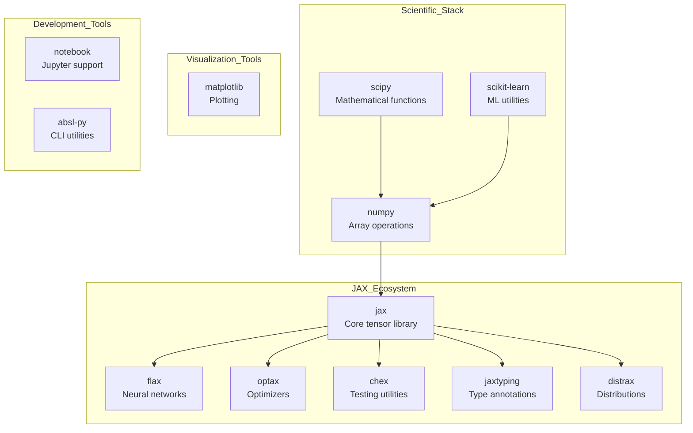
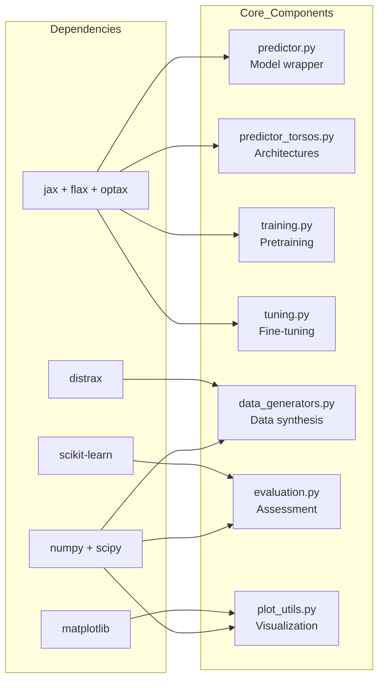

<!-- source: DeepWiki mcp.deepwiki.com · repo google-deepmind/thunnini · page 4.1 Installation and Dependencies · fetched 2026-10-26 -->

# Installation and Dependencies

<details>
<summary>Relevant source files</summary>

The following files were used as context for generating this wiki page:

- [requirements.txt](requirements.txt)

</details>


This document provides detailed information about the Python dependencies required to run Thunnini and instructions for setting up the development environment. It covers the core dependencies, optional packages, and system requirements needed for fine-tuning research workflows.

For information about running experiments after installation, see [Quick Start Guide](#1.1). For development setup and testing requirements, see [Testing](#3.1).

## Dependency Overview

Thunnini requires several categories of dependencies to support its machine learning research capabilities. The complete dependency list is defined in [requirements.txt:1-12]().

### Core Dependencies Table

| Dependency | Category | Purpose |
|------------|----------|---------|
| `jax` | ML Framework | Core computational framework for neural networks |
| `flax` | ML Framework | Neural network library built on JAX |
| `optax` | ML Framework | Optimization library for gradient-based learning |
| `chex` | ML Framework | Testing and debugging utilities for JAX |
| `jaxtyping` | ML Framework | Type annotations for JAX arrays |
| `distrax` | ML Framework | Probability distributions for JAX |
| `numpy` | Scientific Computing | Fundamental array operations |
| `scipy` | Scientific Computing | Advanced mathematical functions |
| `matplotlib` | Visualization | Plotting and visualization |
| `scikit-learn` | ML Utilities | Machine learning utilities and metrics |
| `absl-py` | Utilities | Command-line flags and application utilities |
| `notebook` | Development | Jupyter notebook support |

## Dependency Architecture

### JAX Ecosystem Dependencies


**Dependencies to Core Components Mapping**


Sources: [requirements.txt:1-12]()

## Installation Instructions

### Standard Installation

```bash
# Clone the repository
git clone https://github.com/google-deepmind/thunnini.git
cd thunnini

# Install dependencies
pip install -r requirements.txt
```

### Development Installation

```bash
# Install in editable mode for development
pip install -e .

# Install additional development dependencies if needed
pip install -r requirements.txt
```

### Virtual Environment Setup

```bash
# Create virtual environment
python -m venv thunnini-env
source thunnini-env/bin/activate  # On Windows: thunnini-env\Scripts\activate

# Install dependencies
pip install -r requirements.txt
```

Sources: [requirements.txt:1-12]()

## Dependency Categories and Usage

### JAX Ecosystem Components

The core of Thunnini relies on the JAX ecosystem for high-performance machine learning:

- **`jax`**: Provides the foundational array operations and automatic differentiation used throughout the predictor implementations
- **`flax`**: Supplies the neural network primitives used in `predictor_torsos.py` for LSTM, Transformer, and Linear architectures
- **`optax`**: Provides optimizers used in `training.py` and `tuning.py` for gradient-based parameter updates
- **`chex`**: Offers testing utilities and array assertions used across the codebase
- **`jaxtyping`**: Enables precise type annotations for JAX arrays in function signatures
- **`distrax`**: Supplies probability distributions used in `data_generators.py` for synthetic data generation

### Scientific Computing Stack

- **`numpy`**: Fundamental array operations used throughout data processing and evaluation
- **`scipy`**: Advanced mathematical functions for statistical computations in evaluation metrics
- **`scikit-learn`**: Machine learning utilities used in `evaluation.py` for baseline comparisons and metrics

### Visualization and Development

- **`matplotlib`**: Plotting functionality used extensively in `plot_utils.py` for experimental result visualization
- **`notebook`**: Jupyter notebook support for the demo and experiment notebooks
- **`absl-py`**: Command-line application utilities and structured logging

Sources: [requirements.txt:1-12]()

## System Requirements

### Python Version
- Python 3.8 or higher
- Compatible with Python 3.9 and 3.10

### Hardware Considerations
- **CPU**: Works on standard CPUs, though JAX provides better performance with vectorized operations
- **GPU**: Optional but recommended for faster training - JAX automatically detects and uses available GPUs
- **Memory**: Minimum 8GB RAM recommended for typical experiments

### Platform Support
- Linux (primary development platform)
- macOS (supported through JAX)
- Windows (supported with appropriate JAX installation)

Sources: [requirements.txt:1-12]()

---

