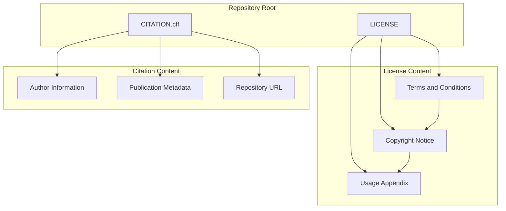
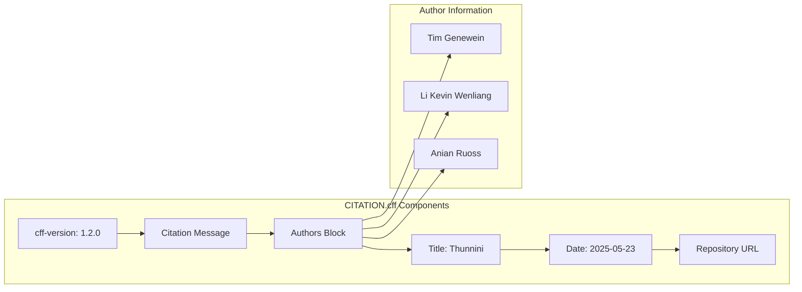

<!-- source: DeepWiki mcp.deepwiki.com · repo google-deepmind/thunnini · page 4.2 License and Citation · fetched 2026-10-26 -->

# License and Citation

<details>
<summary>Relevant source files</summary>

The following files were used as context for generating this wiki page:

- [CITATION.cff](CITATION.cff)
- [LICENSE](LICENSE)

</details>


This page provides comprehensive information about the licensing terms for the Thunnini library and proper citation guidelines for academic and research use. This documentation covers the legal framework governing the use, modification, and distribution of the software, as well as standardized citation formats for referencing the library in publications.

## License Information

The Thunnini library is distributed under the Apache License 2.0, a permissive open-source license that allows for both commercial and non-commercial use, modification, and distribution of the software.

### Apache License 2.0 Overview

The software is licensed under Apache License Version 2.0, effective January 2004. This license provides the following key permissions and requirements:

| Permission | Description |
|------------|-------------|
| **Commercial Use** | Software may be used for commercial purposes |
| **Modification** | Software may be modified |
| **Distribution** | Software may be distributed |
| **Patent Use** | License provides express grant of patent rights from contributors |
| **Private Use** | Software may be used and modified in private |

| Requirement | Description |
|-------------|-------------|
| **License Notice** | Copy of license must be included with the software |
| **State Changes** | Changes made to the software must be documented |
| **Include Copyright** | Original copyright notice must be retained |

### License File Structure



**Sources:** [LICENSE:1-203](), [CITATION.cff:1-13]()

### Key License Terms

The Apache License 2.0 grants broad permissions while maintaining minimal restrictions. Key sections include:

- **Grant of Copyright License** [LICENSE:67-72](): Provides perpetual, worldwide, royalty-free copyright license
- **Grant of Patent License** [LICENSE:74-88](): Includes patent rights protection
- **Redistribution Requirements** [LICENSE:90-129](): Specifies conditions for redistribution
- **Disclaimer of Warranty** [LICENSE:144-152](): Software provided "AS IS" without warranties

**Sources:** [LICENSE:67-152]()

## Citation Information

The Thunnini library uses the Citation File Format (CFF) to provide structured citation metadata. This standardized format enables automatic citation generation and proper academic attribution.

### Citation Metadata Structure



**Sources:** [CITATION.cff:1-13]()

### Standard Citation Format

Based on the metadata in [CITATION.cff:3-12](), the recommended citation format is:

```
Genewein, T., Wenliang, L. K., & Ruoss, A. (2025). 
Thunnini [Computer software]. 
https://github.com/google-deepmind/thunnini.git
```

### Author Information

The library has three primary authors as specified in [CITATION.cff:3-9]():

| Position | Family Name | Given Names |
|----------|-------------|-------------|
| 1st Author | Genewein | Tim |
| 2nd Author | Wenliang | Li Kevin |
| 3rd Author | Ruoss | Anian |

**Sources:** [CITATION.cff:3-9]()

## Usage Guidelines

### For Software Distribution

When redistributing or modifying Thunnini:

1. **Include License File**: The [LICENSE:1-203]() file must be included with any distribution
2. **Maintain Copyright**: Original copyright notices must be preserved
3. **Document Changes**: Any modifications must be clearly documented
4. **Include Attribution**: The [CITATION.cff:1-13]() file should be preserved for proper attribution

### For Academic Use

When using Thunnini in research or academic work:

1. **Cite the Software**: Use the citation format provided above
2. **Reference Repository**: Include the GitHub URL from [CITATION.cff:12]()
3. **Acknowledge Authors**: Credit all three authors listed in [CITATION.cff:3-9]()
4. **Specify Version**: Reference the specific version or commit used in your work

### License Integration Workflow

```mermaid
flowchart TD
    START["Start Using Thunnini"]
    
    subgraph "License Compliance"
        READ_LICENSE["Read LICENSE file"]
        UNDERSTAND_TERMS["Understand Terms & Conditions"]
        INCLUDE_LICENSE["Include LICENSE in Distribution"]
    end
    
    subgraph "Citation Compliance"
        READ_CITATION["Read CITATION.cff"]
        FORMAT_CITATION["Format Citation"]
        INCLUDE_REFERENCE["Include in References"]
    end
    
    subgraph "Usage Types"
        RESEARCH["Research Use"]
        COMMERCIAL["Commercial Use"]
        MODIFICATION["Modification"]
    end
    
    START --> READ_LICENSE
    START --> READ_CITATION
    
    READ_LICENSE --> UNDERSTAND_TERMS
    UNDERSTAND_TERMS --> RESEARCH
    UNDERSTAND_TERMS --> COMMERCIAL
    UNDERSTAND_TERMS --> MODIFICATION
    
    RESEARCH --> INCLUDE_LICENSE
    COMMERCIAL --> INCLUDE_LICENSE
    MODIFICATION --> INCLUDE_LICENSE
    
    READ_CITATION --> FORMAT_CITATION
    FORMAT_CITATION --> INCLUDE_REFERENCE
    
    INCLUDE_LICENSE --> "Compliant Usage"
    INCLUDE_REFERENCE --> "Proper Attribution"
```

**Sources:** [LICENSE:90-129](), [CITATION.cff:1-13]()

## File Relationships

The license and citation files work together to provide comprehensive legal and attribution framework:

- **LICENSE**: Provides legal terms for software use and distribution
- **CITATION.cff**: Provides structured metadata for academic citation
- Both files are located in the repository root for easy access and compliance

These files ensure that Thunnini can be used responsibly in both commercial and academic contexts while maintaining proper attribution to the original authors and respecting the open-source license terms.

**Sources:** [LICENSE:1-203](), [CITATION.cff:1-13]()