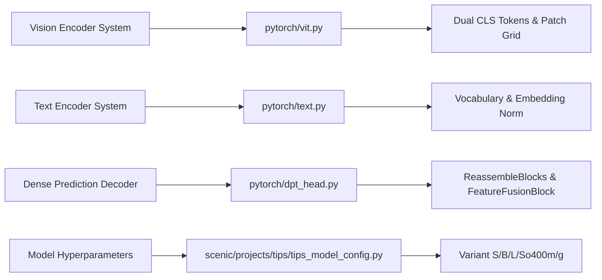

<!-- source: DeepWiki mcp.deepwiki.com · repo google-deepmind/tips · page 1 Overview · fetched 2026-10-26 -->

# Overview

Relevant source files

The following files were used as context for generating this wiki page:

- [README.md](README.md)
- [docs/images/overview.png](docs/images/overview.png)
- [docs/images/pca.png](docs/images/pca.png)
- [docs/images/tipsv2_block.png](docs/images/tipsv2_block.png)
- [docs/images/tipsv2_teaser.png](docs/images/tipsv2_teaser.png)

The **TIPS** series of models (**T**ext-**I**mage **P**retraining with **S**patial Awareness) represents foundational image-text encoders designed for general-purpose computer vision, dense prediction, and multimodal applications [README.md:10-24](). This repository houses the official implementations for both **TIPS** (ICLR 2025) and the latest **TIPSv2** (CVPR 2026), which introduces enhanced patch-text alignment and spatial reasoning [README.md:12-15]().

This wiki page serves as the parent overview of the repository structure, core model families, and documentation assets. For concrete installation steps and script execution details, refer to [Getting Started](#1.1). For comprehensive model sizing, architectural tiers, and checkpoint download instructions, refer to [Model Variants and Checkpoints](#1.2).

---

## Repository Layout and Architecture

The codebase is organized into two primary backend directories: a native **PyTorch** package (`pytorch/`) and a **JAX/Scenic** subsystem (`scenic/`) [README.md:56-58](). Both backends implement identical scaling variants and support core features such as intermediate layer feature extraction, patch-text contrastive alignment, and dense prediction heads.

### Repository Layout Diagram

```mermaid
graph TD
    Repo["Repository Root"] --> PyTorchDir["pytorch/"]
    Repo --> ScenicDir["scenic/"]
    Repo --> DocsDir["docs/images/"]

    PyTorchDir --> PtrRunImg["pytorch/run_image_encoder_inference.py"]
    PyTorchDir --> PtrRunTxt["pytorch/run_text_encoder_inference.py"]
    PyTorchDir --> PtrVit["pytorch/vit.py"]
    PyTorchDir --> PtrTxtMod["pytorch/text.py"]
    PyTorchDir --> PtrDpt["pytorch/dpt_head.py"]

    ScenicDir --> JaxInf["scenic/projects/tips/run_tips_inference.py"]
    ScenicDir --> JaxCfg["scenic/projects/tips/tips_model_config.py"]
    ScenicDir --> JaxMod["scenic/projects/tips/models/tips.py"]

    DocsDir --> ImgOverview["docs/images/overview.png"]
    DocsDir --> ImgPca["docs/images/pca.png"]
    DocsDir --> ImgBlock["docs/images/tipsv2_block.png"]
    DocsDir --> ImgTeaser["docs/images/tipsv2_teaser.png"]
```

*Sources: [README.md:56-58](), [README.md:18-35]()*

---

## Model Ecosystem & System Components

TIPS models bridge natural language text spaces and spatial vision representations by coupling Vision Transformer (ViT) backbones with text encoders and DPT (Dense Prediction Transformer) decoders. 

### System-to-Code Mapping

*Sources: [README.md:10-84]()*

---

## Model Variants Summary

The repository provides checkpoints across two major generations (`TIPSv1` and `TIPSv2`) spanning multiple parameter scales [README.md:25-83](). 

| Model Generation | Size / Variant | Vision / Text Parameters | Key Capabilities |
| :--- | :--- | :--- | :--- |
| **TIPSv2** | `g/14` | 1.1B / 389.1M [README.md:68-68]() | Enhanced patch-text alignment, high-resolution spatial awareness [README.md:13-23]() |
| **TIPSv2** | `SO/14` | 412.4M / 448.3M [README.md:69-69]() | Strong semantic segmentation and depth estimation [README.md:38-41]() |
| **TIPSv2** | `L/14` | 303.2M / 183.9M [README.md:70-70]() | Balanced compute and state-of-the-art zero-shot retrieval [README.md:66-71]() |
| **TIPSv2** | `B/14` | 85.7M / 109.6M [README.md:71-71]() | Lightweight baseline for edge and fast prototyping [README.md:66-71]() |
| **TIPSv1** | `g/14-HR` / `g/14-LR` | 1.1B / 389.1M [README.md:77-78]() | High-resolution / Low-resolution spatial variants [README.md:77-78]() |
| **TIPSv1** | `S/14-HR` | 21.6M / 33.6M [README.md:82-82]() | Ultra-compact text-image pretraining baseline [README.md:82-82]() |

For exhaustive benchmarking tables across 9 tasks and 20 datasets (including PASCAL VOC segmentation, NYU-depth, ImageNet-KNN, and Flickr30k cross-modal retrieval), consult [Model Variants and Checkpoints](#1.2) [README.md:23-83]().

Sources: [README.md:13-83]()

---

## Documentation and Architectural Assets

Visual diagrams and qualitative results illustrating spatial awareness, feature PCA projections, and block architectures are stored under `docs/images/` [README.md:18-36]():

* `docs/images/overview.png`: High-level system architecture and task evaluation matrix [README.md:18-20]().
* `docs/images/pca.png`: Principal component analysis visualizations of spatial patch embeddings [README.md:32-36]().
* `docs/images/tipsv2_block.png`: Detailed structural block diagram of TIPSv2 enhancements [docs/images/tipsv2_block.png:1-29]().
* `docs/images/tipsv2_teaser.png`: Qualitative comparison teaser demonstrating zero-shot dense prediction [docs/images/tipsv2_teaser.png:1-27]().

---

## Child Pages

- [Getting Started](#1.1) — Python 3.11 environment setup, `PYTHONPATH` configuration, backend dependencies, and inference script execution instructions.
- [Model Variants and Checkpoints](#1.2) — Variant naming conventions (`S`/`B`/`L`/`So400m`/`g`, `HR`/`LR`, distillation), version comparison, and Google Cloud Storage (GCS) checkpoint layouts.

---

