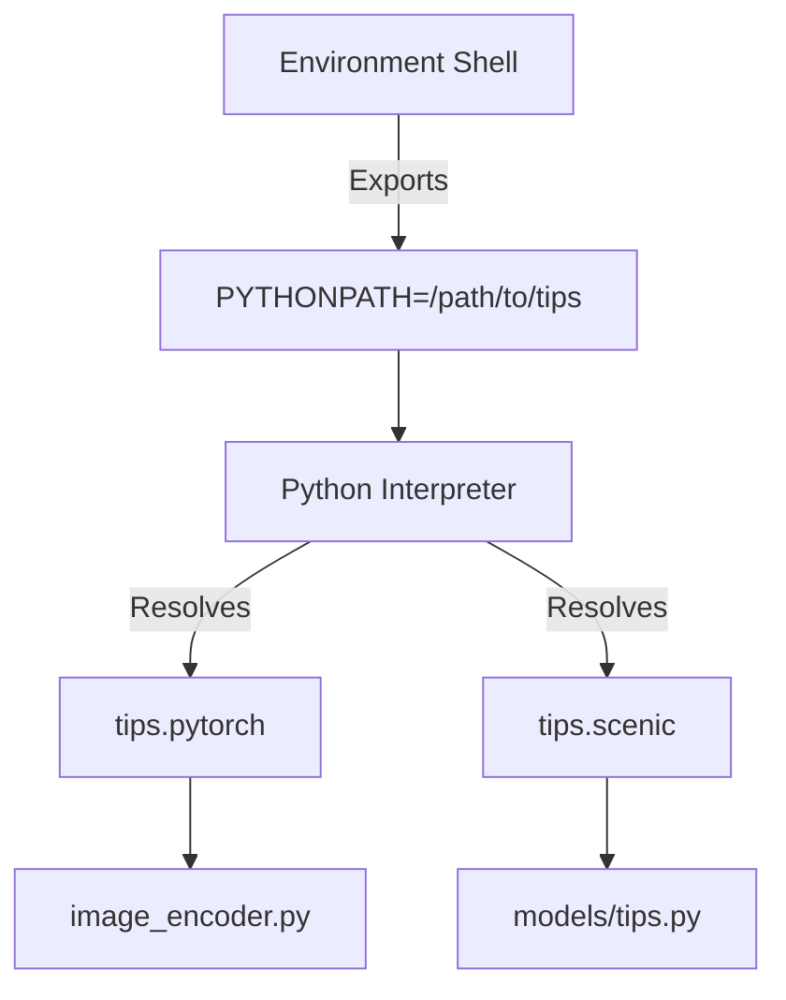
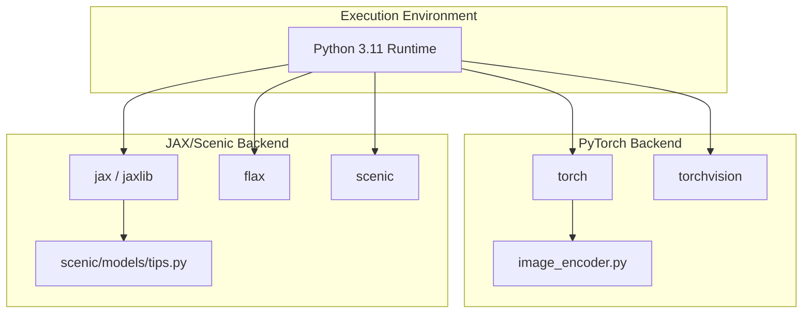

<!-- source: DeepWiki mcp.deepwiki.com · repo google-deepmind/tips · page 1.1 Getting Started · fetched 2026-10-26 -->

# Getting Started

<details>
<summary>Relevant source files</summary>

The following files were used as context for generating this wiki page:

- [README.md](README.md)
- [pytorch/run_image_encoder_inference.py](pytorch/run_image_encoder_inference.py)

</details>


## Purpose and Scope

This page provides comprehensive instructions for setting up the execution environment for both PyTorch and JAX/Scenic backends of the TIPS and TIPSv2 codebase. It details Python 3.11 virtual environment configuration, `PYTHONPATH` exports for module resolution, backend-specific dependency installation, and executing end-to-end inference scripts such as `pytorch/run_image_encoder_inference.py` [pytorch/run_image_encoder_inference.py:16-28]().

Sources: [README.md:1-84](), [pytorch/run_image_encoder_inference.py:16-28]()

---

## Environment Setup and Python 3.11 Configuration

To ensure full compatibility with tensor operations and model definitions, the codebase requires **Python 3.11**. Setting up an isolated virtual environment prevents dependency conflicts with system packages.

```bash
# Create a Python 3.11 virtual environment
python3.11 -m venv tips_env

# Activate the environment
source tips_env/bin/activate

# Upgrade pip and packaging tools
pip install --upgrade pip setuptools wheel
```

Sources: [README.md:1-84]()

---

## PYTHONPATH and Module Resolution

The repository utilizes structured subpackages (`pytorch/` and `scenic/`) that import core utilities relative to the repository root. To ensure Python can resolve absolute imports like `from tips.pytorch import image_encoder` [pytorch/run_image_encoder_inference.py:38](), the repository root must be added to your `PYTHONPATH`.

```bash
# Set PYTHONPATH to the root directory of the repository
export PYTHONPATH="${PYTHONPATH}:/path/to/tips"
```

### Module Resolution Flow


Sources: [pytorch/run_image_encoder_inference.py:30-39]()

---

## Dependencies for Both Backends

The repository supports two distinct deep learning backends: **PyTorch** and **JAX/Scenic**. Depending on your runtime preference, install the respective dependency profiles.

### PyTorch Backend Dependencies
For running PyTorch inference scripts and notebooks, install PyTorch, Torchvision, and supporting data utilities:

```bash
pip install torch torchvision numpy pillow
```

### JAX / Scenic Backend Dependencies
For running the JAX-based inference pipeline using the `scenic` library [README.md:57-58](), install JAX (with GPU/TPU support if applicable) and Scenic requirements:

```bash
pip install jax jaxlib flax scenic
```

Sources: [README.md:53-64](), [pytorch/run_image_encoder_inference.py:30-37]()

### Backend Dependency Architecture


Sources: [README.md:53-64](), [pytorch/run_image_encoder_inference.py:30-37]()

---

## Running Inference Scripts

Once the environment and dependencies are configured, you can execute inference using the provided command-line interfaces.

### Image Encoder Inference (`pytorch/run_image_encoder_inference.py`)

The script `pytorch/run_image_encoder_inference.py` loads a serialized checkpoint (`.npz` converted or raw state dict), resizes input images, instantiates the selected ViT backbone variant, and extracts normalized dual `[CLS]` token embeddings [pytorch/run_image_encoder_inference.py:70-123]().

#### Command-Line Arguments
* `--model_path`: Path to the model checkpoint file (`.npz` or `.pth`) [pytorch/run_image_encoder_inference.py:46]().
* `--image_file`: Path to the input image file for inference [pytorch/run_image_encoder_inference.py:49-53]().
* `--model_variant`: ViT model size variant (`S`, `B`, `L`, `So400m`, `g`) [pytorch/run_image_encoder_inference.py:60-65]().
* `--is_low_res`: Flag for low-resolution models (224px instead of 448px) [pytorch/run_image_encoder_inference.py:55-58]().

#### Execution Example

```bash
python pytorch/run_image_encoder_inference.py \
    --model_path=/path/to/checkpoint.npz \
    --image_file=/path/to/image.jpg \
    --model_variant=g
```

Sources: [pytorch/run_image_encoder_inference.py:16-129]()

---

