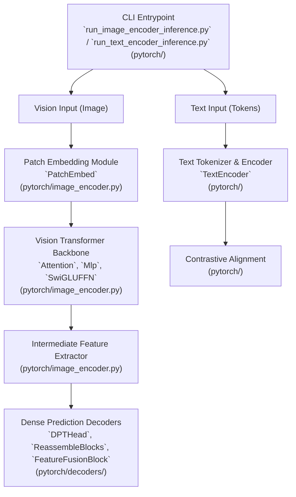
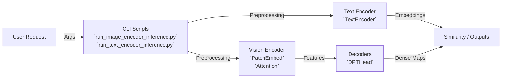

<!-- source: DeepWiki mcp.deepwiki.com · repo google-deepmind/tips · page 2 PyTorch Implementation · fetched 2026-10-26 -->

# PyTorch Implementation

Relevant source files

The following files were used as context for generating this wiki page:

- [pytorch/__init__.py](pytorch/__init__.py)
- [pytorch/image_encoder.py](pytorch/image_encoder.py)

## Purpose and Scope
The `pytorch/` package provides a complete PyTorch implementation of the TIPS and TIPSv2 architectures [pytorch/__init__.py:1-32](). It mirrors the capabilities of the JAX/Scenic backend, providing high-performance vision encoders [pytorch/image_encoder.py:16-16](), text encoders, dense prediction decoders, and production-ready inference CLIs. 

This page serves as a high-level overview of the PyTorch subsystem. For granular technical details, refer to the individual child pages linked below.

---

## Architecture Overview (Natural Language Space to Code Entity Space)

The following diagram maps high-level architectural concepts to their concrete code entities within the `pytorch/` package.

Sources: [pytorch/__init__.py:1-32](), [pytorch/image_encoder.py:16-220]()

---

## 2.1 Image Encoder (ViT backbone)

The Vision Transformer (ViT) backbone is implemented in `pytorch/image_encoder.py` and supports multiple model scales (`vit_small`, `vit_base`, `vit_large`, `vit_so400m`, `vit_giant2`). It features patch extraction with patch size 14 [pytorch/image_encoder.py:67-134](), dual class tokens, positional-embedding interpolation for varying resolutions, and efficient SwiGLU FFN blocks (`SwiGLUFFN`, `SwiGLUFFNFused`) [pytorch/image_encoder.py:136-200]() alongside standard multi-head attention mechanisms (`Attention`) [pytorch/image_encoder.py:201-220]().

For details, see [Image Encoder (ViT backbone)](#2.1).

Sources: [pytorch/image_encoder.py:16-220]()

---

## 2.2 Text Encoder and Tokenizer

The text pipeline processes natural language prompts and inputs to align with visual representations via contrastive learning. It incorporates dedicated `TextEncoder` modules tailored to each model variant, coupled with robust tokenizers handling vocabulary lookup, padding masks, and embedding normalization.

For details, see [Text Encoder and Tokenizer](#2.2).

Sources: [pytorch/__init__.py:1-32]()

---

## 2.3 Dense Prediction Decoders

Dense prediction tasks (such as semantic segmentation, depth estimation, and surface normal prediction) are handled by specialized decoders in the PyTorch package. These modules implement `DPTHead`, `ReassembleBlocks`, and `FeatureFusionBlock` architectures, and include utilities for converting Scenic/Flax pretrained weights into native PyTorch state dicts.

For details, see [Dense Prediction Decoders](#2.3).

Sources: [pytorch/__init__.py:1-32]()

---

## 2.4 PyTorch Inference CLIs

To facilitate evaluation and deployment, the package provides command-line interfaces (`run_image_encoder_inference.py` and `run_text_encoder_inference.py`). These scripts handle argument parsing, image/text preprocessing, device placement (CPU/GPU), model loading, and standardized output formatting.

For details, see [PyTorch Inference CLIs](#2.4).

Sources: [pytorch/__init__.py:1-32]()

---

## Inference and Execution Flow

Sources: [pytorch/__init__.py:1-32](), [pytorch/image_encoder.py:67-220]()

---

