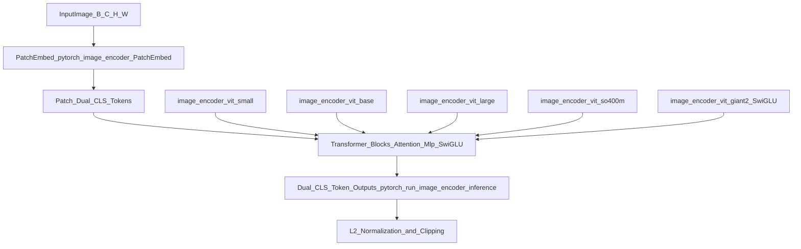
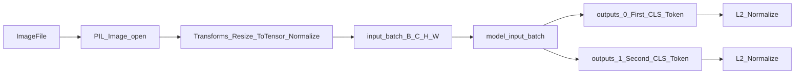

<!-- source: DeepWiki mcp.deepwiki.com · repo google-deepmind/tips · page 2.1 Image Encoder (ViT backbone) · fetched 2026-10-26 -->

# Image Encoder (ViT backbone)

Relevant source files

The following files were used as context for generating this wiki page:

- [pytorch/image_encoder.py](pytorch/image_encoder.py)
- [pytorch/run_image_encoder_inference.py](pytorch/run_image_encoder_inference.py)

## Purpose and Scope
This page details the PyTorch Vision Transformer (ViT) backbone implementation (`pytorch/image_encoder.py`) and its execution pipeline (`pytorch/run_image_encoder_inference.py`). It covers model variant constructors (`vit_small`, `vit_base`, `vit_large`, `vit_so400m`, `vit_giant2`), patch size configuration (patch size 14), dual class (`CLS`) tokens, positional-embedding interpolation for flexible input resolutions, and intermediate layer extraction.

Sources: `pytorch/image_encoder.py:1-220()`, `pytorch/run_image_encoder_inference.py:16-130()`

---

## Model Variants and Constructors
The image encoder supports multiple Vision Transformer variants, exposed via builder functions mapping configuration keys (`'S'`, `'B'`, `'L'`, `'So400m'`, `'g'`) to specific backbone constructors [pytorch/run_image_encoder_inference.py:72-78]():
- `vit_small`: Small variant (`'S'`) [pytorch/run_image_encoder_inference.py:73]()
- `vit_base`: Base variant (`'B'`) [pytorch/run_image_encoder_inference.py:74]()
- `vit_large`: Large variant (`'L'`) [pytorch/run_image_encoder_inference.py:75]()
- `vit_so400m`: So400m variant (`'So400m'`) [pytorch/run_image_encoder_inference.py:76]()
- `vit_giant2`: Giant-2 variant (`'g'`), which uses the `swiglu` feed-forward network layer instead of standard `mlp` [pytorch/run_image_encoder_inference.py:77-80]()

All variants default to a patch size of 14 (`PATCH_SIZE = 14`) [pytorch/run_image_encoder_inference.py:42]() and support both low-resolution (224px) and high-resolution (448px) inputs [pytorch/run_image_encoder_inference.py:55-58(), pytorch/run_image_encoder_inference.py:71]().

Sources: `pytorch/run_image_encoder_inference.py:40-81()`

---

## Core Backbone Components
The ViT architecture relies on several foundational modules implemented in `pytorch/image_encoder.py`:
- `PatchEmbed`: Converts 2D input images `(B, C, H, W)` into patch embeddings `(B, N, D)` using a 2D convolution projection with kernel size and stride equal to `patch_size` [pytorch/image_encoder.py:67-102](). It verifies input dimension divisibility and supports flattening or retaining spatial resolution [pytorch/image_encoder.py:103-120]().
- `Mlp`: Standard Transformer MLP block following DINOv2 conventions, comprising two linear transformations with an activation layer (`nn.GELU`) and dropout [pytorch/image_encoder.py:29-55]().
- `SwiGLUFFN` / `SwiGLUFFNFused`: SwiGLU feed-forward network implementation used by the giant model variant (`g`), utilizing SiLU activation gated across chunked projections [pytorch/image_encoder.py:136-199]().
- `Attention`: Multi-head self-attention module supporting query-key-value projections and scaling factors [pytorch/image_encoder.py:201-220]().

Sources: `pytorch/image_encoder.py:29-220()`

---

## Dual CLS Tokens and Positional-Embedding Interpolation
TIPS models utilize dual `CLS` tokens appended to the patch sequence. During forward execution, the encoder processes the token sequence containing both class tokens and returns outputs corresponding to each [pytorch/run_image_encoder_inference.py:111-114](). These embeddings are subsequently L2-normalized with a clipping epsilon [pytorch/run_image_encoder_inference.py:116-121]().

Positional embeddings support dynamic resolution adjustments via interpolation. TIPSv2 models incorporate a `(32, 32)` positional-embedding grid (for 448px resolution at patch size 14) compared to smaller grids in TIPSv1, configured via parameters such as `interpolate_antialias=True` and `interpolate_offset=0.0` [pytorch/run_image_encoder_inference.py:16-19(), pytorch/run_image_encoder_inference.py:105-107]().

Sources: `pytorch/run_image_encoder_inference.py:16-124()`

---

## Architecture to Code Mapping

Title: "Vision Encoder Architecture Mapping"

Sources: `pytorch/run_image_encoder_inference.py:72-121()`, `pytorch/image_encoder.py:67-120()`

---

## Data Flow and Intermediate Layer Extraction
The image encoder supports extracting intermediate feature representations across layers (crucial for dense prediction decoders). The data flows from image loading and resizing through `PatchEmbed`, through stacked transformer blocks equipped with either `Mlp` or `SwiGLUFFN`, up to final token outputs or intermediate activations.

Title: "Image Encoder Inference Data Flow"

Sources: `pytorch/run_image_encoder_inference.py:87-121()`

---

