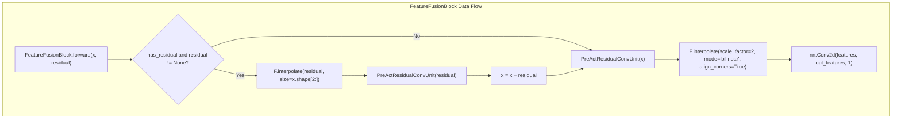
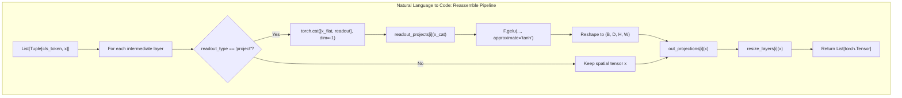
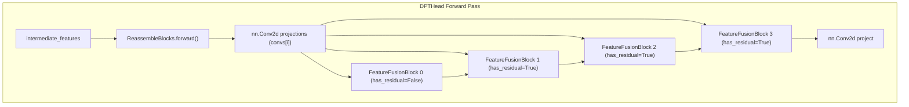

<!-- source: DeepWiki mcp.deepwiki.com · repo google-deepmind/tips · page 2.3 Dense Prediction Decoders · fetched 2026-10-26 -->

# Dense Prediction Decoders

Relevant source files

The following files were used as context for generating this wiki page:

- [pytorch/decoders.py](pytorch/decoders.py)

This section covers the PyTorch implementation of Dense Prediction Transformer (DPT) decoders in the TIPS codebase (`pytorch/decoders.py`). It details the low-level building blocks (`PreActResidualConvUnit`, `FeatureFusionBlock`, `ReassembleBlocks`), the shared `DPTHead` architecture for multi-scale intermediate feature fusion, task-specific decoders for segmentation, depth, and surface normals, and the weight conversion pipeline from Scenic (JAX) to PyTorch.

---

## 1. Core Architectural Building Blocks

The dense prediction decoders transform intermediate patch tokens and `[CLS]` tokens extracted from the Vision Transformer (ViT) backbone into dense, high-resolution spatial feature maps. This is achieved via a hierarchy of pre-activation residual units, feature fusion blocks, and reassembly modules.

### PreActResidualConvUnit and FeatureFusionBlock

The `PreActResidualConvUnit` implements a pre-activation residual convolution block consisting of alternating ReLU activations and 3x3 convolutions (`[pytorch/decoders.py:40-55]()`). 

The `FeatureFusionBlock` takes a feature map, optionally integrates a residual feature map via bilinear interpolation and a `PreActResidualConvUnit`, applies a main residual unit, upsamples the result by a factor of 2 using bilinear interpolation with `align_corners=True`, and projects the channels down using a 1x1 convolution (`[pytorch/decoders.py:57-95]()`).

*Sources: `pytorch/decoders.py:40-95`*

### ReassembleBlocks

The `ReassembleBlocks` module takes a list of intermediate ViT feature tuples—each containing a `[CLS]` token and a spatial patch tensor—and projects and resizes them to match four multi-scale target resolutions (`[pytorch/decoders.py:98-146]`). 

Depending on the `readout_type` parameter, when set to `"project"`, the `[CLS]` token is concatenated with flattened spatial patch tokens, processed through a linear layer and a JAX-compatible approximate GELU activation, and reshaped back into a spatial tensor before applying task-specific projections and resize operations (`[pytorch/decoders.py:108-145]()`).

*Sources: `pytorch/decoders.py:98-146`*

---

## 2. Shared DPT Head Architecture

The `DPTHead` module acts as the unified backbone for all dense prediction tasks in TIPS (`[pytorch/decoders.py:153-197]()`). It coordinates feature reassembly, channel projection, and bottom-up feature fusion across multiple network scales.

*Sources: `pytorch/decoders.py:153-197`*

### Implementation Summary of DPTHead

1. **Reassembly**: Calls `ReassembleBlocks` to project and resize multi-layer ViT features (`[pytorch/decoders.py:172-176]()`).
2. **Channel Adaptation**: Projects each reassembled feature map to a common channel width using `nn.ModuleList` of 2D convolutions (`[pytorch/decoders.py:177-180]()`).
3. **Bottom-Up Fusion**: Passes features sequentially through four `FeatureFusionBlock` instances where deeper features incorporate residual connections from shallower layers (`[pytorch/decoders.py:181-197]()`).

*Sources: `pytorch/decoders.py:153-197`*

---

## 3. Task-Specific Decoders and Weight Conversion

Building upon `DPTHead`, specialized subclasses handle distinct dense prediction targets:
* **Segmentation Decoder**: Outputs class logits per pixel for tasks like semantic segmentation (e.g., ADE20K).
* **Depth Decoder**: Predicts continuous metric or relative depth maps.
* **Surface Normals Decoder**: Regresses 3-channel unit normal vectors for 3D geometric understanding.

### Scenic to PyTorch Weight Conversion

Weights originating from Scenic (JAX/Flax) checkpoints undergo structural transformation before loading into PyTorch decoders:
* Transposition of 2D convolution weights from Flax layout `(H, W, InC, OutC)` to PyTorch layout `(OutC, InC, H, W)`.
* Mapping parameter names from Flax nested dictionaries to flat PyTorch module hierarchies.
* Handling linear layer weight transpositions where PyTorch expects `(OutC, InC)` and Flax uses `(InC, OutC)`.

*Sources: `pytorch/decoders.py:1-25`*

---

