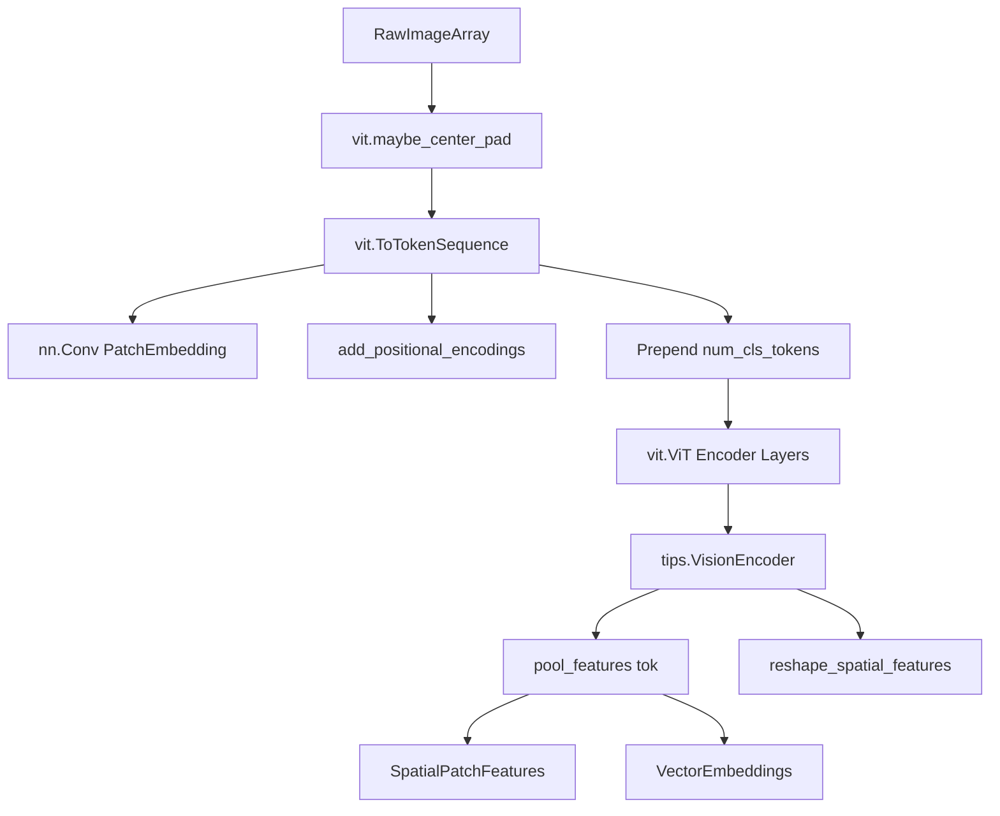
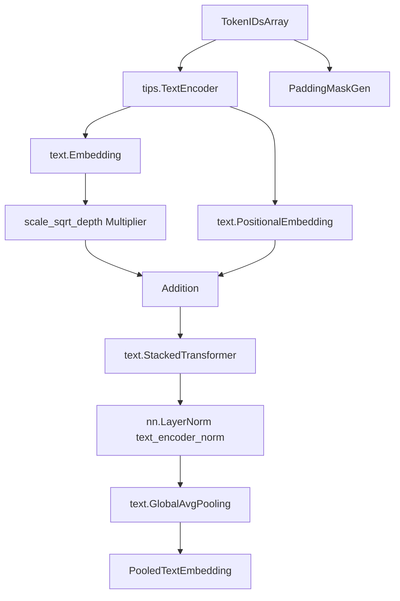

<!-- source: DeepWiki mcp.deepwiki.com · repo google-deepmind/tips · page 3.1 Scenic Models (VisionEncoder, TextEncoder, ViT) · fetched 2026-10-26 -->

# Scenic Models (VisionEncoder, TextEncoder, ViT)

Relevant source files

The following files were used as context for generating this wiki page:

- [scenic/models/text.py](scenic/models/text.py)
- [scenic/models/tips.py](scenic/models/tips.py)
- [scenic/models/vit.py](scenic/models/vit.py)

## Purpose and Scope
This page details the Flax module definitions that comprise the TIPS JAX/Scenic subsystem located in `scenic/models/tips.py`, `scenic/models/vit.py`, and `scenic/models/text.py`. It covers the core architectural components including `VisionEncoder`, `TextEncoder`, patch extraction, positional embedding interpolation, CLS token handling, and text tokenization mechanisms.

---

## 1. Vision Encoder and ViT Backbone

The vision subsystem is structured around a Vision Transformer (`ViT`) backbone wrapped by a `VisionEncoder` module [scenic/models/tips.py:27-52](). Images are converted to token sequences via patch convolution, augmented with 2D sinusoidal positional encodings, and prepended with learnable classification (`cls`) tokens.

### VisionEncoder Implementation
`VisionEncoder` manages the high-level configuration of the vision tower, including model variants (e.g., `'S'`, `'B'`, `'L'`, `'So400m'`, `'g'`), pooling strategies, and the number of CLS tokens (TIPS defaults to `num_cls_tokens = 2`) [scenic/models/tips.py:30-38](). 

During execution, input images are padded to be multiples of the patch size using `maybe_center_pad` [scenic/models/vit.py:48-66](), processed through the underlying `vit.ViT` module [scenic/models/tips.py:42-50](), and split into spatial patch features and vector tokens via `pool_features` [scenic/models/tips.py:53-71]().

Sources:
- `scenic/models/tips.py`: [27-52]()
- `scenic/models/vit.py`: [48-66]()

---

### Positional Embeddings and Patch Tokenization
The `ToTokenSequence` module [scenic/models/vit.py:69-120]() handles spatial patch projection and positional embedding injection:
1. **Patch Extraction**: An `nn.Conv` layer [scenic/models/vit.py:100-104]() projects image patches into the `hidden_size` dimension with a stride equal to the patch size (`fh, fw`).
2. **Positional Encodings**: Learnable 2D positional embeddings `posembed_input` of shape `[1, posemb_h, posemb_w, c]` are added to the projected patch tokens [scenic/models/vit.py:81-89](). If the input resolution differs from the base grid (`self.posembs`), `jax.image.resize` interpolates the embeddings using bilinear resizing [scenic/models/vit.py:86-88]().
3. **CLS Tokens**: Zero-initialized learnable token parameters (`cls`) of shape `[1, num_cls_tokens, c]` are tiled across the batch dimension and prepended to the patch sequence [scenic/models/vit.py:110-118]().

Sources:
- `scenic/models/vit.py`: [69-120]()

---

## 2. Text Encoder and Tokenization

The text subsystem (`TextEncoder` in `scenic/models/tips.py` and supporting modules in `scenic/models/text.py`) maps raw text identifiers into multi-modal embedding spaces using a Transformer architecture.

### TextEncoder Architecture
The `TextEncoder` class instantiates an embedding table, 1D positional embeddings, a stacked transformer, and global average pooling [scenic/models/tips.py:98-141](). Except for the `So400m/14` variant (which uses a symmetric vision-text configuration), text towers fix their depth to 12 layers [scenic/models/tips.py:113-118]().

Sources:
- `scenic/models/tips.py`: [98-156]()
- `scenic/models/text.py`: [33-199]()

---

### Tokenizer and Embedding Lookups
- **`Tokenizer`**: Wraps `tensorflow_text.SentencepieceTokenizer` to ingest raw strings, convert them to lowercase token IDs, truncate or pad them to `max_len`, and construct companion padding masks (`is_padding`) [scenic/models/text.py:33-53]().
- **`Embedding`**: Performs token ID indexing against `emb_var` [scenic/models/text.py:56-89]() and optionally scales activations by $\sqrt{D}$ (`scale_sqrt_depth=True`) [scenic/models/text.py:86-88]().
- **`PositionalEmbedding`**: Generates 1D sinusoidal position signals using geometric timescale progressions from `min_timescale=1` to `max_timescale=10_000` [scenic/models/text.py:95-152]().
- **`GlobalAvgPooling`**: Averages valid sequence tokens while accounting for padding masks via `compatible_paddings` [scenic/models/text.py:155-199]().

Sources:
- `scenic/models/text.py`: [33-199]()

---

## 3. Configuration and FFN Variants

Model dimensions and architectural hyperparameters are dynamically resolved through `get_vit_config(variant)` [scenic/models/vit.py:34-45](). Depending on the variant tag (`S`, `B`, `L`, `So400m`, `g`), the configuration determines:
- `hidden_size`, `num_layers`, `mlp_dim`, and `num_heads` [scenic/models/vit.py:38-41]().
- Feed-forward network type (`ffn_layer`), choosing between standard Multi-Layer Perceptrons (`'mlp'`) and gated fused SwiGLU networks (`'swiglu'`) [scenic/models/vit.py:43]().

The `FFNSwiGluFused` module implements the SwiGLU variant by projecting inputs into two parallel dense layers, applying a swish activation to the first projection, and element-wise multiplying them before the output projection [scenic/models/vit.py:122-177]().

Sources:
- `scenic/models/vit.py`: [34-45](), [122-177]()

---

