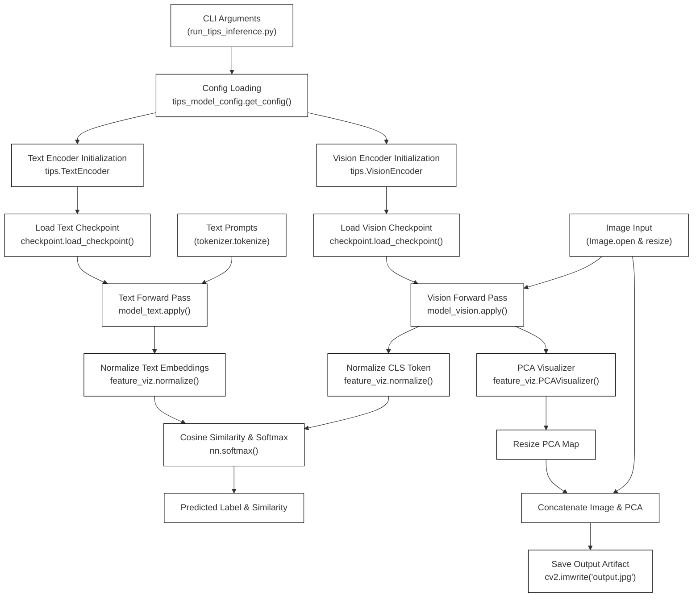
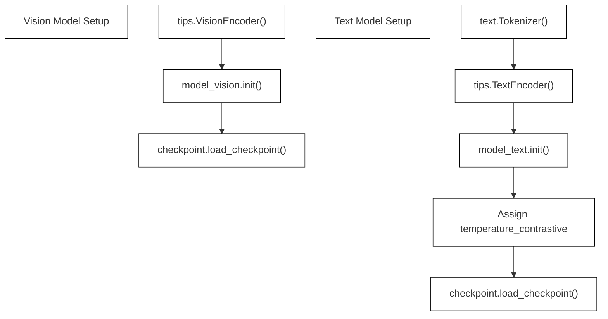

<!-- source: DeepWiki mcp.deepwiki.com · repo google-deepmind/tips · page 3.4 run_tips_inference.py Pipeline · fetched 2026-10-26 -->

# run_tips_inference.py Pipeline

Relevant source files

The following files were used as context for generating this wiki page:

- [scenic/images/example_image.jpg](scenic/images/example_image.jpg)
- [scenic/run_tips_inference.py](scenic/run_tips_inference.py)

Purpose and scope: This section details the end-to-end JAX inference pipeline implemented in `scenic/run_tips_inference.py`. It covers argument parsing, vision and text preprocessing, model initialization, checkpoint restoration for both TIPSv1 and TIPSv2 variants, spatial and textual feature extraction, cosine similarity and contrastive temperature scaling, and principal component analysis (PCA) spatial visualization output artifact generation.

## 1. Pipeline Architecture and Flow

The inference script `scenic/run_tips_inference.py` acts as the primary end-to-end driver for JAX/Scenic model execution. It coordinates configuration parsing, backbone loading, tokenization, multi-modal alignment via contrastive embeddings, and artifact serialization.

Sources: `scenic/run_tips_inference.py:61-187`

## 2. Command-Line Arguments and Supported Variants

The pipeline uses `argparse` to configure execution parameters [`scenic/run_tips_inference.py:61-86`] and supports an extensive suite of TIPSv1 and TIPSv2 model variants [`scenic/run_tips_inference.py:46-59`].

| Argument Name | Type | Default | Description |
| :--- | :--- | :--- | :--- |
| `--image_width` | `int` | `448` | Target width and height for image resizing (`image_shape = (image_width, image_width)`) [`scenic/run_tips_inference.py:62-67, 91-92`]. |
| `--variant` | `str` | `tips_oss_b14_highres_distilled` | Model variant selection from `_ALL_VARIANTS` [`scenic/run_tips_inference.py:68-74`]. |
| `--checkpoint_dir` | `str` | `checkpoints/` | Directory containing `.npz` model weights and `tokenizer.model` [`scenic/run_tips_inference.py:75-80`]. |
| `--image_path` | `str` | `images/example_image.jpg` | Path to the target image file for inference [`scenic/run_tips_inference.py:81-86`]. |

### Supported Variants (`_ALL_VARIANTS`)
- **TIPSv1**: `tips_oss_g14_highres`, `tips_oss_g14_lowres`, `tips_oss_so400m14_highres_largetext_distilled`, `tips_oss_l14_highres_distilled`, `tips_oss_b14_highres_distilled`, `tips_oss_s14_highres_distilled` [`scenic/run_tips_inference.py:47-53`].
- **TIPSv2**: `tips_v2_g14`, `tips_v2_so14`, `tips_v2_l14`, `tips_v2_b14` (utilizing a `(32, 32)` positional embedding grid) [`scenic/run_tips_inference.py:18-19, 54-59`].

Sources: `scenic/run_tips_inference.py:46-86`

## 3. Model Initialization and Checkpoint Restoration

The script initializes both vision and text encoders using Flax module definitions from `tips.VisionEncoder` and `tips.TextEncoder`.

1. **Vision Encoder Initialization**:
   - `model_vision` is instantiated via `tips.VisionEncoder` using config attributes for variant, pooling, `num_cls_tokens`, and positional embedding shapes [`scenic/run_tips_inference.py:102-106`].
   - Initialization parameters are generated via `model_vision.init` with dummy inputs `[1, *image_shape, 3]` [`scenic/run_tips_inference.py:107-108`].
   - Weights are restored using `checkpoint.load_checkpoint` from `{variant}_vision.npz` [`scenic/run_tips_inference.py:109-111`].

2. **Text Encoder Initialization**:
   - The SentencePiece tokenizer is loaded via `text.Tokenizer` from `tokenizer.model` [`scenic/run_tips_inference.py:114-115`].
   - `model_text` is initialized with `tips.TextEncoder` and dummy text/padding tensors of shape `(4, 64)` [`scenic/run_tips_inference.py:116-121`].
   - The contrastive temperature parameter `temperature_contrastive` is explicitly initialized in `init_params_text['params']` before loading the text checkpoint from `{variant}_text.npz` [`scenic/run_tips_inference.py:122-126`].

Sources: `scenic/run_tips_inference.py:97-126`

## 4. Preprocessing and Forward Passes

### Image Preprocessing
Input images loaded via PIL are converted to `jnp.float32`, scaled to the `[0, 1]` range, and resized to `image_shape` using bilinear interpolation [`scenic/run_tips_inference.py:128-131`].

### Vision Forward Pass
The vision model `model_vision.apply` processes the batch-expanded image `image[None]` with `train=False`, returning `spatial_features` and `embeddings_vision` [`scenic/run_tips_inference.py:134-135`]:
- The first classification token (`embeddings_vision[:, 0, :]`) is extracted and normalized using `feature_viz.normalize` to form `cls_token` [`scenic/run_tips_inference.py:136-137`]. (Note: The second CLS token is typically preferred for dense downstream tasks [`scenic/run_tips_inference.py:136`]).

### Text Forward Pass
A predefined list of text prompts is tokenized with `tokenizer.tokenize` up to `max_len=64` [`scenic/run_tips_inference.py:143-148`].
`model_text.apply` generates textual embeddings, which are subsequently normalized using `feature_viz.normalize` [`scenic/run_tips_inference.py:149-154`].

Sources: `scenic/run_tips_inference.py:128-156`

## 5. Similarity Computation and Zero-Shot Classification

To classify the input image against the text prompts, the pipeline computes scaled cosine similarities:
1. **Raw Cosine Similarity**: Computed via matrix multiplication between the normalized `cls_token` and transposed text embeddings `embeddings_text.T` [`scenic/run_tips_inference.py:158-159`].
2. **Temperature Scaling**: The raw similarity is scaled by dividing by `temperature` (`params_text['temperature_contrastive']`) and passed through a softmax function [`scenic/run_tips_inference.py:160-166`].
3. **Prediction**: The script extracts the argmax label index and maximum similarity probability, mapping back to the corresponding text prompt [`scenic/run_tips_inference.py:167-175`].

Sources: `scenic/run_tips_inference.py:158-176`

## 6. PCA Spatial Feature Visualization Artifacts

For visual inspection of patch representations, the pipeline executes a Principal Component Analysis workflow:
1. **PCA Transformation**: `feature_viz.PCAVisualizer` is instantiated with `spatial_features` and applied to yield 3-component PCA projections [`scenic/run_tips_inference.py:177-179`].
2. **Resizing**: The PCA feature map is resized back to `image_shape` using nearest-neighbor interpolation [`scenic/run_tips_inference.py:180-181`].
3. **Artifact Serialization**: The original resized image and the PCA visualization are concatenated horizontally, converted from RGB to BGR (`[::-1]`), scaled to `uint8`, and written to disk as `output.jpg` via `cv2.imwrite` [`scenic/run_tips_inference.py:183-187`].

Sources: `scenic/run_tips_inference.py:177-187`

Sources: `scenic/run_tips_inference.py:1-192`

---

