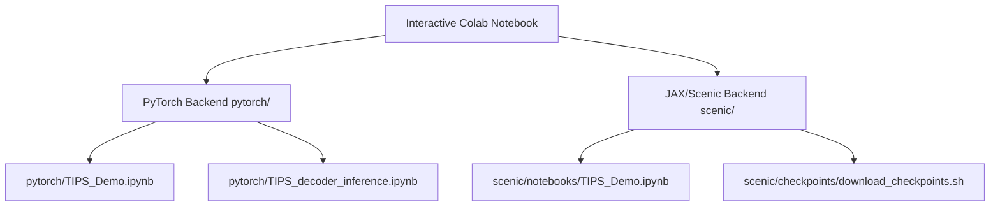

<!-- source: DeepWiki mcp.deepwiki.com · repo google-deepmind/tips · page 4 Demos and Notebooks · fetched 2026-10-26 -->

# Demos and Notebooks

Relevant source files

The following files were used as context for generating this wiki page:

- [pytorch/TIPS_Demo.ipynb](pytorch/TIPS_Demo.ipynb)
- [scenic/checkpoints/download_checkpoints.sh](scenic/checkpoints/download_checkpoints.sh)
- [scenic/notebooks/TIPS_Demo.ipynb](scenic/notebooks/TIPS_Demo.ipynb)

This page provides a high-level overview of the interactive notebooks and demonstration scripts provided in the codebase for both the PyTorch and JAX/Scenic backends. These environments enable rapid prototyping, model variant selection (`TIPS` versus `TIPS_V2`), remote checkpoint acquisition from Google Cloud Storage (GCS), and downstream spatial feature visualization.

## Interactive Notebook Ecosystem

The repository supplies end-to-end Google Colab notebooks for both the native PyTorch implementation (`pytorch/`) and the JAX/Scenic implementation (`scenic/`). These notebooks handle runtime dependency installation, `PYTHONPATH` configuration, model variant parsing, and checkpoint downloading.

Diagram: Notebook Execution and Backend Routing

Sources: [pytorch/TIPS_Demo.ipynb:40-167](), [scenic/notebooks/TIPS_Demo.ipynb:50-187](), [scenic/checkpoints/download_checkpoints.sh:1-49]()

## Child Pages Overview

For technical details, architectural walkthroughs, and step-by-step execution flows, refer to the child pages:

- **PyTorch Demo Notebooks**: Detailed walkthroughs of `pytorch/TIPS_Demo.ipynb` and `pytorch/TIPS_decoder_inference.ipynb`, covering model instantiation, tokenization, and dense decoder pipelines. For details, see [PyTorch Demo Notebooks](#4.1).
- **Segmentation Demos**: Overview of foreground segmentation linear probing demos and zero-shot segmentation notebooks built on top of extracted feature maps. For details, see [Segmentation Demos](#4.2).
- **Scenic Demo Notebook**: Setup instructions, checkpoint downloading flows via `scenic/checkpoints/download_checkpoints.sh`, and PCA-based spatial feature visualization utilizing `scenic/notebooks/TIPS_Demo.ipynb`. For details, see [Scenic Demo Notebook](#4.3).

Diagram: Parent-Child Navigation Structure
Parent Page
Child Pages
Demos and Notebooks
PyTorch Demo Notebooks
Segmentation Demos
Scenic Demo Notebook

Sources: [pytorch/TIPS_Demo.ipynb:1-587](), [scenic/notebooks/TIPS_Demo.ipynb:1-187](), [scenic/checkpoints/download_checkpoints.sh:1-49]()

---

