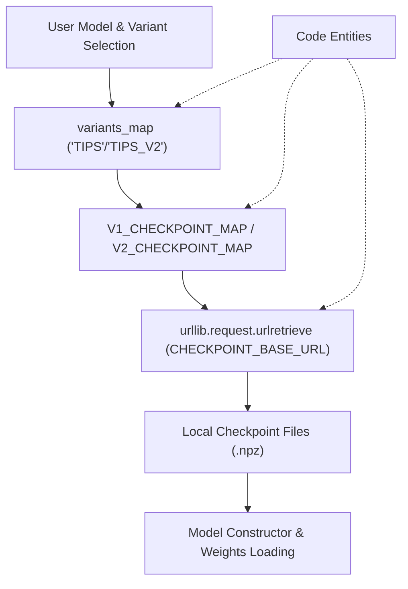
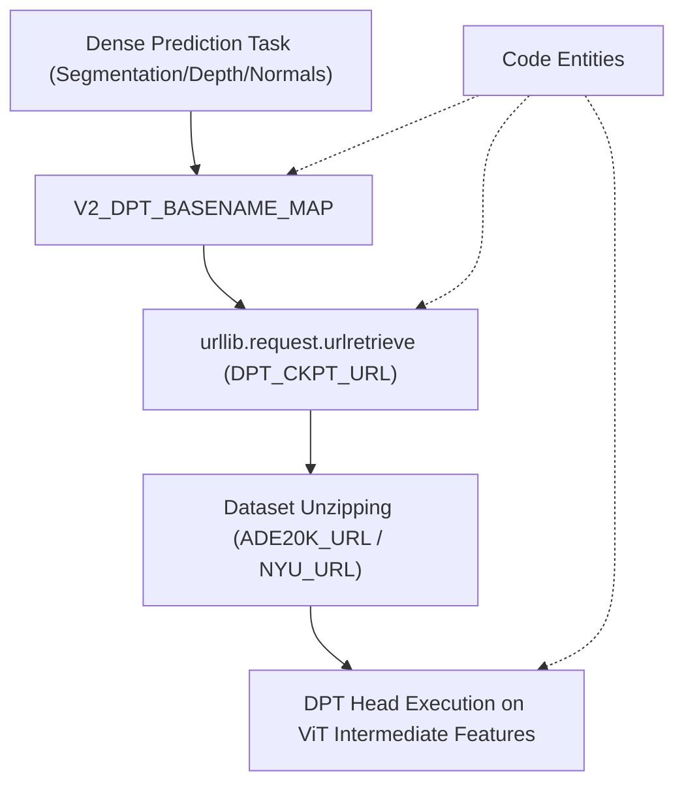

<!-- source: DeepWiki mcp.deepwiki.com · repo google-deepmind/tips · page 4.1 PyTorch Demo Notebooks · fetched 2026-10-26 -->

# PyTorch Demo Notebooks

Relevant source files

The following files were used as context for generating this wiki page:

- [pytorch/TIPS_Demo.ipynb](pytorch/TIPS_Demo.ipynb)
- [pytorch/TIPS_decoder_inference.ipynb](pytorch/TIPS_decoder_inference.ipynb)

## Purpose and Scope
This page details the implementation, data flow, and environment setup for the interactive PyTorch demonstration notebooks provided in the repository: `pytorch/TIPS_Demo.ipynb` and `pytorch/TIPS_decoder_inference.ipynb`. These notebooks serve as end-to-end walkthroughs for running feature extraction, contrastive tasks, and dense prediction decoders (segmentation, depth, and surface normals) using PyTorch backend configurations.

Sources: `pytorch/TIPS_Demo.ipynb:1-167` [pytorch/TIPS_Demo.ipynb:1-167](), `pytorch/TIPS_decoder_inference.ipynb:1-180` [pytorch/TIPS_decoder_inference.ipynb:1-180]().

---

## 1. TIPS Interactive Demo (`TIPS_Demo.ipynb`)

The `pytorch/TIPS_Demo.ipynb` notebook provides a complete interactive workflow for initializing both `TIPS` (v1) and `TIPS_V2` models, downloading corresponding weights from Google Cloud Storage, and processing sample visual and textual inputs using PyTorch.

### Environment Setup and Dependencies
The notebook begins by establishing the execution environment within Google Colab or a local Jupyter instance. It determines the root working directory (`ROOT_DIR`), sets up a local clone of the repository under `TIPS_DIR`, and installs required runtime packages including `torch`, `torchvision`, `torchaudio`, `tensorflow_text`, `mediapy`, `jax`, `jaxlib`, and `scikit-learn` [pytorch/TIPS_Demo.ipynb:40-64](). To ensure internal modules are importable, the root directory is inserted into `sys.path` [pytorch/TIPS_Demo.ipynb:57-60]().

Sources: `pytorch/TIPS_Demo.ipynb:40-64` [pytorch/TIPS_Demo.ipynb:40-64]().

### Model and Variant Configuration
Users can interactively select between `TIPS` (v1) and `TIPS_V2` architectures, and choose model variants (`S`, `B`, `L`, `So400m`, `g`, `So`) [pytorch/TIPS_Demo.ipynb:97-116](). A validation check dynamically maps requested variants to available configurations, falling back to valid defaults if an incompatible combination is selected [pytorch/TIPS_Demo.ipynb:104-113]().

Sources: `pytorch/TIPS_Demo.ipynb:97-116` [pytorch/TIPS_Demo.ipynb:97-116]().

### Checkpoint Retrieval and URL Mapping
Checkpoints are fetched dynamically from version-specific GCS buckets (`CHECKPOINT_BASE_URL`) [pytorch/TIPS_Demo.ipynb:140-145](). The notebook maintains explicit dictionaries (`V1_CHECKPOINT_MAP` and `V2_CHECKPOINT_MAP`) mapping each variant to its respective vision and text `.npz` parameter files [pytorch/TIPS_Demo.ipynb:149-165]().

Sources: `pytorch/TIPS_Demo.ipynb:140-165` [pytorch/TIPS_Demo.ipynb:140-165]().

### Diagram: TIPS Demo Data Flow and Code Entities
The following diagram bridges the natural language space of user selections and asset downloading to the underlying code entities and URL structures in `pytorch/TIPS_Demo.ipynb`.

Sources: `pytorch/TIPS_Demo.ipynb:97-165` [pytorch/TIPS_Demo.ipynb:97-165]().

---

## 2. TIPSv2 Decoder Inference (`pytorch/TIPS_decoder_inference.ipynb`)

The `pytorch/TIPS_decoder_inference.ipynb` notebook focuses on dense prediction tasks using the TIPSv2 DPT (Dense Prediction Transformer) decoder heads. It covers three downstream tasks:
1. **Semantic Segmentation** on ADE20K (150 classes) [pytorch/TIPS_decoder_inference.ipynb:26]()
2. **Monocular Depth Estimation** via classification-based bins (256 bins) [pytorch/TIPS_decoder_inference.ipynb:27]()
3. **Surface Normal Estimation** [pytorch/TIPS_decoder_inference.ipynb:28]()

Sources: `pytorch/TIPS_decoder_inference.ipynb:18-38` [pytorch/TIPS_decoder_inference.ipynb:18-38]().

### Environment Initialization and Repository Cloning
Similar to the core demo, this notebook initializes execution paths, clones the repository into `TIPS_DIR`, updates `sys.path`, and installs essential prerequisites (`torch`, `torchvision`, `torchaudio`, `tensorflow_text`, `scikit-learn`) [pytorch/TIPS_decoder_inference.ipynb:50-74]().

Sources: `pytorch/TIPS_decoder_inference.ipynb:50-74` [pytorch/TIPS_decoder_inference.ipynb:50-74]().

### Checkpoint and Dataset Pipeline
Vision encoder weights (`VISION_CKPT_URL`) and Scenic-format DPT task checkpoints (`DPT_CKPT_URL`) are retrieved based on the selected variant (`B`, `L`, `So`, `g`) [pytorch/TIPS_decoder_inference.ipynb:100-147](). Datasets for evaluation and testing—specifically the NYU Depth v2 subset (`NYU_URL`) and ADE20K challenge data (`ADE20K_URL`)—are automatically downloaded and extracted into local directories (`NYU_IMG_DIR` and `ADE20K_DIR`) [pytorch/TIPS_decoder_inference.ipynb:108-168]().

Sources: `pytorch/TIPS_decoder_inference.ipynb:100-168` [pytorch/TIPS_decoder_inference.ipynb:100-168]().

### Diagram: Decoder Inference Architecture Mapping
The following diagram connects the conceptual dense prediction tasks to the specific checkpoint URLs, directory structures, and loader logic defined in `pytorch/TIPS_decoder_inference.ipynb`.

Sources: `pytorch/TIPS_decoder_inference.ipynb:100-168` [pytorch/TIPS_decoder_inference.ipynb:100-168]().

---

## 3. Comparative Summary of Notebooks

| Notebook File | Primary Focus | Key Dependencies | Download Sources |
| :--- | :--- | :--- | :--- |
| `pytorch/TIPS_Demo.ipynb` | General feature extraction, contrastive models (v1 & v2) | `torch`, `tensorflow_text`, `mediapy`, `jax` | `CHECKPOINT_BASE_URL`, `TOKENIZER_URL`, `IMAGE_BASE_URL` [pytorch/TIPS_Demo.ipynb:140-146]() |
| `pytorch/TIPS_decoder_inference.ipynb` | Dense prediction (Segmentation, Depth, Normals) | `torch`, `torchvision`, `tensorflow_text`, `scikit-learn` | `VISION_CKPT_URL`, `DPT_CKPT_URL`, `NYU_URL`, `ADE20K_URL` [pytorch/TIPS_decoder_inference.ipynb:100-109]() |

Sources: `pytorch/TIPS_Demo.ipynb:40-167` [pytorch/TIPS_Demo.ipynb:40-167](), `pytorch/TIPS_decoder_inference.ipynb:50-168` [pytorch/TIPS_decoder_inference.ipynb:50-168]().

---

