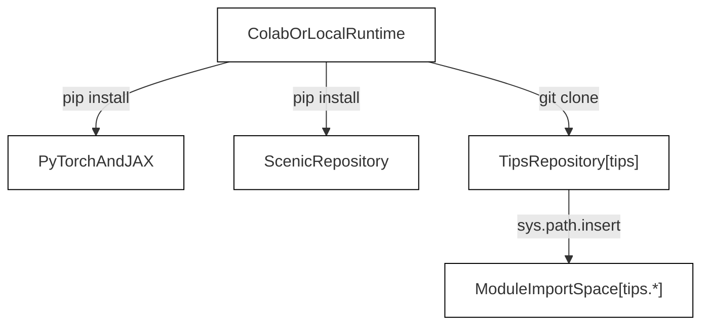
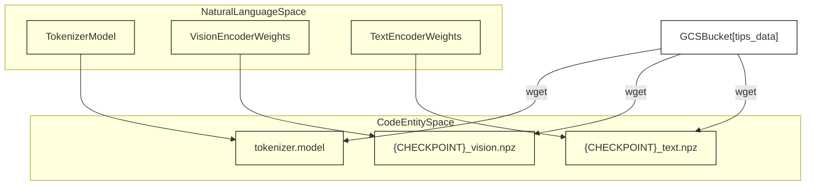

<!-- source: DeepWiki mcp.deepwiki.com · repo google-deepmind/tips · page 4.3 Scenic Demo Notebook · fetched 2026-10-26 -->

# Scenic Demo Notebook

Relevant source files

The following files were used as context for generating this wiki page:

- [scenic/checkpoints/download_checkpoints.sh](scenic/checkpoints/download_checkpoints.sh)
- [scenic/notebooks/TIPS_Demo.ipynb](scenic/notebooks/TIPS_Demo.ipynb)

## Purpose and Scope

This page documents the setup, dependency management, checkpoint download infrastructure, and model visualization workflow defined in `scenic/notebooks/TIPS_Demo.ipynb` and its underlying helper scripts. The Scenic demo notebook provides an interactive environment to initialize, download weights for, and run inference using JAX/Flax-based TIPS and TIPSv2 models.

Sources: [scenic/notebooks/TIPS_Demo.ipynb:1-187](), [scenic/checkpoints/download_checkpoints.sh:1-49]()

---

## Environment Setup and Package Initialization

The notebook initializes an execution environment by installing core deep learning frameworks, utility libraries, and cloning the required repositories (`scenic` and `tips`).

### Dependency Installation Flow
1. **Frameworks**: Installs `torch`, `torchvision`, `torchaudio`, `jax`, `jaxlib`, and `tensorflow_text`.
2. **Utilities**: Installs `mediapy`, `scikit-learn`, `ml_collections`, and `gdown`.
3. **Scenic Library**: Installs the latest `scenic` repository directly from GitHub via `git+https://github.com/google-research/scenic.git`.
4. **TIPS Repository**: Clones the `tips` repository into a local `TIPS_DIR` (`/content/tips`) and prepends `ROOT_DIR` to `sys.path` to enable module imports (`tips.*`).

*Figure 1: Environment initialization and dependency resolution mapping.*

Sources: [scenic/notebooks/TIPS_Demo.ipynb:50-96]()

---

## Model and Variant Selection Logic

The demo notebook supports selecting between two distinct generation versions: `TIPS` (v1.0) and `TIPS_V2`. Each version exposes specific model size variants mapped through a configuration dictionary.

| Model Family | Available Variants | Description |
| :--- | :--- | :--- |
| `TIPS` | `S`, `B`, `L`, `So400m`, `g` | Original TIPS architecture with distilled highres/lowres variants [scenic/checkpoints/download_checkpoints.sh:19-26]() |
| `TIPS_V2` | `B`, `L`, `So`, `g` | Second-generation TIPS architecture with updated scaling properties [scenic/checkpoints/download_checkpoints.sh:27-32]() |

If an invalid variant is selected for a given model family, the notebook automatically catches the mismatch and falls back to the first valid default variant for that architecture [scenic/notebooks/TIPS_Demo.ipynb:132-150]().

Sources: [scenic/notebooks/TIPS_Demo.ipynb:132-150](), [scenic/checkpoints/download_checkpoints.sh:19-32]()

---

## Checkpoint and Asset Download Flow

Model parameters are stored as Flax-compatible `.npz` files alongside the SentencePiece tokenizer (`tokenizer.model`). The notebook and auxiliary shell script pull checkpoints directly from Google Cloud Storage (GCS) buckets hosted under `https://storage.googleapis.com/tips_data/`.

*Figure 2: Mapping of asset types to GCS download endpoints and local file representations.*

### Checkpoint URLs and Layout
* **TIPS v1.0 Checkpoints**: `https://storage.googleapis.com/tips_data/v1_0/checkpoints/scenic/` [scenic/notebooks/TIPS_Demo.ipynb:179-180]()
* **TIPS v2.0 Checkpoints**: `https://storage.googleapis.com/tips_data/v2_0/checkpoints/scenic/` [scenic/notebooks/TIPS_Demo.ipynb:181-182]()
* **Tokenizer Asset**: `https://storage.googleapis.com/tips_data/v1_0/checkpoints/tokenizer.model` [scenic/notebooks/TIPS_Demo.ipynb:183]()

The shell script `scenic/checkpoints/download_checkpoints.sh` automates fetching both vision (`_vision.npz`) and text (`_text.npz`) parameter archives for all supported variants [scenic/checkpoints/download_checkpoints.sh:37-49]().

Sources: [scenic/notebooks/TIPS_Demo.ipynb:175-187](), [scenic/checkpoints/download_checkpoints.sh:1-49]()

---

