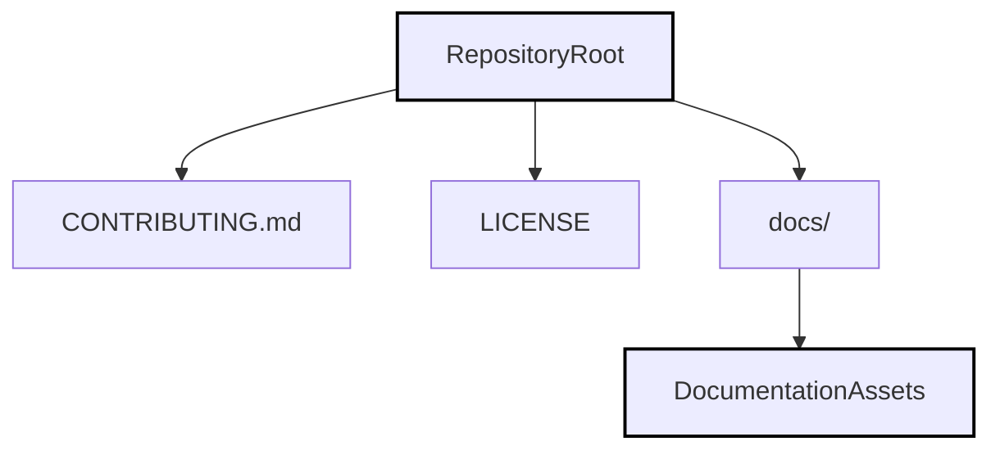

<!-- source: DeepWiki mcp.deepwiki.com · repo google-deepmind/tips · page 5 Project Meta · fetched 2026-10-26 -->

# Project Meta

Relevant source files

The following files were used as context for generating this wiki page:

- [CONTRIBUTING.md](CONTRIBUTING.md)
- [LICENSE](LICENSE)

The "Project Meta" section provides a high-level overview of the repository governance, contribution workflows, licensing frameworks, and documentation assets supporting the TIPS codebase. 

As a parent page, this document outlines the core administrative and structural assets of the project. For deep technical details, consult the respective child pages:
- [Contributing and License](#5.1)
- [Documentation Assets](#5.2)

---

## 5.1 Contributing and License

The repository relies on standard open-source governance models, requiring contributors to execute a Contributor License Agreement (CLA) and adhere to established code review processes via GitHub pull requests [CONTRIBUTING.md:3-20](). Code contributions and project distributions are governed by the Apache License 2.0 [LICENSE:1-126]().

For detailed workflows regarding CLA submission, patch verification, community standards [CONTRIBUTING.md:22-25](), and licensing terms, see [Contributing and License](#5.1).

Sources: `CONTRIBUTING.md:1-25`, `LICENSE:1-126`

---

## 5.2 Documentation Assets

The repository maintains architectural diagrams, feature maps, qualitative visualizations, and teaser graphics inside the documentation directories. These visual assets clarify the multi-backend structure spanning PyTorch and JAX/Scenic implementations.

*Figure 1: Project meta assets and governance structure.*

For details on the specific contents of `docs/images` and their references across the codebase, see [Documentation Assets](#5.2).

Sources: `CONTRIBUTING.md:1-25`, `LICENSE:1-126`

---

