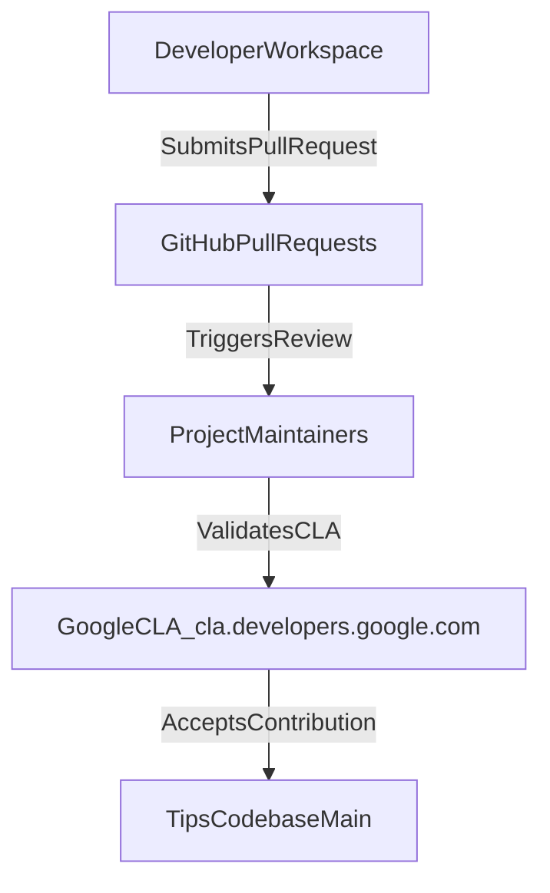
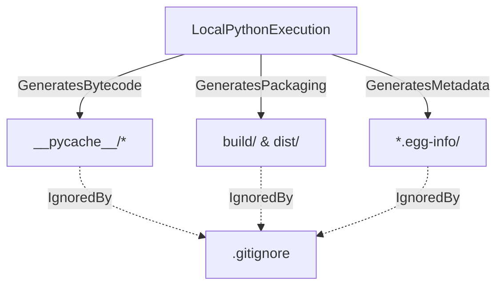

<!-- source: DeepWiki mcp.deepwiki.com · repo google-deepmind/tips · page 5.1 Contributing and License · fetched 2026-10-26 -->

# Contributing and License

Relevant source files

The following files were used as context for generating this wiki page:

- [.gitignore](.gitignore)
- [CONTRIBUTING.md](CONTRIBUTING.md)
- [LICENSE](LICENSE)

## Purpose and Scope
This page documents the governance, contribution workflows, licensing terms, and repository hygiene conventions for the `tips` codebase (`https://github.com/google-deepmind/tips`). It details the requirements for submitting code via the Contributor License Agreement (CLA), the code review process using GitHub pull requests, the rights and restrictions under the Apache 2.0 License, and the exclusion rules enforced by `.gitignore`.

Sources: [CONTRIBUTING.md:1-25](), [LICENSE:1-126](), [.gitignore:1-24]()

---

## Contributor License Agreement and Workflow

Contributions to the repository require adherence to established open-source governance policies. Authors retain the copyright to their contributions while granting the project explicit permission to use and redistribute them [CONTRIBUTING.md:5-9]().

### Contributor License Agreement (CLA)
All contributors must execute a Contributor License Agreement before their changes can be merged. 
* **Individual/Enterprise CLA**: Managed through `https://cla.developers.google.com/` [CONTRIBUTING.md:8-9]().
* **Frequency**: Required once per individual/entity; submissions across different Google-managed open-source repositories typically share the same on-file CLA status [CONTRIBUTING.md:11-13]().

### Review Process and Community Standards
* **Pull Requests**: All submissions—including those authored by core project maintainers—must undergo code review via GitHub pull requests [CONTRIBUTING.md:15-20]().
* **Conduct**: Contributors must adhere to Google's Open Source Community Guidelines [CONTRIBUTING.md:22-25]().

*Figure 1: Natural Language Space to Code Entity Space mapping the contribution governance pipeline.*

Sources: [CONTRIBUTING.md:1-25]()

---

## Apache 2.0 License

The project is made available under the Apache License, Version 2.0 [LICENSE:2-3](). This permissive license governs the use, modification, and distribution of source and object forms.

### Key Provisions
* **Copyright and Patent Grants**: Contributors grant a perpetual, worldwide, non-exclusive, royalty-free license to reproduce, prepare derivative works of, publicly display, sublicense, and distribute the work [LICENSE:67-72](). A corresponding patent grant is included, which terminates if the recipient initiates patent litigation regarding the work [LICENSE:74-88]().
* **Redistribution Requirements**: 
  1. Recipients must receive a copy of the License [LICENSE:95-96]().
  2. Modified files must display prominent notices indicating changes [LICENSE:98-99]().
  3. All copyright, patent, trademark, and attribution notices from the source form must be retained [LICENSE:101-105]().
  4. If a `NOTICE` file is present, derivative works must include a readable copy of those attribution notices [LICENSE:107-116]().

Sources: [LICENSE:1-126]()

---

## Repository Hygiene and `.gitignore` Conventions

To keep the version-controlled repository free of generated artifacts, compiled files, and packaging metadata, the `.gitignore` configuration explicitly excludes specific directories and file patterns [.gitignore:1-24]().

### Excluded Asset Categories
* **Byte-compiled Python Files**: Caches and compiled modules such as `__pycache__/`, `*.py[cod]`, and `*$py.class` [.gitignore:1-4]() are ignored to prevent local bytecode pollution.
* **Packaging and Distribution Artifacts**: Directories used during local builds and packaging—including `build/`, `dist/`, `downloads/`, `eggs/`, `.eggs/`, `lib/`, `lib64/`, `parts/`, `sdist/`, `var/`, `wheels/`, and `*.egg-info/` [.gitignore:6-23]()—are excluded.
* **Metadata and Configuration**: Local packaging configuration files such as `.Python`, `.installed.cfg`, and `MANIFEST` [.gitignore:7-24]() are omitted from version control.

*Figure 2: Natural Language Space to Code Entity Space mapping local build artifacts to `.gitignore` exclusion rules.*

Sources: [.gitignore:1-24]()

---

