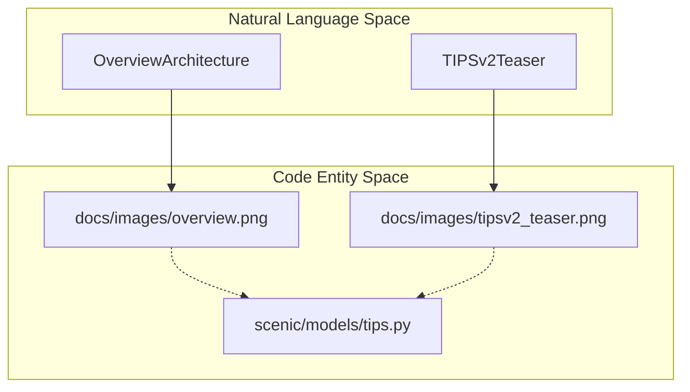
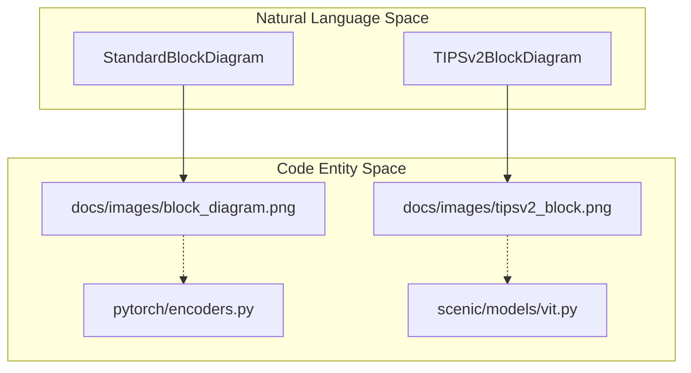
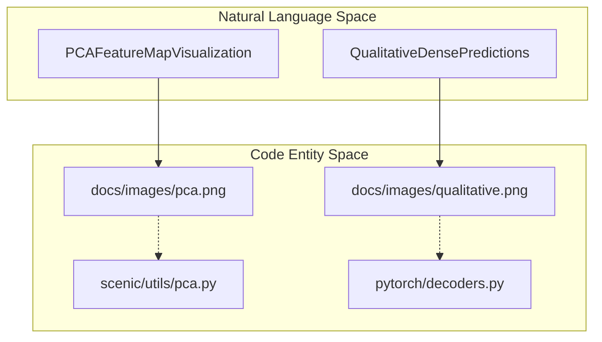

<!-- source: DeepWiki mcp.deepwiki.com · repo google-deepmind/tips · page 5.2 Documentation Assets · fetched 2026-10-26 -->

# Documentation Assets

Relevant source files

The following files were used as context for generating this wiki page:

- [docs/images/block_diagram.png](docs/images/block_diagram.png)
- [docs/images/overview.png](docs/images/overview.png)
- [docs/images/pca.png](docs/images/pca.png)
- [docs/images/qualitative.png](docs/images/qualitative.png)
- [docs/images/tipsv2_block.png](docs/images/tipsv2_block.png)
- [docs/images/tipsv2_teaser.png](docs/images/tipsv2_teaser.png)

The purpose and scope of this section is to document the inventory of visual assets stored within `docs/images/` for the TIPS (Text-Image Pre-training and Segmentation) and TIPSv2 codebases. These assets provide conceptual overviews, block diagrams, Principal Component Analysis (PCA) feature visualizations, qualitative examples, and teasers. They serve as canonical reference diagrams embedded across markdown documentation, model wikis, and interactive Jupyter notebooks.

---

## 1. Architectural Teasers and High-Level Overviews

The high-level assets provide a macro-level perspective of the multi-modal alignment and backbone architectures used across TIPS and TIPSv2.

*   `docs/images/overview.png` [docs/images/overview.png:1-5](): Illustrates the end-to-end framework layout, connecting the Vision Encoder (ViT backbone) and Text Encoder through joint contrastive learning objectives.
*   `docs/images/tipsv2_teaser.png` [docs/images/tipsv2_teaser.png:1-5](): Acts as the primary visual hook for TIPSv2, demonstrating multi-modal zero-shot generalization capabilities, dense feature alignment, and spatial correspondence across disparate domains.

Sources: `docs/images/overview.png:1-5`, `docs/images/tipsv2_teaser.png:1-5`

---

## 2. Structural Block Diagrams

Detailed component layouts break down the internal tensor shapes, patch projection, reassemble modules, and dense prediction heads.

*   `docs/images/block_diagram.png` [docs/images/block_diagram.png:1-5](): Details the standard block-level operations, depicting residual blocks, Multi-Head Self-Attention (MHSA), and SwiGLU vs. standard MLP blocks.
*   `docs/images/tipsv2_block.png` [docs/images/tipsv2_block.png:1-5](): Illustrates the revised TIPSv2 architecture, emphasizing dual CLS token handling, intermediate layer feature extraction, and DPT (Dense Prediction Transformer) head integration.

Sources: `docs/images/block_diagram.png:1-5`, `docs/images/tipsv2_block.png:1-5`

---

## 3. Feature Visualizations and Qualitative Results

Spatial representations and empirical outputs validate feature quality, representation smoothness, and zero-shot transfer capabilities.

*   `docs/images/pca.png` [docs/images/pca.png:1-5](): Visualizes spatial feature maps projected via Principal Component Analysis (`PCAVisualizer`), demonstrating semantic clustering across patch embeddings.
*   `docs/images/qualitative.png` [docs/images/qualitative.png:1-5](): Contains side-by-side qualitative comparisons for tasks such as foreground segmentation, depth estimation, and surface normal prediction using DPT decoders.

Sources: `docs/images/pca.png:1-5`, `docs/images/qualitative.png:1-5`

---

