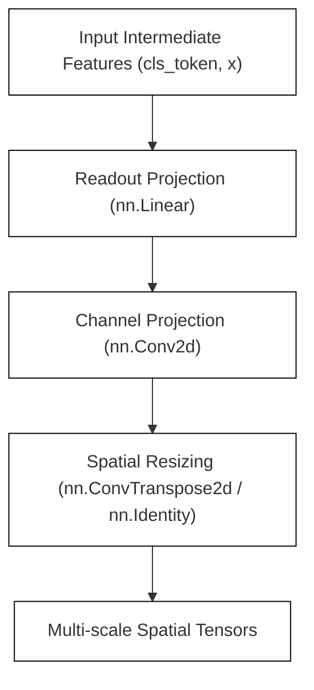
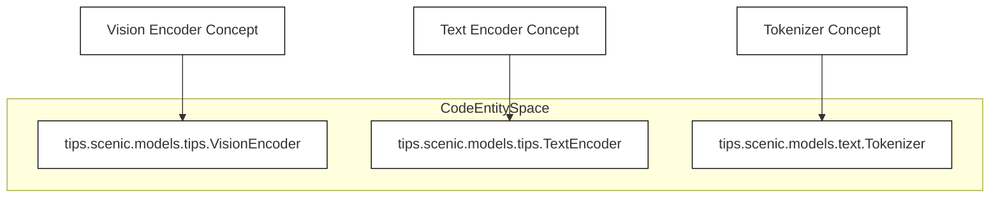
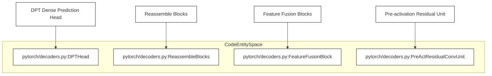

<!-- source: DeepWiki mcp.deepwiki.com · repo google-deepmind/tips · page 6 Glossary · fetched 2026-10-26 -->

# Glossary

Relevant source files

The following files were used as context for generating this wiki page:

- [README.md](README.md)
- [pytorch/decoders.py](pytorch/decoders.py)
- [scenic/run_tips_inference.py](scenic/run_tips_inference.py)

## Purpose and Scope

This page provides formal technical definitions, implementation details, and code pointers for terminology specific to the TIPS (Text-Image Pretraining with Spatial Awareness) and TIPSv2 codebases. It covers core architectural units, training paradigms, tensor transformations, and framework-specific formatting across both the PyTorch and JAX (Scenic) implementations.

---

## 1. System and Architecture Terminology

### TIPS & TIPSv2
**TIPS** (Text-Image Pretraining with Spatial Awareness) and its successor **TIPSv2** are foundational multimodal vision-language architectures designed to retain high-resolution spatial details alongside global semantic alignment [README.md:10-23]. TIPSv2 introduces enhanced patch-text alignment mechanisms and expands the positional embedding resolution from $16 \times 16$ grids to $32 \times 32$ grids [README.md:13, scenic/run_tips_inference.py:18-19].

### Scenic / Flax Formats
The JAX-based subsystem uses the **Scenic** library and Flax NNX/Linen module definitions [README.md:57-58, scenic/run_tips_inference.py:33]. Model parameters are stored as nested dictionaries within `.npz` files (`_vision.npz`, `_text.npz`) [scenic/run_tips_inference.py:110, 125] and loaded into Flax parameter trees via `checkpoint.load_checkpoint` [scenic/run_tips_inference.py:109].

Sources:
- `README.md:10-23`
- `scenic/run_tips_inference.py:33-42`

---

## 2. Vision and Text Representation Terms

### CLS Tokens (Dual CLS Tokens)
Unlike standard Vision Transformers that utilize a single classification token, TIPS models utilize **dual CLS tokens** prepended to the patch token sequence. The first CLS token is optimized for global contrastive retrieval and text alignment, while the second CLS token preserves spatial properties well-suited for dense downstream tasks like segmentation [scenic/run_tips_inference.py:136].

### Positional Embeddings (`posembs`)
**Positional embeddings** are learnable spatial grids added to patch tokens to retain spatial awareness. TIPSv1 models typically use $16 \times 16$ coordinate layouts (often designated as `-HR` / `-LR`), whereas TIPSv2 scales this baseline grid to $32 \times 32$ to support denser feature extraction [scenic/run_tips_inference.py:18-19].

### SwiGLU vs. MLP
Vision and text encoders within TIPS support alternative feed-forward network (FFN) layers. While standard Vision Transformers use a conventional Multilayer Perceptron (MLP) with GELU activations, advanced variants support **SwiGLU** (Switched Gated Linear Unit) activations to improve representation capacity.

### Distilled
The **distilled** tag indicates model variants trained using knowledge distillation from a larger teacher model (e.g., student variants trained to mimic higher-capacity vision-language representations) [README.md:79-82].

### HR / LR
**HR (High-Resolution)** and **LR (Low-Resolution)** designate variant sub-types in TIPSv1. HR variants retain finer spatial stride configurations or higher input token densities compared to their LR counterparts [README.md:77-78].

### Patch Quantization
**Patch quantization** refers to discrete token-level representations or vector quantization applied across image patches to stabilize multimodal pretraining objectives.

Sources:
- `README.md:77-83`
- `scenic/run_tips_inference.py:18-19`

---

## 3. Decoder and Dense Prediction Terms

### DPT (Dense Prediction Transformer)
**DPT** is a dense prediction architecture repurposed in TIPS to map intermediate Vision Transformer patch features into dense pixel-level outputs for tasks such as semantic segmentation, monocular depth estimation, and surface normal prediction [pytorch/decoders.py:16-19].

### Reassemble Blocks (`ReassembleBlocks`)
`ReassembleBlocks` are modules defined in `pytorch/decoders.py` that project intermediate ViT transformer layers into 2D spatial feature maps of various scales, applying readout operations (concatenating CLS tokens) and resolution adjustments (`ConvTranspose2d`, `Conv2d`, or `Identity`) [pytorch/decoders.py:98-126].

*Figure 1: Data flow inside `ReassembleBlocks`.*

Sources:
- `pytorch/decoders.py:16-145`

---

## 4. Optimization and Evaluation Terms

### `temperature_contrastive`
`temperature_contrastive` is a learnable scalar parameter (`temperature`) stored within the text encoder's parameter dictionary (`params_text['params']['temperature_contrastive']`) [scenic/run_tips_inference.py:122-123]. It scales raw cosine similarity logits prior to softmax normalization during text-image retrieval evaluation [scenic/run_tips_inference.py:160-166]:
$$\text{similarity} = \text{softmax}\left(\frac{\text{cls\_token} \cdot \text{embeddings\_text}^T}{\tau}\right)$$

### mAP (Mean Average Precision)
**mAP** is a primary evaluation metric used across detection, instance segmentation, and dense prediction benchmarks to measure the accuracy of bounding boxes or masks against ground truth annotations.

Sources:
- `scenic/run_tips_inference.py:122-166`

---

## 5. Architectural Entity Mapping (Natural Language to Code)

To bridge natural language architectural concepts with concrete code artifacts in the repository, the following diagrams map semantic entities to their respective python classes and files.

### Vision and Text Encoders Mapping

*Figure 2: Natural Language concepts mapped to Scenic/PyTorch code entities.*

Sources:
- `scenic/run_tips_inference.py:39-42`

### Dense Prediction Decoders Mapping

*Figure 3: Dense prediction concepts mapped to PyTorch implementation modules.*

Sources:
- `pytorch/decoders.py:40-187`