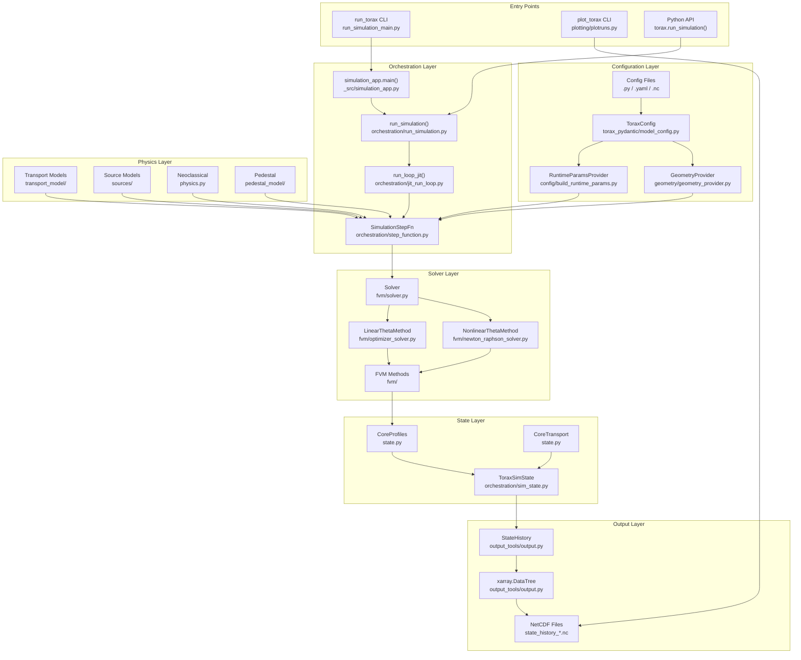
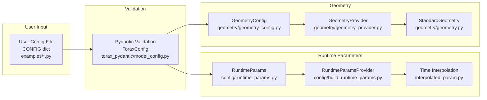
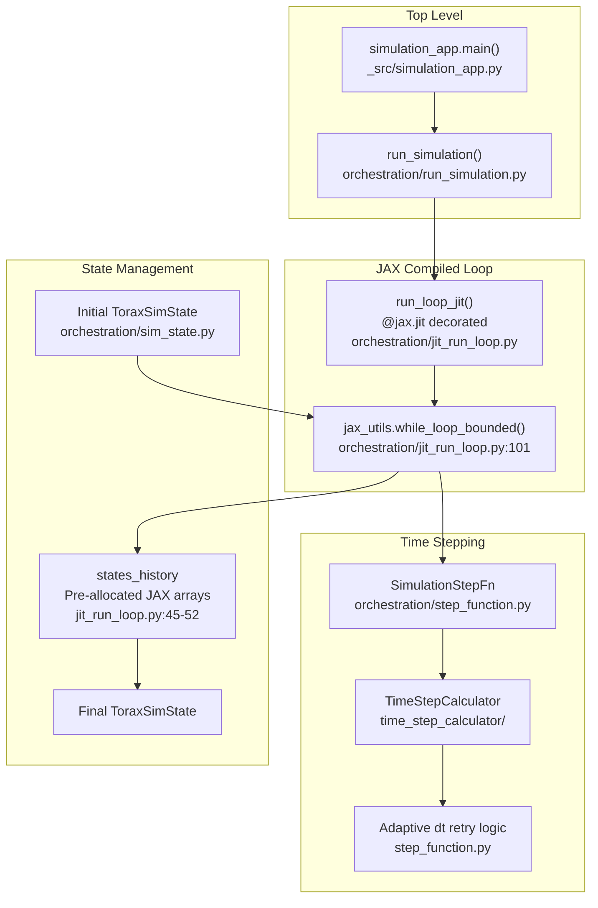
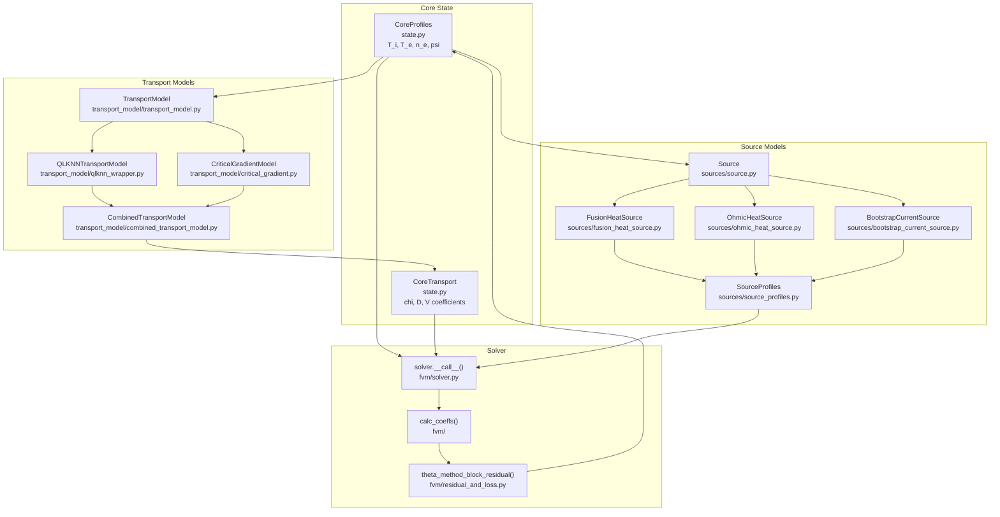

<!-- source: DeepWiki mcp.deepwiki.com · repo google-deepmind/torax · page 1 Overview · fetched 2026-10-26 -->

# Overview

<details>
<summary>Relevant source files</summary>

The following files were used as context for generating this wiki page:

- [.github/workflows/pytest.yml](.github/workflows/pytest.yml)
- [README.md](README.md)
- [docs/configuration.rst](docs/configuration.rst)
- [docs/edge_models.rst](docs/edge_models.rst)
- [docs/installation.rst](docs/installation.rst)
- [docs/interfacing_with_surrogates.rst](docs/interfacing_with_surrogates.rst)
- [docs/links.rst](docs/links.rst)
- [docs/output.rst](docs/output.rst)
- [docs/physics_models.rst](docs/physics_models.rst)
- [docs/running_programmatically.rst](docs/running_programmatically.rst)
- [docs/user_guides.rst](docs/user_guides.rst)
- [docs/using_jax.rst](docs/using_jax.rst)
- [pyproject.toml](pyproject.toml)
- [torax/__init__.py](torax/__init__.py)

</details>


TORAX is a differentiable 1D tokamak plasma transport simulator implemented in Python using JAX. It is designed for fast and accurate forward modeling, pulse design, trajectory optimization, and controller design workflows in magnetic confinement fusion research.

**Scope of this document:** This page provides a high-level overview of TORAX's architecture, key components, and data flow. For detailed information about specific subsystems:
- For installation instructions, see [Installation and Setup](#1.1)
- For running your first simulation, see [Quick Start Guide](#1.2)
- For configuration details, see [Configuration System](#2)
- For physics models, see [Physics Models](#3)
- For numerical methods, see [Numerical Methods](#5)

## Purpose and Key Features

TORAX is built on three core principles:

1. **Open Source and Extensible**: Flexible workflow coupling with modular physics components
2. **Differentiable and Fast**: JAX provides auto-differentiation and JIT compilation for gradient-based optimization and fast execution
3. **ML-Ready Framework**: Natural integration of machine learning surrogates alongside traditional physics models

### Physics Capabilities

| Feature | Description |
|---------|-------------|
| PDEs Solved | Ion/electron heat transport, electron particle transport, current diffusion |
| Discretization | Finite volume method (FVM) with theta-method time integration |
| Solvers | Linear (predictor-corrector, Pereverzev-Corrigan), Nonlinear (Newton-Raphson, optimizer-based) |
| Transport Models | QLKNN_7_11, QLKNN10D, CGM, Bohm-GyroBohm, user-defined |
| Sources | Ohmic, fusion, ICRH, ECRH, generic heating, particle sources, bootstrap current |
| Geometry | CHEASE, FBT, EQDSK, IMAS equilibrium formats; time-dependent geometry |
| Pedestal | Adaptive source models for internal boundary conditions |
| MHD | Sawtooth crash modeling |

**Sources:** [README.md:24-53](), [pyproject.toml:5-10]()

## System Architecture

### Layered Component Overview



**Diagram: TORAX System Architecture**

This diagram shows the complete flow from user entry points through the various system layers to final outputs. The architecture is designed with clear separation of concerns:

- **Entry Points** provide both CLI and programmatic access
- **Configuration Layer** handles validation and time-dependent parameter interpolation
- **Orchestration Layer** manages simulation execution and JAX compilation
- **Physics Layer** contains modular, pluggable physics models
- **Solver Layer** implements numerical methods for PDE solution
- **State Layer** maintains immutable state structures for JAX compatibility
- **Output Layer** serializes results to NetCDF format

**Sources:** [torax/__init__.py:15-59](), [torax/_src/simulation_app.py:15-206](), [README.md:1-274]()

## Key Components and Code Entities

### Entry Points

The system provides three primary entry points:

| Entry Point | Module | Description |
|-------------|--------|-------------|
| `run_torax` | [pyproject.toml:54]() | CLI command for running simulations |
| `plot_torax` | [pyproject.toml:55]() | CLI command for plotting results |
| `run_simulation()` | [torax/__init__.py:26]() | Python API function |

**Sources:** [pyproject.toml:53-55](), [torax/__init__.py:20-35]()

### Configuration System



**Diagram: Configuration System Data Flow**

The configuration system uses Pydantic models for validation and provides time-dependent parameter interpolation:

- **`ToraxConfig`**: Top-level Pydantic model containing all simulation configuration
- **`RuntimeParamsProvider`**: Supplies time-interpolated parameters during simulation without recompilation
- **`GeometryProvider`**: Manages time-dependent equilibrium geometry

**Sources:** [torax/__init__.py:23-34](), [README.md:42-52]()

### Simulation Orchestration



**Diagram: Simulation Execution Flow**

The orchestration layer manages the main simulation loop:

- **`simulation_app.main()`**: Entry point that writes output to NetCDF files
- **`run_simulation()`**: Builds simulation components and runs the loop
- **`run_loop_jit()`**: JAX-compiled loop using pre-allocated history buffers
- **`SimulationStepFn`**: Callable that advances the simulation by one timestep
- **`ToraxSimState`**: Immutable state structure containing `CoreProfiles`, `CoreTransport`, and `Geometry`

**Sources:** [torax/_src/simulation_app.py:149-206](), [torax/_src/orchestration/jit_run_loop.py:29-116]()

### Physics Models and State



**Diagram: Physics Models and State Evolution**

Physics models are modular and interact through well-defined interfaces:

- **`CoreProfiles`**: Contains evolved state variables (temperature, density, poloidal flux)
- **`TransportModel`**: Abstract interface for transport coefficient calculation
- **`Source`**: Abstract interface for heat, particle, and current sources
- **`SourceProfiles`**: Collection of all source terms for a timestep
- **`Solver`**: Evolves `CoreProfiles` forward in time using transport coefficients and sources

**Sources:** [torax/__init__.py:30-31](), [README.md:26-42]()

## Data Flow from Configuration to Output

```mermaid
graph LR
    subgraph "Input"
        ConfigPy["examples/basic_config.py<br/>CONFIG dict"]
    end
    
    subgraph "Build Phase"
        BuildConfig["build_torax_config_from_file()<br/>config/config_loader.py"]
        ToraxCfg["ToraxConfig instance<br/>torax_pydantic/model_config.py"]
        BuildComponents["Build Runtime Providers<br/>Build Geometry Provider<br/>Build Physics Models<br/>Build Solver"]
    end
    
    subgraph "Execution"
        RunLoop["run_loop_jit()<br/>JAX compiled loop"]
        TimeSteps["Timestep Iterations<br/>while t < t_final"]
    end
    
    subgraph "Output"
        StateSeq["Tuple of ToraxSimState<br/>one per timestep"]
        ToDataTree["output.datatree_to_xr_datatree()<br/>output_tools/output.py"]
        NetCDFFile["state_history_*.nc<br/>/tmp/torax_results/"]
    end
    
    ConfigPy --> BuildConfig
    BuildConfig --> ToraxCfg
    ToraxCfg --> BuildComponents
    BuildComponents --> RunLoop
    RunLoop --> TimeSteps
    TimeSteps --> StateSeq
    StateSeq --> ToDataTree
    ToDataTree --> NetCDFFile
```



**Diagram: Complete Data Flow Pipeline**

The simulation follows a clear pipeline from configuration to output:

1. **Input**: User provides a Python file with a `CONFIG` dictionary
2. **Build**: Configuration is validated and components are constructed
3. **Execution**: JAX-compiled loop iterates through timesteps
4. **Output**: State history is converted to xarray `DataTree` and written to NetCDF

**Sources:** [torax/_src/simulation_app.py:149-206](), [torax/_src/orchestration/jit_run_loop.py:29-116]()

## JAX Integration

TORAX leverages JAX for performance and differentiability:

| Feature | Implementation |
|---------|----------------|
| JIT Compilation | `@jax.jit` decorator on `run_loop_jit()` [jit_run_loop.py:29]() |
| Pytree Compatibility | All state structures are JAX pytrees [state.py]() |
| Pre-allocated Arrays | History buffers allocated before loop [jit_run_loop.py:45-52]() |
| While Loop | `jax_utils.while_loop_bounded()` for iteration [jit_run_loop.py:101-112]() |
| Auto-differentiation | Enabled throughout for gradient-based optimization |

Environment variables control JAX behavior:

```python
# Disable JIT for debugging
export JAX_DISABLE_JIT=True

# Enable persistent compilation cache
export JAX_COMPILATION_CACHE_DIR=~/jax_cache
export JAX_PERSISTENT_CACHE_MIN_ENTRY_SIZE_BYTES=-1
export JAX_PERSISTENT_CACHE_MIN_COMPILE_TIME_SECS=0.0

# Set precision (default f64)
export JAX_PRECISION=f64
```

**Sources:** [torax/__init__.py:62-76](), [README.md:164-179](), [docs/running.rst:60-78]()

## Output System

Simulation results are stored in NetCDF files using xarray `DataTree` structures:

- **File Format**: NetCDF4 (`.nc` extension)
- **File Naming**: `state_history_YYYYMMDD_HHMMSS.nc`
- **Default Location**: `/tmp/torax_results/` (configurable via `--output_dir` flag)
- **Data Structure**: Hierarchical xarray `DataTree` with time-series data

The `StateHistory` class [output_tools/output.py]() collects:
- `CoreProfiles` evolution over time
- `CoreTransport` coefficients
- `Geometry` at each timestep
- Post-processed quantities (fusion power, stored energy, etc.)

**Visualization**: Use `plot_torax --outfile <path>` to visualize results with an interactive slider.

**Sources:** [torax/_src/simulation_app.py:102-119](), [docs/running.rst:23-29](), [docs/quickstart.rst:66-85]()

## Testing Framework

TORAX employs comprehensive testing:

| Test Type | Description |
|-----------|-------------|
| Unit Tests | Component-level tests for physics formulas, coefficient calculations |
| Integration Tests | Full simulation runs with reference output comparison |
| Parameterized Tests | Multiple physics model configurations tested systematically |
| CI/CD | GitHub Actions with 8-way parallel test sharding |

Key testing infrastructure:
- **Test Data**: Reference NetCDF files in `torax/tests/test_data/`
- **Test Sharding**: Controlled by `PYTEST_NUM_SHARDS` environment variable [pytest.yml:25]()
- **Error Checking**: `TORAX_ERRORS_ENABLED=1` enables assertions [pytest.yml:23]()
- **No-compile Tests**: `JAX_DISABLE_JIT=True` for debugging [pytest.yml:83]()

**Sources:** [.github/workflows/pytest.yml:1-84](), [README.md:199-206]()

## Getting Started

To run your first simulation:

```bash
# Install from PyPI
pip install torax

# Run basic example
run_torax --config=examples/basic_config.py

# Run with progress logging
run_torax --config=examples/basic_config.py --log_progress

# Plot results
plot_torax --outfile /tmp/torax_results/state_history_*.nc
```

For more details:
- Installation: See [Installation and Setup](#1.1)
- Running simulations: See [Quick Start Guide](#1.2)
- Configuration: See [Configuration System](#2)
- Python API usage: See [Python API](#6.2)

**Sources:** [README.md:103-150](), [docs/quickstart.rst:1-94](), [docs/running.rst:1-183]()

---

