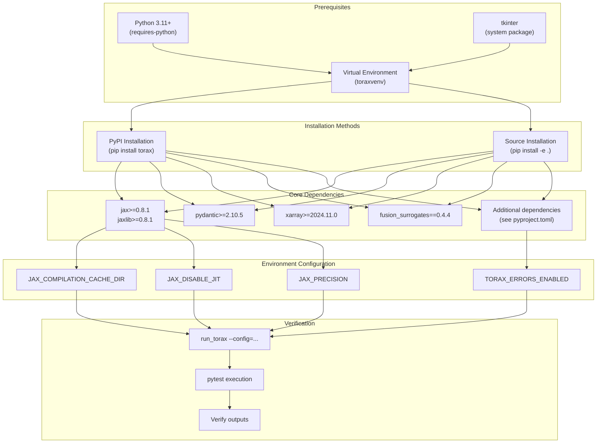
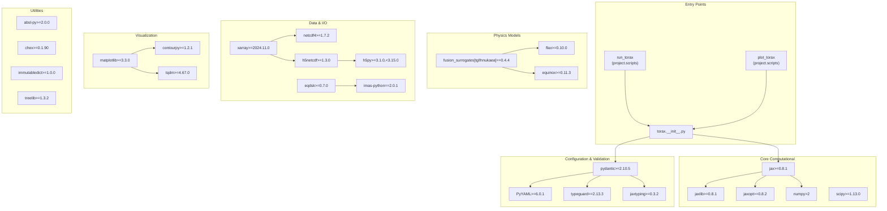
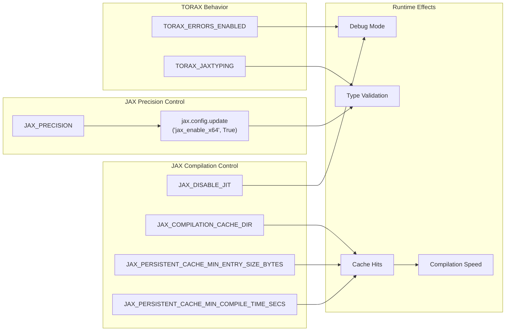
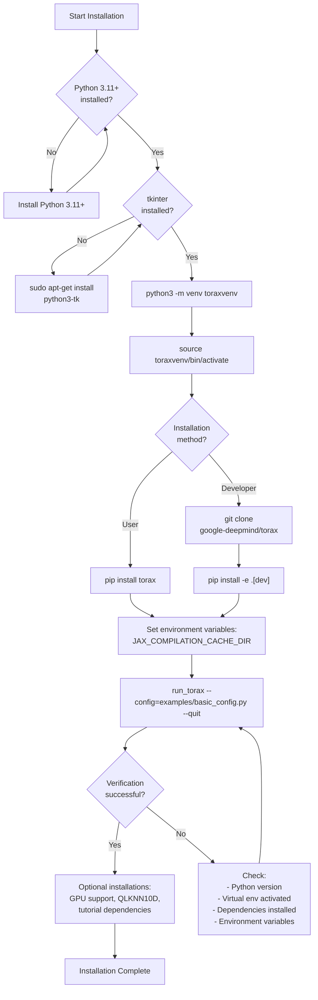

<!-- source: DeepWiki mcp.deepwiki.com · repo google-deepmind/torax · page 1.1 Installation and Setup · fetched 2026-10-26 -->

# Installation and Setup

<details>
<summary>Relevant source files</summary>

The following files were used as context for generating this wiki page:

- [.github/workflows/pytest.yml](.github/workflows/pytest.yml)
- [README.md](README.md)
- [docs/installation.rst](docs/installation.rst)
- [pyproject.toml](pyproject.toml)
- [torax/__init__.py](torax/__init__.py)

</details>


This document covers the installation process for TORAX, including system requirements, dependency management, environment configuration, and verification procedures. For information about running your first simulation, see [Quick Start Guide](#1.2). For detailed configuration of simulation parameters, see [Configuration System](#2).

## Overview

TORAX installation involves three main steps: setting up a Python environment, installing the package and its dependencies, and configuring JAX-specific environment variables for optimal performance. The system supports installation via PyPI for end users or from source for developers.



**Sources:** [pyproject.toml:1-128](), [README.md:69-232](), [docs/installation.rst:1-120]()

## System Requirements

### Python Version

TORAX requires Python 3.11 or greater, as specified in [pyproject.toml:9]().

```bash
python3 --version  # Should show 3.11 or higher
```

### System Dependencies

The `tkinter` library must be installed at the system level for visualization functionality:

```bash
sudo apt-get install python3-tk
```

**Sources:** [README.md:75-79](), [docs/installation.rst:8-17]()

## Virtual Environment Setup

TORAX should be installed in an isolated Python virtual environment to avoid dependency conflicts.

### Creating the Virtual Environment

```bash
# Install or upgrade pip and virtualenv
pip install --upgrade pip
pip install virtualenv

# Create virtual environment
python3 -m venv toraxvenv

# Activate virtual environment
source toraxvenv/bin/activate
```

The virtual environment name `toraxvenv` appears in documentation examples at [README.md:98-100]() and [docs/installation.rst:49]().

To deactivate the virtual environment later:

```bash
deactivate
```

**Sources:** [README.md:83-100](), [docs/installation.rst:24-57]()

## Installation Methods

### PyPI Installation (Recommended for Users)

For users who want to run simulations without modifying TORAX source code:

```bash
pip install torax
```

This installs the package registered at [pyproject.toml:6]() with all required dependencies specified in [pyproject.toml:17-46]().

### Source Installation (For Development)

For developers who need to modify TORAX code, install from the cloned repository:

```bash
git clone https://github.com/google-deepmind/torax
cd torax
pip install -e .[dev]
```

The `[dev]` extra installs additional development dependencies including `pytest`, `pylint`, and `pyink` as specified in [pyproject.toml:65-78]().

**Sources:** [README.md:102-119](), [docs/installation.rst:61-75](), [pyproject.toml:62-78]()

## Dependency Architecture

The following diagram maps TORAX's major dependency categories to their roles in the system:



**Sources:** [pyproject.toml:17-46]()

### Core Dependencies Table

| Dependency | Version Constraint | Purpose |
|------------|-------------------|---------|
| `jax` | >=0.8.1 | Auto-differentiation and JIT compilation framework |
| `jaxlib` | >=0.8.1 | JAX backend implementation |
| `jaxopt` | >=0.8.2 | Optimization solvers (used in optimizer-based PDE solver) |
| `pydantic` | >=2.10.5 | Configuration validation via `ToraxConfig` |
| `xarray` | >=2024.11.0 | Multi-dimensional data structures for output |
| `netcdf4` | >=1.7.2 | NetCDF file I/O for simulation results |
| `fusion_surrogates` | ==0.4.4 | QLKNN neural network transport models |
| `matplotlib` | >=3.3.0 | Plotting and visualization |
| `numpy` | >2 | Numerical array operations |
| `scipy` | >=1.13.0 | Scientific computing utilities |
| `eqdsk` | >=0.7.0 | EQDSK equilibrium file parsing |
| `imas-python` | ==2.0.1 | ITER Integrated Modelling Analysis Suite interface |

**Sources:** [pyproject.toml:17-46]()

## Environment Configuration

TORAX behavior is controlled by several environment variables that configure JAX compilation, caching, and TORAX-specific error checking.

### JAX Environment Variables



**Sources:** [README.md:152-189](), [torax/__init__.py:72-86](), [docs/installation.rst:77-90]()

### Environment Variables Table

| Variable | Default | Description | Code Reference |
|----------|---------|-------------|----------------|
| `JAX_DISABLE_JIT` | `False` | Disables JAX JIT compilation for debugging | [README.md:165-170]() |
| `JAX_COMPILATION_CACHE_DIR` | None | Directory for persistent compilation cache | [README.md:172-179]() |
| `JAX_PERSISTENT_CACHE_MIN_ENTRY_SIZE_BYTES` | N/A | Minimum cache entry size (-1 for all) | [README.md:177]() |
| `JAX_PERSISTENT_CACHE_MIN_COMPILE_TIME_SECS` | N/A | Minimum compile time to cache (0.0 for all) | [README.md:178]() |
| `JAX_PRECISION` | `f64` | Floating point precision (f32/f64) | [torax/__init__.py:74-79]() |
| `TORAX_ERRORS_ENABLED` | `False` | Enable error checking in internal routines | [README.md:154-161]() |
| `TORAX_JAXTYPING` | `False` | Enable runtime type checking | [.github/workflows/pytest.yml:24]() |

### Setting Environment Variables

**Persistent configuration (recommended):**

Add to `~/.bashrc` or `~/.bash_profile`:

```bash
# JAX persistent compilation cache
export JAX_COMPILATION_CACHE_DIR=~/jax_cache
export JAX_PERSISTENT_CACHE_MIN_ENTRY_SIZE_BYTES=-1
export JAX_PERSISTENT_CACHE_MIN_COMPILE_TIME_SECS=0.0

# Optional: Enable error checking (incompatible with cache)
# export TORAX_ERRORS_ENABLED=True
```

**Temporary configuration (for single session):**

```bash
# Disable JIT for debugging
export JAX_DISABLE_JIT=True

# Enable comprehensive error checking
export TORAX_ERRORS_ENABLED=True
export TORAX_JAXTYPING=True
```

**Note:** `TORAX_ERRORS_ENABLED=True` is incompatible with the persistent compilation cache as noted in [README.md:156-157]().

**Sources:** [README.md:152-189](), [torax/__init__.py:72-86](), [docs/installation.rst:77-91]()

## Verification

### Basic Verification

After installation, verify TORAX works correctly by running an example configuration:

```bash
run_torax --config=examples/basic_config.py --quit
```

The `--quit` flag exits immediately after simulation without entering the interactive menu. This command invokes the CLI entry point defined at [pyproject.toml:54]().

**Expected behavior:**
- Progress bar showing simulation time and completion percentage
- Output file written to `/tmp/torax_results/state_history_YYYYMMDD_HHMMSS.nc`
- Process exits with code 0

**Sources:** [README.md:110-114](), [pyproject.toml:53-55]()

### Running Example Configurations

Test more complex scenarios:

```bash
# ITER hybrid scenario with current ramp-up
run_torax --config=examples/iterhybrid_rampup.py

# Predictor-corrector solver
run_torax --config=examples/iterhybrid_predictor_corrector.py
```

These examples demonstrate time-dependent geometry, multiple physics models, and different solver configurations.

**Sources:** [README.md:120-142]()

### Running Test Suite

For development installations, verify all tests pass:

```bash
# Run tests with full error checking
TORAX_JAXTYPING=True TORAX_ERRORS_ENABLED=True pytest . -n auto
```

This command:
- Enables runtime type validation (`TORAX_JAXTYPING=True`)
- Enables internal error checking (`TORAX_ERRORS_ENABLED=True`)
- Runs tests in parallel (`-n auto`)
- Uses pytest configuration from [pyproject.toml:118-127]()

The CI/CD pipeline uses test sharding as configured in [.github/workflows/pytest.yml:25]() with `PYTEST_NUM_SHARDS=8`.

**Sources:** [README.md:199-206](), [.github/workflows/pytest.yml:21-84]()

## Optional Components

### GPU Support

For machines with NVIDIA GPUs, install GPU-enabled JAX following the instructions at:
https://jax.readthedocs.io/en/latest/installation.html#supported-platforms

This replaces the CPU-only `jaxlib` with a GPU-accelerated version.

**Sources:** [docs/installation.rst:92-96]()

### QLKNN-hyper-10D Transport Model

TORAX uses QLKNN_7_11 by default (included in `fusion_surrogates==0.4.4` dependency). For compatibility with older simulations or benchmarking against other codes, install the legacy QLKNN10D model:

```bash
git clone https://gitlab.com/qualikiz-group/qlknn-hyper.git
```

Configure the model path in your simulation configuration:

```python
CONFIG = {
    'transport': {
        'model_path': '/path/to/qlknn-hyper',
    },
}
```

**Differences between models:**
- QLKNN_7_11: Based on QuaLiKiz 2.8.1, includes impurity gradients, better near-edge coverage
- QLKNN10D: Legacy model based on older QuaLiKiz version

**Sources:** [README.md:232-252](), [docs/installation.rst:99-119]()

### Tutorial Dependencies

For running Jupyter notebooks in the tutorials:

```bash
pip install torax[tutorial]
```

This installs additional dependencies specified in [pyproject.toml:80-84]():
- `seaborn` - Statistical visualization
- `notebook` - Jupyter notebook interface

**Sources:** [pyproject.toml:80-84]()

## Installation Workflow Summary



**Sources:** [README.md:69-232](), [docs/installation.rst:1-120]()

## Common Issues and Troubleshooting

### Import Errors

**Symptom:** `ModuleNotFoundError: No module named 'torax'`

**Solution:**
1. Verify virtual environment is activated: `which python` should point to `toraxvenv`
2. Reinstall TORAX: `pip install --force-reinstall torax`

### JAX Compilation Errors

**Symptom:** Compilation fails or is extremely slow

**Solution:**
1. Clear JAX cache: `rm -rf $JAX_COMPILATION_CACHE_DIR`
2. Disable persistent cache temporarily: `unset JAX_COMPILATION_CACHE_DIR`
3. Check available memory (compilation requires significant RAM)

### Precision Warnings

**Symptom:** Warnings about float32 vs float64

**Solution:**
The `set_jax_precision()` function at [torax/__init__.py:72-79]() sets default precision to f64. Override with:

```bash
export JAX_PRECISION=f32  # Use with caution - may affect accuracy
```

### Test Failures

**Symptom:** Tests fail with `TORAX_ERRORS_ENABLED=True`

**Solution:**
This is incompatible with the persistent cache. Either:
1. Disable cache: `unset JAX_COMPILATION_CACHE_DIR`
2. Run tests without error checking (not recommended)

**Sources:** [README.md:154-161](), [torax/__init__.py:72-86]()

---

