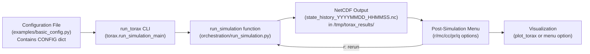
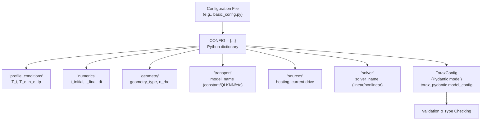
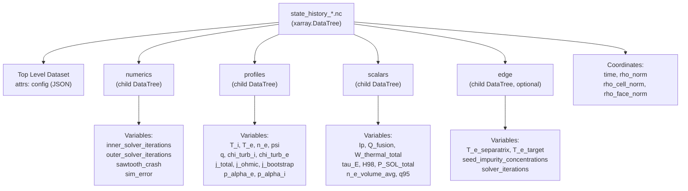
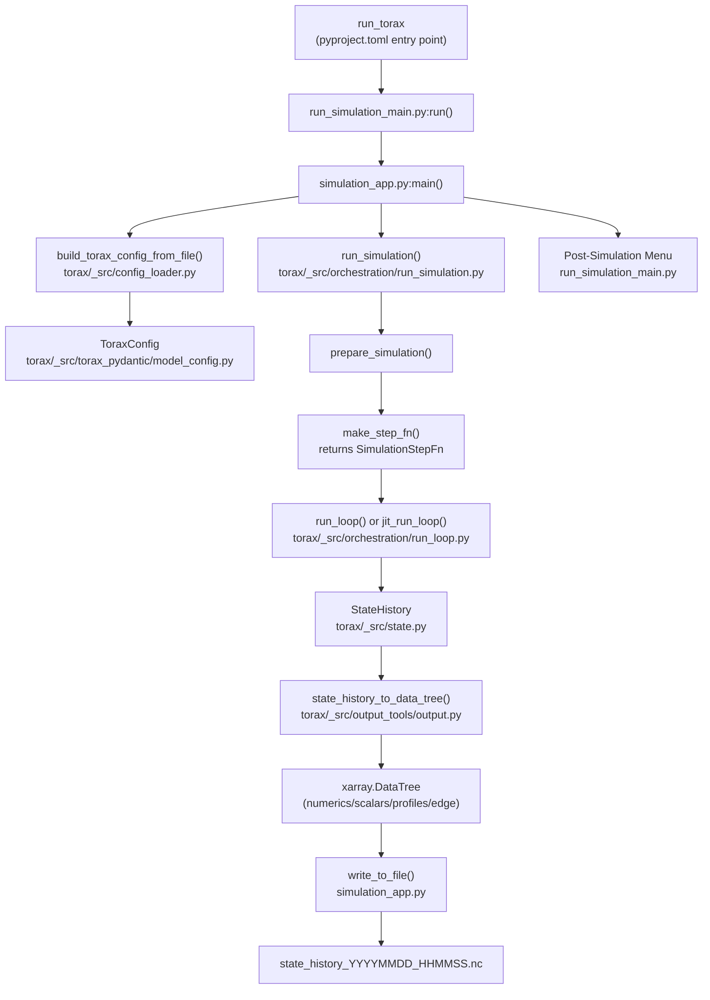

<!-- source: DeepWiki mcp.deepwiki.com · repo google-deepmind/torax · page 1.2 Quick Start Guide · fetched 2026-10-26 -->

# Quick Start Guide

<details>
<summary>Relevant source files</summary>

The following files were used as context for generating this wiki page:

- [docs/configuration.rst](docs/configuration.rst)
- [docs/edge_models.rst](docs/edge_models.rst)
- [docs/interfacing_with_surrogates.rst](docs/interfacing_with_surrogates.rst)
- [docs/links.rst](docs/links.rst)
- [docs/output.rst](docs/output.rst)
- [docs/physics_models.rst](docs/physics_models.rst)
- [docs/plotting.rst](docs/plotting.rst)
- [docs/quickstart.rst](docs/quickstart.rst)
- [docs/running.rst](docs/running.rst)
- [docs/running_programmatically.rst](docs/running_programmatically.rst)
- [docs/user_guides.rst](docs/user_guides.rst)
- [docs/using_jax.rst](docs/using_jax.rst)

</details>


This page provides a rapid, hands-on introduction to running your first TORAX simulation, from configuration file to output visualization. For detailed installation instructions, see [Installation and Setup](#1.1). For comprehensive configuration options, see [Configuration System](#2). For detailed execution concepts, see [Simulation Execution](#4).

---

## Prerequisites

Before following this guide, ensure that:

1. TORAX is installed (see [Installation and Setup](#1.1))
2. Your Python virtual environment is activated
3. You have access to the `examples/` directory (either from PyPI installation or cloned repository)

The examples used in this guide are included with TORAX at [examples/](https://github.com/google-deepmind/torax/tree/main/examples).

**Sources:** [README.md:69-120](), [docs/installation.rst:1-120](), [pyproject.toml:53-55]()

---

## Basic Workflow Overview

The following diagram shows the complete quick start workflow from configuration to visualization:



**Sources:** [torax/run_simulation_main.py:1-100](), [simulation_app.py:149-206](), [docs/running.rst:1-183]()

---

## Running Your First Simulation

### Basic Command

The simplest way to run TORAX is with the `run_torax` command-line interface:

```bash
run_torax --config='examples/basic_config.py'
```

This command:
1. Loads the configuration from `examples/basic_config.py`
2. Validates the `CONFIG` dictionary using Pydantic
3. Runs the simulation with progress bar
4. Writes output to `/tmp/torax_results/state_history_YYYYMMDD_HHMMSS.nc`

**Sources:** [README.md:122-128](), [docs/quickstart.rst:12-24](), [pyproject.toml:53-54]()

### Monitoring Progress

During execution, you will see a progress bar in the terminal:

```
Simulation Progress: 65%|████████████▌      | 3.25s/5.00s
```

The progress bar displays:
- Current simulation time
- Percentage complete relative to `t_final` configured in the `numerics` section
- Time remaining estimate

For additional timestep-level logging, use the `--log_progress` flag:

```bash
run_torax --config='examples/basic_config.py' --log_progress
```

This outputs detailed information for each timestep including `dt`, solver iterations, and convergence status.

**Sources:** [docs/running.rst:85-95](), [simulation_app.py:153-156]()

---

## Understanding Configuration Files

All TORAX simulations require a Python configuration file containing a `CONFIG` dictionary. This dictionary is automatically converted to a `ToraxConfig` Pydantic model for validation.

### Configuration File Structure



**Example: Minimal Configuration**

A minimal `CONFIG` dictionary requires only a geometry specification. All other parameters have defaults:

```python
# In my_config.py
CONFIG = {
    'geometry': {
        'geometry_type': 'circular',
        'n_rho': 25,
    }
}
```

**Sources:** [docs/configuration.rst:1-50](), [torax/__init__.py:34](), [docs/configuration.rst:33-47]()

### Available Example Configurations

TORAX provides several pre-configured examples with increasing complexity:

| Configuration File | Description | Solver | Transport Model |
|-------------------|-------------|--------|-----------------|
| `basic_config.py` | Simple constant transport | Linear | Constant |
| `iterhybrid_predictor_corrector.py` | ITER hybrid flat-top | Linear (predictor-corrector) | QLKNN |
| `iterhybrid_rampup.py` | ITER hybrid current rampup | Nonlinear (Newton-Raphson) | QLKNN |

To run any example:

```bash
run_torax --config='examples/<filename>.py'
```

**Sources:** [README.md:122-142](), [docs/quickstart.rst:26-40](), [docs/running.rst:31-45]()

---

## Output Files and Data Structure

### Output File Location

By default, simulation results are written to `/tmp/torax_results/` with timestamped filenames:

```
/tmp/torax_results/state_history_20240315_143022.nc
```

To specify a custom output directory:

```bash
run_torax --config='examples/basic_config.py' --output_dir=/path/to/my/results
```

**Sources:** [simulation_app.py:85-109](), [docs/running.rst:105-112]()

### NetCDF File Contents

The output file is a NetCDF file containing an `xarray.DataTree` with the following hierarchical structure:

**Title: TORAX Output DataTree Structure**



Key variables in the output:

**Profiles (1D radial profiles):**
- `T_i`, `T_e`: Ion and electron temperature [keV] - shape `(time, rho_norm)`
- `n_e`: Electron density [m⁻³] - shape `(time, rho_norm)`
- `psi`: Poloidal flux [Wb] - shape `(time, rho_norm)`
- `q`: Safety factor - shape `(time, rho_face_norm)`
- `chi_turb_i`, `chi_turb_e`: Turbulent heat conductivities [m²/s] - shape `(time, rho_face_norm)`
- `j_total`, `j_ohmic`, `j_bootstrap`: Current density profiles [A/m²]

**Scalars (time-dependent global quantities):**
- `Ip`: Plasma current [A] - shape `(time,)`
- `Q_fusion`: Fusion gain - shape `(time,)`
- `W_thermal_total`: Total stored energy [J] - shape `(time,)`
- `tau_E`: Energy confinement time [s] - shape `(time,)`
- `H98`: H-mode confinement factor - shape `(time,)`
- `P_SOL_total`: Power to scrape-off layer [W] - shape `(time,)`

For complete variable lists and definitions, see [Output Data Format](#7.1).

**Sources:** [docs/output.rst:11-95](), [docs/output.rst:119-735]()

---

## Visualizing Results

### Post-Simulation Menu

After simulation completion, `run_torax` presents an interactive menu rather than exiting immediately. This preserves the compiled simulation in memory for faster subsequent runs.

```
Menu Options:
  r  : RUN SIMULATION
  mc : modify the existing config and reload it
  cc : provide a new config file to load
  tlp: toggle --log_progress
  tlo: toggle --log_output
  pr : plot previous run(s) or against reference if provided
  q  : quit
```

To visualize your results:
1. Type `pr` and press Enter
2. Select option `0` to plot the last run
3. A matplotlib window will open with an interactive time slider

**Sources:** [docs/running.rst:139-183]()

### Standalone Plotting

Alternatively, use the `plot_torax` CLI command:

```bash
plot_torax --outfile /tmp/torax_results/state_history_20240315_143022.nc
```

**Title: Plot Window Features**

This opens an interactive matplotlib window with:
- **Time slider**: Scrub through all simulation timesteps
- **Spatial profiles**: Radial profiles (T_i, T_e, n_e, q) updated as slider moves
- **Time series plots**: Global quantities (if configured) showing full time evolution
- **Multiple runs**: Overlay two runs for comparison by providing both paths

To customize which quantities are plotted:

```bash
plot_torax --outfile <output_file> --plot_config=plotting/configs/custom_plot_config.py
```

Pre-configured plot layouts are available in `plotting/configs/`:
- `default_plot_config.py`: Comprehensive view of all quantities
- `simple_plot_config.py`: Basic kinetic profiles and currents
- `sources_plot_config.py`: Focus on heating and particle sources
- `global_params_plot_config.py`: Scalar time series (Q_fusion, H98, etc.)

**Sources:** [docs/quickstart.rst:66-84](), [docs/plotting.rst:10-91]()

---

## Common Command-Line Flags

The following table summarizes frequently used `run_torax` flags:

| Flag | Default | Description |
|------|---------|-------------|
| `--config` | (required) | Path to configuration file containing `CONFIG` dict |
| `--output_dir` | `/tmp/torax_results` | Directory for output NetCDF files |
| `--log_progress` | `False` | Log timestep details (time, dt, iterations) |
| `--log_output` | `False` | Log initial and final state to console |
| `--reference_run` | `None` | Path to reference NetCDF file for comparison plotting |
| `--plot_config` | `default_plot_config.py` | Custom plot configuration file |

**Example with multiple flags:**

```bash
run_torax \
  --config='examples/iterhybrid_rampup.py' \
  --output_dir=~/my_torax_results \
  --log_progress \
  --reference_run=/path/to/reference.nc
```

**Sources:** [docs/running.rst:60-137](), [README.md:144-197]()

---

## Environment Variables

Several environment variables control TORAX behavior:

| Variable | Default | Purpose |
|----------|---------|---------|
| `JAX_DISABLE_JIT` | `False` | Disable JAX compilation (debugging) |
| `TORAX_ERRORS_ENABLED` | `False` | Enable runtime error checking (debugging) |
| `JAX_COMPILATION_CACHE_DIR` | (none) | Enable persistent compilation cache |

**To enable compilation caching** (recommended for faster restarts):

```bash
export JAX_COMPILATION_CACHE_DIR=~/jax_cache
export JAX_PERSISTENT_CACHE_MIN_ENTRY_SIZE_BYTES=-1
export JAX_PERSISTENT_CACHE_MIN_COMPILE_TIME_SECS=0.0
```

**Sources:** [README.md:153-179](), [docs/running.rst:60-78](), [torax/__init__.py:38-70]()

---

## Quick Start Workflow Summary

The following diagram traces the execution path from CLI invocation to output file generation:

**Title: Code Execution Flow from CLI to NetCDF Output**



**Sources:** [docs/running.rst:1-184](), [docs/quickstart.rst:1-94]()

---

## Next Steps

Now that you've run your first simulation, explore:

- **[Configuration Parameters](#2.1)** - Comprehensive list of all configuration options
- **[Time-Dependent Parameters](#2.2)** - How to specify time-varying boundary conditions
- **[Physics Models](#3)** - Available transport models, sources, and geometries
- **[Simulation Execution](#4)** - Deep dive into step functions and state management
- **[Running Simulations](#6)** - Advanced CLI usage and Python API
- **[Results and Output](#7)** - Detailed output format and post-processing

For detailed configuration examples, see [Example Configurations](#2.4).

**Sources:** [docs/configuration.rst:1-50](), [docs/running.rst:1-183](), [docs/quickstart.rst:1-94]()

---

