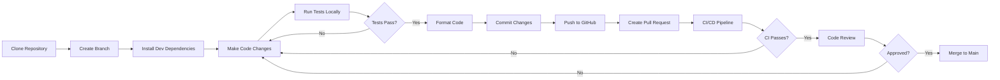

<!-- source: DeepWiki mcp.deepwiki.com · repo google-deepmind/torax · page 10 Development Guide · fetched 2026-10-26 -->

# Development Guide

<details>
<summary>Relevant source files</summary>

The following files were used as context for generating this wiki page:

- [.github/workflows/pytest.yml](.github/workflows/pytest.yml)
- [README.md](README.md)
- [docs/installation.rst](docs/installation.rst)
- [pyproject.toml](pyproject.toml)
- [torax/__init__.py](torax/__init__.py)

</details>


This guide provides an overview of TORAX development practices for contributors. It covers environment setup, code organization principles, testing workflows, and contribution processes. For detailed information about specific aspects of development, see the child pages: [Code Structure](#10.1), [Testing Framework](#10.2), and [Contributing Guidelines](#10.3).

For simulation usage and physics details, refer to [Running Simulations](#6) and [Physics Models](#3).

## Development Environment Setup

TORAX requires Python 3.11 or greater and uses setuptools as the build backend. The project configuration is centralized in [pyproject.toml:1-126]().

### Installation for Development

Clone the repository and install in editable mode with development dependencies:

```bash
git clone https://github.com/google-deepmind/torax.git
cd torax
python3 -m venv toraxvenv
source toraxvenv/bin/activate
pip install -e .[dev]
```

The `dev` extra includes testing tools (`pytest`, `pytest-xdist`, `pytest-shard`), linting (`pylint`), formatting (`pyink`, `isort`), and documentation tools (`sphinx`).

### Core Dependencies

| Category | Key Packages | Version Constraints |
|----------|--------------|---------------------|
| Numerical | `jax`, `jaxlib`, `numpy` | `>=0.7.0`, `>=0.7.0`, `>2` |
| Configuration | `pydantic`, `PyYAML` | `>=2.10.5`, `>=6.0.1` |
| Data I/O | `xarray`, `netcdf4`, `h5netcdf` | `>=2024.11.0`, `>=1.7.2`, `>=1.3.0` |
| Physics | `fusion_surrogates`, `eqdsk` | `==0.1.0`, `>=0.4.0` |
| Optimization | `jaxopt`, `scipy` | `>=0.8.2`, `>=1.13.0` |

### Environment Variables

Set these environment variables for development:

```bash
# Enable JAX compilation cache (recommended)
export JAX_COMPILATION_CACHE_DIR=~/jax_cache
export JAX_PERSISTENT_CACHE_MIN_ENTRY_SIZE_BYTES=-1
export JAX_PERSISTENT_CACHE_MIN_COMPILE_TIME_SECS=0.0

# Enable error checking (incompatible with cache)
export TORAX_ERRORS_ENABLED=True

# Enable runtime type checking with jaxtyping
export TORAX_JAXTYPING=True

# Disable JIT for debugging (slower)
export JAX_DISABLE_JIT=True
```

The default JAX precision is 64-bit float, configured in [torax/__init__.py:62-70](). Override with `JAX_PRECISION=f32` if needed.

**Sources:** [pyproject.toml:1-83](), [README.md:69-179](), [torax/__init__.py:38-70](), [docs/installation.rst:1-120]()

## Code Organization

The TORAX codebase uses a modular architecture with separation between public API, internal implementation, tests, and user-facing scripts.

### Package Structure

```
torax/
├── __init__.py                    # Public API exports
├── run_simulation_main.py         # CLI: run_torax command
├── _src/                          # Internal implementation
│   ├── config/                    # Configuration system
│   │   ├── config_loader.py      # build_torax_config_from_file
│   │   └── build_runtime_params.py # RuntimeParamsProvider
│   ├── torax_pydantic/           # Pydantic configuration models
│   │   └── model_config.py       # ToraxConfig
│   ├── geometry/                 # Geometry providers
│   │   ├── geometry.py           # Geometry, GeometryProvider
│   │   └── standard_geometry.py  # StandardGeometry
│   ├── transport_model/          # Transport coefficients
│   │   ├── qlknn_wrapper.py     # QLKNN ML surrogate
│   │   └── critical_gradient.py  # CGM model
│   ├── sources/                  # Source/sink terms
│   │   ├── source_models.py     # Source model implementations
│   │   └── source_profiles.py   # SourceProfiles container
│   ├── solvers/                  # PDE solvers
│   │   ├── solver.py            # Solver base class
│   │   ├── linear_theta_method.py
│   │   └── nonlinear_theta_method.py
│   ├── orchestration/            # Simulation engine
│   │   ├── run_simulation.py    # run_simulation function
│   │   ├── step_function.py     # SimulationStepFn
│   │   └── jit_run_loop.py      # run_loop_jit
│   ├── state.py                  # CoreProfiles, CoreTransport, SimError
│   └── output_tools/             # Output generation
│       ├── output.py            # StateHistory
│       └── post_processing.py   # PostProcessedOutputs
├── plotting/                     # Visualization tools
│   └── plotruns.py              # CLI: plot_torax command
├── tests/                       # Test suite
│   ├── sim_test.py              # Integration test framework
│   └── test_data/               # Reference data files
└── examples/                    # Example configurations
```

### Public API Exports

The public API is defined in [torax/__init__.py:46-59]() and includes:

| Symbol | Type | Purpose |
|--------|------|---------|
| `ToraxConfig` | Class | Pydantic configuration model |
| `run_simulation` | Function | Main simulation entry point |
| `build_torax_config_from_file` | Function | Load config from Python file |
| `CoreProfiles` | Dataclass | Plasma profile state (T_i, T_e, n_e, psi) |
| `CoreTransport` | Dataclass | Transport coefficients (chi, D, V) |
| `Geometry` | Class | Geometry provider interface |
| `StateHistory` | Class | Time series of ToraxSimState |
| `PostProcessedOutputs` | Dataclass | Derived quantities (P_fusion, etc.) |
| `SourceProfiles` | Dataclass | Source term profiles |
| `SimError` | Dataclass | Error state tracking |

### Command Line Interface

Two CLI commands are defined in [pyproject.toml:53-55]():

- `run_torax`: Entry point via [torax.run_simulation_main:run]()
- `plot_torax`: Entry point via [torax.plotting.plotruns:run]()

**Sources:** [torax/__init__.py:15-59](), [pyproject.toml:53-55](), [pyproject.toml:105-110]()

## Development Workflow

### Development Cycle

Typical development workflow:



### Code Style and Formatting

TORAX follows Google Python style with `pyink` formatter (configured in [pyproject.toml:88-103]()):

```bash
# Format code with pyink
pyink .

# Sort imports with isort
isort .

# Run pylint checks
pylint torax/
```

Key formatting rules:
- Line length: 80 characters
- Indentation: 2 spaces
- Use majority quotes (single vs double based on usage)

### Running Tests During Development

```bash
# Run all tests with parallel execution
pytest -n auto

# Run specific test file
pytest torax/tests/sim_test.py

# Run with full assertion checking
TORAX_JAXTYPING=True TORAX_ERRORS_ENABLED=True pytest -n auto

# Run without JIT compilation (for debugging)
JAX_DISABLE_JIT=True pytest torax/tests/sim_no_compile_test.py

# Run specific test shard (as CI does)
pytest --shard-id=0 --num-shards=8
```

### Testing Changes with Examples

```bash
# Run a basic example
run_torax --config=examples/basic_config.py

# Run with progress logging
run_torax --config=examples/basic_config.py --log_progress

# Run ITER scenario
run_torax --config=examples/iterhybrid_rampup.py --log_progress

# Specify output directory
run_torax --config=examples/basic_config.py --output_dir=./my_results
```

**Sources:** [pyproject.toml:84-103](), [pyproject.toml:116-125](), [README.md:120-206](), [docs/running.rst:1-183]()

## Testing Overview

TORAX uses a comprehensive testing framework with unit tests, integration tests, and CI/CD automation. Detailed testing practices are covered in [Testing Framework](#10.2).

### Test Organization

Tests are located in `torax/tests/` with the following structure:

- **Unit tests**: Component-level tests distributed throughout the codebase
- **Integration tests**: Full simulation runs in `sim_test.py`
- **Reference data**: Expected outputs stored as NetCDF files in `test_data/`
- **Test configurations**: Python config files in `test_data/` matching reference runs

### Running the Test Suite

The test suite uses pytest with several plugins configured in [pyproject.toml:116-125]():

```bash
# Run all tests in parallel
pytest -n auto

# Run with assertion checking enabled
TORAX_ERRORS_ENABLED=True TORAX_JAXTYPING=True pytest -n auto

# Run integration tests only
pytest torax/tests/sim_test.py

# Run specific test
pytest torax/tests/sim_test.py::SimTest::test_qlknn_all_transport
```

### CI/CD Pipeline

GitHub Actions workflow [.github/workflows/pytest.yml:1-84]() runs on every pull request and push:

- **Parallel execution**: 8 shards via `pytest-shard`
- **Environment**: Ubuntu latest, Python 3.11
- **Timeout**: 30 minutes per shard
- **Environment variables**: `TORAX_ERRORS_ENABLED=1`, `TORAX_JAXTYPING=1`

The workflow is triggered by:
- Pull requests to `main`
- Direct pushes to any branch
- Daily cron schedule at 02:00 UTC
- Manual workflow dispatch

**Sources:** [.github/workflows/pytest.yml:1-84](), [pyproject.toml:116-125]()

## Contributing Guidelines

### Adding New Tests

When contributing new functionality, follow these testing patterns:

1. **Unit Tests**: Add component-specific tests in the appropriate module's `tests/` directory
2. **Integration Tests**: Add new parameterized test cases to [torax/tests/sim_test.py:53-269]()
3. **Reference Data**: Generate reference NetCDF files for new integration tests
4. **Configuration Tests**: Add test configuration files following existing patterns

### Code Organization Principles

1. **Internal Implementation**: All core implementation goes in `torax/_src/`
2. **Public API**: Only essential exports in `torax/__init__.py`
3. **Type Safety**: Use Pydantic models for configuration validation
4. **JAX Compatibility**: Ensure all numerical code is JAX-compatible for differentiation

### Development Commands

```bash
# Run all tests
pytest

# Run specific test categories  
pytest torax/tests/sim_test.py

# Run with parallel execution
pytest -n auto

# Run specific shard (for CI debugging)
pytest --shard-id=0 --num-shards=8
```

**Sources:** [torax/tests/sim_test.py:53-269](), [pyproject.toml:49-51](), [torax/__init__.py:42-55]()

---

