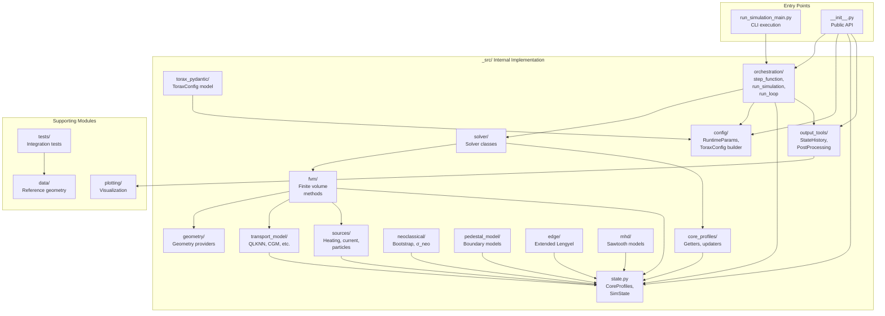
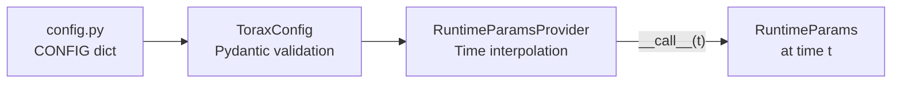
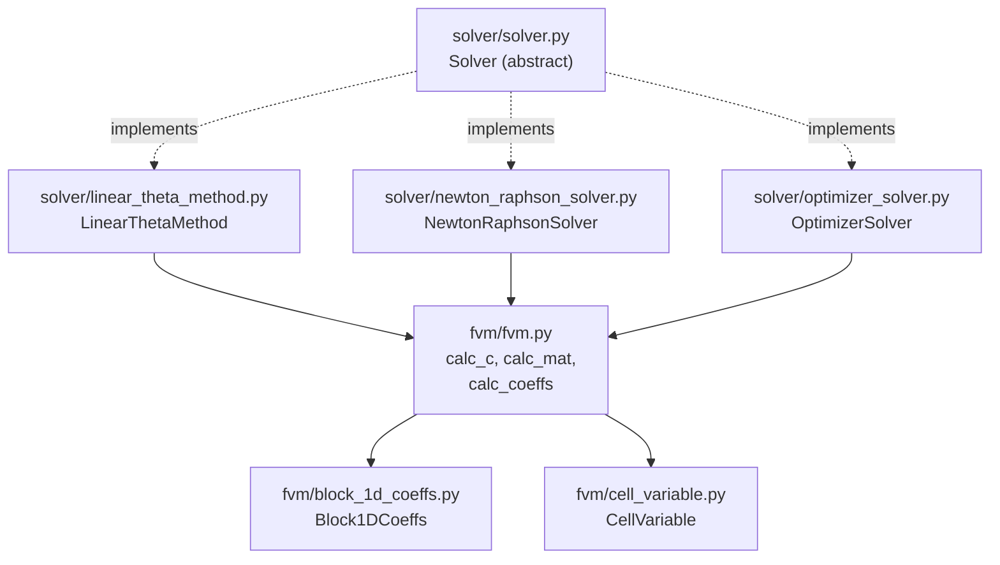
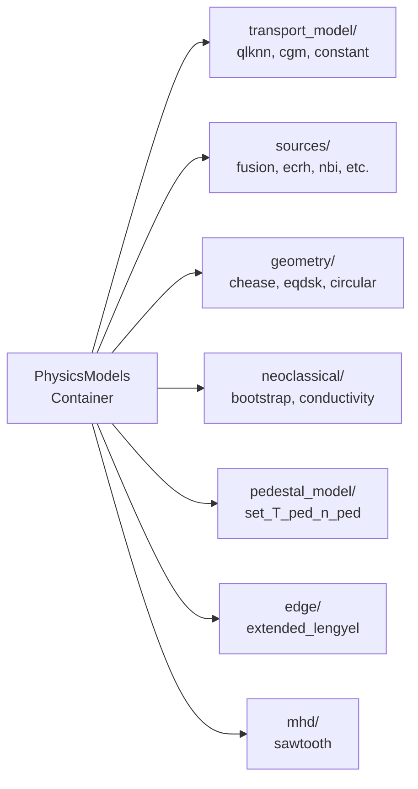
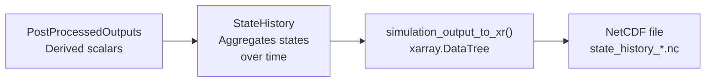
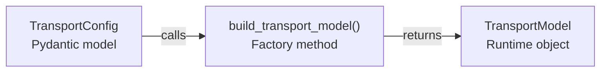

<!-- source: DeepWiki mcp.deepwiki.com · repo google-deepmind/torax · page 10.1 Code Structure and Module Organization · fetched 2026-10-26 -->

# Code Structure and Module Organization

<details>
<summary>Relevant source files</summary>

The following files were used as context for generating this wiki page:

- [.github/workflows/pytest.yml](.github/workflows/pytest.yml)
- [README.md](README.md)
- [docs/installation.rst](docs/installation.rst)
- [pyproject.toml](pyproject.toml)
- [torax/__init__.py](torax/__init__.py)
- [torax/_src/mhd/sawtooth/tests/sawtooth_model_test.py](torax/_src/mhd/sawtooth/tests/sawtooth_model_test.py)
- [torax/_src/orchestration/jit_run_loop.py](torax/_src/orchestration/jit_run_loop.py)
- [torax/_src/orchestration/run_loop.py](torax/_src/orchestration/run_loop.py)
- [torax/_src/orchestration/run_simulation.py](torax/_src/orchestration/run_simulation.py)
- [torax/_src/orchestration/step_function.py](torax/_src/orchestration/step_function.py)
- [torax/_src/orchestration/tests/step_function_test.py](torax/_src/orchestration/tests/step_function_test.py)
- [torax/tests/sim_time_dependence_test.py](torax/tests/sim_time_dependence_test.py)

</details>


This page explains the directory structure, module organization, and code layout conventions used in the TORAX codebase. It serves as a guide for developers navigating the source code and understanding where different functionality resides.

For information about testing practices and test structure, see [Testing Framework and Best Practices](#10.2). For guidance on adding new code, see [Contributing Guidelines](#10.3).

## Package Structure Overview

TORAX follows a clear separation between public API and internal implementation. The package is structured as follows:

```
torax/
├── __init__.py                 # Public API exports
├── run_simulation_main.py      # CLI entry point
├── _src/                       # Internal implementation
│   ├── config/                 # Configuration system
│   ├── orchestration/          # Simulation control flow
│   ├── solver/                 # PDE solvers
│   ├── fvm/                    # Finite volume methods
│   ├── geometry/               # Magnetic geometry
│   ├── transport_model/        # Transport models
│   ├── sources/                # Source/sink models
│   ├── neoclassical/           # Neoclassical physics
│   ├── pedestal_model/         # Pedestal boundary
│   ├── edge/                   # Edge/SOL models
│   ├── mhd/                    # MHD effects
│   ├── core_profiles/          # Profile management
│   ├── output_tools/           # Output generation
│   ├── torax_pydantic/         # Configuration models
│   └── ...
├── plotting/                   # Visualization tools
├── tests/                      # Integration tests
└── data/                       # Reference data
```

The `_src/` prefix indicates internal implementation details that are not part of the public API. Users should import from `torax` directly, not from `torax._src`.

**Sources:** [torax/__init__.py:1-87](), [pyproject.toml:1-128]()

## Entry Points and Public API

### Command-Line Interface

TORAX provides two CLI commands defined in [pyproject.toml:53-55]():

```toml
[project.scripts]
run_torax = "torax.run_simulation_main:run"
plot_torax = "torax.plotting.plotruns:run"
```

The `run_torax` command executes simulations from configuration files, while `plot_torax` visualizes saved results.

### Python API

The public API is exposed through [torax/__init__.py:15-87](), which exports key classes and functions:

| Export | Module | Purpose |
|--------|--------|---------|
| `run_simulation` | `orchestration.run_simulation` | Main simulation entry point |
| `ToraxConfig` | `torax_pydantic.model_config` | Configuration dataclass |
| `build_torax_config_from_file` | `config.config_loader` | Load config from file |
| `CoreProfiles` | `state` | Plasma profile state |
| `Geometry` | `geometry.geometry` | Magnetic geometry |
| `RuntimeParams` | `config.runtime_params` | Time-dependent parameters |
| `StateHistory` | `output_tools.output` | Simulation output container |

Users interact with TORAX through these exports:

```python
import torax

# Load configuration
config = torax.build_torax_config_from_file('config.py')

# Run simulation
datatree, state_history = torax.run_simulation(config)
```

**Sources:** [torax/__init__.py:20-69](), [pyproject.toml:53-55]()

## Directory Organization



**Sources:** [pyproject.toml:107-115](), [torax/__init__.py:1-87]()

## Core Module Responsibilities

### Configuration System (`_src/config/` and `_src/torax_pydantic/`)

The configuration system has two parts:

1. **Static Configuration** (`torax_pydantic/model_config.py`): The `ToraxConfig` Pydantic model validates configuration dictionaries and provides structured access to all simulation parameters.

2. **Runtime Parameters** (`config/runtime_params.py` and `config/build_runtime_params.py`): The `RuntimeParamsProvider` interpolates time-dependent parameters. It converts the static `ToraxConfig` into time-varying `RuntimeParams` that can be queried at any simulation time.



**Sources:** [torax/_src/orchestration/step_function.py:59-91](), [torax/_src/orchestration/run_simulation.py:37-58]()

### Orchestration Layer (`_src/orchestration/`)

The orchestration layer controls simulation execution:

| Module | Key Class/Function | Purpose |
|--------|-------------------|---------|
| `run_simulation.py` | `run_simulation()` | Main entry point, prepares simulation |
| `step_function.py` | `SimulationStepFn` | Advances simulation one time step |
| `run_loop.py` | `run_loop()` | Python loop over time steps |
| `jit_run_loop.py` | `run_loop_jit()` | JAX-compiled loop over time steps |
| `initial_state.py` | `get_initial_state_and_post_processed_outputs()` | Creates initial conditions |
| `adaptive_step.py` | Adaptive dt logic | Handles dt backtracking |
| `sawtooth_step.py` | Sawtooth logic | Handles MHD crashes |

The `SimulationStepFn` class [torax/_src/orchestration/step_function.py:47-560]() is the core time-stepping coordinator. It owns:
- A `Solver` for evolving PDEs
- A `TimeStepCalculator` for determining dt
- A `RuntimeParamsProvider` for time-dependent config
- A `GeometryProvider` for time-dependent geometry

**Sources:** [torax/_src/orchestration/step_function.py:47-560](), [torax/_src/orchestration/run_simulation.py:37-145](), [torax/_src/orchestration/run_loop.py:29-202]()

### Solver Layer (`_src/solver/` and `_src/fvm/`)



The solver layer implements numerical methods for evolving PDEs. The `Solver` base class defines the interface [torax/_src/solver/solver.py](), and concrete implementations provide different solution strategies:

- **LinearThetaMethod**: Predictor-corrector with Pereverzev-Corrigan terms
- **NewtonRaphsonSolver**: Nonlinear Newton-Raphson iteration
- **OptimizerSolver**: Optimization-based using jaxopt

All solvers use finite volume discretization from the `fvm/` module.

**Sources:** [torax/_src/orchestration/step_function.py:82-89](), [torax/_src/orchestration/run_simulation.py:44-46]()

### Physics Models

Physics models are organized into separate packages, each providing modular implementations:



Each physics package contains:
- Runtime parameter classes (e.g., `TransportRuntimeParams`)
- Model implementations (e.g., `QLKNNTransportModel`)
- Configuration builders (e.g., `build_transport_model()`)

For example, [torax/_src/transport_model/]() contains implementations for QLKNN, CGM, Bohm-GyroBohm, and constant transport models.

**Sources:** [torax/_src/orchestration/step_function.py:82-89](), [torax/_src/orchestration/run_simulation.py:42-43]()

### State Management (`_src/state.py` and `_src/core_profiles/`)

The state management system defines simulation state structures:

| Class | Location | Contents |
|-------|----------|----------|
| `CoreProfiles` | `state.py` | `T_i`, `T_e`, `n_e`, `psi`, `Ions`, `Currents` |
| `CoreTransport` | `state.py` | `chi_i`, `chi_e`, `D_e`, `V_e` |
| `CoreSources` | `sources/source_profiles.py` | `SourceProfiles` aggregate |
| `SimState` | `orchestration/sim_state.py` | Complete simulation state |
| `SolverNumericOutputs` | `state.py` | Iteration counts, error states |

The `core_profiles/` package [torax/_src/core_profiles/]() provides getters and updaters for profile manipulation without direct state mutation.

**Sources:** [torax/_src/orchestration/step_function.py:47-560](), [torax/__init__.py:34-37]()

### Output System (`_src/output_tools/`)

The output system converts simulation state to structured formats:



- `StateHistory` [torax/_src/output_tools/output.py]() accumulates time series of `SimState` objects
- `PostProcessedOutputs` [torax/_src/output_tools/post_processing.py]() calculates derived quantities (confinement time, fusion gain)
- `simulation_output_to_xr()` converts to xarray DataTree with profiles/scalars/numerics/edge datasets

**Sources:** [torax/_src/orchestration/run_simulation.py:126-144](), [torax/__init__.py:30-31]()

## Module Dependency Principles

### Internal vs. Public API Separation

The `_src/` directory contains all internal implementation. Modules within `_src/` may import from each other, but external users should only import from `torax/__init__.py`.

```python
# Correct: Import from public API
import torax
config = torax.ToraxConfig.from_dict(config_dict)

# Incorrect: Import from internal implementation
from torax._src.torax_pydantic.model_config import ToraxConfig
```

**Sources:** [torax/__init__.py:1-87](), [pyproject.toml:107-115]()

### Dependency Flow

Dependencies generally flow in this direction:

```
Entry Points → Orchestration → Solver → Physics Models → State
                ↓
            Output System
```

Key principles:
1. **Physics models** depend on state but not on orchestration
2. **Solvers** depend on physics models but not on orchestration logic
3. **Orchestration** depends on solvers and coordinates everything
4. **State** has minimal dependencies (only JAX, geometry basics)
5. **Output** depends on state but not on solvers or orchestration

This ensures physics models are reusable outside the main simulation loop.

**Sources:** [torax/_src/orchestration/step_function.py:1-560]()

## Testing Organization

### Test Structure

Tests are organized to mirror the source structure:

```
torax/
├── _src/
│   └── <module>/
│       ├── implementation.py
│       └── tests/
│           └── <module>_test.py
└── tests/
    ├── test_data/           # Reference NetCDF files
    ├── sim_*_test.py        # Integration tests
    └── test_utils/          # Test utilities
```

Unit tests live in `tests/` subdirectories within each module. Integration tests that exercise multiple systems live in top-level `torax/tests/`.

### Test Configuration

Testing is configured in [pyproject.toml:118-128]() and [.github/workflows/pytest.yml:1-84]():

```toml
[tool.pytest.ini_options]
addopts = [
    "--ignore=torax/tests/test_data",
    "--ignore=torax/tests/scripts",
    # ...
]
testpaths = "**/tests"
```

The CI system runs tests in parallel using pytest-xdist and pytest-shard.

**Sources:** [pyproject.toml:118-128](), [.github/workflows/pytest.yml:1-84](), [torax/tests/sim_time_dependence_test.py:1-290]()

## Code Organization Patterns

### Configuration Pattern

All configurable components follow this pattern:

1. Define a Pydantic config class in `torax_pydantic/` (e.g., `TransportConfig`)
2. Provide a `build_<component>()` method that creates the runtime object
3. Runtime parameters live in `config/` (e.g., `TransportRuntimeParams`)



### Provider Pattern

Time-dependent entities use providers:

- `RuntimeParamsProvider`: Provides `RuntimeParams` at any time t
- `GeometryProvider`: Provides `Geometry` at any time t

```python
# Usage pattern
runtime_params = provider(t=1.5)  # Get params at t=1.5
geometry = geo_provider(sim_state)  # Get geometry for current state
```

**Sources:** [torax/_src/orchestration/step_function.py:59-91]()

### JAX Pytree Registration

State classes are registered as JAX pytrees to enable JIT compilation and automatic differentiation:

```python
@jax.tree_util.register_pytree_node_class
class SimulationStepFn:
  def tree_flatten(self):
    # Separate dynamic (children) from static (aux_data)
    ...
  
  @classmethod
  def tree_unflatten(cls, aux_data, children):
    # Reconstruct from flattened representation
    ...
```

This pattern appears in [torax/_src/orchestration/step_function.py:46-117]().

**Sources:** [torax/_src/orchestration/step_function.py:46-117]()

## Key Files Reference

| File | Purpose |
|------|---------|
| `torax/__init__.py` | Public API definition |
| `torax/run_simulation_main.py` | CLI entry point |
| `_src/orchestration/run_simulation.py` | Main simulation entry point |
| `_src/orchestration/step_function.py` | Time-stepping coordinator |
| `_src/orchestration/run_loop.py` | Python time loop |
| `_src/orchestration/jit_run_loop.py` | JAX-compiled time loop |
| `_src/solver/solver.py` | Solver base class |
| `_src/state.py` | Core state dataclasses |
| `_src/torax_pydantic/model_config.py` | `ToraxConfig` definition |
| `_src/config/build_runtime_params.py` | `RuntimeParamsProvider` |
| `_src/output_tools/output.py` | `StateHistory` and xarray conversion |
| `pyproject.toml` | Package metadata and dependencies |

**Sources:** [pyproject.toml:1-128](), [torax/__init__.py:1-87](), [torax/_src/orchestration/step_function.py:1-560](), [torax/_src/orchestration/run_simulation.py:1-145]()

---

